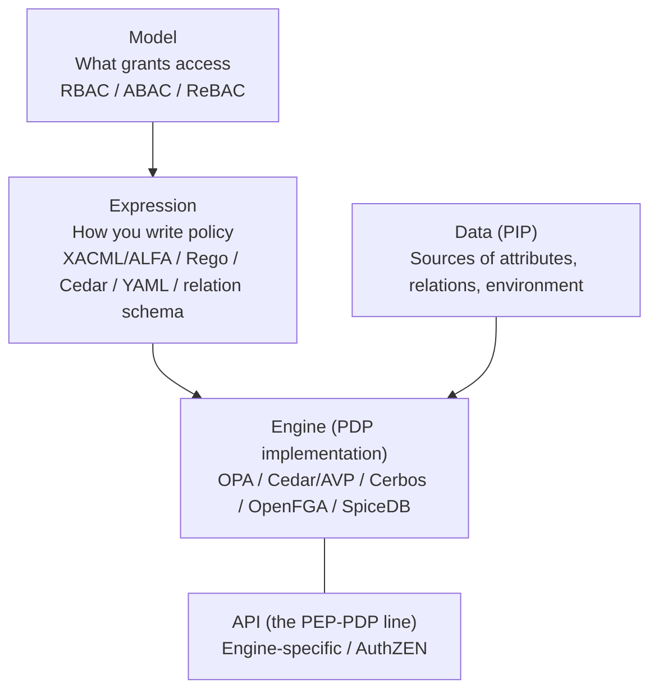
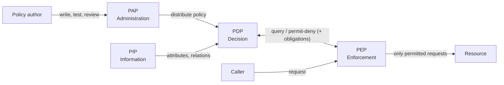
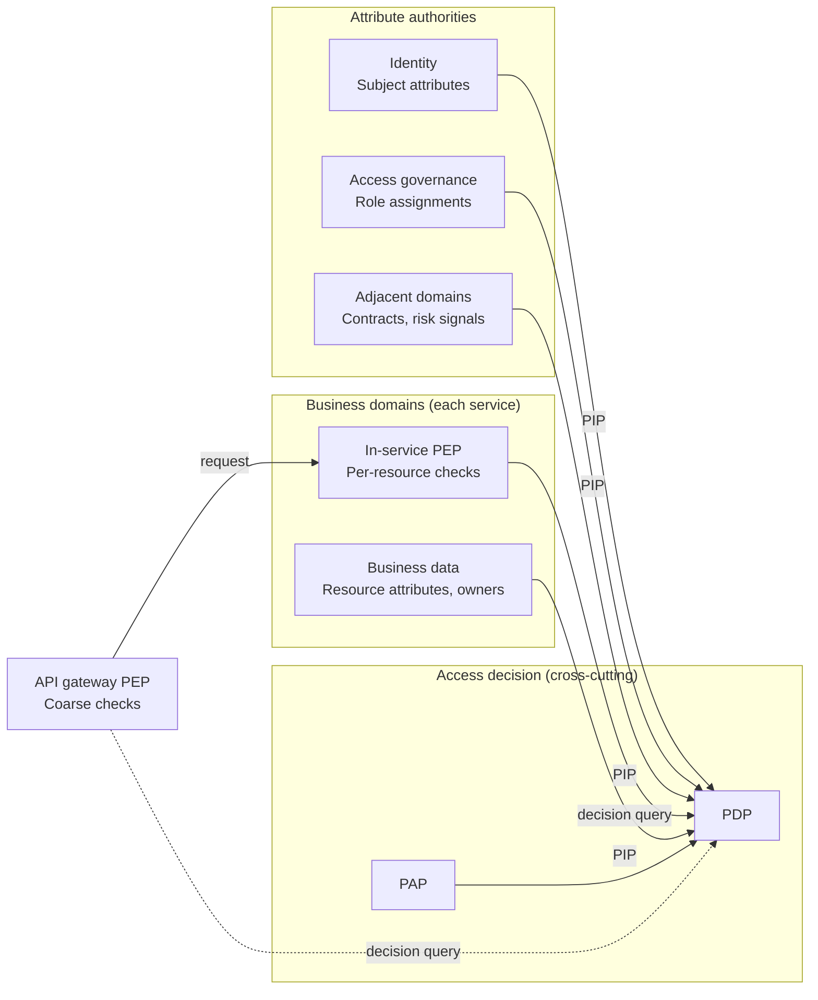
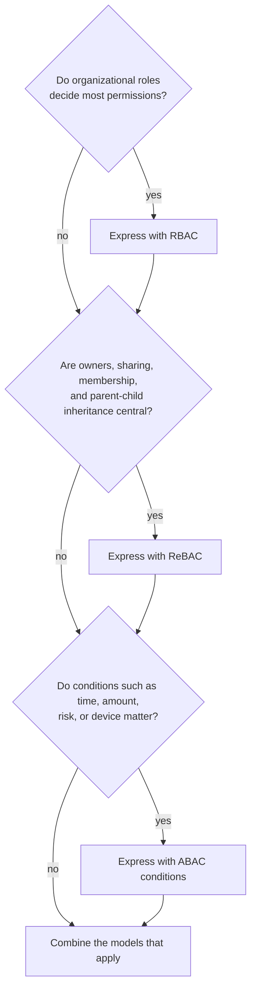

# Overview

The heart of an authorization platform answers one question: how do you express permissions, and where and how do you decide? This post splits that question into three parts.

1. Which components take part in a decision, and where do they sit relative to business domains (PEP/PDP/PIP/PAP)?
2. What do you base permissions on (RBAC/ABAC/ReBAC, and where PBAC fits)?
3. How do you choose a policy engine (OPA, Cedar, Cerbos, OpenFGA, SpiceDB)?

[What is authorization?](/posts/authorization-domain-iam-subdomains/) covered what authorization means and which IAM subdomains it touches. [How far should you build an authorization platform?](/posts/authorization-platform-scope-stages/) covered scope. This post continues from there and looks inside the access decision itself. [Permission management design](/posts/permission-management-design/) already covers the basics of ACL, RBAC, and ABAC, so this post does not repeat them.

# The Big Picture: Five Layers

Discussions about authorization tend to mix up "model", "language", "engine", and "API". Separating the layers first shows which choice constrains which.

| Layer | What you decide | Examples |
|---|---|---|
| Model | What grants access | RBAC, ABAC, ReBAC |
| Expression | The policy language and its authors | XACML, ALFA, Rego, Cedar, YAML, relation schemas |
| Engine | Evaluation, deployment, and data handling | OPA, Cedar, Cerbos, OpenFGA, SpiceDB |
| API | The shape of requests and responses between PEP and PDP | Engine APIs, AuthZEN |
| Data | The authority and freshness of attributes and relations | Directories, HR, contracts, business databases, relation stores |

Picking a model does not fix the expression or the engine. Picking an engine, by contrast, almost fixes the expression and data handling. So the safe order runs "model, then data, then engine".

# Reference Architecture: PEP, PDP, PIP, PAP

## The Four Roles

The terms PEP and PDP first appeared in IETF RFC 2753 (2000), a framework for policy-based admission control. The Policy Framework WG later collected the terminology in RFC 3198. OASIS XACML adopted them and added PAP and PIP to form the four roles. NIST SP 800-162 (the ABAC guide) uses the same vocabulary for its reference architecture, and NIST SP 800-207 (Zero Trust) uses the same PDP and PEP terms. AuthZEN builds on this vocabulary as well.

| Role | What it does | Typical placement |
|---|---|---|
| PDP (Policy Decision Point) | Evaluates policy against input and returns permit or deny, sometimes with obligations or advice | Authorization service, sidecar, embedded library |
| PEP (Policy Enforcement Point) | Sits on the request path, asks the PDP, and enforces the result | API gateway, in-service middleware, sidecar, data layer |
| PIP (Policy Information Point) | Supplies the attributes and relations the PDP needs | Directory, HR database, contract database, business database, relation store |
| PAP (Policy Administration Point) | Handles authoring, testing, review, versioning, and distribution of policy | Git repository, CI, admin console |

## Where Each Role Sits Relative to Business Domains

PEP, PDP, PIP, and PAP have different owners inside an organization. Mapping them onto the IAM subdomains from [What is authorization?](/posts/authorization-domain-iam-subdomains/) gives the following picture.

The query from the gateway to the PDP uses a dotted line because some setups handle coarse checks inside the gateway itself.

- The PEP that enforces per-resource decisions lives on the business domain side. The owner of a resource protects it, and moving this PEP outside the domain opens a bypass. You can also put a PEP in the API gateway at the entry point, but keep it to coarse checks such as token validity and scopes. Leave per-resource checks to the PEP inside the service.
- The PDP and PAP belong to the access decision subdomain. That does not mean a central team writes every rule. A central team owns tenant isolation and company-wide prohibitions, domain teams own domain rules, and the PAP ties them together through review and distribution. SP 800-162 also expects a hierarchy in which subordinate organizations keep their own local policies without conflicting with higher-level ones.
- The PIP connects to wherever the authority for an attribute lives. Identity owns subject attributes, access governance owns role assignments, and the business domain owns resource attributes. Instead of having the PDP hold all data, decide per attribute whether to fetch it from the authority or replicate it.

[How far should you build an authorization platform?](/posts/authorization-platform-scope-stages/) discusses how much to centralize. [Authorization platform architecture and design decisions](/posts/authorization-platform-architecture-decisions/) covers PEP and PDP placement in detail.

# A Taxonomy of Authorization Models

## Three Independent Axes

This post organizes authorization models along three axes. The axes stay independent, so you describe a system with a combination. For example, "we realize DAC with RBAC and store it as ACLs" makes sense.

| Axis | Options | Key distinction |
|---|---|---|
| What grants access | RBAC, ABAC, ReBAC | Whether you model around roles, attributes and conditions, or subject-resource relations |
| Who can change permissions | DAC, MAC | The resource owner decides, or a central label enforces |
| Where permissions live | ACL, Capability | Store the access matrix per resource (column) or per subject (row) |

The third axis goes back to the access matrix in Lampson's 1971 paper. Osborn, Sandhu, and Munawer showed in 2000 that RBAC can simulate both MAC and DAC. This post focuses on the first axis.

## RBAC, ABAC, and ReBAC Compared

| Model | Basis for decisions | Strengths | Weaknesses |
|---|---|---|---|
| RBAC | Roles (bundles of permissions tied to job functions) | Clear administration and review; easy to answer "who can do what" | Cannot handle context such as time or location; baking attribute combinations into roles causes role explosion |
| ABAC | Attributes of subject, resource, and environment, plus conditions | Fine-grained conditions, cross-organization decisions, unknown users | Evaluation cost, policy complexity, difficulty of reviewing "who can do what" in advance |
| ReBAC | A graph of relations between subjects and resources | Owners, sharing, membership, folder inheritance, org hierarchy | Keeping relation data consistent and operating the store |

The three do not exclude each other. SP 800-162 treats ACL and RBAC as, in some ways, special cases of ABAC: ACL decides on the identity attribute and RBAC on the role attribute. You can also express relations as attributes. The difference lies in what you model around, and one system can combine them.

## Treat PBAC as a Style, Not a Model

PBAC (Policy-Based Access Control) has no single agreed definition. The NIST glossary itself lists two definitions. The one it takes from CNSSI 4009 calls it "a form of access control that uses an authorization policy that is flexible in the types of evaluated parameters (e.g., identity, role, clearance, operational need, risk, heuristics)." In my view, the discussion stays clearer if you treat PBAC as a name for a style outside the three axes: writing access rules declaratively in a policy language. The CNSSI 4009 definition comes close to ABAC, yet you can write RBAC and ReBAC in a policy language too. Seen this way, the question "RBAC or PBAC?" mixes two axes. Phrasing it as "an RBAC model written as Policy-as-Code" keeps the discussion clear.

# Choosing and Combining Models

## Checking Which Models You Need

Work through the three questions in order and combine the models that apply.

## "Check" and "List" Are Different Questions

A point that model selection often misses: what kind of question must the system answer?

- Check: "Can this user read this resource?"
- List: "Which resources can this user read?" or "Who can read this resource?"

List questions come up often, for search result filtering in the UI and for access reviews. NIST SP 800-178 points out that logical formula-based policies, as in XACML, cannot support such a review efficiently. Asking "who can read this?" of a policy written only as attribute conditions stays hard by nature.

The same document says that enumerated policies such as NGAC's, which store relations, make this review simpler. ReBAC also stores relations as data, so it can answer these questions more readily. Attribute-centric engines work around the problem with partial evaluation or query plans that turn policy into database filters. Flag the resources that need listing while you choose the model.

## Roles Set the Ceiling; Conditions Narrow It

For combining models, the "role-centric" approach that Kuhn of NIST and his co-authors described still works. Their 2010 paper (Kuhn of NIST, with Coyne and Weil) classified three ways to add attributes to RBAC.

| Approach | How permissions follow | Assessment |
|---|---|---|
| Dynamic roles | Attributes determine roles; roles determine permissions | You can layer it on top of existing RBAC |
| Attribute-centric | The role becomes one attribute among many | RBAC's administrative simplicity fades quickly as attributes grow |
| Role-centric | Attribute conditions constrain the permissions that roles grant | Attributes can only reduce permissions, never add; you can still compute the upper bound |

In the role-centric approach, the usable permissions equal the intersection of "permissions of active roles" and "permissions the rules allow". Roles set the ceiling, which preserves least privilege and keeps review simple. In return, the paper notes, the approach gives up some of ABAC's flexibility because roles still bound the permission sets. The paper also suggests turning static attributes (position, skills, location) into roles and dynamic attributes (such as time) into rules. With ten attributes (four static, six dynamic), pure RBAC or pure ABAC can need up to 1,024 roles or rules. Splitting them needs at most 16 roles and 64 rules.

In authorization platform terms, it looks like this. The paper covers only roles and attributes; where relations fit is my own mapping.

- Use roles to define the most a person can ever do. A relation that grants access by itself, such as sharing a document, also belongs on this ceiling side.
- Narrow with conditions on relations (assignment, ownership, membership) and attributes (time window, device, risk). For example, limit an approver role to requests from the departments the person handles.
- Do not write rules where attributes add permissions; if you need more, express it as a role or as a relation that grants access.

# Comparing Policy Engines

## Overview Table

The table reflects each project's official site, GitHub repository, and the CNCF Landscape as of October 2026.

| Engine | Model focus | Policy expression | Data handling | Listing and filtering | Status and offerings |
|---|---|---|---|---|---|
| OPA | ABAC (general-purpose policy) | Rego | Stateless; evaluates input plus data shipped in bundles | Partial evaluation turns policy into query filters | CNCF Graduated, Apache-2.0 |
| Cedar | RBAC and ABAC (can express relations) | Cedar (permit/forbid) | Stateless; the caller passes entities per request | Partial evaluation exists as an experimental feature; mainly for single checks | CNCF Sandbox, Apache-2.0; managed offering: Amazon Verified Permissions |
| Cerbos | RBAC and ABAC | YAML | Stateless PDP | Query plan API returns filter conditions | Apache-2.0; commercial control plane: Cerbos Hub |
| OpenFGA | ReBAC (Zanzibar-style) | Authorization model DSL plus relationship tuples | Stores relations | ListObjects, ListUsers | CNCF Incubating, Apache-2.0; commercial offering: Auth0 FGA |
| SpiceDB | ReBAC (Zanzibar-style) | Schema language plus relationships | Stores relations | LookupResources, LookupSubjects | Apache-2.0; developed by AuthZed |

Zanzibar is not a product. Google described the internal system in a paper at USENIX ATC 2019. OpenFGA and SpiceDB are open source projects that draw on that paper.

## General-Purpose Policy Engines

OPA covers not only application authorization but also Kubernetes admission control and IaC checks with a single language, Rego. For OPA itself, see [What is Open Policy Agent (OPA)?](/posts/open-policy-agent/). For usage patterns, see [Access control patterns using OPA](/posts/access-control-patterns-using-opa/) and [Implementing microservice access control with OPA](/posts/microservices-access-control-opa/).

Cedar is a language built only for authorization. It denies by default, and forbid overrides permit. Because it constrains how you write policy, schema validation and symbolic analysis get easier, and the Cedar team formalized the language in Lean.

## Relationship-Based Engines (Zanzibar-Style)

The issue specific to Zanzibar-style engines is consistency. If a check ignores the order of ACL updates, a user you removed can still see new content. The Zanzibar paper calls this the "new enemy" problem and prevents it with a consistency token called a zookie, which sets a lower bound on read freshness. SpiceDB avoids the same problem with ZedTokens and per-request consistency settings.

When you combine a ReBAC engine with a policy engine, the ReBAC engine acts as a PDP and also as a PIP from the policy engine's point of view.

If the business database still holds relations such as owners and membership after you adopt a ReBAC engine, you keep the same relation data in two places. Then how you sync business updates with relation updates, and which side holds the source of truth, becomes one of the heaviest decisions in the rollout.

# How to Choose an Engine

| Axis | Question | Leaning |
|---|---|---|
| Model focus | Roles and conditions, or a relation graph? | The former: OPA, Cedar, Cerbos. The latter: OpenFGA, SpiceDB |
| Data handling | Can each request carry the data, or must the engine hold it? | If requests can carry it, go stateless; for large, deep relations, use a store |
| Listing | Must you return "resources this user can read" fast? | Store-based ReBAC excels; attribute engines rely on partial evaluation or query plans |
| Authors and verification | Who writes policy, and how much do you want machine checks? | Rego for generality, Cedar for analyzability, YAML for a configuration-like feel |
| Breadth of use | Application authorization only, or infrastructure control too? | OPA if you want one language across infrastructure |
| Operations | Self-host or managed? | Amazon Verified Permissions for AWS-centric stacks; commercial offerings such as Auth0 FGA for ReBAC |
| Replaceability | Do you want room to switch engines later? | Move the PEP-PDP line toward AuthZEN; AuthZEN does not cover writing relations or distributing policy |

# Summary

- Think of authorization in layers: model, expression, engine, API, and data. The safe order of choice runs model, data, engine.
- Put the PEP that enforces per-resource decisions on the business domain side, the PDP and PAP on the access decision side, and the PIP next to attribute authorities.
- RBAC, ABAC, and ReBAC do not exclude each other. Letting roles (and relations that grant access) set the ceiling, and conditions on attributes and relations narrow it, keeps review manageable. Treating PBAC as a writing style rather than a model keeps the discussion clear.
- Narrow down engines by model focus, data handling, and listing needs. Standardizing the PEP-PDP line keeps the option to choose again.

# Related Posts

- [What is Authorization? Mapping AuthN, AuthZ, and IAM Subdomains](/posts/authorization-domain-iam-subdomains/)
- [How Much Authorization Platform Do You Need? Scope, Ownership, and Decision Axes](/posts/authorization-platform-scope-stages/)
- [What is the AuthZEN Authorization API? A Standard Between PEP and PDP](/posts/authzen-authorization-api/)
- [Which OAuth Standards Does an Authorization Platform Need? A Map of Delegation, Tokens, and Continuous Evaluation](/posts/oauth-standards-map-authorization-platform/)
- [What is Workload Identity? WIMSE, Transaction Tokens, and SPIFFE Client Authentication for Service Identity and Context](/posts/workload-identity-wimse-transaction-tokens/)
- [What is Authorization for AI Agents? Delegation Chains, Human Approval, and Audit with MCP, AuthZEN, AIMS, and A2A/AP2](/posts/authorization-for-ai-agents/)
- [How Should You Design Authorization for MCP? Common Incidents and Decisions That Are Hard to Reverse](/posts/mcp-authorization-design/)
- [What Does an Authorization Platform Architecture Look Like? Containers, Key Sequences, PEP/PDP Placement, and Non-Functional Decisions](/posts/authorization-platform-architecture-decisions/)
- [Exploring Permission Management Design](/posts/permission-management-design/)
- [What is Open Policy Agent (OPA)? A Practical Guide to Policy as Code](/posts/open-policy-agent/)
- [Access Control Patterns Using OPA](/posts/access-control-patterns-using-opa/)
- [Implementation of Access Control System for Microservices Using OPA](/posts/microservices-access-control-opa/)
- [About Row Level Security (RLS) in PostgreSQL](/posts/postgresql-row-level-security/)

# References

- [NIST CSRC Glossary: policy-based access control](https://csrc.nist.gov/glossary/term/policy_based_access_control)
- [R. Kuhn, E. Coyne, T. Weil: Adding Attributes to Role-Based Access Control (2010)](https://csrc.nist.gov/pubs/journal/2010/06/adding-attributes-to-rolebased-access-control/final)
- [RFC 2753: A Framework for Policy-based Admission Control](https://www.rfc-editor.org/rfc/rfc2753) / [RFC 3198: Terminology for Policy-Based Management](https://www.rfc-editor.org/rfc/rfc3198)
- [NIST SP 800-162: Guide to Attribute Based Access Control (ABAC) Definition and Considerations](https://csrc.nist.gov/pubs/sp/800/162/upd2/final)
- [NIST SP 800-178: A Comparison of Attribute Based Access Control (ABAC) Standards for Data Service Applications](https://csrc.nist.gov/pubs/sp/800/178/final)
- [NIST SP 800-207: Zero Trust Architecture](https://csrc.nist.gov/pubs/sp/800/207/final)
- [OASIS: XACML Version 3.0 Plus Errata 01](https://docs.oasis-open.org/xacml/3.0/errata01/os/xacml-3.0-core-spec-errata01-os-complete.html)
- [OASIS XACML TC: alfa-for-xacml-v1.0-wd01.doc uploaded (2015-03-10)](https://groups.oasis-open.org/communities/community-home/digestviewer/viewthread?GroupId=19&MessageKey=4d628175-5a72-4e71-9f75-1bd70a4309d1&CommunityKey=67afe552-0921-49b7-9a85-018dc7d3ef1d)
- [B. Lampson: Protection (1971)](https://bwlampson.site/08-Protection/WebPage.html)
- [S. Osborn, R. Sandhu, Q. Munawer: Configuring role-based access control to enforce mandatory and discretionary access control policies (2000)](https://doi.org/10.1145/354876.354878)
- [Zanzibar: Google's Consistent, Global Authorization System (USENIX ATC 2019)](https://research.google/pubs/pub48190/)
- [Open Policy Agent documentation](https://www.openpolicyagent.org/docs/)
- [Cedar](https://www.cedarpolicy.com/) / [cedar-policy/cedar-spec (Lean formalization)](https://github.com/cedar-policy/cedar-spec)
- [Amazon Verified Permissions](https://docs.aws.amazon.com/verifiedpermissions/latest/userguide/what-is-avp.html)
- [Cerbos documentation](https://docs.cerbos.dev/)
- [OpenFGA documentation](https://openfga.dev/docs)
- [CNCF: OpenFGA Becomes a CNCF Incubating Project](https://www.cncf.io/blog/2025/11/11/openfga-becomes-a-cncf-incubating-project/)
- [SpiceDB documentation](https://authzed.com/docs)
- [CNCF Landscape](https://landscape.cncf.io/)
- [OpenID AuthZEN Authorization API 1.0](https://openid.net/specs/authorization-api-1_0.html)
