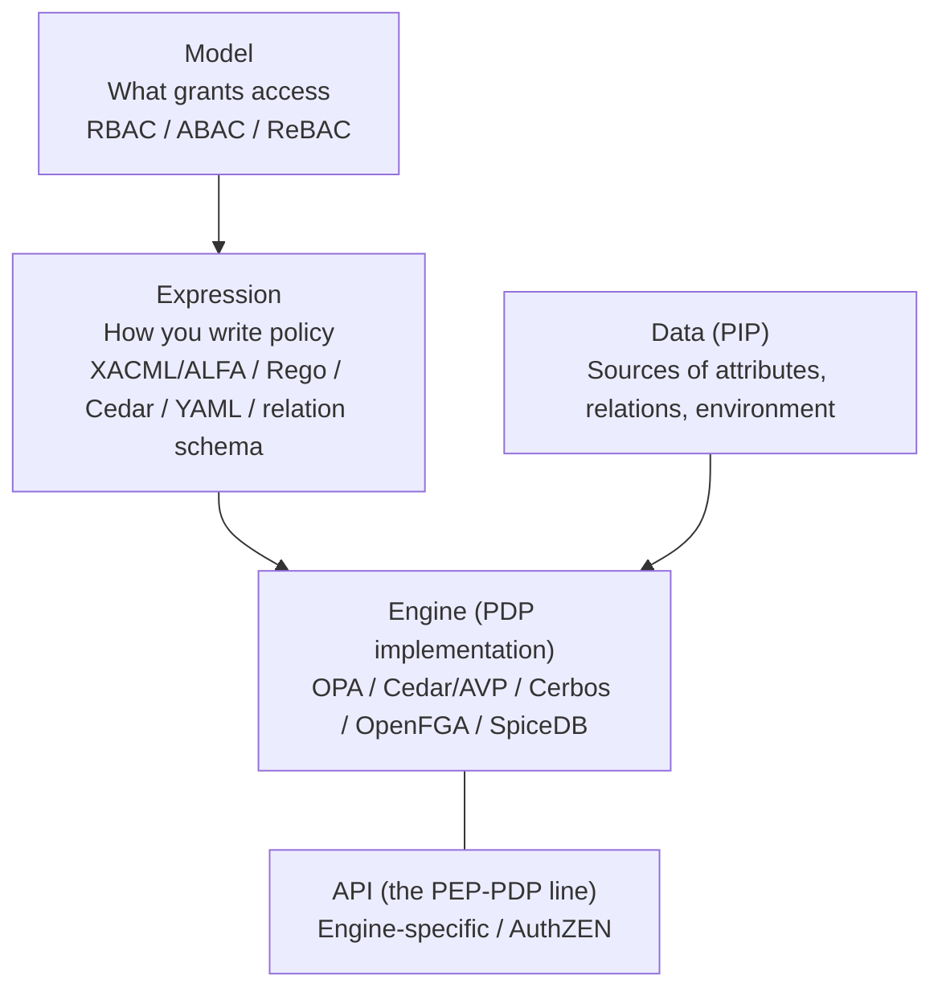
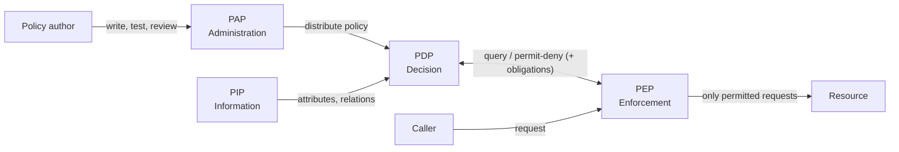
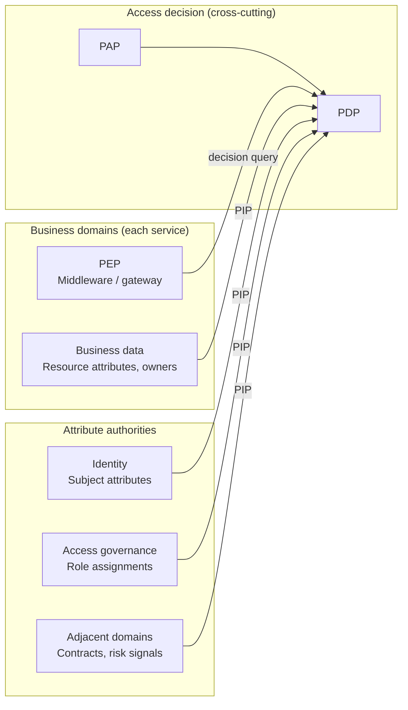
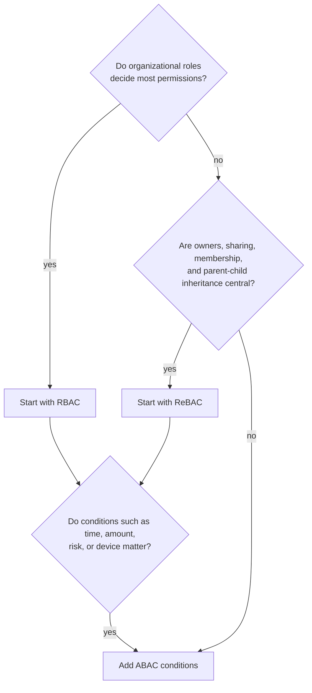

# Overview

The heart of an authorization platform answers one question: how do you express permissions, and where and how do you decide? This post splits that question into four parts.

1. Which components take part in a decision, and where do they sit relative to business domains (PEP/PDP/PIP/PAP)?
2. What do you base permissions on (RBAC/ABAC/ReBAC, and where PBAC fits)?
3. What can the classic standards (the RBAC standard, NIST SP 800-162, XACML, NGAC) still teach us?
4. How do you choose a policy engine (OPA, Cedar, Cerbos, OpenFGA, SpiceDB)?

[What is authorization?](/posts/authorization-domain-iam-subdomains/) covered what authorization means and which IAM subdomains it touches. [How far should you build an authorization platform?](/posts/authorization-platform-scope-stages/) covered scope. This post continues from there and looks inside the access decision itself. [Permission management design](/posts/permission-management-design/) already covers the basics of ACL, RBAC, and ABAC, so this post does not repeat them.

# The Big Picture: Five Layers

Discussions about authorization tend to mix up "model", "language", "engine", and "API". Separating the layers first shows which choice constrains which.

| Layer | What you decide | Examples |
|---|---|---|
| Model | What grants access | RBAC, ABAC, ReBAC |
| Expression | The policy language and its authors | XACML, ALFA, Rego, Cedar, YAML, relation schemas |
| Engine | Evaluation, deployment, and data handling | OPA, Cedar, Cerbos, OpenFGA, SpiceDB |
| API | The shape of requests and responses between PEP and PDP | Engine APIs, AuthZEN |
| Data | The authority and freshness of attributes and relations | Directories, HR, contracts, business databases, relation stores |

Picking a model does not fix the expression or the engine. Picking an engine, by contrast, almost fixes the expression and data handling. So the safe order runs "model, then data, then engine".

# Reference Architecture: PEP, PDP, PIP, PAP

## The Four Roles

The IETF Policy Framework defined the terms PEP and PDP first (RFC 2753 in 2000, with the terminology in RFC 3198). OASIS XACML adopted them and added PAP and PIP to form the four roles. NIST SP 800-162 (the ABAC guide) uses the same vocabulary for its reference architecture, and NIST SP 800-207 (Zero Trust) uses the same PDP and PEP terms. AuthZEN builds on this vocabulary as well.

| Role | What it does | Typical placement |
|---|---|---|
| PDP (Policy Decision Point) | Evaluates policy against input and returns permit or deny, sometimes with obligations or advice | Authorization service, sidecar, embedded library |
| PEP (Policy Enforcement Point) | Sits on the request path, asks the PDP, and enforces the result | API gateway, in-service middleware, sidecar, data layer |
| PIP (Policy Information Point) | Supplies the attributes and relations the PDP needs | Directory, HR database, contract database, business database, relation store |
| PAP (Policy Administration Point) | Handles authoring, testing, review, versioning, and distribution of policy | Git repository, CI, admin console |

SP 800-162 makes the PAP responsible for testing policies thoroughly before enforcement. In today's terms, that means CI for Policy-as-Code. The guide also names an optional Context Handler that decides the order of fetching policies and attributes. Latency measures such as prefetching or caching attributes belong here.

## Where Each Role Sits Relative to Business Domains

PEP, PDP, PIP, and PAP have different owners inside an organization. Mapping them onto the IAM subdomains from [What is authorization?](/posts/authorization-domain-iam-subdomains/) gives the following picture.

- The PEP lives on the business domain side. The owner of a resource protects it, and a PEP outside the domain opens a bypass. Consider splitting the work: coarse checks in the gateway, per-resource checks inside the service.
- The PDP and PAP belong to the access decision subdomain. That does not mean a central team writes every rule. A central team owns tenant isolation and company-wide prohibitions, domain teams own domain rules, and the PAP ties them together through review and distribution. SP 800-162 also expects a hierarchy in which subordinate organizations keep their own local policies without conflicting with higher-level ones.
- The PIP connects to wherever the authority for an attribute lives. Identity owns subject attributes, access governance owns role assignments, and the business domain owns resource attributes. Instead of having the PDP hold all data, decide per attribute whether to fetch it from the authority or replicate it.

[How far should you build an authorization platform?](/posts/authorization-platform-scope-stages/) discusses how much to centralize. [Authorization platform architecture and design decisions](/posts/authorization-platform-architecture-decisions/) covers PEP and PDP placement in detail.

## Design Points

- The AuthZEN spec calls the PEP-PDP connection the most sensitive one in an ABAC architecture and requires (MUST) securing it, for example with TLS. It also says the PDP SHOULD authenticate the PEP, for example with mutual TLS, OAuth, or an API key. A PDP that answers anyone becomes an entry point for policy probing and load attacks.
- Make the PEP fail closed: if it cannot get a decision, it denies. Decide early what happens when the PDP goes down or times out.
- XACML also has a profile for JSON requests and responses (an OASIS Standard since 2019), yet every engine compared in this post exposes its own PEP-PDP API. The OpenID Foundation's AuthZEN Authorization API 1.0 standardizes that line across engines. [What is the AuthZEN Authorization API?](/posts/authzen-authorization-api/) covers it in depth.

# A Taxonomy of Authorization Models

## Three Independent Axes

This post organizes authorization models along three axes. The axes stay independent, so you describe a system with a combination. For example, "we realize DAC with RBAC and store it as ACLs" makes sense.

| Axis | Options | Key distinction |
|---|---|---|
| What grants access | RBAC, ABAC, ReBAC | Whether you model around roles, attributes and conditions, or subject-resource relations |
| Who can change permissions | DAC, MAC | The resource owner decides, or a central label enforces |
| Where permissions live | ACL, Capability | Store the access matrix per resource (column) or per subject (row) |

The third axis goes back to the access matrix in Lampson's 1971 paper. Osborn, Sandhu, and Munawer showed in 2000 that RBAC can simulate both MAC and DAC. This post focuses on the first axis.

## RBAC, ABAC, and ReBAC Compared

| Model | Basis for decisions | Strengths | Weaknesses |
|---|---|---|---|
| RBAC | Roles (bundles of permissions tied to job functions) | Clear administration and review; easy to answer "who can do what" | Cannot handle context such as time or location; baking attribute combinations into roles causes role explosion |
| ABAC | Attributes of subject, resource, and environment, plus conditions | Fine-grained conditions, cross-organization decisions, unknown users | Evaluation cost, policy complexity, difficulty of reviewing "who can do what" in advance |
| ReBAC | A graph of relations between subjects and resources | Owners, sharing, membership, folder inheritance, org hierarchy | Keeping relation data consistent and operating the store |

The three do not exclude each other. SP 800-162 treats ACL and RBAC as, in some ways, special cases of ABAC: ACL decides on the identity attribute and RBAC on the role attribute. You can also express relations as attributes. The difference lies in what you model around, and one system can combine them.

## Treat PBAC as a Style, Not a Model

PBAC (Policy-Based Access Control) has no single agreed definition. The NIST glossary itself lists two definitions. The one it takes from CNSSI 4009 calls it "a form of access control that uses an authorization policy that is flexible in the types of evaluated parameters (e.g., identity, role, clearance, operational need, risk, heuristics)." In my view, the discussion stays clearer if you treat PBAC as a name for a style outside the three axes: writing access rules declaratively in a policy language. The CNSSI 4009 definition comes close to ABAC, yet you can write RBAC and ReBAC in a policy language too. Seen this way, the question "RBAC or PBAC?" mixes two axes. Phrasing it as "an RBAC model written as Policy-as-Code" keeps the discussion clear.

# Choosing and Combining Models

## Where to Start

In my view, many business SaaS products need a little of all three. Job functions such as administrator or approver fit RBAC. "Requests I created" or "data about my direct reports" fit ReBAC. "Only during business hours" or "only from managed devices" fit ABAC.

## "Check" and "List" Are Different Questions

A point that model selection often misses: what kind of question must the system answer?

- Check: "Can this user read this resource?"
- List: "Which resources can this user read?" or "Who can read this resource?"

List questions come up often, for search result filtering in the UI and for access reviews. NIST SP 800-178 points out that logical formula-based policies, as in XACML, cannot support such a review efficiently: the review amounts to propositional satisfiability, an NP-complete problem. Asking "who can read this?" of a policy written only as attribute conditions stays hard by nature.

ReBAC, which stores relations as enumerated data, handles these questions well. Attribute-centric engines work around the problem with partial evaluation or query plans that turn policy into database filters. Flag the resources that need listing while you choose the model.

## Roles Set the Ceiling; Conditions Narrow It

For combining models, the "role-centric" approach that Kuhn of NIST and his co-authors described still works. Their 2010 paper (Kuhn of NIST, with Coyne and Weil) classified three ways to add attributes to RBAC.

| Approach | How permissions follow | Assessment |
|---|---|---|
| Dynamic roles | Attributes determine roles; roles determine permissions | You can layer it on top of existing RBAC |
| Attribute-centric | The role becomes one attribute among many | RBAC's administrative simplicity fades quickly as attributes grow |
| Role-centric | Attribute conditions constrain the permissions that roles grant | Attributes can only reduce permissions, never add; you can still compute the upper bound |

In the role-centric approach, the usable permissions equal the intersection of "permissions of active roles" and "permissions the rules allow". Roles set the ceiling, which preserves least privilege and keeps review simple. The paper also suggests turning static attributes (position, skills, location) into roles and dynamic attributes (such as time) into rules. With ten attributes (four static, six dynamic), pure RBAC or pure ABAC can need up to 1,024 roles or rules. Splitting them needs at most 16 roles and 64 rules.

In authorization platform terms, it looks like this. The paper covers only roles and attributes; where relations fit is my own mapping.

- Use roles to define the most a person can ever do. A relation that grants access by itself, such as sharing a document, also belongs on this ceiling side.
- Narrow with conditions on relations (assignment, ownership, membership) and attributes (time window, device, risk). For example, limit an approver role to requests from the departments the person handles.
- Do not write rules where attributes add permissions; if you need more, express it as a role or as a relation that grants access.

# What the Originals Still Teach

You have little reason to adopt the old standards as-is today. Their design decisions still give you a yardstick for evaluating new engines.

## The RBAC Standard (FK92, the NIST Model, INCITS 359)

Ferraiolo and Kuhn formalized RBAC in 1992, and the NIST model became the US national standard ANSI/INCITS 359-2004 in 2004. A revision followed in 2012, and INCITS reaffirmed 359-2012 in 2022. NIST now marks its RBAC project page as archived, with no further updates.

These points still apply:

- All access goes through roles. The NIST FAQ describes the ability of group-based schemes to tie permissions directly to users as a possible "loophole". Even exceptional grants stay easier to review when you model them as exception roles.
- The 1992 model grants access "only if" a condition holds. A subject can only run transactions authorized for its active roles, but authorization does not guarantee execution. The model leaves room for extra constraints from the start, and the role-centric approach above extends this design.
- A session can activate just a subset of the assigned roles. The same idea applies when you limit the scopes in an OAuth access token to what the request needs.
- Separation of duty comes in two forms. Static separation applies at assignment time; dynamic separation applies when a session activates roles. Transaction-level separation, such as "do not approve your own request", belongs in PDP rules.
- The pre-approval draft of the 2004 standard (2003, published by NIST) leaves two things to implementations: what a role hierarchy means (does activating a senior role activate the junior roles automatically?) and what happens to existing sessions when you remove a role assignment. The 2012 text sits behind a paywall, so public sources do not show whether it changed this. Write these down for your own platform.

## NIST SP 800-162 (ABAC)

SP 800-162 appeared in 2014, and a 2019 update added environment conditions to its trust chain figure. It defines four inputs to an ABAC decision: subject attributes, object attributes, environment conditions, and policy.

Much of the second half of the document deals with attributes rather than policy languages: attribute authority, sharing, freshness, tamper protection, and mapping names across organizations. The lesson: before choosing an engine, build a table of the attributes your decisions use. For each attribute, record its authority (HR, contracts, tenant settings, and so on), its path to the PIP, and how stale it may get.

The guide makes a few more points:

- Separate natural language policy (NLP), digital policy (DP) that machines can run, and metapolicy (MP), policy about policy. You can trace NLP to DP by giving policy code links back to the original rules and tests.
- Even with attribute-based decisions, you lose track of who accessed what unless you log requests and decisions against the subject's identifier.
- Deciding on the credentials of a non-person entity (NPE) alone hides whose behalf the action serves. AI agents revive this exact problem ([How AI agents change authorization](/posts/authorization-for-ai-agents/)).

## XACML 3.0

XACML 3.0 became an OASIS Standard in 2013, and a version with errata followed in 2017. Writing it in XML takes effort, but it defines its evaluation semantics in detail, from the four decision values to combining algorithms and obligations, so it still works as a yardstick for comparing other approaches.

Decisions take four values: Permit and Deny, plus NotApplicable (no matching policy) and Indeterminate (evaluation error). Combining algorithms merge the results of many rules or policies. The table lists the main ones. XACML also defines ordered variants that fix the evaluation order (ordered-deny-overrides and ordered-permit-overrides), and only-one-applicable, which combines policies only.

| Combining algorithm | Rule of thumb |
|---|---|
| deny-overrides | Any Deny wins |
| permit-overrides | Any Permit wins |
| first-applicable | Evaluate in order and take the first result other than NotApplicable |
| deny-unless-permit | Permit if any rule permits; otherwise Deny |
| permit-unless-deny | Deny if any rule denies; otherwise Permit |

Designs worth taking home:

- How to fail closed. Put deny-unless-permit at the top and use a deny-biased PEP that allows only on Permit with every obligation fulfilled. Both NotApplicable and errors then become Deny.
- Obligations versus advice. The PEP must carry out obligations and may ignore advice. If the PEP does not understand or cannot fulfill an obligation, it acts according to its bias; a deny-biased PEP does not allow access. AuthZEN only lists obligations and advice as examples of what the optional (MAY) context field of a response can carry, and leaves the meaning of that field to implementations. It only says a PEP MAY reject a `true` decision whose context it does not understand; unlike a deny-biased XACML PEP, it does not require denial. If you return obligations through AuthZEN, define this contract yourself. Also note that unordered combining algorithms can make the returned set of obligations nondeterministic.
- Avoid negative rules where you can. The XACML spec also recommends using them with care and avoiding them if possible. "Allow unless X" can fall open when the attribute fails to arrive.
- Distinguish kinds of subjects. XACML has separate categories for the subject that started the request, intermediaries, and the recipient of the result. That vocabulary helps when decisions must account for multi-hop calls such as "user, then agent, then API".

As a successor, the XACML TC is drafting ACAL 1.0, an XML-agnostic core model with separate representations: XML (XACML 4.0), JSON (JACAL), and YAML (YACAL). Committee Specification Draft 01 of the core and of the XML and JSON representations came out in February 2026, so adoption decisions would come too early. ALFA, a friendlier notation for XACML, also exists. A Working Draft 01 of it appeared in the XACML TC in 2015, but it never became an OASIS standard.

## NGAC

NGAC (Next Generation Access Control) is an ABAC standard that grew out of NIST research (the Policy Machine). ANSI/INCITS published it as INCITS 499-2018 (functional architecture) and INCITS 526-2016 (operations and data structures). NIST SP 800-178 (2016) compares it with XACML.

The difference lies in how each represents policy. XACML writes policy as logical formulas over attribute values. NGAC enumerates policy as a configuration of assignments and associations among users, user attributes, objects, and object attributes. According to SP 800-178, NGAC supports efficient per-user and per-object review, while the logical formula approach struggles with it. In exchange, NGAC may need an explicit relation for each attribute value, so the number of relations can multiply.

Enumerating relations as a graph and reading "who can access what" from it has much in common with the later Zanzibar-style ReBAC. Read it as a rationale: if you care about both check and list, store a graph.

## SP 800-207 (Zero Trust)

SP 800-207 groups the Policy Engine and Policy Administrator into a PDP, and pairs it with a PEP to decide every access dynamically. In a Zero Trust context, the PDP of an authorization platform plays the same part.

# Comparing Policy Engines

## Overview Table

The table reflects each project's official site, GitHub repository, and the CNCF Landscape as of October 2026.

| Engine | Model focus | Policy expression | Data handling | Listing and filtering | Status and offerings |
|---|---|---|---|---|---|
| OPA | ABAC (general-purpose policy) | Rego | Stateless; evaluates input plus data shipped in bundles | Partial evaluation turns policy into query filters | CNCF Graduated, Apache-2.0 |
| Cedar | RBAC and ABAC (can express relations) | Cedar (permit/forbid) | Stateless; the caller passes entities per request | Partial evaluation exists as an experimental feature; mainly for single checks | CNCF Sandbox, Apache-2.0; managed offering: Amazon Verified Permissions |
| Cerbos | RBAC and ABAC | YAML | Stateless PDP | Query plan API returns filter conditions | Apache-2.0; commercial control plane: Cerbos Hub |
| OpenFGA | ReBAC (Zanzibar-style) | Authorization model DSL plus relationship tuples | Stores relations | ListObjects, ListUsers | CNCF Incubating, Apache-2.0; commercial offering: Auth0 FGA |
| SpiceDB | ReBAC (Zanzibar-style) | Schema language plus relationships | Stores relations | LookupResources, LookupSubjects | Apache-2.0; developed by AuthZed |

Zanzibar is not a product. Google described the internal system in a paper at USENIX ATC 2019. OpenFGA and SpiceDB are open source projects that draw on that paper.

## General-Purpose Policy Engines

OPA (Open Policy Agent) is a general-purpose policy engine for everything from Kubernetes admission control to microservice authorization and IaC checks. It evaluates policies written in Rego against JSON input. It offers bundles for policy distribution, partial evaluation, and decision logs. It reached CNCF Graduated status in 2021. In August 2025, the creators of OPA announced on the project blog that they and many Styra team members had joined Apple; the announcement states that governance and licensing stay unchanged under the CNCF. For OPA itself, see [What is Open Policy Agent (OPA)?](/posts/open-policy-agent/). For usage patterns, see [Access control patterns using OPA](/posts/access-control-patterns-using-opa/) and [Implementing microservice access control with OPA](/posts/microservices-access-control-opa/).

Cedar is an authorization-specific policy language that AWS released as open source. You write permit and forbid policies over principal, action, resource, and context (PARC). Cedar denies by default, and forbid overrides permit. You can check policies against a schema, the Cedar team formalized the language in Lean and published proofs of its properties, and tooling exists for symbolic analysis of policies. Compared with general-purpose Rego, Cedar narrows its scope to authorization, which constrains how you write policy and makes analysis easier. The CNCF accepted Cedar as a Sandbox project. Amazon Verified Permissions provides a managed PDP built on Cedar.

Cerbos is a stateless PDP with policies in YAML. It runs as a service or sidecar and offers a decision API plus a query plan API that returns filter conditions. You can also manage policy distribution and testing in the commercial Cerbos Hub.

## Relationship-Based Engines (Zanzibar-Style)

Zanzibar is the authorization system that many Google products share. It stores permissions as tuples of the form "this user (or set of users) holds this relation on this object", and rewrite rules such as "every editor is also a viewer" let relations inherit from each other. The paper describes the "new enemy" problem: if a check ignores the order of ACL updates, or applies an old ACL to new content, a user you removed can still see the new content. Zanzibar prevents it with timestamps that respect the causal order of updates (external consistency) and with snapshot reads whose freshness a consistency token called a zookie bounds. An index called Leopard speeds up deeply nested groups.

OpenFGA is a Zanzibar-style open source project that Okta (Auth0) engineers started. It joined the CNCF Sandbox in 2022 and moved to Incubating in 2025. You define an authorization model in a DSL, write relationship tuples, and query with Check, ListObjects, and ListUsers. Conditional relationship tuples let it cover some attribute conditions too.

SpiceDB is a Zanzibar-style open source project that AuthZed develops. You define relations and permissions in its schema language, and ZedTokens plus per-request consistency settings avoid the new enemy problem. Its caveats feature expresses conditional relations.

If the business database still holds relations such as owners and membership after you adopt a ReBAC engine, you keep the same relation data in two places. Then how you sync business updates with relation updates, and which side holds the source of truth, becomes one of the heaviest decisions in the rollout.

# How to Choose an Engine

## Decision Axes

| Axis | Question | Leaning |
|---|---|---|
| Model focus | Roles and conditions, or a relation graph? | The former: OPA, Cedar, Cerbos. The latter: OpenFGA, SpiceDB |
| Data handling | Can each request carry the data, or must the engine hold it? | If requests can carry it, go stateless; for large, deep relations, use a store |
| Listing | Must you return "resources this user can read" fast? | Store-based ReBAC excels; attribute engines rely on partial evaluation or query plans |
| Authors and verification | Who writes policy, and how much do you want machine checks? | Rego for generality, Cedar for analyzability, YAML for a configuration-like feel |
| Breadth of use | Application authorization only, or infrastructure control too? | OPA if you want one language across infrastructure |
| Operations | Self-host or managed? | Amazon Verified Permissions for AWS-centric stacks; commercial offerings such as Auth0 FGA for ReBAC |
| Replaceability | Do you want room to switch engines later? | Move the PEP-PDP line toward AuthZEN |

## Combining Engines

You do not need to put everything on one engine. One example setup keeps a ReBAC engine as the authority for relations and evaluates attribute conditions in a policy engine. In that setup, the ReBAC engine acts as a PDP and also as a PIP from the policy engine's point of view. Following the role-centric idea, roles and the relations that grant access set the ceiling, and conditions in the policy engine narrow it.

## Choices to Avoid

- Picking an engine before sorting out attribute authority and freshness. Any engine makes wrong decisions on stale or wrong attributes.
- Copying all business data into the PDP or the ReBAC store. Every sync failure turns into a permission error.
- Rolling out without deciding what happens when no decision comes back. Settle fail-closed behavior and the blast radius of a PDP outage first.
- Calling an engine-specific API from all over the business code. Keep the PEP layer in one place so you can swap engines.

# Summary

- Think of authorization in layers: model, expression, engine, API, and data. The safe order of choice runs model, data, engine.
- Put the PEP on the business domain side, the PDP and PAP on the access decision side, and the PIP next to attribute authorities. Protect the PEP-PDP connection and deny when no decision comes back.
- RBAC, ABAC, and ReBAC do not exclude each other. Letting roles (and relations that grant access) set the ceiling, and conditions on attributes and relations narrow it, keeps review manageable. Treating PBAC as a writing style rather than a model keeps the discussion clear.
- The originals still teach: RBAC's "only if", SP 800-162's attribute authorities, and XACML's combining algorithms and obligations. NGAC adds the idea of answering list questions by enumerating relations.
- Narrow down engines by model focus, data handling, and listing needs. Standardizing the PEP-PDP line keeps the option to choose again.

# Related Posts

- [What is Authorization? Mapping AuthN, AuthZ, and IAM Subdomains](/posts/authorization-domain-iam-subdomains/)
- [How Much Authorization Platform Do You Need? Scope, Ownership, Stages, and Externalized Decisions](/posts/authorization-platform-scope-stages/)
- [What is the AuthZEN Authorization API? A Standard Between PEP and PDP](/posts/authzen-authorization-api/)
- [Which OAuth Standards Does an Authorization Platform Need? A Map of Delegation, Tokens, and Continuous Evaluation](/posts/oauth-standards-map-authorization-platform/)
- [What is Workload Identity? WIMSE, Transaction Tokens, and SPIFFE Client Authentication for Service Identity and Context](/posts/workload-identity-wimse-transaction-tokens/)
- [What is Authorization for AI Agents? Delegation Chains, Human Approval, and Audit with MCP, AuthZEN, AIMS, and A2A/AP2](/posts/authorization-for-ai-agents/)
- [How Should You Design Authorization for MCP? Common Incidents and Decisions That Are Hard to Reverse](/posts/mcp-authorization-design/)
- [What Does an Authorization Platform Architecture Look Like? Containers, Key Sequences, PEP/PDP Placement, and Non-Functional Decisions](/posts/authorization-platform-architecture-decisions/)
- [Exploring Permission Management Design](/posts/permission-management-design/)
- [What is Open Policy Agent (OPA)? A Practical Guide to Policy as Code](/posts/open-policy-agent/)
- [Access Control Patterns Using OPA](/posts/access-control-patterns-using-opa/)
- [Implementation of Access Control System for Microservices Using OPA](/posts/microservices-access-control-opa/)
- [About Row Level Security (RLS) in PostgreSQL](/posts/postgresql-row-level-security/)

# References

- [NIST: Role Based Access Control (project page)](https://csrc.nist.gov/projects/role-based-access-control) / [RBAC FAQ](https://csrc.nist.gov/projects/role-based-access-control/faqs)
- [NIST CSRC Glossary: policy-based access control](https://csrc.nist.gov/glossary/term/policy_based_access_control)
- [D. Ferraiolo, R. Kuhn: Role-Based Access Controls (1992)](https://csrc.nist.gov/pubs/conference/1992/10/13/rolebased-access-controls/final)
- [R. Kuhn, E. Coyne, T. Weil: Adding Attributes to Role-Based Access Control (2010)](https://csrc.nist.gov/pubs/journal/2010/06/adding-attributes-to-rolebased-access-control/final)
- [INCITS 359-2012 (R2022)](https://webstore.ansi.org/standards/incits/incits3592012r2022) / [BSR INCITS 359 draft (2003-04-04, NIST)](https://csrc.nist.gov/CSRC/media/Projects/Role-Based-Access-Control/documents/rbac-std-ncits.pdf)
- [RFC 2753: A Framework for Policy-based Admission Control](https://www.rfc-editor.org/rfc/rfc2753) / [RFC 3198: Terminology for Policy-Based Management](https://www.rfc-editor.org/rfc/rfc3198)
- [NIST SP 800-162: Guide to Attribute Based Access Control (ABAC) Definition and Considerations](https://csrc.nist.gov/pubs/sp/800/162/upd2/final)
- [NIST SP 800-178: A Comparison of Attribute Based Access Control (ABAC) Standards for Data Service Applications](https://csrc.nist.gov/pubs/sp/800/178/final)
- [INCITS 499-2018: Next Generation Access Control - Functional Architecture (NGAC-FA)](https://webstore.ansi.org/standards/incits/incits4992018)
- [INCITS 526-2016: Next Generation Access Control - Generic Operations and Data Structures (NGAC-GOADS)](https://webstore.ansi.org/standards/incits/incits5262016)
- [NIST SP 800-207: Zero Trust Architecture](https://csrc.nist.gov/pubs/sp/800/207/final)
- [OASIS: XACML Version 3.0 Plus Errata 01](https://docs.oasis-open.org/xacml/3.0/errata01/os/xacml-3.0-core-spec-errata01-os-complete.html) / [JSON Profile of XACML 3.0 Version 1.1](https://docs.oasis-open.org/xacml/xacml-json-http/v1.1/os/xacml-json-http-v1.1-os.html)
- [OASIS: ACAL work products](https://docs.oasis-open.org/xacml/acal/)
- [OASIS XACML TC: alfa-for-xacml-v1.0-wd01.doc uploaded (2015-03-10)](https://groups.oasis-open.org/communities/community-home/digestviewer/viewthread?GroupId=19&MessageKey=4d628175-5a72-4e71-9f75-1bd70a4309d1&CommunityKey=67afe552-0921-49b7-9a85-018dc7d3ef1d)
- [B. Lampson: Protection (1971)](https://bwlampson.site/08-Protection/WebPage.html)
- [S. Osborn, R. Sandhu, Q. Munawer: Configuring role-based access control to enforce mandatory and discretionary access control policies (2000)](https://doi.org/10.1145/354876.354878)
- [Zanzibar: Google's Consistent, Global Authorization System (USENIX ATC 2019)](https://research.google/pubs/pub48190/)
- [Open Policy Agent documentation](https://www.openpolicyagent.org/docs/)
- [Note from Teemu, Tim, and Torin to the Open Policy Agent community](https://www.openpolicyagent.org/blog/note-from-teemu-tim-and-torin-to-the-open-policy-agent-community-2dbbfe494371)
- [Cedar](https://www.cedarpolicy.com/) / [cedar-policy/cedar-spec (Lean formalization)](https://github.com/cedar-policy/cedar-spec)
- [Amazon Verified Permissions](https://docs.aws.amazon.com/verifiedpermissions/latest/userguide/what-is-avp.html)
- [Cerbos documentation](https://docs.cerbos.dev/)
- [OpenFGA documentation](https://openfga.dev/docs)
- [CNCF: OpenFGA Becomes a CNCF Incubating Project](https://www.cncf.io/blog/2025/11/11/openfga-becomes-a-cncf-incubating-project/)
- [SpiceDB documentation](https://authzed.com/docs)
- [CNCF Landscape](https://landscape.cncf.io/)
- [OpenID AuthZEN Authorization API 1.0](https://openid.net/specs/authorization-api-1_0.html)
