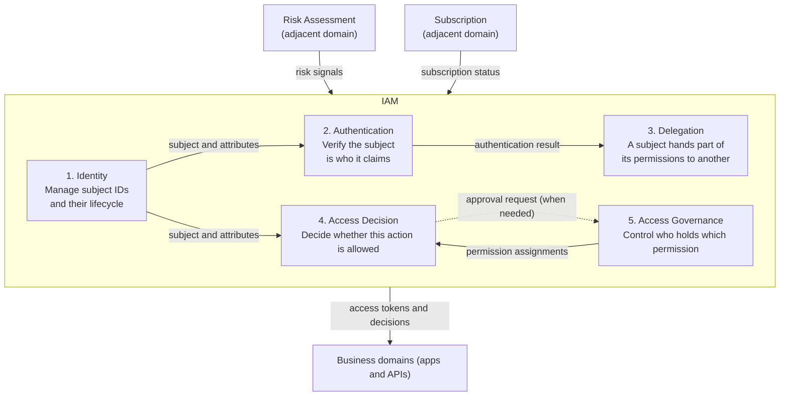

# Overview

People use the word "authorization" for different things. One person means login, another means OAuth scopes, and a third means role design in an admin console. If you start a discussion about an authorization platform without aligning on scope, nobody knows what the team will build.

This post draws a map that lets you treat authorization as a design subject. You will learn:

- What authentication (AuthN) and authorization (AuthZ) each answer, and why you should separate them
- The narrow and broad meanings of "authorization," and why the "authorization" in OAuth centers on delegation
- A map that splits IAM into five subdomains: identity, authentication, delegation, access decision, and access governance
- How IAM fits into the DDD categories Core, Supporting, and Generic
- The adjacent domains outside IAM, and where the business meaning of permissions belongs

This post opens a series on authorization. Each specification and architecture that later posts cover maps to some place on this map.

First, how this post relates to existing ones. [Basics of Authentication and Authorization](/posts/authentication-authorization-basics/) covers the basic terms: identification, authentication, and authorization. [Permission Management Design](/posts/permission-management-design/) covers ACL, RBAC, ABAC, and feature scope versus data scope. [OAuth 2.0 Explained](/posts/oauth-2-0/) covers the OAuth 2.0 specification. This post does not repeat them. It shows where each of them sits on the IAM map.

# Authentication and Authorization Answer Different Questions

Authentication and authorization answer different questions.

| | Authentication | Authorization |
|---|---|---|
| Question | Who are you? | May this subject perform this action on this resource in this context? |
| Result | A verified identity (person, service, agent) | Permit or deny (sometimes with conditions) |
| Main inputs | Credentials (password, passkey, certificate, signature) | Subject, resource, action, context, policy |
| When it fails | It lets an impostor in | It allows an action without permission, or blocks a legitimate one |

The result of authentication forms just one input to authorization. Authorization adds three more pieces to the verified subject and checks them against policy. These are the resource (which data), the action (read, write, approve), and the context (time, origin, tenant, risk).

# Narrow and Broad Meanings of "Authorization"

In the table above, "authorization" means deciding whether a subject may perform an action on a resource. In daily work, people use the word more broadly. Discussions drift when people do not distinguish the meanings.

| Name | Refers to | Typical question |
|---|---|---|
| Authorization in the narrow sense | Access decision | May this action happen? |
| "Authorization" in OAuth | Delegation | What do I hand to this client? |
| Granting and managing permissions (assignment, requests and approvals, access reviews) | Access governance | Who holds which permission? |
| Authorization in the broad sense | The three above together | All of the above |

When someone says "let's build an authorization platform," aligning first on which row they mean speeds up the discussion. On the IAM map later in this post, these three correspond to subdomains 3 (delegation), 4 (access decision), and 5 (access governance).

# Splitting IAM into DDD Subdomains

## Why draw a map

Separating authentication from authorization, and the three meanings of "authorization," still gives a coarse map. Some jobs, such as ID provisioning, do not appear in the table, and the table does not show what each part hands to the others. So this post draws a map that splits the whole of IAM (Identity and Access Management), including authentication and authorization, by business problem.

The map exists to sort discussions and specifications about authorization by the problem they address. For example, a proposal to "build an authorization platform with OAuth" means something completely different depending on whether it targets delegation (3) or access decision (4). With a map, you can draw that line early in the discussion. Once you know which subdomain a problem belongs to, you can also see where its inputs come from. It then becomes easier to settle which business domain owns the business meaning of a permission, and which specification or product solves the problem.

## Why use DDD vocabulary

It borrows DDD (Domain-Driven Design) vocabulary for the split. The terms follow Vaughn Vernon's "Implementing Domain-Driven Design" (IDDD). The "Meaning" column below is my summary based on IDDD's terms and Evans's DDD Reference. This split serves as one example, not the only correct answer.

## What IAM means

The NIST glossary describes IAM, broadly, as the administration of individual identities within a system, such as a company, a network, or even a country. It adds that in enterprise IT, identity management means establishing and managing the roles and access privileges of individual network users.

In this post, IAM means the area that manages the identities of subjects (people, services, AI agents), decides what each subject may access, and governs that access. Concretely, it bundles authentication, authorization (delegation, access decision, access governance), and the identity management those depend on.

## DDD terms

| Term | Meaning |
|---|---|
| Domain | The business an organization runs and the world that business lives in |
| Subdomain | A section of the domain, split by business problem |
| Core domain | The subdomain that holds the real business asset and the most valuable, specialized concepts |
| Supporting subdomain | A subdomain the business needs and that has some specific elements, but not Core |
| Generic subdomain | A subdomain that captures nothing special to the business, yet the overall business solution needs it |

Chapter 1 of IDDD says that models other than the Core Domain matter too, but they may not get the same priority and effort as the Core. Evans's DDD Reference also calls generic elements essential to the functioning of the system and recommends considering off-the-shelf solutions or published models for them. That is why a Generic subdomain is a good candidate for off-the-shelf products or standards.

Core, Supporting, and Generic classify subdomains. Which one applies depends on whose business you look from. The same authentication mechanism counts as Core for a company that sells an IdP and as Generic for an e-commerce site.

## IAM's position depends on the business

| The organization's business | Position of IAM |
|---|---|
| Something other than IAM (business apps such as e-commerce or SaaS) | A Generic subdomain within the business domain (Supporting for some businesses) |
| IAM itself (IdP, authorization engine, or IGA vendor) | IAM forms the domain itself. Its subdomains split into Core, Supporting, and Generic |

For an organization that builds business apps, IAM usually counts as Generic. In an InfoQ interview, Vernon, the author of IDDD, says that the book's sample models treat the Identity and Access Context as a Generic Subdomain. The `iddd_identityaccess` module in the official IDDD samples implements it. When IAM counts as Generic, leaning on standards and off-the-shelf products makes sense.

Still, for a SaaS product whose customers need rich per-tenant permission settings, access decision or access governance can move toward Supporting. For IAM vendors, the Core tends to sit in authentication and delegation for an IdP, in access decision for an authorization engine, and in access governance for IGA (Identity Governance and Administration).

Deciding early which parts count as Core for your organization keeps decisions about where to invest and what to buy steady. [How Much Authorization Platform Do You Need?](/posts/authorization-platform-scope-stages/) covers how to set that scope.

# The IAM Map

This diagram splits IAM into five subdomains and places the adjacent domains and the business domains outside.

Solid lines show data flow, and dotted lines show requests. Authentication and access decision mainly consume risk signals, and access decision consumes subscription status. Delegation hands access tokens to the business domains, and access decision hands them decisions.

# The Five Subdomains

| # | Subdomain | Responsibility | Includes |
|---|---|---|---|
| 1 | Identity | Holds subject identifiers and attributes and manages their lifecycle from creation to deletion | Identifiers, attributes, identity proofing, provisioning |
| 2 | Authentication | Verifies that a subject is who it claims to be and keeps that result | Authenticator and credential management, MFA and step-up, federation, sessions, account recovery, non-human authentication |
| 3 | Delegation | Lets a subject hand part of its permissions to another subject and manages the range and lifetime | Registering delegates, consent, scopes, token issuance, exchange, and revocation, delegation chains |
| 4 | Access Decision | Decides, based on policy, whether a subject may perform an action on a resource | Policy definition, evaluation (PDP), providing decisions and the enforcement mechanism (PEP) |
| 5 | Access Governance | Decides who holds which permission and keeps that appropriate over time | Requests and approvals, assignment, access reviews, separation of duties, just-in-time (JIT) access |

Where lifecycle management and provisioning belong, under 1 or under 5, depends on how you split IAM. For example, Microsoft Entra ID Governance calls identity lifecycle management the foundation for identity governance and includes provisioning among its features.

Beyond the responsibilities and contents in the table, a few points matter for each subdomain.

- 1. Identity: SCIM serves as the representative standard. Access decision uses this subdomain's attributes as input, so stale attributes can cause an authorization incident even when the decision logic is correct. For example, someone who changed departments can still read data from the old one.
- 2. Authentication: OpenID Connect and SAML serve as the representative federation standards. NIST SP 800-63-4 (finalized in July 2025) treats identity proofing (63A), authentication (63B), and federation (63C) separately. That split helps when you think about the boundary between subdomains 1 and 2.
- 3. Delegation: OAuth centers on this subdomain. Still, delegation only settles the range handed to the client. Even with a scope of `invoices:read`, the resource server decides separately which invoices the caller may read, as part of subdomain 4. RFC 6749 only requires (MUST) the resource server to check that the token's scope covers the requested resource, and it does not define how to decide access per resource. [What is Authorization for AI Agents?](/posts/authorization-for-ai-agents/) covers the problems that arise when AI agents chain delegation.
- 4. Access Decision: "Authorization" in the narrow sense refers to this subdomain. Models such as RBAC, ABAC, and ReBAC and policy engines such as OPA and Cedar belong here. Reference architectures such as XACML and NIST SP 800-162 call the component that makes the decision the PDP (Policy Decision Point). They call the component that lets a request through or blocks it based on that decision the PEP (Policy Enforcement Point). [What Are Authorization Architectures and Models?](/posts/authorization-architecture-models-engines/) covers the reference architecture and how to choose a model, and [What is the AuthZEN Authorization API?](/posts/authzen-authorization-api/) covers a standard API between PEP and PDP.
- 5. Access Governance: Subdomain 4 decides "may this action happen now?" on every request. Subdomain 5 decides "should this person hold this permission at all?" over a longer period.

## Why delegation stands alone

Some models fold delegation into authentication or access decision. This map keeps delegation separate because the core OAuth concepts (client, consent, grant) fit nowhere else.

- They do not fit authentication. Consent does not verify who you are
- They do not fit access decision. The delegated range starts from the consent of the side that holds the permission, not from a per-resource decision
- They do not fit access governance. In access governance, administrators and approvers decide which subject holds which permission. In delegation, the side that holds a permission (the OAuth resource owner) hands part of it to a client. When an administrator consents to an app on behalf of the whole organization (for example, admin consent in Microsoft Entra ID), that still counts as delegation, because it hands the organization's permissions to a client

Consent for delegation also differs from consent under privacy laws such as the GDPR, which covers the use of personal data for a specific purpose. The first hands your permissions to another subject. The second concerns privacy. The screens may look alike, but what you record and what happens on withdrawal differ.

# Adjacent Domains

Some domains outside IAM also feed input into authentication and access decision. Two common ones:

| Adjacent domain | Responsibility | What it gives IAM | Receiving subdomain |
|---|---|---|---|
| Risk Assessment | Evaluates whether a subject's behavior looks suspicious | Risk signals | 2. Authentication, 4. Access Decision |
| Subscription | Manages which features each tenant has subscribed to | Subscription status | 4. Access Decision |

Risk assessment spots logins from unusual locations or a burst of suspicious actions. Based on that result, authentication asks for an extra factor (step-up) and access decision blocks risky actions. SSF, CAEP, and RISC exist as standards for sharing such signals continuously.

Subscription feeds the question "may this tenant use this feature?" In a SaaS product where available features depend on the plan, access decision looks at both the user's permissions and the subscription status.

These sit outside IAM because they have different owners. Fraud detection rules and pricing plan definitions do not count as IAM knowledge. IAM takes them as input and uses them in decisions, nothing more.

# The Business Meaning of Permissions Belongs to the Business Domain

One thing people often miss on this map: where the business meaning of a permission lives.

The question "may this person approve this invoice?" carries business knowledge. An invoice exists as a resource, approval exists as an action, the approver changes with the amount, and the requester cannot approve their own request. These rules come from the business domain's language, and the business domain should own them. IAM owns the mechanism for deciding and enforcing.

| | Owned by the business domain | Owned by IAM |
|---|---|---|
| Vocabulary | Invoice, approve, manager, requester | Subject, resource, action, policy |
| Rules | Approver depends on amount; no self-approval | The mechanism that evaluates rules and returns results |
| Who changes it and when | Business teams, as the business changes | Platform teams, as the platform changes |

Mixing these up makes IAM absorb business knowledge. Every change to a business rule turns into a request to the platform team, and the platform team cannot write policies without understanding the business. The reverse also hurts: if each business domain owns the decision mechanism too, decisions tend to drift between applications. Keep the mechanism shared and the meaning in each domain. That split gives you the starting point for scoping an authorization platform.

[Permission Management Design](/posts/permission-management-design/) covers the elements of a permission (who, on what, may do what) and the design of feature scope and data scope.

# Summary

- Authentication answers "who are you?" Authorization answers "may this subject perform this action on this resource in this context?"
- The "authorization" in OAuth centers on issuing tokens for delegated access. Per-resource access decisions live in a different layer
- The map in this post splits IAM into five subdomains (one possible split): identity, authentication, delegation, access decision, and access governance. Everyday "authorization" covers delegation, access decision, and access governance together
- Whether IAM counts as Core, Supporting, or Generic depends on the organization's business. For business-app organizations, it usually counts as Generic
- Adjacent domains such as risk assessment and subscription sit outside IAM and feed it input
- The business domain owns the business meaning of permissions. IAM owns the mechanism for deciding and enforcing

# Related Posts

- [Basics of Authentication and Authorization](/posts/authentication-authorization-basics/)
- [Exploring Permission Management Design](/posts/permission-management-design/)
- [OAuth 2.0 Explained: Complete Guide to Flows, Tokens, and Implementation](/posts/oauth-2-0/)
- [OAuth 2.1 and the Security BCP: RFC 9700 and RFC 6819 (Changes from OAuth 2.0)](/posts/oauth-2-1-security-bcp/)
- [What is the Big Picture of Service-to-Service Authentication? mTLS, Token Exchange, SPIFFE, and Zero Trust](/posts/service-to-service-authentication/)
- [Introduction to Digital Identity: Essential Authentication, Authorization, and ID Management for Web Services](/posts/introduction-digital-identity/)
- [Everything About Digital Identity: Knowledge for Realizing a Secure and User-Centric Identity System](/posts/digital-identity-overview/)
- [How Much Authorization Platform Do You Need? Scope, Ownership, and Decision Axes](/posts/authorization-platform-scope-stages/)
- [What Are Authorization Architectures and Models? PEP/PDP, RBAC/ABAC/ReBAC, and Choosing a Policy Engine](/posts/authorization-architecture-models-engines/)
- [What is the AuthZEN Authorization API? A Standard Between PEP and PDP](/posts/authzen-authorization-api/)
- [Which OAuth Standards Does an Authorization Platform Need? A Map of Delegation, Tokens, and Continuous Evaluation](/posts/oauth-standards-map-authorization-platform/)
- [What is Workload Identity? WIMSE, Transaction Tokens, and SPIFFE Client Authentication for Service Identity and Context](/posts/workload-identity-wimse-transaction-tokens/)
- [What is Authorization for AI Agents? Delegation Chains, Human Approval, and Audit with MCP, AuthZEN, AIMS, and A2A/AP2](/posts/authorization-for-ai-agents/)
- [How Should You Design Authorization for MCP? Common Incidents and Decisions That Are Hard to Reverse](/posts/mcp-authorization-design/)
- [What Does an Authorization Platform Architecture Look Like? Containers, Key Sequences, PEP/PDP Placement, and Non-Functional Decisions](/posts/authorization-platform-architecture-decisions/)

# References

- [RFC 6749 The OAuth 2.0 Authorization Framework](https://www.rfc-editor.org/rfc/rfc6749)
- [RFC 7643 System for Cross-domain Identity Management: Core Schema](https://www.rfc-editor.org/rfc/rfc7643)
- [RFC 7644 System for Cross-domain Identity Management: Protocol](https://www.rfc-editor.org/rfc/rfc7644)
- [NIST CSRC Glossary: identity and access management](https://csrc.nist.gov/glossary/term/identity_and_access_management)
- [NIST SP 800-63-4 Digital Identity Guidelines](https://csrc.nist.gov/pubs/sp/800/63/4/final)
- [NIST SP 800-162 Guide to Attribute Based Access Control (ABAC) Definition and Considerations](https://nvlpubs.nist.gov/nistpubs/SpecialPublications/NIST.SP.800-162.pdf)
- [OASIS eXtensible Access Control Markup Language (XACML) Version 3.0](https://docs.oasis-open.org/xacml/3.0/xacml-3.0-core-spec-os-en.html)
- [OpenID Shared Signals Framework Specification 1.0](https://openid.net/specs/openid-sharedsignals-framework-1_0-final.html)
- [OpenID Continuous Access Evaluation Profile 1.0](https://openid.net/specs/openid-caep-1_0-final.html)
- [OpenID RISC Profile Specification 1.0](https://openid.net/specs/openid-risc-1_0-final.html)
- [Eric Evans, DDD Reference](https://www.domainlanguage.com/ddd/reference/)
- [Vaughn Vernon, Implementing Domain-Driven Design, Chapter 1 excerpt: The Business Value of Using DDD (InformIT)](https://www.informit.com/articles/article.aspx?p=1944876&seqNum=4)
- [Vaughn Vernon, IDDD_Samples](https://github.com/VaughnVernon/IDDD_Samples)
- [Implementing Domain Driven Design Review and Interview (InfoQ)](https://www.infoq.com/articles/implmenting-domain-driven-design-vaughn-vernon/)
- [Grant tenant-wide admin consent to an application (Microsoft Learn)](https://learn.microsoft.com/en-us/entra/identity/enterprise-apps/grant-admin-consent)
- [What is Microsoft Entra ID Governance? (Microsoft Learn)](https://learn.microsoft.com/en-us/entra/id-governance/identity-governance-overview)
