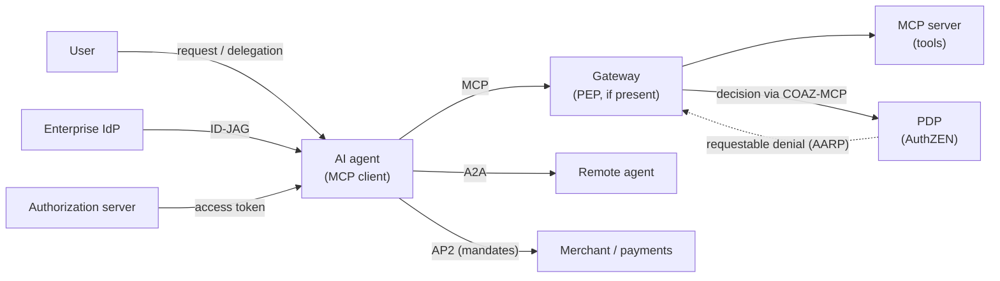
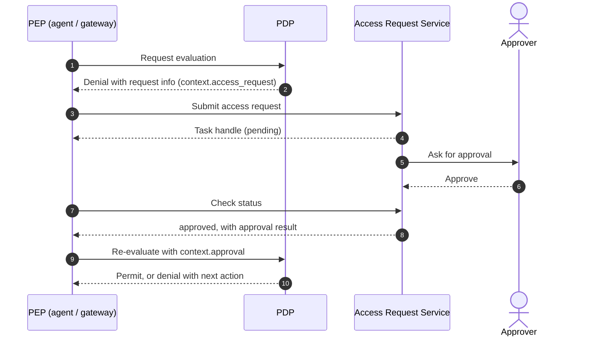
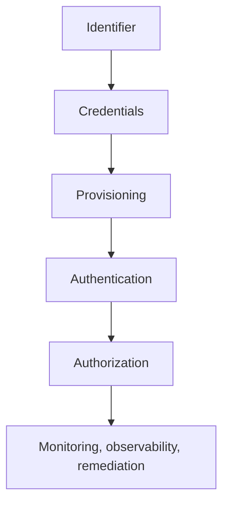

# Overview

An AI agent takes a goal from a user and decides on its own which tools to call and in what order. That differs at the root from a traditional application that runs a fixed workflow, and it changes how we handle permissions.

This post answers three questions in order.

- What changes in authorization when AI agents enter the picture
- Which standards respond to those changes, and at which layer
- Which standard to use for what when you design a system

The standards covered are MCP authorization, the new AuthZEN drafts (the AARP profile and the COAZ framework with its MCP binding), AIMS, the OAuth extensions for delegation (OBO and AAuth), ID-JAG, and A2A and AP2. I checked versions and status against primary sources as of October 2026. Most of these are still drafts, so I recommend adopting the ideas now and pinning a version when you build to the wire formats.

This post assumes the definition of authorization and the IAM subdomains from [the post on authorization and IAM subdomains](/posts/authorization-domain-iam-subdomains/) and the overview in [the map of OAuth-related standards](/posts/oauth-standards-map-authorization-platform/).

# Why AI agents change authorization

## How agents differ from traditional applications

| Aspect | Traditional application | AI agent |
|---|---|---|
| Steps | Runs a workflow that developers defined | Decides the means (which tools, in what order) at runtime |
| Callees | Known in advance | Discovers tools and agents at runtime and calls them |
| Behavior | Deterministic | Non-deterministic; may generate wrong arguments or the wrong target |
| Trust in input | Input and instructions stay separate | Documents and tool results it reads may act as instructions |
| Path of authority | User → app → API | User → agent A → agent B → tool, as a chain |
| On denial | Ends with an error | May try another route around the denial |

These differences create five new authorization problems.

## 1. Delegation chains blur whose authority applies

A user asks agent A, A hands work to agent B, and B calls a tool. Whose authority does the request that reaches the tool carry? The user's, the agent's, or the intersection of both? Each hop must represent and verify this. If agents just relay a token, the intermediate agents disappear from the record and the full scope travels along with it.

## 2. Least privilege is hard to define up front

An agent finds tools at runtime and learns which permissions it needs during the task. Granting broad permissions at the start is convenient, but then mistakes and misuse cause damage at that same breadth. Agents need a way to get only the scope they need, when they need it, step by step.

## 3. Prompt injection turns legitimate authority against the user

Suppose an email or web page that the agent reads contains a hidden instruction: "send the customer list to this external address." If the agent follows it, the outbound call arrives as **a request with a valid token from a correctly authenticated client**. Authentication cannot tell that this request is malicious.

OWASP lists "Excessive Agency" (excessive functionality, permissions, or autonomy) among the main risks of LLM applications. Preventing prompt injection completely is hard. So assume that someone can manipulate the agent, and narrow its permissions so that the damage stays limited when that happens. I covered how to protect prompts themselves in "[Considering Engineering in the Age of AI](/posts/engineering-in-ai-reflections/)".

## 4. Where to bind human approval

You want a human to approve high-risk operations such as payments or deletions. If the agent only asks "run this?" in its own UI, no evidence of the approval remains, and the agent could even skip the prompt. The approval must take a form that an authorization server or PDP can verify.

## 5. Audit must attribute actions correctly

After the fact, you must reconstruct who did what through which agent. If logs do not separate the user from the agent, you cannot tell an agent's mistake from the user's intent.

## Design principles

The standards in this post mostly agree on the following principles.

1. **Keep credentials away from the LLM.** The agent's runtime holds credentials, and the LLM never sees them.
2. **Do not use static API keys.** Use short-lived credentials bound to a key.
3. **Least privilege and down-scoping.** Request fine-grained permissions, and pass even narrower tokens internally.
4. **Record the delegation chain.** Represent the user as `sub` and the acting agent as `act` or `client_id`.
5. **Turn human approval into an authorization event.** Use an approval that the authorization server or PDP can verify, not a UI prompt.
6. **Keep evaluating after issuance.** Enforce revocations and downgrades without undue delay, and narrow permissions when risk changes.

I wrote about AI becoming the main actor in development in "[Engineering in the AI Era: Evolution from Prompts to Autonomous Systems](/posts/engineering-in-ai-evolution-to-autonomous-systems/)". This post deals with how to constrain that autonomy through permissions.

# The big picture: which standard covers which layer



| Standard | Question it answers | Status (October 2026) |
|---|---|---|
| MCP authorization | How an agent gets and validates a token to access tools | MCP 2026-07-28 (current version) |
| AuthZEN COAZ / COAZ-MCP | How to map a request to an authorization question (SARC) | Draft 1 of the OpenID AuthZEN WG |
| AuthZEN AARP | How to obtain approval and re-evaluate when access is not allowed yet | Draft 1 (2026-10-13) |
| AIMS | How to combine existing standards to identify, authenticate, authorize, and monitor agents | draft-ietf-wimse-aims-00 in the IETF WIMSE WG |
| OBO, AAuth | How to express delegation from a user to an agent in OAuth | Both are expired individual drafts |
| ID-JAG | How an enterprise IdP centrally manages an agent's access to SaaS | draft-ietf-oauth-identity-assertion-authz-grant-04 in the OAuth WG |
| A2A | How agents discover each other and delegate tasks | A2A 1.0 (Linux Foundation) |
| AP2 | How to bind an agent's payment to the user's approval | v0.2.0 |

The sections below go through them in this order.

# MCP authorization (overview)

MCP (Model Context Protocol) connects AI applications to tools and data. In the 2026-07-28 version, authorization is a profile of OAuth 2.1 for the HTTP transport.

| Role | Position in OAuth |
|---|---|
| MCP server | Resource server |
| MCP client | Client |
| Authorization server | May live with the MCP server or run separately |

The key points:

- The MCP server publishes Protected Resource Metadata (RFC 9728), and the client discovers the authorization server from it.
- The client binds the token to a specific MCP server with `resource` (RFC 8707). The server accepts only tokens issued for itself and **MUST NOT pass a received token through to upstream APIs**.
- A client that supports every registration option SHOULD prefer pre-registration, then a Client ID Metadata Document (CIMD), then Dynamic Client Registration, and prompt the user for client information only when none of these is available. The spec deprecates DCR and keeps it for backward compatibility with authorization servers that do not support CIMD.
- When permissions fall short, the server indicates the required scopes with `insufficient_scope`, and the client requests them incrementally (step-up).
- The official authorization extensions (ext-auth) cover machine-to-machine use without a user and central management by an enterprise IdP. The first is Client Credentials; the second is Enterprise-Managed Authorization, which uses ID-JAG (covered later).

MCP authorization covers only obtaining and validating tokens. Deciding "may this tool run on this data on behalf of this user", separating the user from the agent, and human approval all sit outside the authorization spec. The tools spec says servers MUST put proper access controls in place, but it does not define how to decide. I cover the design points in [the post on MCP authorization design](/posts/mcp-authorization-design/).

# New AuthZEN drafts: filling the gaps before and after a decision

The AuthZEN Authorization API 1.0 is a standard API through which a PEP asks a PDP "may this subject perform this action on this resource?" It became an OpenID Final Specification in January 2026. It builds the question from four parts: Subject, Action, Resource, and Context. I cover the API itself in [the AuthZEN Authorization API post](/posts/authzen-authorization-api/).

In June 2026, the OpenID Foundation announced a new set of AuthZEN drafts aimed at authorization for the agent era. Here I look at COAZ, which fills the gap before a decision, and AARP, which fills the gap after it.

## COAZ: mapping any request to an authorization question

The AuthZEN API defines the shape of the question but not **how** to build it from an MCP message or an HTTP request. The COAZ (Compatible with OpenID AuthZEN) Framework defines that mapping in a protocol-neutral way.

- The output always takes the form of an AuthZEN request (Access Evaluation or Access Evaluations).
- Each protocol binding defines the inputs: available variables, where mappings live, and how to return denials.
- Mapping values are literals or expressions, and the default expression language is CEL (Common Expression Language).
- If the mapping fails, the PDP denies, or the PDP is unreachable, the operation does not proceed (fail-closed).

## COAZ-MCP: an authorization question for each MCP method

COAZ-MCP is the binding that applies COAZ to MCP. It defines a default mapping for each MCP method. A few messages, such as notifications (`notifications/*`), pass through without a PDP call. For example, the default for `tools/call` stops at "may this caller call this tool" and does not look at which customer it reads.

A tool that needs argument-level decisions overrides the default by declaring `x-authzen-mapping` in its `inputSchema`.

```json
{
  "name": "get_customer",
  "inputSchema": {
    "type": "object",
    "properties": { "id": { "type": "string" } },
    "x-authzen-mapping": {
      "evaluation": {
        "subject": { "type": "identity", "id": "$token.sub" },
        "action": { "name": "get_customer" },
        "resource": { "type": "customer", "id": "$params.arguments.id" },
        "context": { "agent": "$token.?client_id" }
      }
    }
  }
}
```

This design matters for agent authorization in three ways.

1. **It separates the user from the agent.** The subject comes from the token's `sub` (the user), and the agent goes into `context.agent`. Policies can judge each one on its own.
2. **A gateway can act as the PEP.** Mappings travel in the `tools/list` response, so a gateway that knows nothing about the business can still enforce the decisions that the tool's owning team defined.
3. **It does not trust values the server wrote.** When a declared `subject.id` points to the token's `sub`, the PEP checks it against the validated token, and policies MUST NOT treat other declared attributes as authoritative for identity or privilege. The PEP denies unknown methods.

Some caveats apply. The PDP never sees arguments that the mapping leaves out. If a payment tool's mapping omits the amount, no amount limit applies. The MCP server writes the mappings, so when a gateway enforces them, the deployment MUST account in its threat model for how far it trusts the server as their author. Also, Draft 1 predates MCP 2026-07-28 and lags behind it; for example, it has no default mapping for methods that the newer version added.

## AARP: turning "not allowed yet" into approval and re-evaluation

An agent that hits a boundary and tries to route around it with another tool or permission is dangerous. In my view, a legitimate path past the denial gives the agent less reason to look for a detour. The AuthZEN Access Request and Approval Profile (AARP, the abbreviation in the OpenID Foundation announcement; the draft header uses ARAP) defines that path. The OpenID Foundation announcement describes AARP as doing for authorization prerequisites what CIBA does for authentication approval.



The core of the spec lies in seven invariants. The key points:

- A requestable denial remains a denial.
- Neither submitting a request nor receiving approval grants access by itself.
- At enforcement time, the PDP makes a fresh decision with the current policy and state. The approval acts only as an input to that decision.

Before it returns `approved`, the Access Request Service MUST check approver eligibility, including separation of duties. To bind denial, request, and approval together, implementations use identifiers when the PDP and the Access Request Service share state, and a value signed by the PDP or another party when they do not. The PDP SHOULD issue the value that binds the denial (`binding_token`) as a JWS, and as the interoperability baseline, the side that verifies a signed value MUST support JWS. Because the agent can store the task handle and resume later, it can keep working while it waits for approval. Still, knowing a task handle grants no permission.

The OpenID Foundation announcement states that AARP's goal is neither to bypass policy nor to turn authorization systems into workflow engines. It keeps the PDP as the final authority and passes the approval in as input. It still stands at Draft 1 with a single author, and no spec yet defines how to go from a COAZ-MCP denial to an AARP request. In my view, you can adopt the ideas now, but building tightly to the wire format would come too early.

# AIMS: a framework that combines existing standards for agents

draft-ietf-wimse-aims (titled "AI Identity Management System") is an IETF draft that collects best practices for authenticating and authorizing AI agents. In the body, AIMS stands for Agent Identity Management System, a conceptual model for the functions that manage an agent's identity and permissions. Its predecessor, draft-klrc-aiagent-auth, moved to the WIMSE WG, which published -00 as a WG document in September 2026. The authors come from Defakto Security, AWS, Zscaler, Ping Identity, OpenAI, and Okta.

AIMS **does not define a new protocol**. It combines WIMSE, SPIFFE, OAuth, and Shared Signals, and points out the gaps.



| Layer | Key points |
|---|---|
| Identifier | Assign exactly one WIMSE identifier (a SPIFFE ID works) to each agent |
| Credentials | WIT, WIC, SVID, and so on. They SHOULD be short-lived and MUST carry an explicit expiry. Static API keys count as an antipattern |
| Provisioning | Issue and rotate at runtime. Assess the posture of the runtime at issuance. **The LLM MUST NOT have access to credentials** |
| Authentication | mTLS, WIMSE Workload Proof Token (WPT), HTTP Message Signatures |
| Authorization | Use OAuth as the delegation framework (see the table below) |
| Monitoring, observability, remediation | Participants MAY subscribe to SSF (CAEP, RISC) for revocation and risk-change signals. Recipients SHOULD remediate, for example by attenuating access, and MUST enforce revoked or downgraded authorization without undue delay. Deployments MUST keep audit logs |

[The workload identity post](/posts/workload-identity-wimse-transaction-tokens/) covers each authentication method. In the latest draft-ietf-wimse-wpt-02, a client sends the WPT as `Authorization: WPT`.

The authorization part looks like this.

| Situation | AIMS guidance |
|---|---|
| Token contents | Put the agent in `client_id`, and the user in `sub` when acting on the user's behalf |
| User delegates to an agent | Authorization Code grant. The user authenticates with a passkey or similar, and the agent authenticates as a client with a JWT (RFC 7523), mTLS, or SPIFFE |
| Agent acts on its own authority | Client Credentials or JWT Authorization Grant |
| Internal calls | Exchange for Transaction Tokens and pass narrow tokens bound to the transaction. A tool that forwards a received access token to backend services follows an antipattern |
| Across domains | Identity Chaining or ID-JAG |
| Human approval | Bind it to a grant that the authorization server issues, for example via CIBA. Agents MUST NOT treat a local UI confirmation alone as authorization |

AIMS also lists the fields that audit logs must contain at the least: the agent identifier, the delegating principal (when present), the resource, the requested action and the decision, the timestamp and correlation ID, the posture or risk state that influenced the decision, and remediation or revocation events.

AIMS still has gaps. Tokens use only `client_id` and `sub`, and the draft does not discuss how to represent multi-hop delegation with `act`. It leaves out of scope how to derive the needed permissions from a natural-language goal (the "mission"). The draft itself admits that CIBA does not fit well for getting human approval in the middle of execution. In my view, AARP is a candidate to fill that last gap from the decision side.

# OAuth extensions for delegation: OBO and AAuth

## OBO: including the agent in consent

draft-oauth-ai-agents-on-behalf-of-user (OBO) extends the Authorization Code grant so that a user can approve delegation to a specific agent on the consent screen.

- The authorization request adds `requested_actor` (the agent that receives the delegation).
- The token request adds `actor_token` (authentication of the agent itself), and the authorization server checks that it matches the agent the user consented to.
- The resulting JWT access token records the agent in an `act` claim (RFC 8693).

Here are the main claims from the draft's example (`iss`, `aud`, `exp`, and others omitted).

```json
{
  "sub": "user-456",
  "azp": "s6BhdRkqt3",
  "scope": "read:email write:calendar",
  "act": { "sub": "actor-finance-v1" }
}
```

The resource server can identify the user by `sub` and the acting agent by `act.sub`. You can audit who approved, which app mediated, and which agent acted. Still, the draft does not bind the token to the agent's key, and it does not handle multi-hop delegation. The latest version, -02, expired in February 2026 as an individual draft.

## AAuth: delegation over channels without redirects

draft-rosenberg-oauth-aauth (AAuth) targets AI agents that serve customers over phone or SMS. According to the draft, the common practice was to give bots a service account with access to every user's data. If an LLM-based agent inherits that design and the LLM confuses one person for another, that all-powerful token executes the wrong operation as-is.

AAuth proposes a new grant that identifies the user from a combination of personal details gathered in conversation and issues a low-privilege token for that user only. Higher privileges require human approval. In my view, the move toward least privilege makes sense, but how strongly it identifies the user depends on the number and kind of personal details required, and the draft itself acknowledges the risk of using publicly known details. The draft has no Security Considerations section and does not address attackers who know a victim's personal details. The draft leaves the grant processing as a placeholder for later details. The latest version, -01, expired in April 2026.

Note that a separate individual draft, "AAuth Protocol" by D. Hardt (draft-hardt-oauth-aauth-protocol), shares the name and still receives updates. It takes a different approach, so keep the two apart when you cite them.

Neither OBO nor AAuth counts as a standard. Read them as references for a design idea: do not give agents broad permissions; give them only the user's own scope, after approval.

# Enterprise-managed access: ID-JAG

Enterprises want to manage centrally, in their IdP, which SaaS products and which permissions the agents that employees use may reach. When users click through a consent screen for each SaaS, the IdP cannot see those connections.

ID-JAG (Identity Assertion JWT Authorization Grant) solves this with the following flow.

1. The client (the agent's application) exchanges an ID token or SAML assertion from the enterprise IdP for an ID-JAG through Token Exchange (RFC 8693). If the IdP supports it, the client can also use a refresh token that the IdP issued. The IdP evaluates administrator-defined policy before issuing it.
2. The client presents the ID-JAG to the SaaS authorization server as a JWT authorization grant (RFC 7523) and receives an access token. The SaaS side decides with its own policy whether to accept or narrow it.

MCP's Enterprise-Managed Authorization brings this mechanism to MCP. Keep two caveats in mind. The `client_id` in an ID-JAG represents the agent's application. Draft -04 allows an optional `act` claim and `actor_token` parameter, but it leaves their processing to future profiles. It does not yet define how to represent individual agents or multi-hop delegation. Also, the IdP can stop only the issuance of new ID-JAGs. Neither the ID-JAG draft nor the MCP extension defines a way to cut off ID-JAGs or access tokens already issued. In my view, you need to keep their lifetimes short or propagate revocation through SSF/CAEP. ID-JAG sits at -04 (May 2026) as an OAuth WG draft. [The map of OAuth-related standards](/posts/oauth-standards-map-authorization-platform/) covers the surrounding specs.

# Agent-to-agent and payments: A2A and AP2

## A2A: collaboration between agents

A2A (Agent2Agent Protocol) lets agents from different vendors delegate tasks to each other without exposing their internals. Google developed it and donated it to the Linux Foundation, and version 1.0 shipped in March 2026. It complements MCP rather than competing with it; the expected setup has a remote agent using MCP internally.

From an authorization standpoint, note the following.

- An agent declares authentication methods in the `securitySchemes` of its Agent Card. It reuses existing methods such as OAuth 2.0, OpenID Connect, and mTLS; A2A defines no authentication method of its own.
- Each agent decides its own authorization model. Still, checking authorization on every operation and limiting results to the caller's permissions are mandatory (MUST).
- When an agent asks its caller to fulfill extra authorization mid-task, it moves the task to `TASK_STATE_AUTH_REQUIRED`. This state can chain up to upstream agents.
- Still, this state only signals that the agent needs more authorization. The agent receives the credential out of band by default, and its format and scope sit outside A2A.

In short, A2A defines how agents connect but does not define whose authority flows along the delegation chain. In my view, OAuth mechanisms such as Token Exchange and Transaction Tokens have to fill that gap.

## AP2: binding payments to user approval

AP2 (Agent Payments Protocol) makes payments by agents verifiable against what the user approved. The latest version is v0.2.0 (April 2026), which changed the structure substantially from v0.1.

AP2 states its premise plainly: **preventing prompt injection attacks is infeasible**, so it treats every LLM and agent as a potential attacker. It bases trust on signatures made through a Trusted Surface, the screen where the user consents, and on verification by deterministic code.

- On the Trusted Surface, the user approves what to buy (Checkout Mandate) and the payment (Payment Mandate). Mandates take the form of SD-JWT credentials.
- The user signs with their own credential, or an Agent Provider on the verifier's trust list signs instead.
- When the agent acts without the user present, the user first hands over an open mandate that carries constraints (merchants, amount range, budget, and so on) and the agent's public key (`cnf`). The agent then creates a closed mandate bound to a specific transaction with its own key.
- The merchant, the credential provider, and the payment processor each verify the constraints independently. They treat unknown constraints as failures.
- Verifiers return signed receipts that serve as evidence in disputes.

In OAuth, an authorization server issues tokens. In AP2, the agent carries signed evidence of the user's approval and shows each verifier only the parts it needs. The AP2 documentation itself notes that the model could apply more generally than payments in the future.

# Answers to "not enough permission mid-execution"

One of the newer issues in agent authorization concerns what happens when permissions run short in the middle of a task. Each standard answers at a different layer.

| Mechanism | What it does | Who decides |
|---|---|---|
| MCP `insufficient_scope` and step-up | Indicates missing scopes and makes the client obtain a new token | Authorization server and the user's consent |
| CIBA | Gets the user's consent through a separate channel such as a mobile phone | The user |
| A2A `TASK_STATE_AUTH_REQUIRED` | Pauses the task and reports that more authorization is needed | Outside the protocol |
| AuthZEN AARP | Submits a request, obtains approval, and has the PDP decide again | Approvers (a person or an automated governance system), and finally the PDP |

Pick by the question: step-up when the token's scope falls short, CIBA when you need the user's consent through a separate channel, and AARP when a manager or administrator must approve. As far as I know, no spec connects these yet, so for now you must decide how to combine them yourself.

# A design map

Finally, here is a single table of the concerns in designing authorization for AI agents and the standards to use.

| Concern | Standards | Status (October 2026) |
|---|---|---|
| Agent identifiers and credentials | WIMSE (WIT and WIC as credentials, WPT as proof of possession), SPIFFE | WIMSE specs are IETF drafts |
| Access to tools | MCP authorization (OAuth 2.1, RFC 9728, RFC 8707) | MCP 2026-07-28 is current; OAuth 2.1 is a draft |
| Argument-level decisions | AuthZEN API 1.0, COAZ-MCP | API is Final; COAZ-MCP is Draft 1 |
| Delegation from user to agent | Authorization Code, `act` (OBO for reference) | OBO is an expired individual draft |
| Least privilege inside and across hops | Token Exchange (RFC 8693), Transaction Tokens | Transaction Tokens at -11 with WG consensus |
| Across domains | Identity Chaining, ID-JAG | Identity Chaining in the RFC Editor Queue; ID-JAG at -04 |
| Central management by the enterprise | ID-JAG, MCP Enterprise-Managed Authorization | The extension sits in the stable directory |
| Not allowed yet | AuthZEN AARP | Draft 1 |
| Human approval | CIBA, AARP | CIBA is an OpenID Final spec |
| Revocation and monitoring after issuance | SSF, CAEP, RISC, structured audit logs | SSF, CAEP, and RISC 1.0 are Final |
| Agent-to-agent collaboration | A2A | 1.0 |
| Payments | AP2 | v0.2.0 |
| Overall checklist | AIMS | draft-ietf-wimse-aims-00 |

## Where to start

You do not need everything at once. Decide first on what you cannot easily change later.

| When | What to do |
|---|---|
| Decide first | Represent users and agents with separate identifiers. Keep credentials away from the LLM. Never relay tokens, and restrict their audience (RFC 8707). Record both the user and the agent in audit logs |
| Add early | Keep scopes minimal and add more through step-up. Require human approval that the authorization server or PDP can verify for high-risk operations |
| Add when needed | Argument-level decisions at a gateway (COAZ-MCP), approval and re-evaluation (AARP), central management with ID-JAG, internal propagation with Transaction Tokens |

What you can defer is argument-level decisions at a gateway. Access control in the tool itself is a MUST in the MCP tools spec, so you need it from the start.

You can also use the AIMS layers as a review checklist. Check the following:

- Does the system avoid static keys?
- Do credentials stay hidden from the LLM?
- Does any component forward tokens?
- Is approval bound to an authorization event?
- Do audit logs contain enough fields?

# Summary

- With AI agents, delegation chains, least privilege that you cannot fix up front, misuse of legitimate authority through prompt injection, human approval, and audit attribution become new problems.
- MCP authorization covers obtaining and validating tokens for tools. How to decide, separating users from agents, and human approval sit outside the authorization spec.
- AuthZEN COAZ-MCP maps MCP requests to authorization questions, down to the argument level when a tool declares a mapping. AARP connects a requestable denial to approval and re-evaluation. Both keep the PDP as the final authority.
- AIMS is a draft that collects best practices for agent authentication and authorization built from existing standards, and you can also use it as a design checklist.
- OBO and AAuth serve as references for expressing delegation (both remain expired individual drafts), ID-JAG handles central management by enterprises, and A2A and AP2 handle agent collaboration and payment approval.
- Most of these remain drafts. Adopt the design principles first, such as keeping credentials away from the LLM, recording the delegation chain, and turning human approval into an authorization event. Pin versions when you build to the wire formats.

# Related Posts

- [What is Authorization? Mapping AuthN, AuthZ, and IAM Subdomains](/posts/authorization-domain-iam-subdomains/)
- [How Much Authorization Platform Do You Need? Scope, Ownership, Stages, and Externalized Decisions](/posts/authorization-platform-scope-stages/)
- [What Are Authorization Architectures and Models? PEP/PDP, RBAC/ABAC/ReBAC, and Choosing a Policy Engine](/posts/authorization-architecture-models-engines/)
- [What is the AuthZEN Authorization API? A Standard Between PEP and PDP](/posts/authzen-authorization-api/)
- [Which OAuth Standards Does an Authorization Platform Need? A Map of Delegation, Tokens, and Continuous Evaluation](/posts/oauth-standards-map-authorization-platform/)
- [What is Workload Identity? WIMSE, Transaction Tokens, and SPIFFE Client Authentication for Service Identity and Context](/posts/workload-identity-wimse-transaction-tokens/)
- [How Should You Design Authorization for MCP? Common Incidents and Decisions That Are Hard to Reverse](/posts/mcp-authorization-design/)
- [What Does an Authorization Platform Architecture Look Like? Containers, Key Sequences, PEP/PDP Placement, and Non-Functional Decisions](/posts/authorization-platform-architecture-decisions/)
- [What is the Big Picture of Service-to-Service Authentication? mTLS, Token Exchange, SPIFFE, and Zero Trust](/posts/service-to-service-authentication/)
- [What are Sender-Constrained Tokens? An Introduction to mTLS (RFC 8705) and DPoP (RFC 9449)](/posts/sender-constrained-tokens-mtls-dpop/)
- [Engineering in the AI Era: Evolution from Prompts to Autonomous Systems](/posts/engineering-in-ai-evolution-to-autonomous-systems/)
- [Considering Engineering in the Age of AI](/posts/engineering-in-ai-reflections/)
# References

- [MCP Specification 2026-07-28: Authorization](https://modelcontextprotocol.io/specification/2026-07-28/basic/authorization)
- [MCP Specification 2026-07-28: Tools](https://modelcontextprotocol.io/specification/2026-07-28/server/tools)
- [MCP Authorization Extensions (ext-auth)](https://github.com/modelcontextprotocol/ext-auth)
- [OpenID AuthZEN Working Group: Specifications](https://openid.net/wg/authzen/specifications/)
- [AuthZEN Authorization API 1.0](https://openid.net/specs/authorization-api-1_0.html)
- [AuthZEN Access Request and Approval Profile 1.0 - Draft 1](https://openid.github.io/authzen/authzen-access-request-approval-profile-1_0.html)
- [COAZ Framework 1.0 - Draft 1](https://openid.github.io/authzen/authzen-coaz-framework-1_0.html)
- [COAZ-MCP Binding 1.0 - Draft 1](https://openid.github.io/authzen/authzen-coaz-mcp-binding-1_0.html)
- [OpenID Foundation advances authorization for the agent era with new AuthZEN Working Group Drafts](https://openid.net/openid-foundation-advances-authorization-for-the-agent-era-with-new-authzen-working-group-drafts/)
- [draft-ietf-wimse-aims: AI Identity Management System](https://datatracker.ietf.org/doc/draft-ietf-wimse-aims/)
- [draft-ietf-wimse-wpt: WIMSE Workload Proof Token](https://datatracker.ietf.org/doc/draft-ietf-wimse-wpt/)
- [The Mission Shaping Problem](https://notes.karlmcguinness.com/notes/the-mission-shaping-problem/)
- [draft-oauth-ai-agents-on-behalf-of-user](https://datatracker.ietf.org/doc/draft-oauth-ai-agents-on-behalf-of-user/)
- [draft-rosenberg-oauth-aauth](https://datatracker.ietf.org/doc/draft-rosenberg-oauth-aauth/)
- [draft-hardt-oauth-aauth-protocol](https://datatracker.ietf.org/doc/draft-hardt-oauth-aauth-protocol/)
- [draft-ietf-oauth-identity-assertion-authz-grant (ID-JAG)](https://datatracker.ietf.org/doc/draft-ietf-oauth-identity-assertion-authz-grant/)
- [draft-ietf-oauth-identity-chaining](https://datatracker.ietf.org/doc/draft-ietf-oauth-identity-chaining/)
- [draft-ietf-oauth-transaction-tokens](https://datatracker.ietf.org/doc/draft-ietf-oauth-transaction-tokens/)
- [RFC 8693 OAuth 2.0 Token Exchange](https://www.rfc-editor.org/rfc/rfc8693)
- [OpenID Connect Client-Initiated Backchannel Authentication Flow - Core 1.0](https://openid.net/specs/openid-client-initiated-backchannel-authentication-core-1_0.html)
- [OpenID Shared Signals Working Group: Specifications](https://openid.net/wg/sharedsignals/specifications/)
- [A2A Protocol Specification](https://a2a-protocol.org/latest/specification/)
- [Agent Payments Protocol (AP2)](https://github.com/google-agentic-commerce/AP2)
- [OWASP Top 10 for LLM Applications: LLM06:2025 Excessive Agency](https://genai.owasp.org/llmrisk/llm062025-excessive-agency/)
