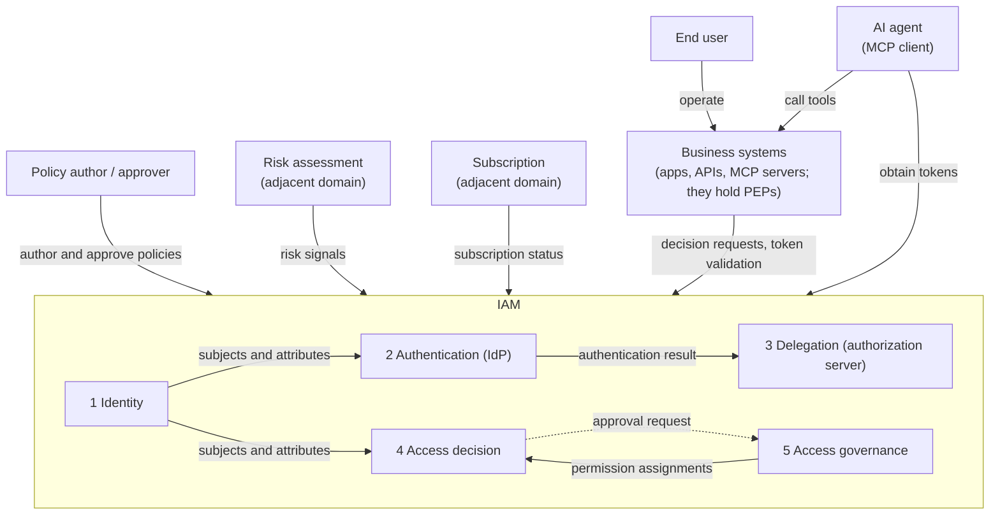
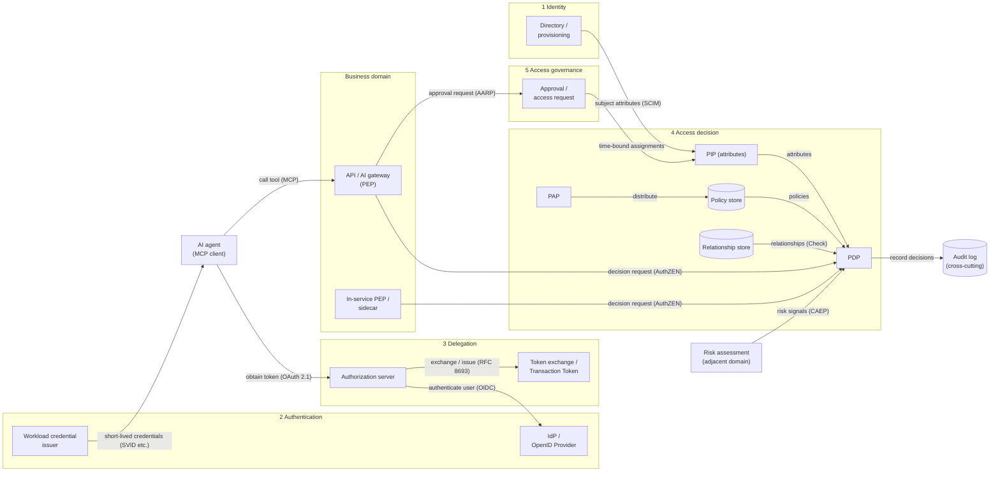
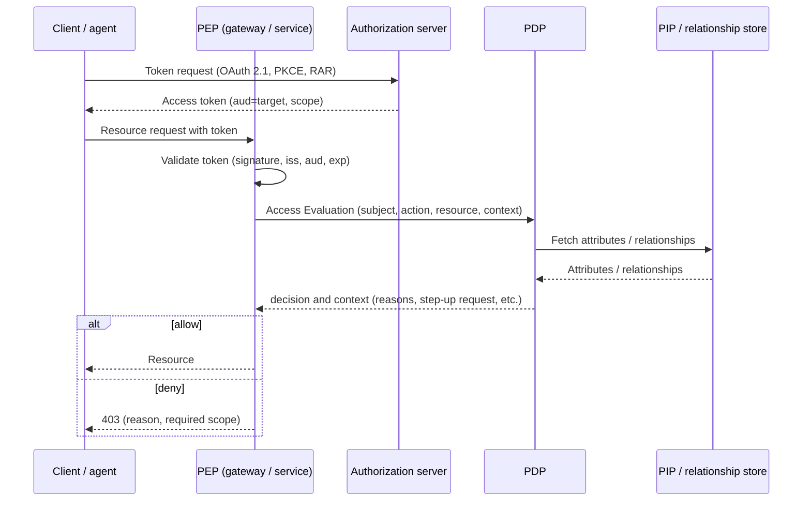
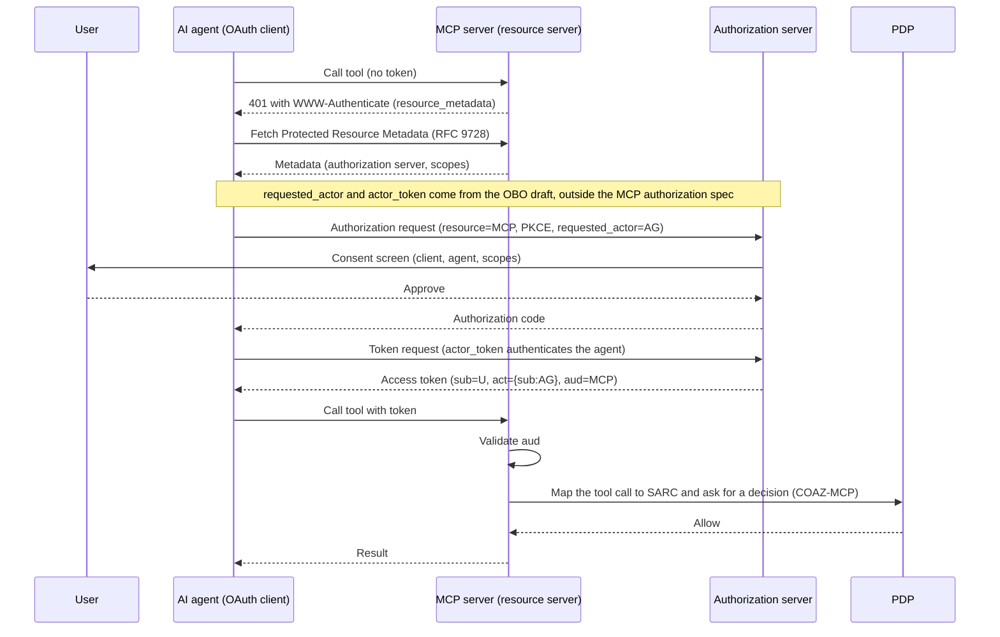
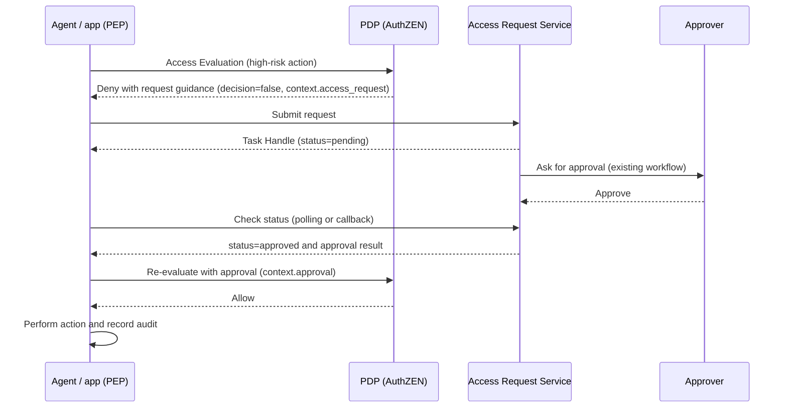
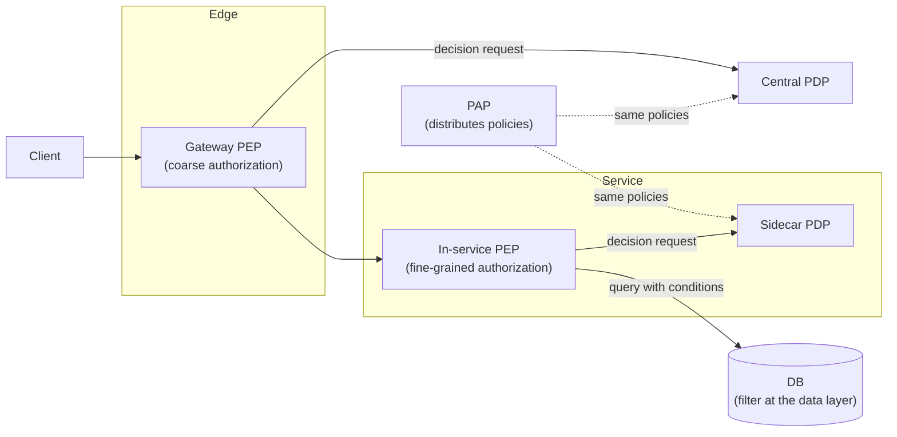

# Overview

Once you decide to build an authorization platform, the next question is "which parts go where, and how do they connect?" This post answers that question from two angles: diagrams and design decisions.

What you will learn:

- How to cut the system context and containers of an authorization platform along IAM subdomains
- Which standards (OAuth, OIDC, SCIM, AuthZEN, and others) each container maps to
- Three representative flows: request-time decisions, AI agent delegation with MCP, and an approval flow for "not allowed yet"
- Where to place PEPs and PDPs, how to split coarse and fine-grained authorization, and what to carry in tokens
- Non-functional decisions: latency, caching, availability and fail-closed, consistency, and audit

The diagrams follow two levels of the C4 model: Context (the system and the outside world) and Container (deployable building blocks). See [the C4 model](https://c4model.com/) for the approach. For general advice on documenting architecture, see [Things to Consider When Writing Architecture Documents](/posts/writing-architecture-documentation/).

The architecture here works as a reference: it lists every element an organization might need. You do not need to build everything on day one. How far to go, and whether to move decisions out of applications at all, belongs to [How Far Should You Build an Authorization Platform?](/posts/authorization-platform-scope-stages/).

# Premise: Align Boundaries with IAM Subdomains

The architecture draws its boundaries along IAM subdomains, which split IAM by business problem. [What Is Authorization?](/posts/authorization-domain-iam-subdomains/) explains the split in detail. The table below gives only the essentials.

| # | Subdomain | Responsibility |
|---|---|---|
| 1 | Identity | Holds subject identifiers and attributes and manages them from creation to deletion |
| 2 | Authentication | Confirms that a subject is who it claims to be |
| 3 | Delegation | Lets a subject hand part of its authority to another subject and manages the scope and lifetime |
| 4 | Access decision | Decides, by policy, whether a subject may perform an action on a resource |
| 5 | Access governance | Decides who holds which permissions and keeps those assignments valid over time |

Outside IAM sit adjacent domains such as risk assessment (is this behavior suspicious?) and subscription (which features does this tenant pay for?). They feed inputs into decisions.

This split yields two rules for the architecture.

1. **The PEP lives on the business side.** Decisions (the PDP) can live in subdomain 4, but enforcement (the PEP) belongs to the business system that receives the request.
2. **The business domain owns the meaning of permissions.** The business domain defines what "may this user approve this invoice?" means: which resources and actions exist and which business rules apply. IAM owns the machinery for deciding and enforcing.

The PEP (Policy Enforcement Point) enforces, and the PDP (Policy Decision Point) decides. The PIP (Policy Information Point) supplies attributes, and the PAP (Policy Administration Point) manages policies. [Authorization Architecture, Models, and Engines](/posts/authorization-architecture-models-engines/) covers this reference architecture.

# System Context: Who Does the Platform Talk To?

First, look at which actors and external systems each IAM subdomain deals with. Arrow labels show what flows along each edge.

Three points stand out in this diagram.

- **Business systems hold PEPs and externalize decisions to subdomain 4.** From IAM's point of view, apps, APIs, and MCP servers all ask for a decision and enforce the result.
- **Three kinds of subjects enter the system.** Humans, workloads (services), and AI agents. The context diagram shows humans and AI agents; the container diagram covers workloads.
- **Inputs also come from outside IAM.** Subdomains 2 and 4 receive most risk signals, and subdomain 4 receives subscription status.

# Containers: Split Each Subdomain into Deployable Units

Next, split each subdomain into deployable containers. Arrow labels show what each edge carries and which standard it uses.

## Containers and Standards

The table lists the role of each container and the standards or implementations that map to it. Status reflects October 2026; IETF drafts and OpenID Drafts can still change.

| Container | Subdomain | Role | Standards and implementations |
|---|---|---|---|
| Directory / provisioning | 1 Identity | Manage and distribute subjects and attributes | SCIM (RFC 7643 / RFC 7644) |
| IdP / OpenID Provider | 2 Authentication | Authenticate users | OpenID Connect |
| Workload credential issuer | 2 Authentication | Issue and rotate short-lived credentials | SPIFFE / SPIRE, WIMSE (in progress) |
| Authorization server | 3 Delegation | Issue tokens | OAuth 2.1 (IETF draft), PKCE, PAR (RFC 9126), RAR (RFC 9396), metadata (RFC 8414) |
| Token exchange / Transaction Token | 3 Delegation | Delegation chains, downscoping | Token Exchange (RFC 8693), Transaction Tokens (IETF draft), Identity Chaining (in the RFC Editor queue) |
| PDP | 4 Access decision | Evaluate policies | AuthZEN Authorization API 1.0 (Final), OPA / Rego, Cedar |
| PAP / policy store | 4 Access decision | Author, distribute, and version policies | Policy as code (Rego, Cedar, and others) |
| PIP (attributes) | 4 Access decision | Supply attributes for decisions | Directory, SCIM integration |
| Relationship store | 4 Access decision | Ownership, sharing, and inheritance | Zanzibar-style systems (OpenFGA, SpiceDB) |
| Approval / access request | 5 Access governance | Approval after a denial, time-bound assignments | AuthZEN AARP (Draft), CIBA |
| API / AI gateway (PEP) | Business domain | Coarse authorization at the entry, token validation | Bearer tokens (RFC 6750), Protected Resource Metadata (RFC 9728), COAZ-MCP (Draft) |
| In-service PEP / sidecar | Business domain | Enforce fine-grained authorization | AuthZEN (PEP side), OPA sidecar |
| Risk assessment | Adjacent domain | Send risk signals | OpenID SSF, CAEP, RISC |
| Audit log | Cross-cutting | Record decisions and operations | Structured audit logs |

Other posts in this series cover each row in depth.

- [Authorization Architecture, Models, and Engines](/posts/authorization-architecture-models-engines/) covers PDPs, relationship stores, and how to choose an engine.
- [What Is the AuthZEN Authorization API?](/posts/authzen-authorization-api/) covers the API between PEPs and PDPs.
- [A Map of OAuth and Related Standards for Authorization Platforms](/posts/oauth-standards-map-authorization-platform/) covers authorization servers, tokens, SCIM, and SSF / CAEP.
- [Standardizing Workload Identity](/posts/workload-identity-wimse-transaction-tokens/) covers workload credentials and Transaction Tokens. [What is the Big Picture of Service-to-Service Authentication?](/posts/service-to-service-authentication/) covers authentication between services.
- [Authorization for AI Agents](/posts/authorization-for-ai-agents/) covers approvals for agents and MCP.

The key point of the container diagram: **inputs reach the PDP from many directions.** Policies come from the PAP, attributes from the PIP, relationships from the relationship store, and risk signals from adjacent domains. Keep the PDP itself stateless and keep state on the input side. [Implementation of Access Control System for Microservices Using OPA](/posts/microservices-access-control-opa/) shows how PEP, PDP, and PIP split their work in an OPA-based implementation.

# Key Sequences

Three representative flows show how the containers interact.

## Request-Time Decisions

This is the basic form of externalized authorization. The client gets a token, and the PEP validates it before asking the PDP for a decision.

Note how the flow splits the roles.

- **Token validation is the PEP's job.** Until the PEP checks the signature, issuer (iss), audience (aud), and expiry (exp), asking the PDP has no value.
- **Deciding is the PDP's job.** The PEP passes "who, what action, which resource, in what context" as AuthZEN's Subject, Action, Resource, and Context.
- **A decision is more than true or false.** An AuthZEN 1.0 decision carries a context that can return reasons for a denial or a step-up authentication request (such as acr_values).

## AI Agent Delegation with MCP

Here an AI agent uses a tool on an MCP server. Under the MCP authorization specification, the MCP server acts as an OAuth resource server, and the agent (the MCP client) acts as an OAuth client.

This flow stacks three layers.

1. **The scope of the MCP authorization specification.** The flow starts with a 401 and WWW-Authenticate, finds the authorization server through RFC 9728 metadata, and names the target with the RFC 8707 resource parameter when requesting a token. The MCP server MUST confirm that the token names it as the intended audience.
2. **An extension that records whose authority the agent uses.** `requested_actor` and `actor_token` in the diagram come from "On-Behalf-Of User Authorization for AI Agents," an individual draft submitted to the IETF. That draft has expired as of October 2026. The draft defines the client (the application) and the actor (the agent) as separate roles; the diagram merges them into one. Recording the user and the agent separately through the `act` claim follows the same idea as `act` in Token Exchange (RFC 8693).
3. **Externalized fine-grained authorization.** COAZ-MCP (an AuthZEN Draft) defines how to map MCP messages to AuthZEN's SARC and ask a PDP. It lets the PDP answer what scopes cannot express: "may this user call this tool with these arguments?"

[Key Points for Designing MCP Authorization](/posts/mcp-authorization-design/) goes deeper into MCP authorization design, including the risk of "token passthrough," where a server forwards the received token downstream as is.

## Approval Flow for "Not Allowed Yet" (AARP)

When you grant permissions ahead of time through roles or scopes, a denial at runtime ends the story. The AuthZEN Access Request and Approval Profile (AARP, Draft) connects a denial to approval and re-evaluation. AARP is the abbreviation from the OpenID Foundation announcement; the draft's header uses ARAP.

The architectural point: **approval alone does not grant access; the PDP makes a fresh decision at the end.** AARP rests on invariants such as "a requestable denial is still a denial" and "approval alone does not grant access." It keeps the approval machinery (subdomain 5) separate from the decision machinery (subdomain 4) and still turns denial-to-allow into one flow. Approval screens and workflow engines fall outside AARP, so you can put an existing approval system behind it.

# Design Decisions

The rest of this post covers how to choose each part of the diagrams.

## Whether to Externalize Decisions

[How Far Should You Build an Authorization Platform?](/posts/authorization-platform-scope-stages/) covers whether to pull decision logic out of applications into a PDP. The decisions below assume you have chosen to externalize.

## PEP and PDP Placement

Two independent axes decide placement: where the PEP (enforcement) sits on the request path, and where the PDP (decision) runs relative to the PEP.

| Axis | Option | Good fit |
|---|---|---|
| Where the PEP sits | Edge / gateway | Reject requests early at the entry, typically with coarse authorization by scope or role |
| | Service mesh proxy | Enforce on service-to-service traffic without changing service code |
| | Inside the service (middleware, code) | Fine-grained authorization that uses business context |
| | Data layer (row-level security, SQL conditions from partial evaluation) | Narrow "which items may I see" inside the database |
| Where the PDP runs | In-process library (OPA, Cedar, Cerbos SDKs, etc.) | Lowest latency |
| | Sidecar | Language-independent, low latency |
| | Central service (including managed services) | Consistent decisions, centralized audit, shared by many PEPs |

You combine the two axes. For example, "a gateway PEP calls a central PDP" or "an in-service PEP calls a sidecar PDP."

Guidelines for choosing:

- **Two tiers are the default.** Do coarse authorization at the edge and fine-grained authorization inside the service or at the data layer. Reject clearly invalid requests early, and leave per-resource decisions to the side that has the context.
- **Central management and execution location are separate concerns.** Even if the PDP runs as a library or sidecar, distributing policies from a central PAP keeps management in one place.
- **Keep the API independent of placement.** The AuthZEN API works with a PDP in any placement. A standard interface between PEP and PDP makes later placement changes easier.
- **Design list retrieval separately.** Repeating "may I read this resource?" for every item in a list breaks counts and page boundaries and raises load. [Considerations and Solutions for Pagination Impact in OPA](/posts/pagination-impact-solutions-opa/) examines this problem and its solutions with OPA. [Access Control Patterns Using OPA](/posts/access-control-patterns-using-opa/) compares returning database conditions through partial evaluation with returning structured conditions. The AuthZEN 1.0 Resource Search API (with pagination) also answers "which resources may this subject see?"

## Coarse vs Fine-Grained Authorization, and the Role of Tokens

Authorization has two layers with different granularity.

| Layer | Unit of decision | Main location | Information used |
|---|---|---|---|
| Coarse-grained | Scope, role | Gateway, resource server entry | scope or roles in the access token |
| Fine-grained | This action on this resource | Inside the service, data layer | PDP, PIP, relationship store (ReBAC / ABAC) |

Splitting the two layers clarifies what tokens do.

- **Tokens carry coarse authorization.** They suit statements that cross boundaries, such as "this client may read this API."
- **Do not stuff fine-grained authorization into tokens.** Listing per-resource permissions in claims bloats the token, and a revoked permission survives until the token expires. Leave fine-grained decisions to the PDP and PIP.
- **Narrow tokens when you pass them inward.** Do not reuse an access token between services; swap it for a token with a narrower audience and authority through Token Exchange or Transaction Tokens (downscoping). [Standardizing Workload Identity](/posts/workload-identity-wimse-transaction-tokens/) covers this in detail.

RAR (RFC 9396) lets a token request carry structured authority, such as "from this account, up to this amount." Even so, per-resource decisions that change with every request stay easier to revoke and audit when the PDP handles them.

## Non-Functional Decisions

Externalizing decisions puts a decision round trip on the request path. That is why non-functional decisions make or break the architecture.

### Latency and Caching

If decisions sit on the synchronous path, decide how to keep the round trip short.

- **Run the PDP close by.** An in-process library or a sidecar removes network hops.
- **Batch your questions.** The AuthZEN Access Evaluations API sends many decisions in one request (boxcarring). You choose the evaluation semantics: `execute_all`, `deny_on_first_deny`, or `permit_on_first_permit`.
- **Cache decisions.** A short-TTL cache keyed on Subject, Action, Resource, and Context helps, but it delays revocation. Set the TTL by how late a revocation may take effect.
- **Filter lists up front.** As the previous section explains, use partial evaluation or the Search API to compute lists in one pass.

### Availability and Fail-Closed

Decide whether to let requests through (fail-open) or stop them (fail-closed) when the PDP is down or slow.

- **Fail closed by default.** If you cannot decide, deny. AARP follows the same idea: when the mechanism is unavailable, the denial stands.
- **Shrink the blast radius by design.** Redundant PDPs, sidecar placement, and local copies of policies and attributes all reduce how often fail-closed kicks in.
- **Set timeouts.** Put an upper bound on how long to wait for the PDP, and treat a timeout as a denial.
- **Make degradation explicit.** If you allow degraded operation as an exception (for example, reads only), write which actions pass under which conditions as policy, and record it in the audit log.

### Consistency

Decide when updates to relationships and attributes reach decisions.

- Relationship stores for ReBAC propagate updates with some delay. Zanzibar handles the risk of deciding on stale state right after a permission removal (the "new enemy" problem) with a consistency token called a zookie. SpiceDB's ZedToken follows the same idea.
- How fast a revocation takes effect depends on the combination of cache TTL, token lifetime, and relationship store consistency settings. Shortening only one of them does not help if the others stay long.

### Audit

Make every decision reconstructible after the fact.

- **Record denials too.** Keep not only allows but also denials with reasons, the policy version, and the main inputs. OPA provides decision logs for this.
- **Record execution at the PEP.** PDP decision logs alone do not tell you whether the operation actually ran. Record the outcome at the PEP and give it an identifier that links it to the decision.
- **Keep secrets out.** Never log tokens or credentials themselves.

### Least Privilege and Credential Protection

- **Narrow at every boundary.** Apply the downscoping from the previous section each time a request crosses a boundary.
- **Use short-lived credentials.** Rotate workload credentials automatically, as SPIFFE / SPIRE does.
- **Make stolen tokens useless.** On paths that need high assurance, bind tokens to the sender (DPoP in RFC 9449, mTLS in RFC 8705).

### Testing and Continuous Evaluation

- **Test policies as code.** Treat policies as code and run unit and regression tests. OPA provides `opa test`. Build a way to check, before production, "whose decisions change with this policy change?"
- **Revisit tokens after issuance.** OpenID CAEP defines event types such as session revocation and risk level changes, and SSF defines how to send and receive them. Use them to cut off issued tokens and sessions midway.

## Other Decisions

The table below covers the remaining choices.

| Decision | Options | Guideline |
|---|---|---|
| Token validation | Self-contained JWT (RFC 9068), introspection (RFC 7662) | JWT for low latency, introspection for immediate revocation; you can combine both |
| Token theft protection | Bearer, DPoP, mTLS binding | Bind tokens to the sender when you need high assurance |
| Adopt ReBAC? | Are relationships central to decisions? | Adopt it when ownership, sharing, and inheritance drive access |
| Agent support | Recording delegation (act), COAZ-MCP, AARP | Close to mandatory for platforms that serve AI agents, though COAZ-MCP and AARP remain Drafts |
| Decision API | Product-specific API, AuthZEN | Standardize on one API when many languages and teams write PEPs |

# Summary

- Aligning boundaries with IAM subdomains (identity, authentication, delegation, access decision, access governance) keeps an authorization platform architecture easy to reason about.
- Put PEPs on the business side and externalize decisions to a PDP. Connecting them through a standard API such as AuthZEN makes placement easy to change.
- The three representative flows are request-time decisions, AI agent delegation with MCP, and denial-to-approval-to-re-evaluation. In each, the PDP makes the final decision.
- Let tokens carry coarse authorization and leave fine-grained authorization to the PDP and PIP. Downscope tokens inside your system.
- On the non-functional side, design latency and caching, fail-closed and availability, consistency, and audit together. Revocation speed depends on several settings at once.

# Related Posts

- [What is Authorization? Mapping AuthN, AuthZ, and IAM Subdomains](/posts/authorization-domain-iam-subdomains/)
- [How Much Authorization Platform Do You Need? Scope, Ownership, Stages, and Externalized Decisions](/posts/authorization-platform-scope-stages/)
- [What Are Authorization Architectures and Models? PEP/PDP, RBAC/ABAC/ReBAC, and Choosing a Policy Engine](/posts/authorization-architecture-models-engines/)
- [What is the AuthZEN Authorization API? A Standard Between PEP and PDP](/posts/authzen-authorization-api/)
- [Which OAuth Standards Does an Authorization Platform Need? A Map of Delegation, Tokens, and Continuous Evaluation](/posts/oauth-standards-map-authorization-platform/)
- [What is Workload Identity? WIMSE, Transaction Tokens, and SPIFFE Client Authentication for Service Identity and Context](/posts/workload-identity-wimse-transaction-tokens/)
- [What is Authorization for AI Agents? Delegation Chains, Human Approval, and Audit with MCP, AuthZEN, AIMS, and A2A/AP2](/posts/authorization-for-ai-agents/)
- [How Should You Design Authorization for MCP? Common Incidents and Decisions That Are Hard to Reverse](/posts/mcp-authorization-design/)
- [Implementation of Access Control System for Microservices Using OPA](/posts/microservices-access-control-opa/)
- [Access Control Patterns Using OPA](/posts/access-control-patterns-using-opa/)
- [Considerations and Solutions for Pagination Impact in OPA](/posts/pagination-impact-solutions-opa/)
- [What is the Big Picture of Service-to-Service Authentication? mTLS, Token Exchange, SPIFFE, and Zero Trust](/posts/service-to-service-authentication/)
- [Things to Consider When Writing Architecture Documents](/posts/writing-architecture-documentation/)

# References

- [The C4 model for visualising software architecture](https://c4model.com/)
- [Authorization API 1.0 (OpenID AuthZEN)](https://openid.net/specs/authorization-api-1_0.html)
- [AuthZEN Access Request and Approval Profile (Draft)](https://openid.github.io/authzen/authzen-access-request-approval-profile-1_0.html)
- [COAZ-MCP: COAZ Binding for the Model Context Protocol (Draft)](https://openid.github.io/authzen/authzen-coaz-mcp-binding-1_0.html)
- [Model Context Protocol: Authorization (2026-07-28)](https://modelcontextprotocol.io/specification/2026-07-28/basic/authorization)
- [Model Context Protocol: Security Best Practices (2026-07-28)](https://modelcontextprotocol.io/specification/2026-07-28/basic/security_best_practices)
- [The OAuth 2.1 Authorization Framework (Internet-Draft)](https://datatracker.ietf.org/doc/draft-ietf-oauth-v2-1/)
- [RFC 8693: OAuth 2.0 Token Exchange](https://www.rfc-editor.org/rfc/rfc8693)
- [Transaction Tokens (Internet-Draft)](https://datatracker.ietf.org/doc/draft-ietf-oauth-transaction-tokens/)
- [OAuth Identity and Authorization Chaining Across Domains (Internet-Draft)](https://datatracker.ietf.org/doc/draft-ietf-oauth-identity-chaining/)
- [OAuth 2.0 Extension: On-Behalf-Of User Authorization for AI Agents (Internet-Draft)](https://datatracker.ietf.org/doc/draft-oauth-ai-agents-on-behalf-of-user/)
- [RFC 9728: OAuth 2.0 Protected Resource Metadata](https://www.rfc-editor.org/rfc/rfc9728)
- [RFC 8707: Resource Indicators for OAuth 2.0](https://www.rfc-editor.org/rfc/rfc8707)
- [RFC 9396: OAuth 2.0 Rich Authorization Requests](https://www.rfc-editor.org/rfc/rfc9396)
- [RFC 9068: JSON Web Token (JWT) Profile for OAuth 2.0 Access Tokens](https://www.rfc-editor.org/rfc/rfc9068)
- [RFC 7662: OAuth 2.0 Token Introspection](https://www.rfc-editor.org/rfc/rfc7662)
- [RFC 9449: OAuth 2.0 Demonstrating Proof of Possession (DPoP)](https://www.rfc-editor.org/rfc/rfc9449)
- [RFC 8705: OAuth 2.0 Mutual-TLS Client Authentication and Certificate-Bound Access Tokens](https://www.rfc-editor.org/rfc/rfc8705)
- [RFC 7644: System for Cross-domain Identity Management: Protocol](https://www.rfc-editor.org/rfc/rfc7644)
- [OpenID Continuous Access Evaluation Profile 1.0](https://openid.net/specs/openid-caep-1_0.html)
- [OpenID Shared Signals Framework Specification 1.0](https://openid.net/specs/openid-sharedsignals-framework-1_0.html)
- [Zanzibar: Google's Consistent, Global Authorization System (USENIX ATC 2019)](https://www.usenix.org/conference/atc19/presentation/pang)
- [Open Policy Agent: Decision Logs](https://www.openpolicyagent.org/docs/management-decision-logs)
- [Open Policy Agent: Policy Testing](https://www.openpolicyagent.org/docs/policy-testing)
- [SPIFFE](https://spiffe.io/)
