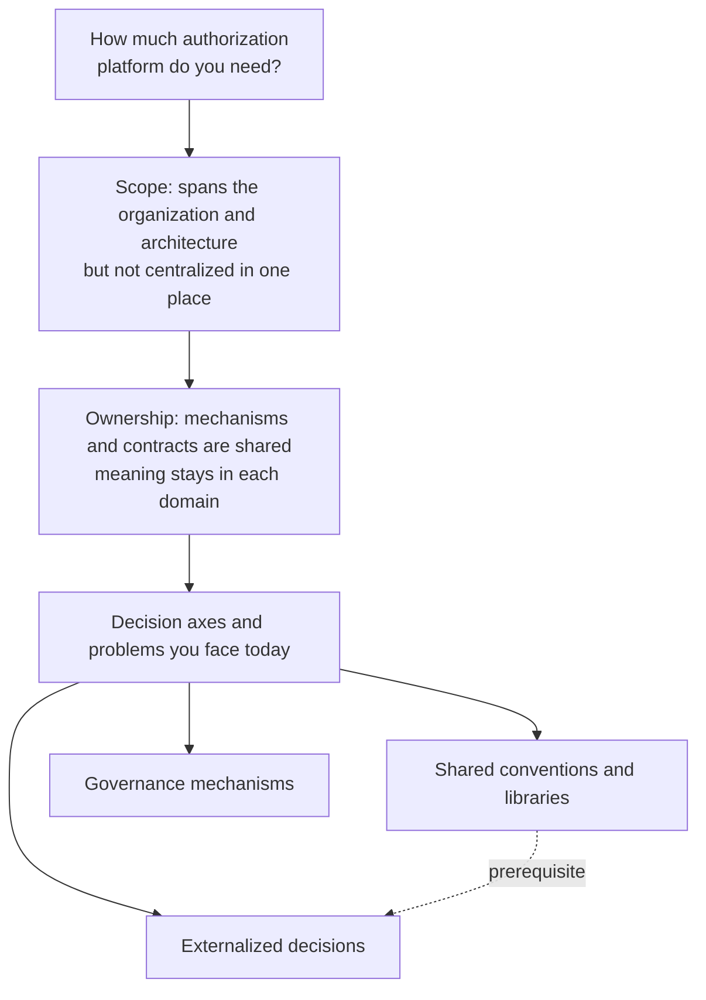
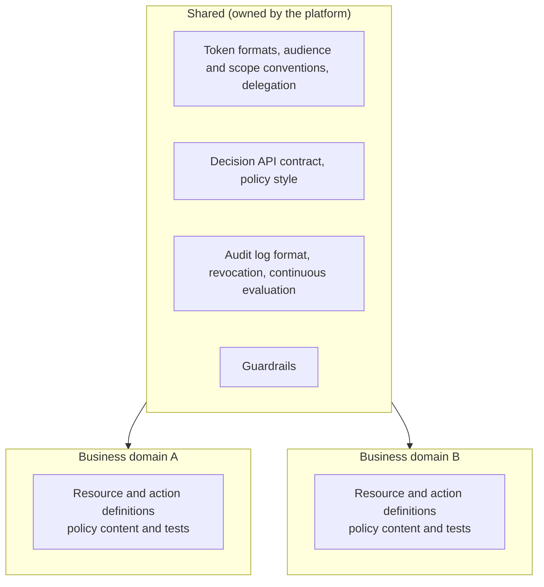

# Overview

This article lays out the material you need to decide how much authorization platform your organization needs. You will learn:

- Why an authorization platform spans the whole organization and architecture, and why you still should not gather it in one place
- How to split what you standardize across the organization and what each business domain owns
- The decision axes and the problems you face today that tell you how much you need
- Three options (shared conventions, externalized decisions, and governance mechanisms), and the signs that you should not build a platform

[What is Authorization? Mapping AuthN, AuthZ, and IAM Subdomains](/posts/authorization-domain-iam-subdomains/) covers what authorization is, how it differs from authentication, and the IAM subdomains. This article builds on that and focuses on how much an organization should build.

The split into options and the decision axes in this article reflect my own framing. No standard set of criteria exists for this decision.

Here is the big picture first.

# An Authorization Platform Spans the Whole Organization and Architecture

Authorization does not stay inside one team or one service. This section looks at why from two sides: architecture and organization.

## Architecture: every component shares the same concern

Authorization happens on every request to a protected resource. You can verify authentication once at the entry point and carry the result in a token. Authorization, by contrast, asks for each resource, "may this subject perform this action on this resource?" That means you need enforcement points (PEPs, Policy Enforcement Points) everywhere protected resources live: gateways, every service, and the data layer.

Delegation also chains across services. Permissions travel from a user to an agent, to an MCP server, to a business API. If token audience design, scope structure, how services get new tokens, and how you record the user and the agent are not consistent, one loose implementation anywhere becomes a hole in the whole system. One example: a service that forwards the token it received straight to the next service.

Authorization is also hard to change later, and when it stops, everything stops. When each application makes its own decisions, authorization logic gets embedded in code everywhere. So when you change the permission model, you have to touch every service. Conversely, once you externalize decisions, an outage of the decision service can stop every feature. The usual rule is to deny (fail-closed) rather than allow (fail-open) when you cannot reach a decision, so the decision service's availability drives the availability of the whole system. Either way, the blast radius covers the entire architecture.

Because every component shares this concern, aligning where you enforce and how you handle tokens across the system pays off. That does not mean gathering everything in one place. A later section covers what to align centrally and what to leave to each domain. [Standardizing Workload Identity](/posts/workload-identity-wimse-transaction-tokens/) covers context propagation between services, and [What Changes in Authorization with AI Agents](/posts/authorization-for-ai-agents/) covers agent delegation.

## Organization: no single team can decide it

The owners of authorization decisions sit in many parts of the organization.

First, the "meaning" of a permission lives in each business domain. Only the team that runs a business process knows what "may approve this invoice" means. An authorization platform can provide the decision mechanism, but what to allow requires alignment with every business domain. [The Abstraction Trap in Architecture Design](/posts/abstraction-trap-in-architecture/) also touched on how authorization is a bundle of domain rules.

Second, the information a decision needs comes from across the organization.

| Information | Main source |
|---|---|
| Subject attributes (department, title, employment type) | HR systems, directories |
| Permission assignments | Approvers and administrators (access governance) |
| Risk signals | Security team, detection systems |
| Contract state (plan, contract period) | Contract management |
| Resource attributes (owner, visibility, state) | Each business domain |

Authorization becomes the point where these sources meet. A single team cannot decide who holds which information and how fresh it must be when it reaches a decision.

Third, governance is the organization's own process. Who may grant permissions, separation of duties, periodic access reviews, and revoking permissions when someone leaves all tie directly to the organizational structure and internal controls. Technology alone does not determine whether you can reliably remove a departed employee's permissions from every system. Cross-organizational processes determine it.

In short, you can build an authorization platform as a technical component, but that alone is not enough. What to allow, which information reaches decisions at what freshness, and who governs access all need a division of roles and agreement across several departments. An authorization platform crosses not only technical boundaries but also departmental ones.

# Do Not Centralize It: What to Standardize and What Domains Own

The reasons above make it tempting to say "manage all authorization centrally." But that collides with the fact that the meaning of permissions lives in each domain. If a central platform team takes on the meaning of every business's permissions, the platform team tends to become a bottleneck, and its business knowledge tends to go stale.

So **standardize the mechanisms and contracts across the organization, and keep the meaning in each domain**.

| Standardized across the organization (owned by the platform) | Owned by each business domain |
|---|---|
| Token formats, conventions for audiences and scopes, how to carry delegation | Definitions of resources and actions, business rules |
| The decision API contract (such as AuthZEN) and how to write policies | The content of the domain's own policies |
| Audit log format, revocation mechanisms, delivery of continuous evaluation | Testing and changing policies |
| Guardrails (constraints no domain may break) | Decisions within the guardrails |

Guardrails are constraints every domain follows regardless of business meaning. Examples: "never allow access across tenants," "deny when you cannot reach a decision," and "always write privileged operations to the audit log."

You can centralize authentication in an IdP almost entirely, but you cannot do the same with authorization. The organization can give one answer to "who is this?", but the answer to "what may they do?" differs by business. Because of this difference, an authorization platform spans the whole organization while the whole organization shares ownership of it.

[Viability Conditions for Building a Platform](/posts/platform-viability-conditions/) covers the general conditions for building a shared platform (being a supporting or generic subdomain, reuse by many teams, sustained ownership, and so on). An authorization platform can follow the same conditions, but if you put the meaning of permissions into the platform, the platform ends up holding core-domain knowledge. The line in the table above also keeps the platform on the supporting and generic side.

# Deciding How Much You Need

An authorization platform is not a yes-or-no choice. If you do nothing, each application decides in its own code. This article covers three options you can add on top of that.

| Option | What it includes |
|---|---|
| Shared conventions and libraries | Standardize token formats, audiences and scope structure, audit log format, and revocation mechanisms across the organization. Decisions stay in each application |
| Externalized decisions | Share a decision engine (PDP, Policy Decision Point) and manage policies as code. Each domain owns the content of its policies |
| Governance mechanisms | Add access requests and approvals, access reviews, continuous evaluation, and management of delegation chains |

The three do not form steps you climb in order. You pick the ones you need. Externalized decisions do depend on shared conventions, though. A PDP relies on the token and audit log formats you standardized. If you introduce a PDP without shared conventions, each PEP still represents subjects and writes logs in its own way, and you lose much of the consistency and auditability that motivated externalization.

Cohesion and coupling offer a useful way to see externalized decisions. You take the permission rules scattered across applications and gather them into one place as policy, which raises cohesion. Applications then depend only on the decision API contract, which lowers the coupling between applications and rules. As a result, a rule change stays within the policy, separate from application releases. In return, if you call the PDP over the network, you take on the latency of a decision round trip and a dependency on the PDP's availability.

[Authorization Architecture, Models, and Engines](/posts/authorization-architecture-models-engines/) covers the roles of the PEP and PDP and how to choose a model, and [What is the AuthZEN Authorization API?](/posts/authzen-authorization-api/) covers the standard between the PEP and PDP.

## Decision axes

| Axis | Direction that calls for a platform | Direction that works without one |
|---|---|---|
| Scale and cross-cutting reach | Many applications and services need authorization, and you want the same rules to apply across several of them | Few applications, and each application's rules stay self-contained |
| Complexity of the permission model | Conditional permissions (time, amount, risk), sharing, hierarchy, and inheritance relationships, customer-defined roles, delegation | A few fixed roles suffice |
| Change frequency and who changes it | Policies change often, and people other than developers (business admins, customers) want to change them | Changes are rare, and only developers make them |
| Governance and regulatory requirements | You need audit trails, separation of duties, periodic access reviews, and explanations of "why we allowed this" | Light audit requirements |
| Diversity of subjects | Besides people, you have workloads, external partners, and AI agents, and delegation chains | Subjects are almost all people |
| Consistency requirements | You want the same person's permissions aligned across several products, and you want to reflect departures and permission changes in every system right away | One product, and propagation delays do not matter |
| Organizational capability and cost | A team can operate the platform and keep the decision service highly available (or buy one) | Nobody can operate it, and you cannot accept the latency of a decision round trip or the risk of lower availability |

The last axis, organizational capability and cost, differs in nature from the others. The other axes show need; this one shows feasibility. If the need is strong but capability falls short, consider options such as adopting fewer options or using a managed service.

[Authorization Architecture, Models, and Engines](/posts/authorization-architecture-models-engines/) covers how to choose a permission model (RBAC, ABAC, ReBAC, and others). [Exploring Permission Management Design](/posts/permission-management-design/) summarizes permission design within an application (functional scope and data scope, among others).

## Problems you face today

You consider the axes including future requirements, but the problems you face today also tell you something. If the following problems occur, the time has come to add an option.

- Authorization code gets copied into each application, and behavior differs between applications
- Authorization defects (such as seeing someone else's data) keep recurring
- Adding a role or changing a permission requires development and a release every time
- You cannot answer "who can see this resource?" and someone investigates by hand at every audit
- Permission requests run on tickets and spreadsheets

A rough guide to which axis and option each problem relates to:

| Problem | Related axis | Option most likely to help |
|---|---|---|
| Authorization code copied, behavior differs | Scale and cross-cutting reach | Shared conventions and libraries |
| Authorization defects keep recurring | Scale and cross-cutting reach, complexity of the permission model | Shared conventions and libraries, externalized decisions |
| Permission changes need development and a release | Change frequency and who changes it | Externalized decisions |
| You cannot answer who can see a resource | Governance and regulatory requirements | Externalized decisions, governance mechanisms |
| Requests run on tickets and spreadsheets | Governance and regulatory requirements | Governance mechanisms |

You do not need to move every domain at once when you add an option. Start with the domains where the problems are worst, and firm up the shared contracts as you go. In my view, that keeps the platform close to real requirements.

[Case Study on Authorization Management Infrastructure](/posts/permission-management-case-study/) covers freee's example (from articles and presentation slides published in 2023 and 2024) of a dedicated team that builds and runs a permission management platform.

## Align shared conventions early

In my view, once you have several applications or teams, you should align shared conventions early. How you handle tokens and audit logs forms a shared contract between teams. If you do not align on them as conventions, even without a platform team, unifying them later tends to become costly.

OAuth and related standards can express much of what the shared conventions standardize (token formats, audiences and scopes, revocation). [A Map of OAuth and Related Standards for an Authorization Platform](/posts/oauth-standards-map-authorization-platform/) organizes which standard decides what.

# Signs You Should Not Build One

Some situations call for not adding externalized decisions or governance mechanisms.

- You have one product, with few and stable roles
- The latency of moving decisions out, or the risk that a decision service outage stops everything, outweighs the benefits
- Even if you build a platform, teams have no incentive to use it (they keep deciding inside their applications)

Building a platform too early tends to add availability risk and operational burden before it delivers any benefit. The third sign also means you fail the condition that "several teams or several products will reuse it" from [Viability Conditions for Building a Platform](/posts/platform-viability-conditions/).

Not building a platform does not mean doing nothing, though. As the previous section explains, aligning shared conventions early pays off once you have several applications or teams. The decision not to build applies mainly to externalized decisions and governance mechanisms.

# Summary

- Authorization happens wherever protected resources live, its meaning lives in each business domain, and its inputs come from across the organization. So an authorization platform spans the whole organization and architecture
- Even so, do not gather it in one place. Standardize mechanisms and contracts (tokens, the decision API contract, audit logs, revocation, guardrails) across the organization, and keep meaning (resources and actions, policy content) in each domain
- An authorization platform is not a yes-or-no choice. On top of per-application implementation, add the options you need: shared conventions and libraries, externalized decisions, and governance mechanisms. Externalized decisions depend on shared conventions
- The seven decision axes are scale and cross-cutting reach, permission model complexity, change frequency, governance, diversity of subjects, consistency, and organizational capability. The problems you face today also tell you where you stand
- In my view, you should align shared conventions early once you have several applications or teams. Signs that you should not build externalized decisions or governance mechanisms include one product with few and stable roles, latency and availability risks that outweigh the benefits, and teams with no incentive to use the platform

# Related Posts

- [What is Authorization? Mapping AuthN, AuthZ, and IAM Subdomains](/posts/authorization-domain-iam-subdomains/)
- [What Are Authorization Architectures and Models? PEP/PDP, RBAC/ABAC/ReBAC, and Choosing a Policy Engine](/posts/authorization-architecture-models-engines/)
- [What is the AuthZEN Authorization API? A Standard Between PEP and PDP](/posts/authzen-authorization-api/)
- [Which OAuth Standards Does an Authorization Platform Need? A Map of Delegation, Tokens, and Continuous Evaluation](/posts/oauth-standards-map-authorization-platform/)
- [What is Workload Identity? WIMSE, Transaction Tokens, and SPIFFE Client Authentication for Service Identity and Context](/posts/workload-identity-wimse-transaction-tokens/)
- [What is Authorization for AI Agents? Delegation Chains, Human Approval, and Audit with MCP, AuthZEN, AIMS, and A2A/AP2](/posts/authorization-for-ai-agents/)
- [Why Is MCP Authorization Hard? Risks and Key Decisions When AI Agents Operate Internal Systems](/posts/mcp-authorization-design/)
- [Exploring Permission Management Design](/posts/permission-management-design/)
- [Case Study on Authorization Management Infrastructure](/posts/permission-management-case-study/)
- [Viability Conditions for Building a Platform](/posts/platform-viability-conditions/)
- [The Abstraction Trap in Architecture Design](/posts/abstraction-trap-in-architecture/)
- [Implementation of Access Control System for Microservices Using OPA](/posts/microservices-access-control-opa/)

# References

- [OpenID Foundation - Authorization API 1.0](https://openid.net/specs/authorization-api-1_0.html)
