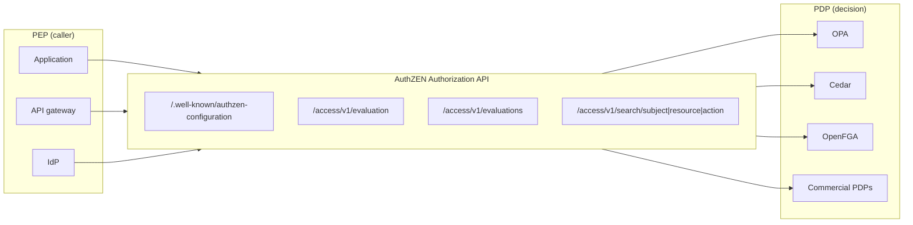

# Overview

Systems that decide "may this person perform this action on this resource?" usually split the work into two roles: the PDP (Policy Decision Point), which decides, and the PEP (Policy Enforcement Point), which enforces. Until recently, each engine shaped the PEP-to-PDP call in its own way. With OPA you build a Rego `input`. With Cedar you build a `principal`, an `action`, and a `resource`. With OpenFGA you build a `user`, a `relation`, and an `object`.

The OpenID Foundation's AuthZEN Working Group wrote **Authorization API 1.0** to standardize that line between the PEP and the PDP. The OpenID Foundation membership approved it as an OpenID Final Specification in January 2026.

This post answers the following questions.

- Why do we need a standard API between the PEP and the PDP?
- What goes in and what comes back (the SARC information model and the five endpoints)?
- How can a PDP return reasons for a decision or ask for step-up authentication?
- What does the spec fix, and what does it leave open, for PDP discovery and security?
- How does it relate to XACML and NIST ABAC?
- What does "swap OPA, Cedar, or OpenFGA" mean, and where does it stop?

The post [Authorization architecture: models and engines](/posts/authorization-architecture-models-engines/) covers the PEP/PDP/PIP/PAP reference architecture and compares models (RBAC, ABAC, ReBAC) and engines. This post focuses on the API that connects the PEP and the PDP.

# The Big Picture

The PDP serves the AuthZEN Authorization API and the PEP calls it. The PEP does not have to live in application code; an API gateway or an IdP can act as a PEP too.



The table lists what the spec defines and what it leaves out.

| Scope | Item |
| --- | --- |
| Defines | Information model (Subject, Action, Resource, Context, and Decision) |
| Defines | Access Evaluation API (one decision) |
| Defines | Access Evaluations API (many decisions in one call) |
| Defines | Search APIs (lists of subjects, resources, or actions) |
| Defines | PDP metadata (`/.well-known/authzen-configuration`) |
| Defines | HTTPS/JSON binding, error handling, security considerations |
| Leaves out | Policy language, PDP internal architecture, state management |
| Leaves out | How the PEP authenticates to the PDP (it only recommends OAuth 2.0 support) |
| Leaves out | Meaning and format of the vocabulary inside the decision `context` (reasons, obligations, and so on) |

# Why a Standard API Between the PEP and the PDP

## Every Engine Asks the Question Differently

When you move authorization decisions out of the application, application code turns into calls to the PDP. If the shape of that call differs per engine, three problems follow.

- PEP code and middleware become tied to one engine's API and vocabulary.
- Products such as API gateways and IdPs must build a separate integration for each engine.
- Changing engines means rewriting every PEP.

The spec's introduction observes that PDP-PEP communication follows similar patterns across products. The API aims to let PDP and PEP providers work without binding themselves to a single PDP or PEP implementation.

## What OAuth and OIDC Standardized, and What They Did Not

OAuth standardized delegation, and OpenID Connect standardized how to convey authentication results. The AuthZEN Authorization API standardizes the neighboring step: asking for a decision. Scopes and claims in a token narrow things down coarsely, and then the application asks a PDP for fine-grained, per-resource decisions. Apart from the XACML profiles covered later, that second part had no common shape.

For a map of the OAuth-related standards, see [A map of OAuth and related standards for an authorization platform](/posts/oauth-standards-map-authorization-platform/).

## Specification Status

I checked the status as of this post's date against openid.net.

| Item | Value |
| --- | --- |
| Name | Authorization API 1.0 |
| Type | OpenID Final Specification |
| Published | 2026-01-11 (the "Published" date in the spec) |
| Approval announced | 2026-01-12 (81 approve, 1 object, 25 abstain) |
| Editors | O. Gazitt (Aserto), D. Brossard (Axiomatics), A. Tulshibagwale (SGNL) |
| History | Draft 01 became the first Implementer's Draft in November 2024. Draft 02 added batch evaluation, and draft 03 added the Search APIs |
| Conformance testing | The OpenID Foundation conformance suite has test plans for PDPs. As of October 2026, the official page states that the tests are at an early stage |

A Final Specification gives implementers intellectual property protections and does not change further. The editors' copy on GitHub (openid.github.io/authzen) had the same body text as the Final version as of October 2026. The spec states that later revisions MAY add to the API but MUST NOT change the 1.0 API.

# Information Model: SARC

An AuthZEN request has four elements, abbreviated SARC: Subject, Action, Resource, and Context. The response is a Decision.

| Element | Meaning | Required keys | Optional keys |
| --- | --- | --- | --- |
| Subject | The principal under evaluation (a user or a machine) | `type`, `id` | `properties` |
| Action | The operation the subject wants to perform | `name` | `properties` |
| Resource | The target of the operation | `type`, `id` | `properties` |
| Context | The environment of the request (time, location, PEP capabilities, and so on) | None (the whole object is optional) | Any attributes |
| Decision | The result | `decision` (boolean) | `context` |

The `id` of a Subject or Resource only needs to be unique within its `type`. Action alone uses `name` instead of `type` and `id`.

```json
{
  "subject": {
    "type": "user",
    "id": "alice@example.com",
    "properties": {
      "department": "Sales"
    }
  },
  "action": {
    "name": "can_read"
  },
  "resource": {
    "type": "book",
    "id": "123",
    "properties": {
      "library_record": {
        "title": "AuthZEN in Action",
        "isbn": "978-0593383322"
      }
    }
  },
  "context": {
    "time": "1985-10-26T01:22-07:00"
  }
}
```

The spec explains why `properties` exists. Many authorization systems keep no state and expect the PEP to pass every attribute the policy needs. So the PEP can put subject attributes such as department, group memberships, device identifier, or IP address into the subject's `properties`. Resources and actions carry their own `properties` for the same purpose.

Some things stay open. The spec does not define the values of `type` (for example, `user` or `account`), the values of `name` (for example, `can_read` or `read`), or the keys of `properties`. Aligning that vocabulary between PEPs and PDPs remains your job.

# Access Evaluation API: One Decision

This is the core API. The PEP sends one SARC and receives one Decision. In the HTTPS binding, the default path is `/access/v1/evaluation` and the method is POST.

```http
POST /access/v1/evaluation HTTP/1.1
Host: pdp.example.com
Content-Type: application/json
Authorization: Bearer <PEP credential>
X-Request-ID: bfe9eb29-ab87-4ca3-be83-a1d5d8305716

{
  "subject": { "type": "user", "id": "alice@example.com" },
  "resource": { "type": "todo", "id": "1" },
  "action": { "name": "can_read" },
  "context": { "time": "1985-10-26T01:22-07:00" }
}
```

```http
HTTP/1.1 200 OK
Content-Type: application/json
X-Request-ID: bfe9eb29-ab87-4ca3-be83-a1d5d8305716

{
  "decision": true
}
```

Three points matter.

- **A denial comes back as 200.** The PDP expresses a denial as `200 OK` with `{"decision": false}`. A `401` means the PEP failed to authenticate to the PDP, and `400` or `500` signal a problem with the request or its processing. HTTP errors and decisions are separate things.
- **The PEP MAY reject a `true` decision if it does not understand the `context`.** When the decision is `false`, the PEP MUST NOT let the request go forward.
- **Request identifiers.** The PEP can identify a request with the `X-Request-ID` header. If it does, the PDP MUST return the same value in the response. This helps you correlate PEP and PDP records in audit logs.

If the request omits a required attribute, the PDP returns `400 Bad Request`. Receivers MUST ignore unknown fields, which keeps the format open for future extensions.

# Access Evaluations API: Batch Decisions

Suppose a list page needs to decide, for each of 50 documents, whether to show an edit button. Fifty HTTP round trips cost too much. The Access Evaluations API packs many decisions into one request (the spec calls this "boxcarring"). The default path is `/access/v1/evaluations`.

## Defaults and Overrides

The top-level `subject`, `action`, `resource`, and `context` act as defaults for each element of the `evaluations` array. A key inside an element overrides the default. In the example below, all elements share the subject, action, and context, and only the third element switches the action to `can_edit`.

```json
{
  "subject": { "type": "user", "id": "alice@example.com" },
  "context": { "time": "2024-05-31T15:22-07:00" },
  "action": { "name": "can_read" },
  "evaluations": [
    { "resource": { "type": "document", "id": "boxcarring.md" } },
    { "resource": { "type": "document", "id": "subject-search.md" } },
    {
      "action": { "name": "can_edit" },
      "resource": { "type": "document", "id": "resource-search.md" }
    }
  ]
}
```

The response lists Decisions in the `evaluations` array, in the same order as the request.

```json
{
  "evaluations": [
    { "decision": true },
    { "decision": false, "context": { "reason": "resource not found" } },
    { "decision": false, "context": { "reason": "Subject is a viewer of the resource" } }
  ]
}
```

If the `evaluations` array is missing or empty, the API behaves like a single Access Evaluation.

## Three Evaluation Semantics

`options.evaluations_semantic` controls when the PDP stops evaluating.

| Value | Behavior | Analogy |
| --- | --- | --- |
| `execute_all` (default) | Evaluates everything and returns every result. Parallel evaluation is fine | Independent checks |
| `deny_on_first_deny` | Stops at the first denial (or error) and returns the results so far | `&&` |
| `permit_on_first_permit` | Stops at the first permit and returns the results so far | `\|\|` |

`deny_on_first_deny` fits cases where you proceed only if every precondition holds. `permit_on_first_permit` fits cases where any one path to a permit suffices.

## Errors

The spec separates two kinds of errors. Errors that concern the whole payload use HTTP 4xx or 5xx. An error in one evaluation sets that element to `"decision": false` and carries the error in its `context`. Decisions default to closed (fail-closed).

```json
{
  "evaluations": [
    { "decision": true },
    {
      "decision": false,
      "context": { "error": { "status": 404, "message": "Resource not found" } }
    }
  ]
}
```

# Search APIs: Listing What Is Allowed

Access Evaluation answers "can Alice read document 123?" The Search APIs flip the direction: "which documents can Alice read?", "who can read document 123?", and "what can Alice do with document 123?"

| API | Default path | What the PEP omits | What comes back |
| --- | --- | --- | --- |
| Subject Search | `/access/v1/search/subject` | `subject.id` | Permitted subjects |
| Resource Search | `/access/v1/search/resource` | `resource.id` | Permitted resources |
| Action Search | `/access/v1/search/action` | The whole `action` | Permitted actions |

Here is a Resource Search. The PEP sends only the `type` of the resource it wants to find.

```json
{
  "subject": { "type": "user", "id": "alice@example.com" },
  "action": { "name": "can_read" },
  "resource": { "type": "account" },
  "page": { "limit": 2 }
}
```

```json
{
  "page": { "next_token": "a3M9NDU2O3N6PTI=", "count": 2, "total": 3 },
  "results": [
    { "type": "account", "id": "123" },
    { "type": "account", "id": "456" }
  ]
}
```

## Semantics

- **Consistency with evaluation.** If you pass a search result to Access Evaluation, the decision SHOULD be `true`. Evaluation can depend on other variables such as time, so the spec does not guarantee it.
- **Transitive traversal.** The spec recommends transitive search. If user U belongs to group G and G can view document D, a search for subjects who can view D includes U.
- **Pagination.** Pagination support is optional (MAY) for the PDP. With a PDP that supports it, the PEP fetches the next page with an opaque token, and an empty `next_token` marks the end. Pagination gives no atomic snapshot, so if data changes mid-way, results may repeat or go missing. Requests after the first page MUST repeat every value of the first request except the token.

## Where It Helps

The Search APIs help with pre-filtering list pages, deciding which menus and buttons to show, and reviewing access. Once you externalize decisions, lists and pagination get hard. I explored that problem with OPA in [Considerations and Solutions for Pagination Impact in OPA](/posts/pagination-impact-solutions-opa/).

Reverse lookups such as "who can access what" are not new. Zanzibar's Expand API takes an object#relation pair and returns the effective userset as a tree. OpenFGA's ListObjects and ListUsers return lists of permitted objects and users. What AuthZEN adds is a common API for them across PDPs. All Search APIs are optional, and if the metadata does not list one, the PEP can conclude that the PDP does not support it.

# Decision Context: Beyond a Boolean

The core of a Decision is just `true` or `false`. Everything else goes into the optional `context` object. The spec lists examples of what `context` can carry:

- Reasons for the decision
- Advice or obligations tied to the decision
- Hints for rendering UI state
- Instructions for step-up authentication
- Environmental information

Two non-normative examples from the spec follow. The first gives different reasons to administrators and end users.

```json
{
  "decision": false,
  "context": {
    "reason_admin": { "403": "Request failed policy C076E82F" },
    "reason_user": { "403": "Insufficient privileges. Contact your administrator" }
  }
}
```

The second asks for step-up authentication. The PDP signals the `acr` and `amr` access token claim values it expects to see.

```json
{
  "decision": false,
  "context": {
    "acr_values": "urn:com:example:loa:3",
    "amr_values": "mfa hwk"
  }
}
```

Keep in mind that the meaning and format of `context` sit outside the spec. Keys such as `reason_admin` and `acr_values` serve as examples, not rules. If you change PDPs, the way you read `context` may change too. To close this gap, the working group develops a separate Obligations Profile that defines the format of obligations (see below).

Also avoid leaking policy internals through admin-facing reasons. Keep user-facing reasons separate, and word them so that users cannot infer the structure of your policies.

# PDP Metadata: What Lives Where

The spec recommends that a PDP publish its configuration as metadata at `/.well-known/authzen-configuration`. A multi-tenant PDP can append the tenant to the path, as in `https://pdp.example.com/.well-known/authzen-configuration/tenant1`.

```json
{
  "policy_decision_point": "https://pdp.example.com",
  "access_evaluation_endpoint": "https://pdp.example.com/access/v1/evaluation",
  "search_subject_endpoint": "https://pdp.example.com/access/v1/search/subject",
  "search_resource_endpoint": "https://pdp.example.com/access/v1/search/resource"
}
```

| Parameter | Required | Meaning |
| --- | --- | --- |
| `policy_decision_point` | Yes | PDP identifier (an https URL). Prevents PDP mix-up attacks |
| `access_evaluation_endpoint` | Yes | URL of the Access Evaluation API |
| `access_evaluations_endpoint` | No | URL of the Access Evaluations API |
| `search_subject_endpoint` and others | No | URLs of each Search API |
| `capabilities` | No | Array of IANA-registered capability URNs |
| `signed_metadata` | No | A JWT that signs the metadata |

A PEP has to check and handle the following.

- The `policy_decision_point` value in the metadata must equal the identifier the PEP used to fetch it. If they differ, the PEP MUST NOT use the data.
- A PEP that supports `signed_metadata` validates the signature and the issuer (`iss`). Signed values take precedence over plain JSON values.
- Normal HTTP caching applies. Use directives such as `Cache-Control` with `max-age` to cache metadata for a suitable period.

If the metadata lists an endpoint URL, the PEP MUST use it. Without one, the PEP SHOULD build the URL by appending the default path to the PDP's base URL. Still, an API missing from the metadata tells the PEP that the PDP does not support it. The spec does not cite the OAuth metadata RFCs, but its design closely resembles OAuth Authorization Server Metadata (RFC 8414) and OAuth 2.0 Protected Resource Metadata (RFC 9728). Its definition of `signed_metadata` follows the RFC 9728 wording almost word for word.

# Transport and Security

## HTTPS and JSON Binding

The spec separates the information model from the transport. A compliant PDP MUST support the HTTPS/JSON binding. Future profiles may define other bindings such as gRPC.

For JSON, the spec recommends following I-JSON (RFC 7493): UTF-8 encoding, no numbers beyond IEEE 754 double precision, and unique member names. It also recommends omitting properties whose value is `null`, to avoid confusing "absent" with "null".

## Security Considerations

| Area | Requirement | Reason |
| --- | --- | --- |
| Integrity and confidentiality | The PEP-PDP connection MUST use adequate protection such as TLS | It is the most sensitive connection in an ABAC architecture |
| PEP authentication | The PDP SHOULD authenticate the PEP, for example with mTLS, OAuth, or API keys | Stops attackers from probing policies with crafted requests, and helps against DoS |
| Authentication failure | MUST return `401` and SHOULD include `WWW-Authenticate` | Tells the caller which scheme to use |
| Trust | The PDP trusts the PEP | The PEP enforces the decision in the end |
| Response integrity | The PDP MAY sign its response | TLS does not cover the full path when proxies or gateways sit in between |
| Availability | The PDP SHOULD protect against large payloads, request floods, invalid or deeply nested JSON, and memory exhaustion | Rate limiting and similar measures prevent DoS |

## Design Notes (My Take)

The assumption that "the PDP trusts the PEP" carries weight. The PDP believes whatever department or role the PEP puts in `properties`. So decide who supplies the attributes that drive decisions. If a decision depends on attributes the PEP can set freely, an attacker who takes over the PEP can forge them too. A safer design lets the PDP fetch important attributes from a PIP itself, or read them from a signed token.

The second point concerns what happens when the PEP cannot reach the PDP. The spec makes errors in individual evaluations fail closed, but it does not say how a PEP should behave when the PDP itself goes down. The PEP side has to decide on timeouts, caching, and degraded-mode decisions. For decisions about PEP/PDP placement and non-functional requirements, see [Authorization platform architecture and design decisions](/posts/authorization-platform-architecture-decisions/).

# Relation to XACML and NIST ABAC

AuthZEN did not invent new concepts. The spec opens by noting that XACML and NIST SP 800-162 (the ABAC guide) define PDPs and PEPs.

| Aspect | XACML 3.0 | AuthZEN Authorization API 1.0 |
| --- | --- | --- |
| Scope | Policy language, request/response format, processing model | Only the request and response between PEP and PDP |
| Format | XML (JSON and REST profiles became OASIS Standards in 2019) | JSON (HTTPS binding mandatory) |
| Request structure | Attributes grouped into categories (subject, resource, action, environment) | Subject, Action, Resource, and Context objects |
| Decision values | Permit, Deny, NotApplicable, Indeterminate | `true` or `false` |
| Obligations and advice | Defined in the policy language | Carried in `context` (profiles define the format) |
| Listing questions | Not in the core | Search APIs |

XACML returns four decision values and defines everything down to the policy language and processing model. In my view, this is why PDPs that accept XACML requests were almost always XACML engines. AuthZEN stays out of policy languages and defines only the shape of the line. Inside, the PDP can use Rego, Cedar, or relationship tuples. Reducing the decision to a boolean and moving everything else into `context` reads as a way to let different engines expose the same interface.

NIST SP 800-162 describes ABAC through subject attributes, object attributes, operations, and environment conditions. SARC maps closely to that vocabulary. For the original sources behind the models, see [Authorization architecture: models and engines](/posts/authorization-architecture-models-engines/).

# What "Swapping OPA, Cedar, or OpenFGA" Means

## Mapping SARC to Each Engine

AuthZEN pays off by hiding engine differences from the PEP. The concepts of common engines map to SARC roughly as follows.

| SARC | OPA (Rego) | Cedar | OpenFGA |
| --- | --- | --- | --- |
| Subject | Any structure in `input` | `principal` (entity) | `user` |
| Action | Any structure in `input` | `action` (entity) | `relation` |
| Resource | Any structure in `input` | `resource` (entity) | `object` |
| Context | Any structure in `input` | `context` | `context` (for conditional relationships) |
| Listing questions | Needs workarounds such as partial evaluation | Not part of the core decision API | ListObjects, ListUsers |

Cedar's four-part request looks almost identical to SARC. OpenFGA asks about relationships, so you need a convention that maps Action to `relation`. OPA does not fix the shape of its input, so you can write policies that take SARC directly as `input`. OPA itself has no AuthZEN endpoints, though. To feed an AuthZEN request into `input`, you need a translation layer such as the authzen-proxy in OPA's contrib repository. For OPA basics, see [What is Open Policy Agent (OPA)?](/posts/open-policy-agent/), and for its use in microservices, see [Implementation of Access Control System for Microservices Using OPA](/posts/microservices-access-control-opa/).

## What You Can Swap, and What You Cannot

AuthZEN makes the PEP code and the wire format easy to swap. The following work remains even with AuthZEN.

| Remaining work when you switch | Reason |
| --- | --- |
| Rewriting policies | Policy languages sit outside the spec |
| Migrating the data model | Each engine stores relationship tuples and attributes differently |
| Aligning `type` and `name` vocabulary | The spec defines no vocabulary |
| Reading `context` | Formats for reasons and obligations sit outside the spec |
| Search API support | Search and batch evaluation are optional and vary by PDP |
| Attribute supply paths | Which attributes the PEP sends and which the PDP fetches depends on your setup |

In short, AuthZEN lets you switch PDPs without rewriting PEPs, but not without rewriting policies. Even so, in an organization with as many PEPs as it has services and gateways, the first benefit matters a lot.

## Interoperability Track Record

The AuthZEN Working Group has run seven interoperability events since June 2024 (according to authzen-interop.net).

| Scenario | Event | Draft | Endpoints |
| --- | --- | --- | --- |
| Application code | Identiverse 2024 | 00 | `/evaluation` |
| Application code | EIC 2024 | 01 | `/evaluation` |
| Application code | Authenticate 2024 | 02 | adds `/evaluations` |
| Application code | Gartner IAM US 2024 | 02 | adds `/evaluations` |
| API gateway | Gartner IAM London 2025 | 02 | adds `/evaluations` |
| Search | Identiverse 2025 | 03 | `/search`, `/.well-known` |
| IdP | Gartner IAM US 2025 | 04 | `/search` |

Many PDPs posted results for the scenario that uses a todo app as the PEP, including Aserto, Axiomatics, Cerbos, Open Policy Agent, OpenFGA, Amazon Verified Permissions, PlainID, SGNL, and Topaz. Participation does not mean the product speaks AuthZEN out of the box, though. For example, the OPA results come from a proxy that runs on the interop site. Before adopting a product, check its documentation for which draft and which APIs it supports.

The interop site also shows a layered setup: coarse-grained decisions at the IdP, medium-grained ones at the API gateway, and fine-grained ones in the application. Connecting PEPs at all three layers through one API shows well why a standard API matters.

# Profiles at a Glance

The working group builds profiles for specific uses on top of Authorization API 1.0. Every one of them is a draft and may still change. [What changes in authorization for AI agents](/posts/authorization-for-ai-agents/) covers their use with AI agents in detail.

| Profile | Status | Gap it fills |
| --- | --- | --- |
| Access Request and Approval Profile (AARP) | Working Group Draft | Connects a "denied, but requestable" decision to request, approval, and re-evaluation. After approval, the PDP re-evaluates and still decides |
| COAZ Framework | Working Group Draft | A declarative way to map requests from any protocol into SARC |
| COAZ-MCP Binding | Working Group Draft | Applies COAZ to MCP so that each MCP message gets a decision |
| Obligations Profile | Working Group Draft | Format and negotiation of mandatory actions that the PEP must perform for a decision |
| OAuth-related (Token Issuance, Token Exchange, Authorization Claims) | Draft 1 in the repository | Ask AuthZEN whether to issue or exchange a token, and which entitlements to put in JWT access tokens |

The abbreviation AARP follows the OpenID Foundation announcement; the draft header abbreviates the name as ARAP.

In its June 2026 announcement, the OpenID Foundation said that authorization systems used to answer one question, "can this action happen right now?", and increasingly must also answer what must happen before policy can allow the action. Add the "which" question that the Search APIs handle, and decision APIs answer three questions.

| Question | Example | Coverage |
| --- | --- | --- |
| Can (decision) | Is this action allowed right now? | Access Evaluation, Access Evaluations |
| Which (discovery) | Which resources can this subject read? | Search APIs |
| What is required (preconditions) | What does a permit require? | AARP, Obligations, step-up in `context` |

This grouping into three questions is my own framing; the spec does not define it. For MCP, see also [Key points for designing MCP authorization](/posts/mcp-authorization-design/).

# Tips for Adoption

Finally, here are my own tips for bringing AuthZEN into a design.

- **Start with Access Evaluation only.** The spec calls this API the core feature, and its URL is the only required endpoint in the metadata. Publishing metadata is itself only recommended. Some PDPs don't support batch evaluation or search, so confirm support before you use them.
- **Settle the `type` and `name` vocabulary first.** Use one vocabulary for resource types and action names across the organization. If some PEPs send `read` and others send `can_read`, decisions drift even without a PDP change.
- **Document your `context` conventions.** Agree inside the organization on how to return reasons and step-up requests. Once the Obligations Profile stabilizes, move toward it.
- **Decide where attributes come from.** Separate attributes the PEP sends from attributes the PDP fetches. The more important the attribute, the less you should rely on the PEP for it.
- **Wrap the PEP in an SDK or middleware.** Do not hand-write HTTP calls in every service; build a shared component instead. Put metadata discovery, caching, timeouts, and fail-closed behavior there.
- **Decide first whether to externalize decisions at all.** AuthZEN defines the line after you externalize. Whether you should externalize is a separate decision, which [How far should you build an authorization platform?](/posts/authorization-platform-scope-stages/) covers.

# Summary

- AuthZEN Authorization API 1.0 standardizes the request and response between the PEP and the PDP. It became an OpenID Final Specification in January 2026.
- A request carries Subject, Action, Resource, and Context (SARC), and a response carries a boolean `decision` and an optional `context`.
- The API consists of single evaluation, batch evaluation with selectable semantics, subject/resource/action search, and metadata at `/.well-known/authzen-configuration`.
- A denial comes back as `200` with `false`, separate from HTTP errors. Errors in individual evaluations fail closed.
- On security, TLS protection is mandatory, and the spec recommends or permits PEP authentication, signed responses, and DoS protections. The PDP trusts the PEP, so the source of attributes becomes a central design question.
- It inherits vocabulary from XACML and NIST ABAC but stays out of policy languages. That lets OPA, Cedar, OpenFGA, and others expose the same interface.
- The PEP side becomes easy to swap; policies, data, vocabulary, and the reading of `context` remain your work.

# Related Posts

- [What is Authorization? Mapping AuthN, AuthZ, and IAM Subdomains](/posts/authorization-domain-iam-subdomains/)
- [How Much Authorization Platform Do You Need? Scope, Ownership, Stages, and Externalized Decisions](/posts/authorization-platform-scope-stages/)
- [What Are Authorization Architectures and Models? PEP/PDP, RBAC/ABAC/ReBAC, and Choosing a Policy Engine](/posts/authorization-architecture-models-engines/)
- [Which OAuth Standards Does an Authorization Platform Need? A Map of Delegation, Tokens, and Continuous Evaluation](/posts/oauth-standards-map-authorization-platform/)
- [What is Authorization for AI Agents? Delegation Chains, Human Approval, and Audit with MCP, AuthZEN, AIMS, and A2A/AP2](/posts/authorization-for-ai-agents/)
- [How Should You Design Authorization for MCP? Common Incidents and Decisions That Are Hard to Reverse](/posts/mcp-authorization-design/)
- [What Does an Authorization Platform Architecture Look Like? Containers, Key Sequences, PEP/PDP Placement, and Non-Functional Decisions](/posts/authorization-platform-architecture-decisions/)
- [What is Open Policy Agent (OPA)? A Practical Guide to Policy as Code](/posts/open-policy-agent/)
- [Implementation of Access Control System for Microservices Using OPA](/posts/microservices-access-control-opa/)
- [Considerations and Solutions for Pagination Impact in OPA](/posts/pagination-impact-solutions-opa/)

# References

- [Authorization API 1.0 (OpenID Final Specification)](https://openid.net/specs/authorization-api-1_0.html)
- [Authorization API 1.0 editors' copy](https://openid.github.io/authzen/)
- [Authorization API 1.0 Final Specification Approved (OpenID Foundation)](https://openid.net/authorization-api-1-0-final-specification-approved/)
- [AuthZEN Working Group – Specifications](https://openid.net/wg/authzen/specifications/)
- [Conformance Testing for OpenID AuthZEN Authorization API 1.0](https://openid.net/certification/authzen_testing/)
- [OpenID AuthZEN Interop](https://authzen-interop.net/)
- [openid/authzen (GitHub)](https://github.com/openid/authzen)
- [open-policy-agent/contrib authzen-proxy (GitHub)](https://github.com/open-policy-agent/contrib/tree/main/authzen/authzen-proxy)
- [OpenID Foundation advances authorization for the agent era with new AuthZEN Working Group Drafts](https://openid.net/openid-foundation-advances-authorization-for-the-agent-era-with-new-authzen-working-group-drafts/)
- [OASIS XACML 3.0](https://docs.oasis-open.org/xacml/3.0/xacml-3.0-core-spec-os-en.html)
- [JSON Profile of XACML 3.0 Version 1.1](https://docs.oasis-open.org/xacml/xacml-json-http/v1.1/xacml-json-http-v1.1.html)
- [XACML REST Profile Version 1.1](https://docs.oasis-open.org/xacml/xacml-rest/v1.1/xacml-rest-v1.1.html)
- [NIST SP 800-162 Guide to Attribute Based Access Control (ABAC) Definition and Considerations](https://csrc.nist.gov/pubs/sp/800/162/upd2/final)
- [RFC 7493 The I-JSON Message Format](https://www.rfc-editor.org/rfc/rfc7493)
- [RFC 8414 OAuth 2.0 Authorization Server Metadata](https://www.rfc-editor.org/rfc/rfc8414)
- [RFC 9728 OAuth 2.0 Protected Resource Metadata](https://www.rfc-editor.org/rfc/rfc9728)
