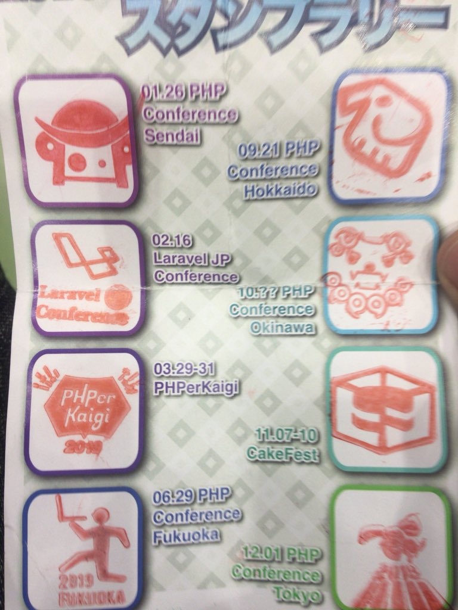
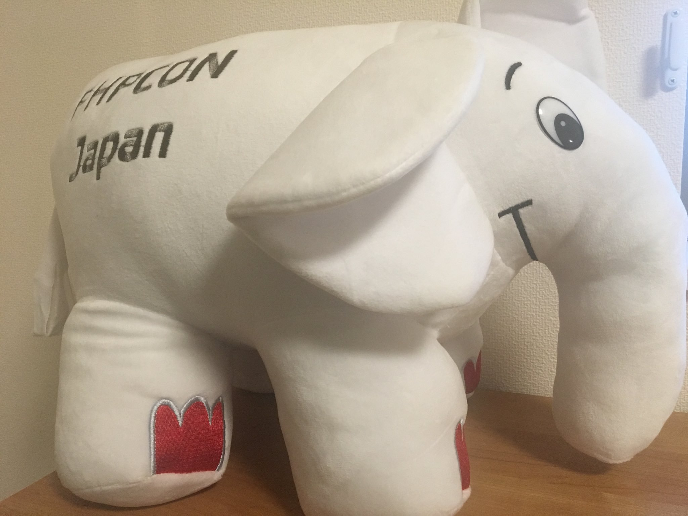

# Overview
I participated in all official PHP conferences held in Japan in 2019, so I have compiled my participation records.

# PHP Conference Participation Report Summary
The journey from starting in Sendai to ending in Tokyo.
All conferences outside of Tokyo were my first time attending.

- [Participated in PHP Conference Sendai 2019](/posts/php-conference-sendai-2019/)
- [Laravel JP Conference](http://web.archive.org/web/20260117100821/https://conference2019.laravel.jp/)
The first Laravel conference held in Japan.
I participated as both staff and speaker.
I plan to participate as staff next year as well.
cf. [Laravel JP Conference 2020](http://web.archive.org/web/20250126161113/http://conference2020.laravel.jp/)
- [Participated and Spoke at PHPerKaigi 2019](/posts/phperkaigi-2019-participation/)
- [Participated and Spoke at PHP Conference Fukuoka 2019](/posts/php-conference-fukuoka-2019-participation/)
I had submitted CFPs about twice before but was not selected for Fukuoka.
I had heard good things from participants every year, so I was determined to participate through a CFP this year, and I was glad to successfully participate and speak.
- [Participated in PHP Conference Hokkaido 2019](/posts/php-conference-hokkaido-2019-participation/)
- [Participated in PHP Conference Okinawa 2019](/posts/php-conference-okinawa-2019-participation/)
First time held. Being in Okinawa, it seemed like a high hurdle for participants from outside the prefecture, but there were a fair number of participants from outside, and it seemed to be a great success.
There were also participants from Taiwan, giving it an international feel.
- [CakeFest](https://cakefest.org/)
The first CakeFest conference held in Japan. As an international conference, it had a strong global feel, making it seem like attending an overseas conference while in Japan.
The sessions covered not only CakePHP but also general PHP web development topics, making it interesting even for those who don't usually use CakePHP.
- [PHP CONFERENCE JAPAN 2019](https://phpcon.php.gr.jp/2019/)
This year's PHP Conference Tokyo had a special feel as it was the 20th anniversary.
I have participated for three consecutive years, but this year was particularly memorable as [Sebastian Bergmann](https://twitter.com/s_bergmann), the creator of PHPUnit, was a speaker.
- I couldn't fully participate in [Laravel JP Conference](http://web.archive.org/web/20260117100821/https://conference2019.laravel.jp/), [CakeFest](https://cakefest.org/), and [PHP CONFERENCE JAPAN 2019](https://phpcon.php.gr.jp/2019/), so I skipped writing reports...

Reflecting on the sessions of each conference, I think there were relatively many sessions on application design and testing this year.

# Impressions
I could feel firsthand that there are people with a passion for PHP all over the country, sharing similar interests and facing similar issues, while also experiencing the connections within the domestic PHP community.
I am deeply grateful to my company for supporting my participation.
Next year, to an overseas conference... (to be continued)

PHP Conference Stamp Rally Complete.

The prize received for completing the stamp rally. Cute.

