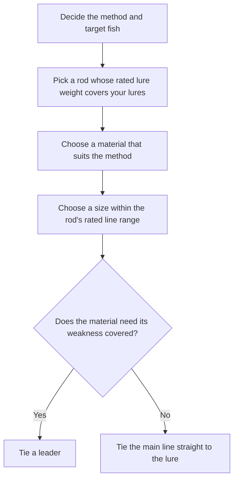

# Introduction
Line comes in many combinations of material and size, so picking one can feel confusing. This post sorts out how to choose line for lure fishing in two parts: material and size. The figures come from line makers' published values and official rod specs.

# The Short Answer
- Decide in this order: rod, material, then size.
- Choose the material for your fishing by its abrasion resistance, specific gravity, and stretch.
- Choose the size within the rated line range printed on the rod.
- The Japanese size number (gou) shows thickness (weight for PE). Compare strength by the lb or kg rating.
- Cover the weaknesses of PE and ester with a leader tied to the end.

# Order of Decisions
Choose a line in this order.

The rod comes first because its specs list the rated line. A tackle maker names a mismatch with the rod as a cause of line trouble, since a line that is too thick runs poorly through the guides.

# Choosing the Material
## Traits of the Four Materials
The four main line materials are nylon, fluorocarbon, ester (polyester), and PE. Line makers' published figures and explanations come down to the following.

| Material | Specific gravity | Stretch | Abrasion resistance | Strengths | Weaknesses | Typical uses |
| --- | --- | --- | --- | --- | --- | --- |
| Nylon | 1.14 | 20–40% | Average | Supple and easy to handle; stretch absorbs shock | Absorbs water and degrades; stretch lowers sensitivity | Stream trout, rock-shore fishing, and most other fishing |
| Fluorocarbon | 1.78 | 23–30% | High | Resists abrasion; sinks | Stiff; holds coil memory | Bass around cover, rockfish, leaders |
| Ester | 1.35–1.38 | 17–20% | High | Low stretch and high sensitivity; sinks light lures | Breaks under sudden force; stiff and takes practice | Horse mackerel with light jig heads, area trout with light spoons |
| PE | 0.97 | 3–8% | Low | Strongest at a given size; low stretch and high sensitivity | Weak against abrasion; floats and catches wind and current | Long casts and big fish, such as sea bass and shore jigging |

The higher the specific gravity, the more readily a line sinks; PE, below 1, floats. The lower the stretch, the more clearly bites reach your hand.

## Matching the Material to Your Fishing
From this table, pick a material as follows.

- Around rocks and cover, pick fluorocarbon for its abrasion resistance.
- To sink a light lure and hold it at a depth, pick fluorocarbon or ester for their higher specific gravity.
- For long casts or big fish that call for a thin, strong line, pick PE.
- When ease of handling and fewer lost fish come first, pick nylon for its suppleness and stretch.

## Covering Weaknesses with a Leader
Each material also has a weakness. PE is weak against abrasion, and ester breaks under sudden force. A leader covers for this: tie fluorocarbon for abrasion resistance or nylon for its shock-absorbing stretch to the end.

# Choosing the Size
## Reading Sizes and lb Ratings
The Japanese size number shows line thickness. The JAFS fishing line standards set a standard diameter for each size of nylon, fluorocarbon, and polyester line. Strength, though, depends on each maker, and the standards do not tie sizes to strength.

The lb or kg rating shows strength. For nylon and fluorocarbon, "roughly size 1 = 4 lb" serves as a rule of thumb. Here is an example of one line maker's published figures.

| Size | Standard diameter (mm) | Example lb rating |
| --- | --- | --- |
| 0.6 | 0.128 | 2 |
| 0.8 | 0.148 | 3 |
| 1 | 0.165 | 4 |
| 1.5 | 0.205 | 6 |
| 2 | 0.235 | 8 |
| 2.5 | 0.260 | 10 |
| 3 | 0.285 | 12 |
| 4 | 0.330 | 16 |

Keep these points in mind for each material:

- PE size depends on weight (mass per 9,000 m), not thickness. At size 1, strength ranges from 16 to 22 lb depending on the product.
- PE has 2.5 to 3 times the strength of nylon at the same size.
- Ester is a little weaker than nylon at the same size.
- Two lines both labeled "4 lb" can differ: some break at or below the stated lb, while others hold beyond it.

Use the size as a guide to thickness, and look at the lb or kg rating when you compare strength.

## Picking from the Rod's Rated Line
A rod's spec table lists the rated line in lb for nylon and fluorocarbon and as a size for PE. Pick the size within that range. The table shows typical examples by fishing style, taken from official rod specs of two major tackle makers (as of November 1, 2026).

| Fishing | Nylon/fluoro (lb) | PE (size) |
| --- | --- | --- |
| Horse mackerel / rockfish light game | 1–4 | 0.1–0.6 |
| Area trout | 1.5–8 | 0.15–0.6 |
| Bass | 3–25 | Up to 1–5 |
| Rockfish | 6–12 | Up to 1.5 |
| Sea bass | - | 0.5–2.0 |
| Shore jigging | - | Up to 2.5–4 |

The range shifts with rod power even within one style. The sea bass and shore jigging rods listed here give only a PE range.

## Settling on a Size within the Range
Within the rated range, think it through like this:

- Around rocks or when targeting big fish, choose the thicker end.
- When distance or light lures come first, choose the thinner end.
- Thick PE on a light lure catches wind and current, so the lure tends to fly short, sink slowly, and lose touch with the bottom.
- PE strength differs between products at the same size, so compare the lb or kg ratings rather than the size.

# Summary
- Choose in this order: rod, material, then size.
- Choose the material by abrasion resistance, specific gravity, and stretch: fluorocarbon around rocks, fluorocarbon or ester to sink light lures, PE for distance and big fish, and nylon for ease of handling.
- Cover the weaknesses of PE and ester with a fluorocarbon or nylon leader.
- The size number shows thickness (weight for PE); compare strength by lb or kg. For nylon and fluorocarbon, "size 1 = 4 lb" serves as a rule of thumb.
- Pick the size within the rod's rated line range, then settle on thickness by the spot and what matters most to you.

# Related Posts
- [Spinning Reel Casting Guide](/posts/spinning-reel-casting-guide/)
- [Rockfish Field Guide](/posts/rockfish-worm-field-guide/)

# References
- [jaftma.or.jp - Fishing line JAFS standards (Japanese)](https://www.jaftma.or.jp/service/standard/index02.html)
- [jaftma.or.jp - Standard diameters of nylon, fluorocarbon, and polyester line, JAFS-D1051100 (Japanese)](https://www.jaftma.or.jp/service/images/nylon.pdf)
- [jaftma.or.jp - PE line thickness standard, JAFS-D1011002 (Japanese)](https://www.jaftma.or.jp/service/images/pe.pdf)
- [varivas.co.jp - Line material properties and size/lb basics (Japanese)](https://www.varivas.co.jp/contents/line/)
- [fishing.sunline.co.jp - Line material traits (Japanese)](https://fishing.sunline.co.jp/material/)
- [fishing.sunline.co.jp - Fluorocarbon line sizes and lb ratings (Japanese)](https://fishing.sunline.co.jp/line/29146/)
- [fishing.sunline.co.jp - 4-strand PE line sizes and lb ratings (Japanese)](https://fishing.sunline.co.jp/line/30531/)
- [fishing.sunline.co.jp - 8-strand PE line sizes and lb ratings (Japanese)](https://fishing.sunline.co.jp/line/30936/)
- [xbraidygk.jp - 8-strand PE line sizes and lb ratings (Japanese)](https://xbraidygk.jp/products/upgradex8/)
- [daiwa.com - Unit conversion table (Japanese)](https://www.daiwa.com/jp/beginner/conversion/)
- [fish.shimano.com - Light game rod specs (Japanese)](https://fish.shimano.com/ja-JP/product/rod/lightsalt/a075f00003xgh7lqaq.html)
- [fish.shimano.com - Bass rod specs (Japanese)](https://fish.shimano.com/ja-JP/product/rod/bass/shimano/a075f00003yfzrsqam.html)
- [fish.shimano.com - Rockfish rod specs (Japanese)](https://fish.shimano.com/ja-JP/product/rod/shoresalt/rockfish/a075f00003xgoslqae.html)
- [fish.shimano.com - Shore jigging rod specs (Japanese)](https://fish.shimano.com/ja-JP/product/rod/shoresalt/shorejigging/a075f00003e2chxqay_p.html)
- [daiwa.com - Area trout rod specs (Japanese)](https://www.daiwa.com/jp/product/ngp6a8l)
- [daiwa.com - Sea bass rod specs (Japanese)](https://www.daiwa.com/jp/product/ye9mr5u)
- [fish.shimano.com - Spinning reel casting and line trouble prevention (Japanese)](https://fish.shimano.com/ja-JP/content/fishingstyle/article/2026/260430/index.html)
