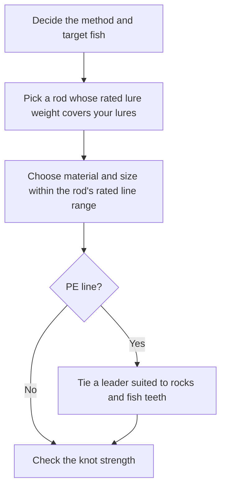

# Introduction
Anglers often describe the link between line size and lure weight with rules of thumb such as "size 1 = 4 lb" or "the lb rating equals the heaviest lure in grams you can cast." This post checks those rules against primary sources and lays out how line size, line strength, and lure weight relate.

I used four kinds of sources:

- The JAFS fishing line standards from the Japan Fishing Tackle Manufacturers Association (JAFTMA)
- Published figures from line makers (Sunline, Varivas, and YGK)
- Official rod spec tables from Shimano and Daiwa
- A paper on casting loads, plus a simple mechanics calculation

Japanese line sizes use a unit called *gou* (号). This post writes it as "size," for example "size 1."

# The Short Answer
- The size number defines thickness (weight for PE), not strength. "Size 1 = 4 lb" for nylon and fluorocarbon is an industry rule of thumb. For PE, strength at the same size differs widely between products (16 to 22 lb at size 1).
- The rod's rated lure weight, not the line, decides how heavy a lure you can cast. Pick the line from the rod's rated line range too.
- Across official rod specs, "nylon/fluoro lb rating = heaviest lure in grams" holds roughly for trout and bass rods. On light game and rockfish rods, the top lure weight in grams reaches two to three times the lb rating.
- "PE size × 25 to 30 = heaviest lure in grams" comes close to the metal jig limit on sea bass and shore jigging rods. On trout and bass rods, the ratio stays between 4 and 18.
- A normal cast loads the line with a few to a few dozen times the lure's weight. Line strength leaves a far larger margin than that. The margin covers failed releases, knots, damage, and fighting fish.

# The Size Number Defines Thickness
## Nylon and Fluorocarbon
The JAFS standard JAFS-D1051100 sets a standard diameter for each size of nylon, fluorocarbon, and polyester line. On strength, it says "each company decides," so the standard does not tie a size to a strength.

| Size | Standard diameter (mm) | Example lb rating (Sunline Basic FC) |
| --- | --- | --- |
| 0.6 | 0.128 | 2 |
| 0.8 | 0.148 | 3 |
| 1 | 0.165 | 4 |
| 1.5 | 0.205 | 6 |
| 2 | 0.235 | 8 |
| 2.5 | 0.260 | 10 |
| 3 | 0.285 | 12 |
| 4 | 0.330 | 16 |

Varivas explains that for nylon and fluorocarbon, "roughly size 1 = 4 lb." Daiwa's unit conversion table also lists 4 lb = size 1 and notes that the figure can vary between products and makers.

The lb rating itself comes in two kinds. Varivas separates IGFA-class lines, which break at or below the stated lb, from LB.OVER lines, which do not break at the stated value. Two lines both labeled "4 lb" can break at different loads.

## PE
For PE, weight decides the size number, not thickness. The JAFS standard JAFS-D1011002 measures PE line by mass per 9,000 m (denier) and sets size 1 = 200 denier (200 g per 9,000 m). It sets no diameter.

Strength at the same size still varies from product to product. The table below shows the lb ratings each maker publishes.

| Size | JAFS standard (denier) | Sunline BASIC PE (4-strand) | Sunline Cast One X8 (8-strand) | YGK Upgrade X8 (8-strand) |
| --- | --- | --- | --- | --- |
| 0.3 | 60 | 5 | 8 | - |
| 0.4 | 80 | 6 | 10 | - |
| 0.6 | 120 | 10 | 14 | 14 |
| 0.8 | 160 | 12 | 18 | 16 |
| 1 | 200 | 16 | 21 | 22 |
| 1.2 | 240 | 20 | 26 | 25 |
| 1.5 | 300 | 25 | 32 | 30 |
| 2 | 400 | 35 | 38 | 40 |

At size 1, the ratings range from 16 to 22 lb, a gap of over 30 percent. Varivas puts PE at 2.5 to 3 times the strength of nylon at the same size.

# The Rod Decides the Lure Weight
Rod specs list a rated lure weight and a rated line range. Shimano names a mismatch with the rod as a cause of line trouble: a lure that is too heavy makes the rod wobble, and a line that is too thick runs poorly through the guides.

Line size alone does not tell you how heavy a lure you can cast. I took the official specs of 70 models in 14 Shimano and Daiwa series (as of November 1, 2026) and divided each top rated lure weight in grams by the top rated line (lb or PE size). I call the result the ratio. The table shows representative models.

| Fishing | Rod | Lure (grams) | Nylon/fluoro (lb) | PE (size) | Ratio to lb | Ratio to PE size |
| --- | --- | --- | --- | --- | --- | --- |
| Horse mackerel / rockfish light game | Shimano Soare BB S76UL-S | 0.5–5 | 1–4 | 0.1–0.4 | 1.3 | 12.5 |
| Horse mackerel / rockfish light game | Shimano Soare BB S76L-S | 0.6–12 | 1.5–4 | 0.1–0.6 | 3.0 | 20 |
| Area trout | Daiwa Presso MX 60UL | 0.4–3 | 1.5–3 | 0.15–0.3 | 1.0 | 10 |
| Area trout | Daiwa Presso MX 62MHF | 2–10 | 2–8 | 0.3–0.6 | 1.3 | 17 |
| Bass | Shimano Zodias 264L | 3–10 | 3–6 | Max 1 | 1.7 | 10 |
| Bass | Shimano Zodias 1610M | 7–21 | 8–16 | Max 3 | 1.3 | 7 |
| Bass | Shimano Zodias 172H-2 | 14–42 | 12–25 | Max 5 | 1.7 | 8 |
| Rockfish | Shimano Hard Rocker BB S83MH | 8–32 | 6–12 | Max 1.5 | 2.7 | 21 |
| Sea bass | Daiwa Lateo 90L | 5–28 | - | 0.5–1.2 | - | 23 |
| Sea bass | Daiwa Lateo 96M | 10–50 | - | 0.8–2.0 | - | 25 |
| Shore jigging | Shimano Coltsniper BB S96M | Jig max 60, plug max 45 | - | Max 2.5 | - | Jig 24, plug 18 |
| Shore jigging | Shimano Coltsniper BB S96H | Jig max 100, plug max 85 | - | Max 4 | - | Jig 25, plug 21 |

The ratios across all 70 models, grouped by fishing style, look like this. The sea bass and shore jigging rods I collected list no nylon/fluoro line rating.

| Fishing | Ratio to lb | Ratio to PE size |
| --- | --- | --- |
| Light game | 1.2–3.0 | 10–25 |
| Area and stream trout | 0.8–1.3 | 7.5–18 |
| Bass (excluding big bait rods) | 0.9–1.8 | 4–11 |
| Rockfish | 1.5–2.7 | 15–21 |
| Sea bass (excluding big bait rods) | - | 19–25 |
| Shore jigging | - | Jigs 24–30, plugs and others 18–25 |

Against the common rules of thumb:

- "Nylon/fluoro lb rating = heaviest lure in grams" roughly fits trout and bass rods. On light game and rockfish rods, the top rating in grams stretches to two or three times the lb rating.
- "PE size × 25 to 30 = heaviest lure in grams" roughly fits the metal jig limit on shore jigging rods. Plug limits come to about 20 times the PE size, and trout and bass rods stay between 4 and 18 times.

## Power Labels Follow No Shared Standard
I found no common definition across makers for power labels such as UL, L, ML, M, MH, and H. The same label covers very different lure weights from series to series.

- For ML, the top rating is 5 g on the Daiwa Presso MX 62ML and a 50 g metal jig on the Shimano Coltsniper BB S96ML.
- For L, the Shimano Zodias 264L takes 3–10 g, while the Daiwa Presso MX 62L takes 0.6–4 g.

Read a power label as relative strength within its series, and check the lure weight in the spec table.

# The Force on the Line During a Cast
## Most of the Load Comes from Centrifugal Force
A 2008 study by Watanabe and colleagues in the Transactions of the Japan Society of Mechanical Engineers ran casting experiments with a 152.4 cm ultralight rod and 4 lb line, and compared them with a numerical simulation. The study found that centrifugal force makes up most of the load on the lure, and that the load grows with heavier lures and later releases.

## A Rough Estimate
A simple model gives the size of the casting load.

- The lure accelerates along a circle of radius `r`, the rod length plus the drop, and leaves at speed `v`.
- Just before release, the line pulls with the centrifugal force `m × v² ÷ r`, where `m` is the lure's mass.
- Ignoring air drag, a 45-degree launch carries the lure a distance `R = v² ÷ g`, where `g` is gravitational acceleration.

Together, these mean the line carries at least `R ÷ r` times the lure's weight. A real cast fights air drag and needs a faster launch to reach the same distance, so the actual load runs higher.

| Distance | Minimum launch speed | Radius | Load ÷ lure weight (minimum) |
| --- | --- | --- | --- |
| 15 m | about 12 m/s | 2 m | about 8× |
| 30 m | about 17 m/s | 2.5 m | about 12× |
| 60 m | about 24 m/s | 3 m | about 20× |
| 90 m | about 30 m/s | 3.5 m | about 26× |

Watanabe's team cast indoors in a gym toward a 15 m target, and the lure averaged 11 m/s. With a 2 m radius, that puts the load at about 6 times the lure's weight, the same order as the estimate above.

By this estimate, casting a 5 g lure 30 m loads the line with about 60 gf. A 4 lb line (about 1.8 kgf) leaves a margin of about 30 times.

## When the Release Fails
If the angler fails to let go of the line, the load climbs above a normal cast. Watanabe's team simulated the peak load when the lure never leaves. With a safety factor of 3 on 4 lb line (17.8 N), the allowed load comes to about 6 N, which the simulation reached at a lure weight of about 10 g.

6 N equals about 60 times the weight of a 10 g lure. From this result, the paper recommends lures of 10 g or less on 4 lb line.

## Knots Cut Strength
A line weakens where you tie it. The makers publish these figures, and a PE knot can keep half its strength or less depending on the knot.

| Material | Specific gravity | Knot strength (Sunline) | Knot strength (Varivas) | Stretch (Varivas) |
| --- | --- | --- | --- | --- |
| Nylon | 1.14 | About 85% of straight strength | 80–90% | 20–40% |
| Fluorocarbon | 1.78 | About 70% of straight strength | 70–80% | 23–30% |
| PE | 0.97 | About 40% of straight strength | 40–90% | 3–8% |

The Varivas figures give ranges that vary by knot. Nylon and fluorocarbon typically lose 10 to 30 percent, while the choice of knot matters far more for PE.

## Abrasion and Damage
PE consists of fine braided fibers, so if abrasion or friction heat cuts one strand, the whole line can fail from there (Sunline). Anglers tie a fluorocarbon or nylon shock leader to the end of PE to make up for its weakness against rocks and fish teeth (Varivas).

Tronixpro, a UK tackle maker, gives "10 lb of leader per 1 oz (about 28 g) of weight" as a guide for surf casting with heavy sinkers. That works out to a strength of about 160 times the weight, again a margin far above the load of a normal cast.

The extra strength in a line covers failed releases, knots, damage, and fighting fish more than the cast itself.

# Rod Stiffness and Line Thickness
Stiffer rods use thicker line mainly because they handle heavier lures and stronger fish. Within a series, higher power raises both the rated lure weight and the rated line. On the Shimano Zodias, for example, the 264L takes 3–10 g and 3–6 lb, and the 172H-2 takes 14–42 g and 12–25 lb.

A softer rod acts as a spring, so it likely cushions sudden shocks such as a failed release or a snag. Still, I found no published maker data that puts numbers on how rod stiffness affects line load.

# When PE Line Is Too Thick
PE has a specific gravity of 0.97, lighter than water. Varivas says PE floats easily and wind and current affect it easily.

The buoyancy itself stays small, though. Size 1 PE weighs about 0.022 g per meter. Taking seawater's specific gravity as 1.025, sinking 10 m of it leaves a net lift of only about 0.013 gf. Thickness matters far more through drag. A thicker line catches more wind in the air and more current in the water. As a result, it casts shorter, forms a bigger bow, and lets the lure sink more slowly.

When you fish a light lure on thick PE, drag rather than buoyancy causes the trouble: the lure flies short, sinks slowly, and makes the bottom hard to feel. Sunline also makes a sinking PE, ULT-PE Type III, with a dense core fiber that raises its specific gravity to 1.48.

# How to Choose a Line
Choose a line in this order.

When you settle on a size:

- Around rocks or when targeting big fish, choose the thicker end of the rated range.
- When distance or light lures come first, choose the thinner end.
- PE strength differs between products at the same size, so compare the lb or kg ratings rather than the size.

# Summary
- The size number defines thickness (weight for PE), so check strength on each maker's label. "Size 1 = 4 lb" for nylon and fluorocarbon serves as a rule of thumb.
- The rod's rated lure weight decides how heavy a lure you can cast. Choose the line within the rod's rated line range.
- "lb rating = heaviest lure in grams" roughly fits trout and bass rods, and "PE size × 25 to 30" roughly fits metal jigs on shore jigging rods. The ratios differ for other fishing styles.
- A normal cast loads the line with a few to a few dozen times the lure's weight. The strength margin covers failed releases, knots, damage, and fighting fish.
- Light lures on thick PE suffer mainly from wind and current drag on the thicker line, not from buoyancy.

# Related Posts
- [Spinning Reel Casting Guide](/posts/spinning-reel-casting-guide/)
- [Rockfish Field Guide](/posts/rockfish-worm-field-guide/)

# References
- [jaftma.or.jp - Fishing line JAFS standards (Japanese)](https://www.jaftma.or.jp/service/standard/index02.html)
- [jaftma.or.jp - Standard diameters of nylon, fluorocarbon, and polyester line, JAFS-D1051100 (Japanese)](https://www.jaftma.or.jp/service/images/nylon.pdf)
- [jaftma.or.jp - PE line thickness standard, JAFS-D1011002 (Japanese)](https://www.jaftma.or.jp/service/images/pe.pdf)
- [varivas.co.jp - Choosing a line (Japanese)](https://www.varivas.co.jp/contents/line/)
- [fishing.sunline.co.jp - Line material characteristics (Japanese)](https://fishing.sunline.co.jp/material/)
- [fishing.sunline.co.jp - Basic FC (Japanese)](https://fishing.sunline.co.jp/line/29146/)
- [fishing.sunline.co.jp - BASIC PE (Japanese)](https://fishing.sunline.co.jp/line/30531/)
- [fishing.sunline.co.jp - Cast One X8 (Japanese)](https://fishing.sunline.co.jp/line/30936/)
- [xbraidygk.jp - Upgrade X8 (Japanese)](https://xbraidygk.jp/products/upgradex8/)
- [daiwa.com - Unit conversion table (Japanese)](https://www.daiwa.com/jp/beginner/conversion/)
- [fish.shimano.com - Soare BB (Japanese)](https://fish.shimano.com/ja-JP/product/rod/lightsalt/a075f00003xgh7lqaq.html)
- [fish.shimano.com - Zodias (Japanese)](https://fish.shimano.com/ja-JP/product/rod/bass/shimano/a075f00003yfzrsqam.html)
- [fish.shimano.com - Hard Rocker BB (Japanese)](https://fish.shimano.com/ja-JP/product/rod/shoresalt/rockfish/a075f00003xgoslqae.html)
- [fish.shimano.com - Coltsniper BB (Japanese)](https://fish.shimano.com/ja-JP/product/rod/shoresalt/shorejigging/a075f00003e2chxqay_p.html)
- [daiwa.com - Presso MX (Japanese)](https://www.daiwa.com/jp/product/ngp6a8l)
- [daiwa.com - Lateo (Japanese)](https://www.daiwa.com/jp/product/ye9mr5u)
- [fish.shimano.com - Saltwater spinning reel casting and line trouble prevention (Japanese)](https://fish.shimano.com/ja-JP/content/fishingstyle/article/2026/260430/index.html)
- [Watanabe, Kasai, and Tanaka, "Dynamics of Lure Casting (Influence of Lure Weight)," Transactions of the JSME Series C, 74(742), 2008 (Japanese)](https://doi.org/10.1299/kikaic.74.1445)
- [tronixpro.com - Understanding Surf Shock Leaders](https://tronixpro.com/understanding-surf-shock-leaders)

