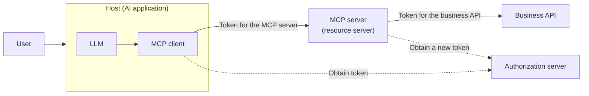
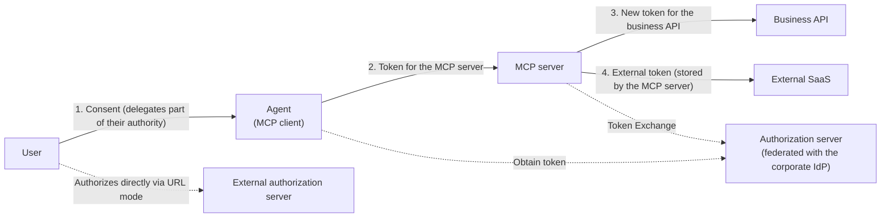
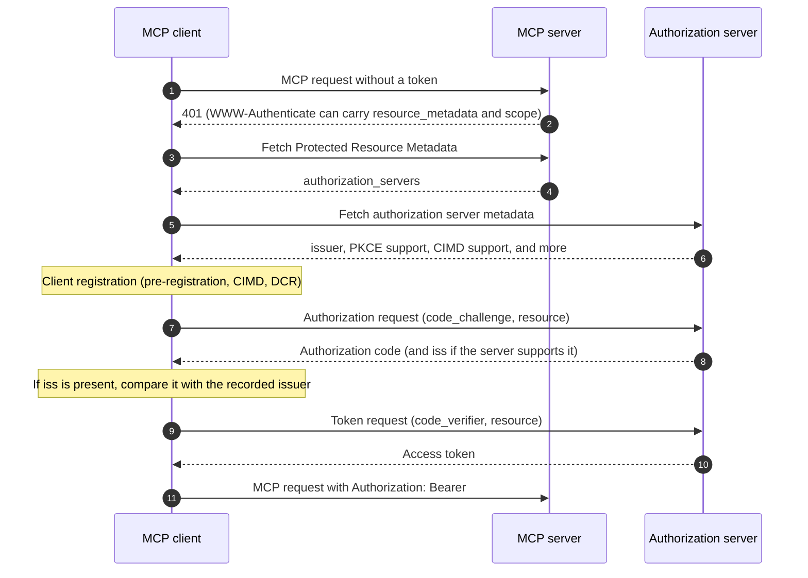

# Overview

MCP (Model Context Protocol) is an open standard for connecting AI applications to external tools and data. When you put an MCP server in front of internal business APIs, an agent can read and write business data on behalf of a user. That convenience comes with risk. A flawed authorization design lets an agent perform operations the user never intended, or lets a stolen token reach other APIs.

MCP has an authorization specification built on OAuth 2.1, which is still an IETF draft. That specification mainly covers one part: obtaining and validating a token for the MCP server. The specification does not say how to answer the question "may this agent, acting for this user, run this tool on this data?" Your team has to design that part.

This post targets teams that add authorization to MCP servers or MCP clients. It covers the following:

- Incidents that an "it just works" implementation causes, and their typical causes
- What the MCP authorization specification decides, and what you must design yourself
- Who holds whose authority at each hop
- Decisions that cost a lot to change later
- How to separate what to do now from what can wait
- A table of the main requirements in the specification

This post refers to the 2026-07-28 revision, the current revision as of October 2026. The MCP specification keeps evolving, so pick the revision you adopt and check the original text. For the broader picture of authorization for AI agents, including the new AuthZEN drafts (AARP, COAZ) and delegation extensions, see [Authorization for AI agents](/posts/authorization-for-ai-agents/).

# The architecture this post assumes

This post uses an example: an MCP server in front of internal business APIs, through which employees read and write business data from an AI application. In MCP, a host runs several MCP clients, and each client talks to exactly one MCP server. In the authorization specification, the MCP server acts as an OAuth 2.1 resource server and the MCP client acts as an OAuth 2.1 client.

To apply it to your own system, fill in three things on this diagram. Then map the incident list and the "whose authority" analysis below onto it, and concrete problems in your architecture will show up.

- Actors: the user, the host (the AI application) and its MCP clients, the MCP servers, the business APIs behind them, and the authorization server
- Token flow: who receives a token, from where, for which audience, and where they pass it
- How you hold authority: which scopes, with what lifetime, stored where

# Incidents that can happen

First, here are the incidents that can happen when you build this setup so that it just works.

| What can happen | Typical cause | Main countermeasure |
|---|---|---|
| The MCP server forwards the token it received to a backend API as is. A stolen token then reaches other APIs | The server skips audience validation and relays the token (token passthrough) | Accept only tokens issued for this server, and obtain a separate token for each backend API |
| An attacker steals an authorization code through an MCP server that connects to a third-party API, without user consent | A proxy that uses a static client ID with a third-party authorization server skips per-client consent (confused deputy) | Record consent per client and show a consent screen |
| The agent performs operations the user did not intend, such as deletion, sending messages, or reading other people's data | Scopes grant too much. Prompt injection abuses legitimate permissions | Minimal scopes with step-up, per-tool access decisions, and human confirmation |
| Credentials leak through prompts or conversation logs | The LLM context contains API keys or tokens | Let the host or MCP server hold credentials and keep them away from the LLM |
| Nobody can trace later who did what through which agent | Logs do not distinguish the user from the agent | Record the user, agent, tool, target, and result as separate fields |
| Offboarding or permission changes do not reach the agent | Long-lived tokens, static API keys, and no revocation mechanism | Short-lived tokens and a way to revoke them |
| Someone manipulates another user's state (a cart or a workflow) | The server treats possession of a state handle as authentication | Bind handles to the verified user and check them on every request |

The following subsection explains the confused deputy problem, whose mechanism the table alone does not make clear.

## Confused deputy

The confused deputy problem can appear when an MCP server acts as a proxy to a third-party API. The official MCP documentation includes [Security Best Practices](https://modelcontextprotocol.io/docs/2026-07-28/tutorials/security/security_best_practices) ("the Best Practices" below). They say the attack becomes possible when every one of these conditions holds:

- The MCP server uses one static client ID with the third-party authorization server
- The MCP server lets MCP clients register dynamically
- The third-party authorization server sets a consent cookie after the first authorization
- The MCP server forwards requests to the third-party authorization server without per-client consent

An attacker then registers a malicious client and gets the user to click a link. The consent cookie remains, so the consent screen never appears, and the authorization code goes to the attacker's redirect URI.

As a countermeasure, an MCP proxy that uses a static client ID MUST get user consent for each dynamically registered client before it forwards the request to the third party.

# What the MCP authorization specification decides, and what it does not

Adding OAuth does not finish authorization. Viewed through the IAM subdomains, the gaps become visible. [What is authorization?](/posts/authorization-domain-iam-subdomains/) describes the subdomains: identity, authentication, delegation, access decisions, and access governance.

| Question | Subdomain | Does the MCP authorization specification cover it? |
|---|---|---|
| Is the user who they claim to be? | Authentication | Out of scope. Leave it to your existing IdP |
| Which client may access which MCP server, and how far? | Delegation (OAuth, scopes, audience) | The core of the specification |
| May the caller run this tool on this data? | Access decision | Requires access controls (MUST) but does not say how to decide. Design it yourself |
| Who decides and reviews which agent may use which tool? | Access governance | Out of scope |
| Do high-risk operations need human approval? | Access decision and governance | Only a SHOULD about the host UI; no mechanism dedicated to approval. A server can ask the user to confirm through Elicitation |

The specification does not ignore access decisions. The tools specification says servers MUST put proper access controls in place. The caching specification says servers MUST NOT rely on `cacheScope` alone and MUST apply access controls per primitive (tools, resources, and so on). It does not say how to decide, though. That part belongs to your design.

## Designing access decisions for tools and data

An access decision uses at least these inputs:

- Subject: the user (`sub`) and the client (`client_id`) taken from the verified token
- Action: the MCP method and tool name (for example, `execute_sql` in `tools/call`)
- Resource: the data that the tool arguments point to (tenant, record, file)
- Context: scopes, time, and the risk of the operation

Use scopes as a coarse upper bound such as "may use this kind of feature on this MCP server", and make decisions about individual data in the server. The 2026-07-28 revision explicitly allows the result of `tools/list` to vary by the authorization attached to the request. For example, a server can return only the tools that the granted scopes permit. Showing fewer tools also lowers the chance that the LLM picks a dangerous tool by mistake. Hiding a tool from the list does not replace a decision, though. Decide on every `tools/call`.

You have three main places to put the decision:

| Location | Good fit | Caveat |
|---|---|---|
| Directly in the MCP server code | Few MCP servers and simple policies | Every policy change means modifying every MCP server |
| A gateway (PEP) in front of the MCP servers | You want per-tool permissions or per-tenant controls in one place | To inspect argument values, it must parse the body or use the arguments that the server marks with `x-mcp-header` and the client mirrors into headers |
| An external decision service (PDP) | Many MCP servers, and you want to manage policy across them | You need to design the decision API and the attributes it uses |

In the 2026-07-28 Streamable HTTP transport, every request REQUIRES the `Mcp-Method` header. Requests such as `tools/call` also REQUIRE the `Mcp-Name` header. A gateway learns "which method, which tool" without parsing the body and can apply per-tool controls. A server that processes the body MUST check that the header values match the body and reject mismatches. A gateway that decides on headers SHOULD confirm that `MCP-Protocol-Version` names a revision that requires this check, and reject the request otherwise.

If you externalize decisions, AuthZEN's [Authorization API](/posts/authzen-authorization-api/) offers a standard between the PEP and the PDP. AuthZEN also has a draft binding, COAZ-MCP, that maps MCP requests to decision requests. [Authorization architecture](/posts/authorization-architecture-models-engines/) covers how to split the PEP and the PDP.

## Identifiers are not permissions

The 2026-07-28 revision removed protocol-level sessions. A server that needs state across calls mints a handle and receives it back as an ordinary tool argument. The specification says that, for authenticated servers, a handle is a name, not a capability. The Best Practices say servers MUST NOT treat possession of a state handle as authentication. They also recommend binding each handle to the verified user in the server-side store. For example, key the stored state as `<user_id>:<handle>` and take the user ID from the verified token.

The same idea applies to other values. `clientInfo` (in 2026-07-28, the `io.modelcontextprotocol/clientInfo` field in the request `_meta`) is self-reported, and the specification says implementations SHOULD NOT rely on it for security decisions. Clients MUST treat tool annotations as untrusted unless they come from trusted servers. Take the subject information for access decisions only from verified tokens.

# Who holds whose authority at each hop

Share within the team, for each hop, whose authority the caller uses. When this stays vague, token passthrough and excessive permissions follow.

| Hop | Whose authority | Token audience | What the receiver does |
|---|---|---|---|
| 1. User → client | The user delegates part of their authority to the client | — | The authorization server shows the client and scopes on the consent screen |
| 2. Client → MCP server | The client uses the user's authority on their behalf | The MCP server (set through `resource`) | The MCP server validates audience, expiry, and scopes, then decides on the tool and data |
| 3. MCP server → business API | The MCP server uses the user's authority on their behalf | The business API | The business API validates the audience and records both the user and the actor |
| 4. MCP server → external SaaS | Authority that the user granted directly at the external service | The external service | The external service validates it |

## Use a separate token for each hop

When the MCP server calls a backend API, it does not relay the token it received. The specification requires a separate token issued by the authorization server of that backend API. For internal APIs, Token Exchange (RFC 8693) offers a natural way to get a token for the backend API. [The big picture of service-to-service authentication](/posts/service-to-service-authentication/) covers the basics of Token Exchange.

When the MCP server calls an external SaaS, it becomes an OAuth client of that service. The specification provides URL mode in Elicitation for this case. The user authorizes the external service in a browser without going through the MCP client, and the external credentials never pass through the MCP client. The MCP server stores and manages the external token, so the MCP server becomes stateful.

In this flow, the server MUST confirm that the user who started the Elicitation and the user who finished authorization in the browser match. Without this check, an attacker can send the URL from their own request to a victim. The victim's external token then ends up bound to the attacker's account.

## Distinguish the user from the agent

In tokens and records, separate the user (`sub`) from the party acting on their behalf (`act`). The Token Exchange `act` claim can express a delegation chain. Audit logs should contain at least the user, the client (agent), the tool, the target, and the result.

The MCP specification has no standard way to distinguish the user from the agent, though. `clientInfo` is self-reported. A CIMD `client_id` identifies the client software, not an agent instance or a multi-step delegation chain. Decide how to represent this distinction yourself, as part of the token design of your authorization server. [Authorization for AI agents](/posts/authorization-for-ai-agents/) introduces delegation extensions for agents.

# Decisions that are hard to reverse

You do not need to do everything now. Settle the decisions that cost a lot to change later at the start.

| Decision | Why it is hard to change later |
|---|---|
| Use your corporate identity platform instead of building an authorization server per MCP server | Once the source of truth for credentials splits, merging it back costs a lot |
| The audience (`resource`) design for each MCP server | It spreads into token validation logic and client configuration |
| Scope granularity | Scopes you have handed out resist change. Keep fine-grained permissions out of tokens and put fine-grained decisions on the decision side |
| Where the decision logic lives | Hardcoding means every policy change touches every MCP server |
| Audit log fields (user, agent, tool, target, result) | Adding them later does not recover past records |
| Token lifetime and revocation | You cannot recall long-lived tokens once you spread them |

Notes on two of them follow.

- Authorization server: the specification allows the authorization server to live with the MCP server. If you build one per MCP server, though, every permission change or offboarding has to reach every one of them. Inside a company, build on the corporate IdP. The authorization server you build on still has to support PKCE, publish its metadata, and issue tokens whose audience is a specific MCP server. The official Enterprise-Managed Authorization extension defines a way to manage access to MCP servers centrally through the enterprise IdP.
- Audience: the MCP client puts the canonical URI of the MCP server in `resource`. The specification recommends the form without a trailing slash unless the slash is semantically significant. If you do not settle the format early, you end up fixing both the validator and the client configuration.

# What to do now and what can wait

Instead of "we cannot ship until we do everything", draw a line. For anything you postpone, record the reason and the conditions for revisiting it in an ADR (Architecture Decision Record). The team keeps moving, and the long-term debt stays visible.

| Category | Items |
|---|---|
| Do now | Audience validation and no passthrough, PKCE, minimal scopes, short-lived tokens, no credentials in the LLM, audit logs that separate the user from the agent, per-request access decisions (hardcoded is fine) |
| Can wait (but record it) | Externalized decisions (AuthZEN, COAZ-MCP), human approval flows (AuthZEN AARP, CIBA), continuous evaluation (CAEP), fine-grained per-tool policies |

Among the "do now" items, audience validation, no passthrough, and PKCE are MUSTs in the specification. Per-request access decisions also fall under the access controls that the tools specification requires servers to put in place (MUST). If you add short-lived tokens or audit logs later, they do not reach the long-lived tokens you have already handed out or the past operations you never recorded. In the author's view, most "can wait" items are easy to add or swap later as long as you have fixed the entry point for decisions (the PEP). That is why you should gather the places that call the decision into one spot, even if the logic stays hardcoded for now.

# Main requirements of the MCP authorization specification

Finally, here are the main requirements of the 2026-07-28 authorization specification. Check the original text for details.

The authorization flow works as follows. The MCP client sends a request without a token and gets a 401. It then finds the authorization server through Protected Resource Metadata. After that, it runs the authorization code flow with PKCE and `resource`.

| Area | Requirement | Applies to | Strength |
|---|---|---|---|
| Scope of applicability | Authorization itself is optional. HTTP transports should follow the specification. stdio should not, and gets credentials from the environment | All | OPTIONAL / SHOULD / SHOULD NOT |
| Foundation | Support OAuth 2.1 with appropriate security measures for both public and confidential clients | Authorization server | MUST |
| Discovery | Support Protected Resource Metadata (RFC 9728) and list `authorization_servers` | MCP server | MUST |
| Discovery | Use Protected Resource Metadata to find the authorization server | MCP client | MUST |
| Metadata | Provide at least one of RFC 8414 or OpenID Connect Discovery. Clients support both | Authorization server / MCP client | MUST |
| Registration | Obtain a client ID through pre-registration, CIMD, or DCR. Priority: pre-registration, CIMD, DCR, then user input | MCP client | MUST (priority is SHOULD) |
| Registration | Support Client ID Metadata Documents | Authorization server / MCP client | SHOULD |
| Registration | Dynamic Client Registration (RFC 7591) is deprecated and stays only for backward compatibility. If you use it, set `application_type` | Authorization server / MCP client | MAY (setting it is MUST) |
| Registration | Bind credentials from pre-registration or DCR to the issuing authorization server, and never reuse them with another one | MCP client | MUST |
| Audience | Include `resource` (RFC 8707) in both the authorization request and the token request, with the canonical URI of the MCP server. Send it even if the authorization server does not support it | MCP client | MUST |
| Sending | Send the token in the `Authorization: Bearer` header on every HTTP request. Never put it in the URI query | MCP client | MUST / MUST NOT |
| Validation | Check that the token names this server as its audience. Return 401 for invalid or expired tokens | MCP server | MUST |
| No passthrough | Never accept or transit tokens meant for anyone else | MCP server | MUST NOT |
| PKCE | Support PKCE and use `S256` when technically capable. Refuse to proceed if the metadata lacks `code_challenge_methods_supported` | MCP client | MUST |
| Mix-up defense | Include `iss` (RFC 9207) in authorization responses. If you include it, advertise it in the metadata | Authorization server | SHOULD (advertising is MUST) |
| Mix-up defense | Record the `issuer` of the chosen authorization server. If the response has `iss`, compare the two before using the code. Reject a response without `iss` from an authorization server that advertises `iss` support | MCP client | MUST |
| Scopes | Use the `scope` in the first 401, or `scopes_supported` if absent. Signal missing scopes with 403 `insufficient_scope`; the client reauthorizes with the union | MCP server / MCP client | SHOULD |
| Transport | Serve all authorization server endpoints over HTTPS. Redirect URIs use localhost or HTTPS, and the authorization server checks them by exact match | Authorization server / MCP client | MUST |
| Token theft | Issue short-lived access tokens. Rotate refresh tokens for public clients | Authorization server | SHOULD / MUST |
| Confused deputy | An MCP proxy with a static client ID gets user consent for each dynamically registered client before forwarding | MCP server (proxy) | MUST |

For client registration, a client without pre-registered credentials uses CIMD before DCR when the authorization server advertises CIMD support in its metadata. The specification positions CIMD for the most common MCP scenario, where clients and servers have no prior relationship. CIMD arrived in the 2025-11-25 revision as the recommended mechanism, and the 2026-07-28 revision deprecated DCR. With CIMD, the client uses an HTTPS URL as its `client_id` and hosts a JSON metadata document at that URL. The authorization server fetches the document and checks that `client_id` matches and that the document lists the `redirect_uri`. Because the authorization server fetches arbitrary URLs, it needs to guard against SSRF.

[Dynamic Client Registration (DCR)](/posts/dynamic-client-registration/) covers how DCR works, and [OpenID Connect Discovery and metadata](/posts/oidc-discovery-metadata/) covers metadata-based discovery. [OAuth 2.1 and the Security BCP](/posts/oauth-2-1-security-bcp/) summarizes the OAuth 2.1 foundation, including PKCE and mix-up defenses. For where MCP's OAuth building blocks fit, see [A map of OAuth and related standards](/posts/oauth-standards-map-authorization-platform/).

The core specification fits the case where a user interactively grants a client access to an MCP server. For other cases, two official authorization extensions exist. Use OAuth Client Credentials for machine-to-machine integration without a human. Use Enterprise-Managed Authorization when an enterprise IdP manages access centrally. In the latter, the client obtains an ID-JAG (Identity Assertion JWT Authorization Grant) from the enterprise IdP and exchanges it for an access token at the MCP authorization server. Neither extension takes effect unless the MCP client explicitly supports it.

# Summary

- The MCP authorization specification mainly covers delegation: obtaining and validating tokens. Design access decisions for tools and data, access governance, and human approval yourself.
- Put audience validation and the ban on passthrough in place first. For backend APIs, use a new token obtained through Token Exchange or a similar method.
- Draw whose authority each hop uses, and record the user and the agent separately.
- Do not treat identifiers such as handles or `clientInfo` as permissions. Take the subject information for decisions from verified tokens.
- The authorization server placement, audience, scope granularity, decision location, audit log fields, and token lifetime and revocation resist change later. Decide them first.
- For anything you postpone, record the reason and the conditions for revisiting it in an ADR.

# Related Posts

- [What is Authorization? Mapping AuthN, AuthZ, and IAM Subdomains](/posts/authorization-domain-iam-subdomains/)
- [What Are Authorization Architectures and Models? PEP/PDP, RBAC/ABAC/ReBAC, and Choosing a Policy Engine](/posts/authorization-architecture-models-engines/)
- [What is the AuthZEN Authorization API? A Standard Between PEP and PDP](/posts/authzen-authorization-api/)
- [Which OAuth Standards Does an Authorization Platform Need? A Map of Delegation, Tokens, and Continuous Evaluation](/posts/oauth-standards-map-authorization-platform/)
- [What is Authorization for AI Agents? Delegation Chains, Human Approval, and Audit with MCP, AuthZEN, AIMS, and A2A/AP2](/posts/authorization-for-ai-agents/)
- [What Does an Authorization Platform Architecture Look Like? Containers, Key Sequences, PEP/PDP Placement, and Non-Functional Decisions](/posts/authorization-platform-architecture-decisions/)
- [OAuth 2.1 and the Security BCP: RFC 9700 and RFC 6819 (Changes from OAuth 2.0)](/posts/oauth-2-1-security-bcp/)
- [What are Sender-Constrained Tokens? An Introduction to mTLS (RFC 8705) and DPoP (RFC 9449)](/posts/sender-constrained-tokens-mtls-dpop/)
- [What is Dynamic Client Registration (DCR)? An Introduction to RFC 7591 and 7592](/posts/dynamic-client-registration/)
- [OpenID Connect Discovery and Metadata: Auto-Configuration and jwks_uri Key Retrieval](/posts/oidc-discovery-metadata/)
- [What is the Big Picture of Service-to-Service Authentication? mTLS, Token Exchange, SPIFFE, and Zero Trust](/posts/service-to-service-authentication/)
- [Access Token Validation and Revocation: Introspection, JWT, and Token Revocation (RFC 7009)](/posts/access-token-validation-revocation/)

# References

- [MCP Specification 2026-07-28](https://modelcontextprotocol.io/specification/2026-07-28)
- [MCP Versioning](https://modelcontextprotocol.io/docs/2026-07-28/learn/versioning)
- [MCP Key Changes (2026-07-28)](https://modelcontextprotocol.io/specification/2026-07-28/changelog)
- [MCP Key Changes (2025-11-25)](https://modelcontextprotocol.io/specification/2025-11-25/changelog)
- [MCP Architecture (2026-07-28)](https://modelcontextprotocol.io/specification/2026-07-28/architecture)
- [MCP Base Protocol Overview (2026-07-28)](https://modelcontextprotocol.io/specification/2026-07-28/basic)
- [MCP Authorization (2026-07-28)](https://modelcontextprotocol.io/specification/2026-07-28/basic/authorization)
- [MCP Authorization Server Discovery (2026-07-28)](https://modelcontextprotocol.io/specification/2026-07-28/basic/authorization/authorization-server-discovery)
- [MCP Client Registration (2026-07-28)](https://modelcontextprotocol.io/specification/2026-07-28/basic/authorization/client-registration)
- [MCP Authorization Security Considerations (2026-07-28)](https://modelcontextprotocol.io/specification/2026-07-28/basic/authorization/security-considerations)
- [MCP Tools (2026-07-28)](https://modelcontextprotocol.io/specification/2026-07-28/server/tools)
- [MCP Caching (2026-07-28)](https://modelcontextprotocol.io/specification/2026-07-28/server/utilities/caching)
- [MCP Elicitation (2026-07-28)](https://modelcontextprotocol.io/specification/2026-07-28/client/elicitation)
- [MCP Streamable HTTP (2026-07-28)](https://modelcontextprotocol.io/specification/2026-07-28/basic/transports/streamable-http)
- [MCP Security Best Practices (2026-07-28)](https://modelcontextprotocol.io/docs/2026-07-28/tutorials/security/security_best_practices)
- [MCP Authorization Extensions](https://modelcontextprotocol.io/extensions/auth/overview)
- [MCP OAuth Client Credentials](https://modelcontextprotocol.io/extensions/auth/oauth-client-credentials)
- [MCP Enterprise-Managed Authorization](https://modelcontextprotocol.io/extensions/auth/enterprise-managed-authorization)
- [The OAuth 2.1 Authorization Framework (draft-ietf-oauth-v2-1)](https://datatracker.ietf.org/doc/draft-ietf-oauth-v2-1/)
- [OAuth Client ID Metadata Document (draft-ietf-oauth-client-id-metadata-document)](https://datatracker.ietf.org/doc/draft-ietf-oauth-client-id-metadata-document/)
- [RFC 9728 OAuth 2.0 Protected Resource Metadata](https://www.rfc-editor.org/rfc/rfc9728)
- [RFC 8707 Resource Indicators for OAuth 2.0](https://www.rfc-editor.org/rfc/rfc8707)
- [RFC 8414 OAuth 2.0 Authorization Server Metadata](https://www.rfc-editor.org/rfc/rfc8414)
- [OpenID Connect Discovery 1.0](https://openid.net/specs/openid-connect-discovery-1_0.html)
- [RFC 9207 OAuth 2.0 Authorization Server Issuer Identification](https://www.rfc-editor.org/rfc/rfc9207)
- [RFC 7591 OAuth 2.0 Dynamic Client Registration Protocol](https://www.rfc-editor.org/rfc/rfc7591)
- [RFC 8693 OAuth 2.0 Token Exchange](https://www.rfc-editor.org/rfc/rfc8693)
- [AuthZEN Authorization API 1.0](https://openid.net/specs/authorization-api-1_0.html)
- [COAZ-MCP: COAZ Binding for the Model Context Protocol](https://openid.github.io/authzen/authzen-coaz-mcp-binding-1_0.html)
- [AuthZEN Access Request and Approval Profile](https://openid.github.io/authzen/authzen-access-request-approval-profile-1_0.html)
- [OpenID Foundation advances authorization for the agent era with new AuthZEN Working Group Drafts](https://openid.net/openid-foundation-advances-authorization-for-the-agent-era-with-new-authzen-working-group-drafts/)
- [OWASP Top 10 for LLM Applications: LLM06 Excessive Agency](https://genai.owasp.org/llmrisk/llm062025-excessive-agency/)
