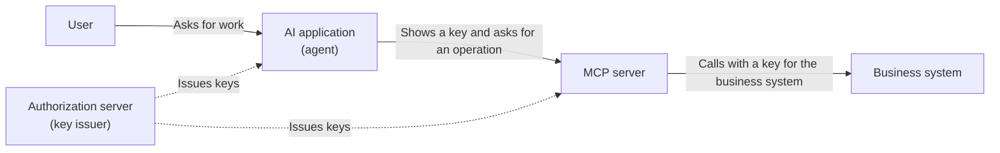

# Overview

MCP (Model Context Protocol) is a standard for connecting AI applications to internal systems and external services. With MCP, an AI agent can read and change business data on behalf of a user.

That convenience comes with risk. Authorization decides how much you let the AI do, and where. If you get it wrong, incidents follow: the AI may delete data the user never meant to touch, or an attacker with a stolen key may reach other systems.

This post is for people who plan features that use MCP or decide whether to adopt it. It covers the following points without going into the details of the specification, so that managers and PMs can follow it too.

- Why MCP authorization is hard
- What incidents can happen
- What to decide first and what can wait
- Questions to ask your team

It follows the 2026-07-28 version, the current version as of October 2026. For implementation details, see the specification and the related posts.

# What happens in MCP

Consider an MCP server in front of internal business systems, through which employees work with business data from an AI application.

When the user asks the AI for work, the AI calls the MCP server on the user's behalf. To do so, the AI shows a temporary key called a token. The MCP server checks the key and then operates the business system.

Authorization means deciding, in this flow, who may do what, and how far.

# Why MCP authorization is hard

## 1. You cannot easily see whose authority the AI uses

The AI acts on the user's behalf. If records contain only the user, you cannot tell the AI's mistakes from the user's intent. After an incident, you cannot separate the cause or the responsibility.

## 2. AI makes mistakes, and attackers can trick it

An AI can misread instructions. It may also follow instructions hidden in an email or web page it reads (prompt injection). The resulting operations use a legitimate key, so the login system cannot stop them. Assume that someone can manipulate the AI, and limit what you let it do.

## 3. Keys tend to get reused

Passing the key the MCP server received straight on to backend business systems takes little effort. But if one key opens several systems, a stolen key exposes every one of them. The MCP specification forbids this reuse.

## 4. The specification protects only a narrow area

The MCP authorization specification mainly defines how the MCP server receives and checks keys. It does not define how to decide whether this AI may operate on this data on behalf of this user. The specification says only that servers MUST enforce access control, and each team builds the decision logic.

| Question | Does the MCP authorization specification cover it? |
|---|---|
| Is the user who they claim to be? | Out of scope. Leave it to your existing login system |
| Which AI did the user allow to reach which MCP server, and how far? | The core of the specification |
| May this AI operate on this data? | It does not define how to decide. Each team builds it |
| Who decides and reviews which AI may use which features? | Out of scope |
| Do high-risk operations need human approval? | No dedicated mechanism |

# Incidents that can happen

Here are the incidents that can happen when you build something that merely works, and how to prevent them.

| Incident | Impact | Prevention |
|---|---|---|
| An attacker uses a stolen key to reach the business systems behind the MCP server | One leak spreads to several systems | Accept only keys meant for the MCP server, and get a separate key for each business system |
| The AI deletes data, sends data outside, or reads other people's data | Data leaks or data loss | Keep permissions minimal, and decide on each operation. Have a human confirm high-risk operations |
| Passwords or keys leak through conversation logs with the AI | Leaked keys | Let the systems hold keys, and never show them to the AI |
| After an incident, nobody can trace who did what through which AI | No investigation or audit possible | Record the user and the AI separately |
| Departures and role changes do not reach the AI's permissions | The AI keeps acting with a former employee's permissions | Keep key lifetimes short, and prepare a way to revoke keys |

# What to decide first and what can wait

You do not need to build everything at the start. Decide first on what costs a lot to change later.

| When | Item | Why |
|---|---|---|
| Decide first | Issue keys from your company's central authentication platform, not from a separate issuer per MCP server | With several issuers, every departure and role change must reach all of them |
| Decide first | Do not reuse keys; use a separate key for each destination | Splitting them later means changing the settings of every connection |
| Decide first | Grant minimal permissions and add more when needed | Broad permissions are hard to take back once granted |
| Decide first | Record the user and the AI separately | Records you add later cannot cover past operations |
| Decide first | Keep key lifetimes short and keep a way to revoke them | You cannot recall long-lived keys once they spread |
| Can wait | Moving decision rules to an external system, human approval flows, continuous review of permissions | If you route decisions through one place, you can add these later |

For anything you postpone, record the reason and the conditions for revisiting it. That way you keep moving while the remaining work stays visible.

# Questions to ask your team

When you decide on adoption, check whether your team can answer these questions.

1. Which systems and data can the AI reach?
2. Whose authority does the AI use? Does it hold broader permissions than the user?
3. Does a human confirm high-risk operations such as deletions or payments?
4. Can you trace who did what through which AI after the fact?
5. When someone leaves or changes roles, do the AI's permissions stop too?

Any question your team cannot answer points to a gap in the design.

# Summary

- The MCP authorization specification mainly protects how keys reach the MCP server. Each team builds the decisions about which data the AI may operate on.
- AI makes mistakes, and attackers can trick it. It acts with a legitimate key, so the login system cannot stop it. Let it do as little as possible.
- Do not reuse keys, record the user and the AI separately, and keep keys short-lived and revocable. These three are hard to change later, so decide them first.
- When you decide on adoption, check whether your team can answer the five questions.

# Related Posts

- [What is Authorization? Mapping AuthN, AuthZ, and IAM Subdomains](/posts/authorization-domain-iam-subdomains/)
- [What Are Authorization Architectures and Models? PEP/PDP, RBAC/ABAC/ReBAC, and Choosing a Policy Engine](/posts/authorization-architecture-models-engines/)
- [What is the AuthZEN Authorization API? A Standard Between PEP and PDP](/posts/authzen-authorization-api/)
- [Which OAuth Standards Does an Authorization Platform Need? A Map of Delegation, Tokens, and Continuous Evaluation](/posts/oauth-standards-map-authorization-platform/)
- [What is Authorization for AI Agents? Delegation Chains, Human Approval, and Audit with MCP, AuthZEN, AIMS, and A2A/AP2](/posts/authorization-for-ai-agents/)
- [OAuth 2.1 and the Security BCP: RFC 9700 and RFC 6819 (Changes from OAuth 2.0)](/posts/oauth-2-1-security-bcp/)
- [What are Sender-Constrained Tokens? An Introduction to mTLS (RFC 8705) and DPoP (RFC 9449)](/posts/sender-constrained-tokens-mtls-dpop/)
- [What is Dynamic Client Registration (DCR)? An Introduction to RFC 7591 and 7592](/posts/dynamic-client-registration/)
- [OpenID Connect Discovery and Metadata: Auto-Configuration and jwks_uri Key Retrieval](/posts/oidc-discovery-metadata/)
- [What is the Big Picture of Service-to-Service Authentication? mTLS, Token Exchange, SPIFFE, and Zero Trust](/posts/service-to-service-authentication/)
- [Access Token Validation and Revocation: Introspection, JWT, and Token Revocation (RFC 7009)](/posts/access-token-validation-revocation/)

# References

- [MCP Specification 2026-07-28](https://modelcontextprotocol.io/specification/2026-07-28)
- [MCP Authorization (2026-07-28)](https://modelcontextprotocol.io/specification/2026-07-28/basic/authorization)
- [MCP Tools (2026-07-28)](https://modelcontextprotocol.io/specification/2026-07-28/server/tools)
- [MCP Security Best Practices (2026-07-28)](https://modelcontextprotocol.io/docs/2026-07-28/tutorials/security/security_best_practices)
- [OWASP Top 10 for LLM Applications: LLM06 Excessive Agency](https://genai.owasp.org/llmrisk/llm062025-excessive-agency/)
