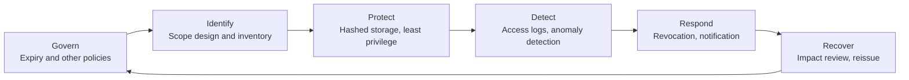
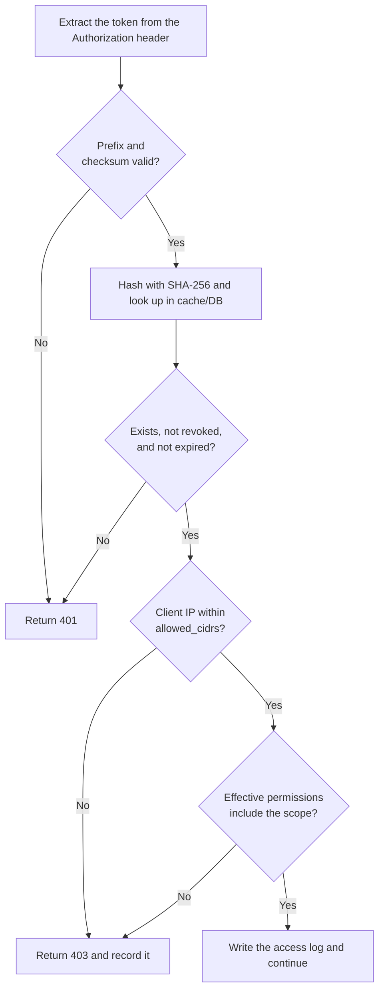

# Introduction
Services like GitHub and OpenAI let users issue Personal Access Tokens (PATs) with chosen scopes. The feature is convenient.

But if the implementation only issues a token, stores it in a database, and compares it on each request, a leaked token lets an attacker in as a legitimate user. Worse, nothing tells you that it happened.

This article first lays out the ideas behind the NIST Cybersecurity Framework (CSF) 2.0, then works backward from them to the design and implementation of an API token feature.

# TL;DR
- Design API tokens to both prevent misuse (Protect) and notice it (Detect).
- Use the six NIST CSF 2.0 Functions as a design checklist to cover operations, not just authentication.
- In practice: store hashes, use an identifiable token format, check scope containment, keep access logs, and revoke with cache purge.

# Why NIST CSF
Security discussions tend to focus on defense: how to encrypt, how to authenticate.

An API token, though, is a key that treats whoever holds it as the legitimate user. A leaked token passes authentication as is, so defense alone cannot stop the damage. The design must also cover how you notice a breach, how you stop it, and how you recover.

NIST CSF 2.0 gives a framework for this whole picture. NIST released CSF 2.0 on February 26, 2024, and added a sixth Function, Govern, to the original five. The Functions read as follows.

| Function | CSF 2.0 definition |
|---|---|
| Govern (GV) | The organization's cybersecurity risk management strategy, expectations, and policy are established, communicated, and monitored |
| Identify (ID) | The organization's current cybersecurity risks are understood |
| Protect (PR) | Safeguards to manage the organization's cybersecurity risks are used |
| Detect (DE) | Possible cybersecurity attacks and compromises are found and analyzed |
| Respond (RS) | Actions regarding a detected cybersecurity incident are taken |
| Recover (RC) | Assets and operations affected by a cybersecurity incident are restored |

CSF describes outcomes to achieve, not how to build them. The mapping in this article is my own interpretation of CSF applied to an API token feature.



# Mapping NIST CSF to API Token Design
The table maps each CSF Function to requirements for an API token feature. The IDs in parentheses point to relevant CSF 2.0 Subcategories.

| Function | Requirement | Design decisions |
|---|---|---|
| Govern | Token lifecycle rules (GV.PO-01) | Mandatory expiry with a cap (e.g. 90 days max), auto-revoke tokens unused for a long time |
| Identify | Know the scopes and who holds which token (ID.AM-08) | Scope granularity (`read:users`, `write:orders`, etc.), a token list with last-used time |
| Protect | Safe storage and least privilege (PR.AA-01, PR.AA-05, PR.DS-01) | Store hashes instead of raw tokens, block privilege escalation, IP restrictions (CIDR) |
| Detect | Find leaks and misuse early (DE.CM-03, DE.AE-02) | Rate-limit overruns, access from unknown IPs or countries, secret scanning |
| Respond | Contain and notify (RS.MI-01, RS.CO-02) | Instant revocation, automatic revocation and user notification on detection |
| Recover | Return to a safe state (RS.AN-03, RC.RP-05) | Review impact through access logs, a reissue flow |

# Implementation Derived from the Framework
The following sections show implementation examples that meet the requirements above. The examples use PostgreSQL and Go.

## [Protect] Schema: Never Store Raw Tokens
Generate tokens with a cryptographically secure random source and keep only the SHA-256 hash in the database. Show the raw token to the user once, at issue time.

```sql
CREATE TABLE api_tokens (
    id            UUID PRIMARY KEY DEFAULT gen_random_uuid(),
    user_id       UUID NOT NULL REFERENCES users(id),
    name          VARCHAR(255) NOT NULL,
    token_hash    CHAR(64) NOT NULL UNIQUE,         -- hex SHA-256 (Protect)
    token_prefix  VARCHAR(16) NOT NULL,             -- first chars for the UI (Identify)
    scopes        JSONB NOT NULL DEFAULT '[]',      -- least privilege (Protect)
    allowed_cidrs CIDR[],                           -- IP restrictions (Protect)
    last_used_at  TIMESTAMPTZ,                      -- last use (Detect)
    last_used_ip  INET,                             -- last client IP (Detect)
    expires_at    TIMESTAMPTZ NOT NULL,             -- mandatory expiry (Govern)
    revoked_at    TIMESTAMPTZ,                      -- revocation time (Respond)
    created_at    TIMESTAMPTZ NOT NULL DEFAULT now()
);

CREATE INDEX api_tokens_user_id_idx ON api_tokens (user_id);
```

Key points:

- Unlike a password, an API token is a long random value. Nobody can brute-force it back from its hash, so you don't need a slow hash like bcrypt; SHA-256 works. To verify, hash the incoming token and look it up by `token_hash`.
- Make `expires_at` `NOT NULL` so the schema itself rejects tokens without expiry. The application enforces the lifetime cap as a policy.
- Represent revocation with `revoked_at` instead of deleting the row. Deleting rows makes it impossible to tell later which token you revoked and when, which the Recover phase needs.

## [Protect / Detect] An Identifiable Token Format
Give tokens a service-specific prefix and a checksum. In 2021 GitHub changed its token format to use prefixes such as `ghp_` and a CRC32 checksum in the last six characters.

This format has several benefits:

- The prefix makes tokens easy to find in logs and source code with a regular expression, and reduces false positives in secret scanning.
- The checksum lets you reject malformed tokens before querying the database.
- `_` is not a base64 character, so it works well as a separator.

For example, Stripe uses `sk_live_`. Don't reuse another company's format; pick a prefix unique to your service. The example below uses `acme_pat_`.

```go
package token

import (
	"crypto/rand"
	"crypto/sha256"
	"encoding/hex"
	"hash/crc32"
	"math/big"
	"strings"
)

const (
	prefix    = "acme_pat_"
	randomLen = 30 // 30 Base62 chars ≈ 178 bits
	sumLen    = 6  // 62^6 > 2^32, so CRC32 fits
	alphabet  = "0123456789ABCDEFGHIJKLMNOPQRSTUVWXYZabcdefghijklmnopqrstuvwxyz"
)

// Generate returns the raw token (shown to the user once) and the hash to store.
func Generate() (raw, hash string, err error) {
	var b strings.Builder
	max := big.NewInt(int64(len(alphabet)))
	for i := 0; i < randomLen; i++ {
		n, err := rand.Int(rand.Reader, max)
		if err != nil {
			return "", "", err
		}
		b.WriteByte(alphabet[n.Int64()])
	}
	body := b.String()
	raw = prefix + body + checksum(body)
	return raw, Hash(raw), nil
}

// Hash returns the hex SHA-256 used as the lookup key.
func Hash(raw string) string {
	sum := sha256.Sum256([]byte(raw))
	return hex.EncodeToString(sum[:])
}

// LooksValid checks the prefix and checksum before any DB query.
func LooksValid(raw string) bool {
	if len(raw) != len(prefix)+randomLen+sumLen || !strings.HasPrefix(raw, prefix) {
		return false
	}
	body := raw[len(prefix) : len(prefix)+randomLen]
	return checksum(body) == raw[len(prefix)+randomLen:]
}

func checksum(body string) string {
	c := uint64(crc32.ChecksumIEEE([]byte(body)))
	out := make([]byte, sumLen)
	for i := sumLen - 1; i >= 0; i-- {
		out[i] = alphabet[c%62]
		c /= 62
	}
	return string(out)
}
```

The checksum does not protect against tampering. It only filters out typos and false positives cheaply. The database hash lookup remains the only authority on whether a token is valid.

## [Protect] Blocking Privilege Escalation
The issuing API must not let users attach permissions they don't have. Check that the user's permissions contain every requested scope.

```go
// ValidateScopes checks that requested is a subset of granted.
func ValidateScopes(requested, granted []string) error {
	allowed := make(map[string]struct{}, len(granted))
	for _, s := range granted {
		allowed[s] = struct{}{}
	}
	for _, s := range requested {
		if _, ok := allowed[s]; !ok {
			return fmt.Errorf("scope %q exceeds the user's permissions", s)
		}
	}
	return nil
}
```

The check at issue time is not enough. If the user later loses a permission, the token must not keep the old one. At request time, treat the intersection of the token's scopes and the user's current permissions as the effective permissions.

## [Protect / Detect] Request Verification Flow
Verify each request in the order below. Cheap checks come first to reduce database queries.



Updating `last_used_at` and `last_used_ip` on every request turns token traffic directly into database write load. Throttle the updates.

```sql
UPDATE api_tokens
SET last_used_at = now(), last_used_ip = $2
WHERE id = $1
  AND (last_used_at IS NULL OR last_used_at < now() - interval '1 minute');
```

## [Detect] Anomaly Detection
`last_used_ip` keeps only the latest value. For detection and later impact review, keep a separate per-request access log (token ID, client IP, User-Agent, endpoint, status). Then watch for signals like these:

- **Traffic spikes**: an abnormal number of requests in a short time. Beyond returning 429 from the rate limiter, record the overrun itself as a detection event.
- **Unknown IPs or countries**: record access from sources missing in the token's history and notify the user.
- **Changed usage patterns**: a long-dormant token suddenly gets used, or calls to endpoints it never touched increase.

## [Detect] Secret Scanning Integration
GitHub secret scanning finds secrets in public repositories and public npm packages. If you join the secret scanning partner program as a service provider, GitHub notifies you when it finds a string that matches your token format.

To join, you contact GitHub and register a regular expression that detects your tokens and an endpoint that receives alerts. To improve regular expression quality, GitHub recommends a unique prefix, a high-entropy random string, and a 32-bit checksum. The token format above follows those recommendations.

GitHub POSTs a JSON array like this to your endpoint:

```json
[
  {
    "token": "acme_pat_...",
    "type": "acme_personal_access_token",
    "url": "https://github.com/octocat/Hello-World/blob/.../foo/bar.txt",
    "source": "content"
  }
]
```

Handle it in this order:

1. Verify that GitHub sent the request using the `Github-Public-Key-Identifier` and `Github-Public-Key-Signature` headers. The signature uses ECDSA (NIST P-256, SHA-256). Verify it against the raw body you received, not a re-serialized JSON.
2. Check each `token` with `LooksValid`, hash it, and look it up.
3. Revoke matching tokens and notify the user, including the `url` where the leak appeared.

GitHub's documentation recommends treating any reported secret as public and compromised. So revoke automatically here without waiting for confirmation.

## [Respond] Instant Revocation and Cache Purge
Let users revoke a token from the dashboard at any time.

```sql
UPDATE api_tokens
SET revoked_at = now()
WHERE id = $1 AND user_id = $2 AND revoked_at IS NULL;
```

If you cache verification results in Redis or similar, delete the cache entry along with the revocation. Key the cache by `token_hash` rather than the raw token, so raw tokens never land in the cache either.

```go
func (s *Service) Revoke(ctx context.Context, userID, tokenID string) error {
	hash, err := s.repo.Revoke(ctx, userID, tokenID) // runs the UPDATE above, returns token_hash
	if err != nil {
		return err
	}
	if err := s.cache.Del(ctx, "apitoken:"+hash).Err(); err != nil {
		return err // don't swallow a failed purge
	}
	s.notifier.TokenRevoked(ctx, userID, tokenID)
	return nil
}
```

Keep the cache TTL short as well. If a purge fails, the TTL caps how long a revoked token stays usable.

For automatic responses to anomalies, consider false positives. When a compromise is near certain, as with a secret scanning alert, revoke automatically. When the signal is ambiguous, such as access from an unknown IP, notify the user and ask for confirmation.

## [Recover] Impact Review and Reissue
After revocation, find out what happened and return to a safe state.

- **Impact review**: extract the access log for the token ID from the suspected leak time to the revocation time and show it to the user. Knowing which endpoints and data the token touched tells you what else to do.
- **Reissue**: provide a flow to issue a new token with the same scopes. Use it as a chance to ask whether the old scopes were really necessary.

Feed what you learn in Recover back into policies such as expiry and scope granularity (Govern). The CSF Functions form a cycle, not a one-way sequence.

# Summary
When you design from functional requirements alone, an API token feature tends to end up as Protect only: issue, store, compare.

Looking through the NIST CSF lens first surfaces operational questions at design time:

- How do you notice a leak? (Detect)
- How do you stop it once you notice? (Respond)
- How do you get back to normal afterward? (Recover)
- What rules govern the whole lifecycle? (Govern)

Hashed storage, an identifiable token format, scope containment checks, access logs, and revocation with cache purge are all painful to retrofit. Build them in from the early stages of development.

# Related Posts
- [Access Token Validation and Revocation: Introspection, JWT, and Token Revocation (RFC 7009)](/posts/access-token-validation-revocation/)
- [OAuth 2.1 and the Security BCP: RFC 9700 and RFC 6819 (Changes from OAuth 2.0)](/posts/oauth-2-1-security-bcp/)
- [A Book to Understand Attacks and Countermeasures on OAuth and OIDC (Redirect Attack Edition)](/posts/oauth-oidc-attacks-and-countermeasures-guide/)

# References
- [The NIST Cybersecurity Framework (CSF) 2.0 (NIST CSWP 29)](https://doi.org/10.6028/NIST.CSWP.29)
- [NIST Releases Version 2.0 of Landmark Cybersecurity Framework](https://www.nist.gov/news-events/news/2024/02/nist-releases-version-20-landmark-cybersecurity-framework)
- [Behind GitHub's new authentication token formats - The GitHub Blog](https://github.blog/engineering/platform-security/behind-githubs-new-authentication-token-formats/)
- [Secret scanning partner program - GitHub Docs](https://docs.github.com/en/code-security/secret-scanning/secret-scanning-partnership-program/secret-scanning-partner-program)

