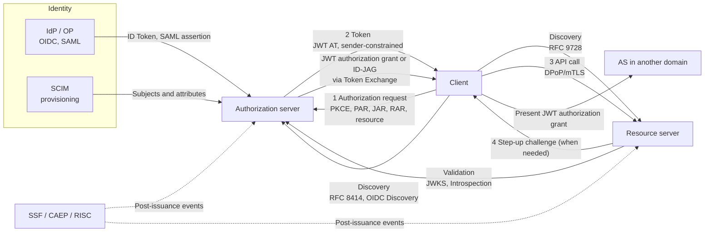

# Overview

Dozens of RFCs and OpenID Foundation specifications surround OAuth. If you build an authorization platform, memorizing each one helps less than grouping them by the question each one answers.

This post maps OAuth and its related standards from the viewpoint of an authorization platform. You will learn:

- The big picture, with standards grouped into seven questions: delegation, request integrity, discovery and audience, cross-domain, tokens, identity and provisioning, and continuous evaluation
- A one-line role for each standard and its status as of October 2026 (RFC, Draft, Final, and so on)
- What an authorization platform must decide
- An index to the deep-dive posts on this blog

Earlier posts on this blog cover OAuth 2.0, OAuth 2.1, PKCE, JOSE, JWT, sender-constrained tokens, Introspection, DCR, and OIDC in detail. This post gives only the key points for those and links to them.

This post gives short explanations of the standards the blog has not covered yet: RAR, PAR and JAR, Step-up, Protected Resource Metadata, and Client ID Metadata Document. It also covers CIBA, GNAP, SCIM, IPSIE, SSF/CAEP/RISC, and FAPI 2.0.

# Which Part of an Authorization Platform Does OAuth Handle?

OAuth carries delegation: who let which client access which resource. OAuth does not decide, inside a resource, "may this subject perform this action on this row?" A policy-based decision point (PDP) makes that call. [Authorization architecture, models, and engines](/posts/authorization-architecture-models-engines/) covers it.

Within an authorization platform, OAuth and related standards play these roles:

- Issue the result of delegation as a token, carry it, and let others check it
- Supply identifiers and attributes of subjects (users, clients, workloads)
- Announce changes that happen after issuance

[What is authorization? IAM subdomains](/posts/authorization-domain-iam-subdomains/) shows where this fits in IAM as a whole.

# The Big Picture

First, place the standards on the basic OAuth flow. A client obtains an access token from an authorization server (AS) and calls a resource server (RS). Each standard defines or strengthens some part of this flow.

The following table is the map itself. I checked each status as of October 2026 against the IETF Datatracker and openid.net.

| Question | Main standards | Status (October 2026) | Deep-dive posts |
| --- | --- | --- | --- |
| Delegation: who delegates what | OAuth 2.0 (RFC 6749/6750), OAuth 2.1, RFC 9700, PKCE (RFC 7636), RAR (RFC 9396), CIBA, GNAP (RFC 9635) | OAuth 2.1 is a Draft; the rest are RFCs or Final | [OAuth 2.0](/posts/oauth-2-0/), [OAuth 2.1](/posts/oauth-2-1-security-bcp/) |
| Request integrity: prevent tampering | PAR (RFC 9126), JAR (RFC 9101), `iss` (RFC 9207), FAPI 2.0 | RFCs; FAPI 2.0 is Final | [OAuth 2.1](/posts/oauth-2-1-security-bcp/) |
| Discovery and audience: which AS, for which resource | RFC 8414, OIDC Discovery, Resource Indicators (RFC 8707), Protected Resource Metadata (RFC 9728), DCR (RFC 7591/7592), CIMD | CIMD is a Draft; RFC 7592 is an Experimental RFC; the rest are RFCs or Final | [Discovery](/posts/oidc-discovery-metadata/), [DCR](/posts/dynamic-client-registration/) |
| Cross-domain: cross trust boundaries | Token Exchange (RFC 8693), Identity Chaining, ID-JAG, Transaction Tokens | All Drafts except RFC 8693 | [Service-to-service authentication](/posts/service-to-service-authentication/) |
| Tokens: what goes in, how to validate, how to stop | JOSE, JWT, JWT AT (RFC 9068), Introspection (RFC 7662), Revocation (RFC 7009), mTLS (RFC 8705), DPoP (RFC 9449) | RFCs | [JOSE](/posts/jose-overview/), [Validation and revocation](/posts/access-token-validation-revocation/), [Sender-constrained tokens](/posts/sender-constrained-tokens-mtls-dpop/) |
| Identity: establish who and supply attributes | OIDC Core, SAML 2.0, SCIM (RFC 7643/7644/9967), IPSIE | OIDC is Final, SAML 2.0 is an OASIS Standard, SCIM consists of RFCs, IPSIE is a Draft | [OIDC](/posts/openid-connect-1-0-spec-summary/), [SAML](/posts/saml-2-0/) |
| Continuous evaluation: reflect changes after issuance | SET (RFC 8417), SSF, CAEP, RISC, Step-up (RFC 9470) | RFCs; SSF/CAEP/RISC are Final | [Logout and SET](/posts/oidc-logout-security-event-token/) |

The rest of this post walks through each question: the role of each standard and what the platform must decide.

# Delegation: Who Delegates What, and How Far

## The Foundation

| Standard | One-line role | Status |
| --- | --- | --- |
| RFC 6749 / RFC 6750 | The core of OAuth 2.0: roles, grants, and how to use bearer tokens | RFC |
| OAuth 2.1 (draft-ietf-oauth-v2-1) | Consolidates 6749, major extensions, and the BCP. Requires PKCE with narrow exceptions and drops Implicit and Password | Draft (-16, September 2026) |
| RFC 9700 (BCP 240) | The Security BCP, collecting attacks and countermeasures found since 2012 | RFC |
| RFC 7636 (PKCE) | Stops authorization code interception. RFC 9700 requires it for public clients and recommends it for confidential clients; OAuth 2.1 requires it for all clients with narrow exceptions | RFC |
| RFC 8252 and RFC 10017 (BCP 212) | Best Current Practice for native apps and browser-based apps | RFC (10017 in August 2026) |
| RFC 8628 | Device grant: approve on a second device when the first one has poor input | RFC |
| RFC 7523 | Client authentication with a JWT (the basis of OIDC's `private_key_jwt`), and JWTs as authorization grants | RFC |

[What is OAuth 2.0?](/posts/oauth-2-0/) covers OAuth 2.0 as a whole, and [What is OAuth 2.1?](/posts/oauth-2-1-security-bcp/) covers OAuth 2.1 and the RFC 9700 recommendations. [Where should you store SPA tokens?](/posts/spa-token-storage-bff/) covers token storage in SPAs.

An authorization platform must decide which grant types and which client types (public or confidential) to allow.

## RAR (RFC 9396): Delegation That Scopes Cannot Express

RAR (OAuth 2.0 Rich Authorization Requests) expresses fine-grained delegation that scopes cannot, such as "let me send 45 euros to Merchant A." The client puts it in the `authorization_details` parameter, a JSON array of typed objects. The AS returns the granted details in the token response, and the RS can read them from a JWT access token or an introspection response.

An authorization platform has to decide which operations to express as scopes and which as RAR, and who defines and validates the schema for each `type`. RAR carries what someone delegated; decisions inside the resource still need a separate check.

## CIBA: Approval on the User's Own Device

CIBA (OpenID Connect Client-Initiated Backchannel Authentication) became an OpenID Foundation Final specification in September 2021. Without a redirect, the client asks the OP for authentication and consent over a back channel, and the user approves on a separate device such as a phone. It suits cases where the person operating and the person approving use different devices, and AI agents that need human approval can use it too. [What is Authorization for AI Agents?](/posts/authorization-for-ai-agents/) covers that case.

An authorization platform has to decide how to identify the user (the `login_hint` format) and which device receives the approval request.

## GNAP (RFC 9635): A Separate Protocol That Rebuilds OAuth

GNAP (Grant Negotiation and Authorization Protocol) does not extend OAuth. It redesigns delegation from scratch and does not aim for direct compatibility with OAuth 2.0. Its ideas of key-bound clients and grants you can update or revoke after issuance still help when you design OAuth sender constraints or agent delegation.

# Request Integrity: Keep Authorization Requests Tamper-Proof

Authorization request parameters usually travel in the browser URL. The user's device or a browser extension can read or rewrite them. A large JSON payload such as RAR also makes the URL long.

| Standard | One-line role | Status |
| --- | --- | --- |
| RFC 9126 (PAR) | Push the authorization request to the AS over a back channel first, and give the browser only a reference | RFC (September 2021) |
| RFC 9101 (JAR) | Turn the authorization request into a signed JWT (Request Object) | RFC (August 2021) |
| RFC 9207 | Put `iss` in the authorization response to stop mix-up attacks | RFC |
| FAPI 2.0 Security Profile | A high-assurance profile that requires PAR and sender constraints | Final (February 2025) |

[What is OAuth 2.1?](/posts/oauth-2-1-security-bcp/) covers `iss` and mix-up attacks.

## PAR (RFC 9126) and JAR (RFC 9101)

With PAR, the client first sends the authorization request parameters to the AS over a back channel, and gives the browser only a reference, `request_uri`. The parameters never pass through the browser, which makes tampering and leakage harder.

JAR packs the authorization request into a signed JWT (Request Object). The signature shows that the client created the request and that nobody changed it on the way.

The two protect different things, and you can combine them. An authorization platform must decide whether to require PAR for every client. The AS can announce this through the `require_pushed_authorization_requests` metadata.

## FAPI 2.0: A High-Assurance Profile

FAPI 2.0 is an OpenID Foundation profile that narrows how to use OAuth for high-risk APIs such as those in finance. The Security Profile reached Final in February 2025. It requires PAR, PKCE, and sender-constrained access tokens, among other things. Even if you do not build financial APIs, FAPI 2.0 serves as a reference for how far to tighten controls on high-risk operations.

# Discovery and Audience: Which AS, and Tokens for Which Resource

Sometimes the client, the AS, and the RS have no prior relationship. With MCP and AI agents, for example, a client facing an unfamiliar RS must find out at runtime which AS issues tokens for it.

| Standard | One-line role | Status |
| --- | --- | --- |
| RFC 8414 / OIDC Discovery | Publish the AS (OP) endpoints, capabilities, and `jwks_uri` | RFC / Final |
| RFC 8707 (Resource Indicators) | Name the token's target with `resource` and narrow `aud` | RFC |
| RFC 9728 (Protected Resource Metadata) | Let the RS publish which AS protects it and which scopes it supports | RFC (April 2025) |
| RFC 7591 / RFC 7592 (DCR) | Register and manage clients at the AS dynamically | RFC (7592, for management, is Experimental) |
| CIMD (draft-ietf-oauth-client-id-metadata-document) | Use a URL as `client_id` and host the client metadata at that URL | Draft (-02, July 2026) |

[OpenID Connect Discovery and metadata](/posts/oidc-discovery-metadata/) covers AS metadata, [What are sender-constrained tokens?](/posts/sender-constrained-tokens-mtls-dpop/) covers Resource Indicators, and [What is Dynamic Client Registration?](/posts/dynamic-client-registration/) covers DCR.

## Protected Resource Metadata (RFC 9728)

RFC 9728 is the RS counterpart of RFC 8414. The RS serves JSON at `/.well-known/oauth-protected-resource` that lists its identifier (`resource`), the authorization servers that can issue tokens for it, and the scopes and sender constraints it supports. When the RS returns 401, it can point to this URL in the `WWW-Authenticate` header. The moment a call to the RS fails, the client learns which AS it should contact. The MCP authorization specification requires MCP servers to serve this metadata.

An authorization platform must decide how to name RS identifiers. The same value appears in the RFC 8707 `resource` parameter and in the token's `aud`. Without consistent identifiers, audience validation breaks down.

## Client ID Metadata Document (CIMD)

With DCR, the client registers at each AS it uses, and each AS stores and manages the registered client information. CIMD uses an HTTPS URL as the `client_id`, and the client hosts its metadata as JSON at that URL. The AS fetches the document from that URL, so the client does not need to register with each AS in advance.

Because the AS fetches external URLs, it needs SSRF countermeasures. The AS can also set its own policy on which client domains to trust. The MCP authorization specification (2026-07-28) prefers CIMD over DCR and deprecates DCR. [How Should You Design Authorization for MCP?](/posts/mcp-authorization-design/) covers the details.

An authorization platform must decide which registration methods (pre-registration, DCR, CIMD) to allow for which kinds of clients.

# Cross-Domain: Carry Delegation Across Trust Boundaries

Sometimes you want to carry a user's delegation between internal microservices or across SaaS products. Passing the original token straight through leaves its audience wide open and widens the damage if it leaks. So you exchange the token each time you cross a boundary.

| Standard | One-line role | Status (October 2026) |
| --- | --- | --- |
| RFC 8693 (Token Exchange) | Exchange one token for another, and record the delegation chain in `act` | RFC |
| Identity Chaining (draft-ietf-oauth-identity-chaining) | Get a JWT authorization grant from the AS in domain A, then exchange it for a token at the AS in domain B | Draft (-17, in the RFC Editor queue) |
| ID-JAG (draft-ietf-oauth-identity-assertion-authz-grant) | Use an ID-JAG from the IdP to get a token at another SaaS for a user who already signed in through SSO | Draft (-04, May 2026) |
| Transaction Tokens | Carry user and request context along a chain of internal calls | Draft |

[The big picture of service-to-service authentication](/posts/service-to-service-authentication/) covers Token Exchange basics. [Standardizing workload identity](/posts/workload-identity-wimse-transaction-tokens/) covers Transaction Tokens and workload identity.

## Identity Chaining and ID-JAG

Identity Chaining offers a general mechanism for crossing domains. The client obtains a grant for the other domain through Token Exchange at the AS in its own domain. It then presents that grant to the other domain's AS and receives an access token.

ID-JAG (Identity Assertion JWT Authorization Grant) applies this pattern to apps that trust the same IdP for SSO. The user does not need to sign in or consent again. The IdP decides in one place which app may access which SaaS. The SaaS authorization server still applies its own policy to decide whether to honor the ID-JAG and what access token to issue.

An authorization platform must decide whose permissions to carry across a domain boundary, and how far. Narrow `aud` and scopes at each exchange, and record who acts on whose behalf in `act`. [What is Authorization for AI Agents?](/posts/authorization-for-ai-agents/) covers the use with AI agents.

# Tokens: What Goes In, How to Validate, How to Stop

This blog has covered this area in the most depth. Here are only the key points and the posts.

| Standard | One-line role | Deep-dive posts |
| --- | --- | --- |
| RFC 7515–7518 (JOSE), RFC 7519 (JWT), RFC 8725 (JWT BCP) | Containers for signatures, encryption, keys, algorithms, and claims, and how to use them safely | [What is JOSE?](/posts/jose-overview/), [What is JWT?](/posts/jwt-introduction/) |
| RFC 9068 (JWT access tokens) | Claims and validation steps for access tokens in JWT form | [Access token validation and revocation](/posts/access-token-validation-revocation/) |
| RFC 7662 (Introspection) | Ask the AS whether an opaque token is valid and what attributes it has | Same as above |
| RFC 7009 (Revocation) | Revoke access tokens and refresh tokens | Same as above |
| RFC 8705 (mTLS), RFC 9449 (DPoP) | Bind tokens to keys so stolen tokens become useless | [What are sender-constrained tokens?](/posts/sender-constrained-tokens-mtls-dpop/) |
| BFF | An architecture that keeps tokens out of the browser | [Where should you store SPA tokens?](/posts/spa-token-storage-bff/) |

As of October 2026, the revision of RFC 8725 (draft-ietf-oauth-rfc8725bis) sits in the RFC Editor queue.

An authorization platform must decide:

- **Format**: Let the RS self-validate JWTs, or let it check opaque tokens through Introspection. Choose based on whether you need instant revocation or want to avoid lookup latency.
- **Lifetime**: Keep access tokens short-lived, and back them up with refresh tokens and event-driven revocation.
- **Audience**: Always check `aud` and narrow it with RFC 8707. Without audience restriction, an RS that receives the token, or anyone who steals it, can replay it at other resource servers that trust the same AS.
- **Sender constraint**: Hand out bearer tokens as they are, or bind them to keys with DPoP or mTLS.
- **Content**: Pack a list of permissions into the token, or leave decisions to the PDP and put only the subject and delegation in the token. [Authorization platform architecture and design decisions](/posts/authorization-platform-architecture-decisions/) covers this choice.

[Designing secure API tokens with NIST CSF 2.0](/posts/nist-csf-api-token-design/) covers the design of long-lived tokens such as API keys.

# Identity and Provisioning: Establish Who, and Supply Attributes

Authorization decisions need to know who the subject is, which groups it belongs to, and which attributes it has. Authentication standards and provisioning standards carry that information.

| Standard | One-line role | Status |
| --- | --- | --- |
| OpenID Connect Core 1.0 | Carries the authentication result as an ID Token on top of OAuth | Final |
| SAML 2.0 | SSO with XML assertions. OASIS approved it as a standard in March 2005 | OASIS Standard |
| RFC 7643 / RFC 7644 (SCIM) | REST API and schema to create, update, and delete users and groups across organizations | RFC (September 2015) |
| RFC 9967 (SCIM profile for SETs) | Notifies SCIM changes asynchronously through Security Event Tokens | RFC (May 2026) |
| IPSIE | Interoperability profiles for enterprise SSO, lifecycle, revocation, and more | Draft (in progress in the WG) |

[Summary of OpenID Connect 1.0](/posts/openid-connect-1-0-spec-summary/) covers OIDC, and [What is SAML 2.0?](/posts/saml-2-0/) covers SAML. Keep authentication and authorization in separate layers. An ID Token tells the RP who authenticated; it does not serve as a token for calling APIs.

## SCIM: Keep Subjects and Attributes in Sync for Authorization

SCIM (System for Cross-domain Identity Management) delivers users and groups from an IdP or HR system to SaaS products. For an authorization platform, SCIM keeps the subjects and attributes used in decisions in sync across services ahead of time, and this is the data a PIP reads. Groups and attributes change automatically as people join, move, and leave.

An authorization platform must decide where the source of truth for subjects and attributes lives, and whether to push data through SCIM in advance or query a PIP on each decision.

## IPSIE: Interoperability Profiles for the Enterprise

IPSIE (Interoperability Profiling for Secure Identity in the Enterprise) is an OpenID Foundation working group. It does not create new protocols. It writes profiles that narrow how to use existing specifications, covering SSO, user lifecycle management, logout, token revocation, and more. As of October 2026, IPSIE has no Final specification and no Implementer's Draft.

# Continuous Evaluation: When Things Change After Issuance

A token reflects a decision at the moment of issuance. After that, a user may leave the company, a device may fall into an attacker's hands, or the risk level may rise. Short token lifetimes alone cannot catch changes within that window.

| Standard | One-line role | Status |
| --- | --- | --- |
| RFC 8417 (SET) | A JWT container for security events | RFC |
| OIDC Back-Channel Logout 1.0 | Lets the OP tell the RP about logout through a Logout Token (a JWT with an `events` claim) | Final |
| SSF 1.0 | Defines streams that deliver SETs between event transmitters and receivers | Final (August 2025) |
| CAEP 1.0 | Defines event types such as session revocation and claim changes | Final (August 2025) |
| RISC 1.0 | Defines event types such as account disablement and credential compromise | Final (August 2025) |
| RFC 9470 (Step-up) | Lets the RS return a challenge that asks for stronger or fresher authentication | RFC (September 2023) |

[OIDC logout and Security Event Token (SET)](/posts/oidc-logout-security-event-token/) covers SET and OIDC logout.

## SSF, CAEP, and RISC

SSF (OpenID Shared Signals Framework) sets the rules between a Transmitter that sends events and a Receiver that receives them. CAEP (Continuous Access Evaluation Profile) defines event types for continuous access evaluation, such as session revocation and claim changes. RISC (Risk Incident Sharing and Coordination) defines event types about account risk, such as account disablement and credential compromise.

With these standards, you can run "short-lived access tokens, plus instant notification of important changes through events."

## Step-up (RFC 9470): The RS Asks for Stronger Authentication

RFC 9470 lets the RS say "the authentication behind this token falls short." In the `WWW-Authenticate` header of a 401 response, the RS names the required authentication strength (`acr_values`) or the upper limit on time since authentication (`max_age`). The client has the user authenticate again and retries with the new token. Use it when you want strong authentication only for operations such as payments or permission changes. [What is the AuthZEN Authorization API?](/posts/authzen-authorization-api/) shows an example of turning a PDP decision into a step-up.

For continuous evaluation, an authorization platform must decide:

- Which events to receive, and what to stop when one arrives
- Which `acr` to require for which operations

# What an Authorization Platform Must Decide

This table collects the decisions from each section.

| Area | Decision | Related standards |
| --- | --- | --- |
| Delegation | Which grant types and client types to allow | OAuth 2.1, RFC 9700, RFC 10017 |
| Delegation | Scopes or `authorization_details` | RAR |
| Delegation | Whether to use approval on another device, and if so, how to identify the user and where to send the notice | CIBA, device grant |
| Request integrity | Whether to require PAR or JAR, and from which risk level | PAR, JAR, FAPI 2.0 |
| Discovery and audience | How to name RS identifiers and validate `aud` | RFC 8707, RFC 9728 |
| Discovery and audience | How clients register | Pre-registration, DCR, CIMD |
| Cross-domain | How much permission to carry across a boundary, and how to record delegation | Token Exchange, ID-JAG, Transaction Tokens |
| Tokens | Format, lifetime, sender constraint, and content | JWT AT, Introspection, DPoP, mTLS |
| Identity | The source of truth for subjects and attributes, and how to distribute them | OIDC, SCIM |
| Continuous evaluation | Which events to receive and what to stop, and which operations need step-up | SSF, CAEP, RISC, Step-up |

You do not need to adopt everything from day one. Use the decision axes in [How far should you build an authorization platform?](/posts/authorization-platform-scope-stages/) and answer each question when it becomes relevant. Still, the author recommends deciding RS identifier naming and token content early. Identifiers end up in client configuration and `aud` checks, and token content ends up in RS code, so both resist later change.

# Summary

- OAuth carries delegation, and the PDP makes decisions inside resources. Grouping related standards into seven questions makes the field easier to navigate.
- RAR adds fine-grained delegation, PAR and JAR add request integrity, and FAPI 2.0 sets a bar for high-risk use.
- RFC 9728 and CIMD connect an RS, an AS, and a client that have never met. CIMD remains a Draft as of October 2026.
- Token Exchange forms the base for cross-domain delegation. Identity Chaining sits in the RFC Editor queue, and ID-JAG remains a working group Draft.
- SCIM keeps subjects and attributes in sync, and SSF, CAEP, RISC, and Step-up reflect changes after issuance. IPSIE aims to bundle SSO, lifecycle management, risk signal sharing, and more into enterprise profiles.
- As of October 2026, OAuth 2.1 remains a Draft.

# Related Posts

- [What is Authorization? Mapping AuthN, AuthZ, and IAM Subdomains](/posts/authorization-domain-iam-subdomains/)
- [How Much Authorization Platform Do You Need? Scope, Ownership, and Decision Axes](/posts/authorization-platform-scope-stages/)
- [What Are Authorization Architectures and Models? PEP/PDP, RBAC/ABAC/ReBAC, and Choosing a Policy Engine](/posts/authorization-architecture-models-engines/)
- [What is the AuthZEN Authorization API? A Standard Between PEP and PDP](/posts/authzen-authorization-api/)
- [What is Workload Identity? WIMSE, Transaction Tokens, and SPIFFE Client Authentication for Service Identity and Context](/posts/workload-identity-wimse-transaction-tokens/)
- [What is Authorization for AI Agents? Delegation Chains, Human Approval, and Audit with MCP, AuthZEN, AIMS, and A2A/AP2](/posts/authorization-for-ai-agents/)
- [How Should You Design Authorization for MCP? Common Incidents and Decisions That Are Hard to Reverse](/posts/mcp-authorization-design/)
- [What Does an Authorization Platform Architecture Look Like? Containers, Key Sequences, PEP/PDP Placement, and Non-Functional Decisions](/posts/authorization-platform-architecture-decisions/)
- [OAuth 2.0 Explained: Complete Guide to Flows, Tokens, and Implementation](/posts/oauth-2-0/)
- [OAuth 2.1 and the Security BCP: RFC 9700 and RFC 6819 (Changes from OAuth 2.0)](/posts/oauth-2-1-security-bcp/)
- [Summary of OpenID Connect 1.0 Specifications](/posts/openid-connect-1-0-spec-summary/)
- [OpenID Connect Discovery and Metadata: Auto-Configuration and jwks_uri Key Retrieval](/posts/oidc-discovery-metadata/)
- [What is Dynamic Client Registration (DCR)? An Introduction to RFC 7591 and 7592](/posts/dynamic-client-registration/)
- [What is JOSE? An Overview of JWT, JWS, JWE, JWK, and JWA](/posts/jose-overview/)
- [What is JWT? JSON Web Tokens Explained for Secure API Authentication](/posts/jwt-introduction/)
- [Access Token Validation and Revocation: Introspection, JWT, and Token Revocation (RFC 7009)](/posts/access-token-validation-revocation/)
- [What are Sender-Constrained Tokens? An Introduction to mTLS (RFC 8705) and DPoP (RFC 9449)](/posts/sender-constrained-tokens-mtls-dpop/)
- [OIDC Logout and Security Event Token (SET)](/posts/oidc-logout-security-event-token/)
- [Where Should You Store SPA Tokens? A BFF + Session Authentication Design](/posts/spa-token-storage-bff/)
- [What is the Big Picture of Service-to-Service Authentication? mTLS, Token Exchange, SPIFFE, and Zero Trust](/posts/service-to-service-authentication/)
- [SAML 2.0 Explained: How SSO and Federated Identity Work](/posts/saml-2-0/)
- [Designing Secure API Tokens with NIST CSF 2.0: Working Backward from Protect and Detect](/posts/nist-csf-api-token-design/)
- [Resources for Catching Up on OAuth2 and OIDC](/posts/resources-for-catching-up-on-oauth2-oidc/)

# References

- [RFC 6749 The OAuth 2.0 Authorization Framework](https://www.rfc-editor.org/rfc/rfc6749)
- [RFC 6750 The OAuth 2.0 Authorization Framework: Bearer Token Usage](https://www.rfc-editor.org/rfc/rfc6750)
- [The OAuth 2.1 Authorization Framework (draft-ietf-oauth-v2-1)](https://datatracker.ietf.org/doc/draft-ietf-oauth-v2-1/)
- [RFC 9700 Best Current Practice for OAuth 2.0 Security](https://www.rfc-editor.org/rfc/rfc9700)
- [RFC 7636 Proof Key for Code Exchange by OAuth Public Clients](https://www.rfc-editor.org/rfc/rfc7636)
- [RFC 8252 OAuth 2.0 for Native Apps](https://www.rfc-editor.org/rfc/rfc8252)
- [RFC 10017 OAuth 2.0 for Browser-Based Applications](https://www.rfc-editor.org/rfc/rfc10017)
- [RFC 8628 OAuth 2.0 Device Authorization Grant](https://www.rfc-editor.org/rfc/rfc8628)
- [RFC 7523 JSON Web Token (JWT) Profile for OAuth 2.0 Client Authentication and Authorization Grants](https://www.rfc-editor.org/rfc/rfc7523)
- [RFC 9396 OAuth 2.0 Rich Authorization Requests](https://www.rfc-editor.org/rfc/rfc9396)
- [RFC 9126 OAuth 2.0 Pushed Authorization Requests](https://www.rfc-editor.org/rfc/rfc9126)
- [RFC 9101 The OAuth 2.0 Authorization Framework: JWT-Secured Authorization Request (JAR)](https://www.rfc-editor.org/rfc/rfc9101)
- [RFC 9207 OAuth 2.0 Authorization Server Issuer Identification](https://www.rfc-editor.org/rfc/rfc9207)
- [RFC 9470 OAuth 2.0 Step Up Authentication Challenge Protocol](https://www.rfc-editor.org/rfc/rfc9470)
- [RFC 8414 OAuth 2.0 Authorization Server Metadata](https://www.rfc-editor.org/rfc/rfc8414)
- [OpenID Connect Discovery 1.0](https://openid.net/specs/openid-connect-discovery-1_0.html)
- [RFC 8707 Resource Indicators for OAuth 2.0](https://www.rfc-editor.org/rfc/rfc8707)
- [RFC 9728 OAuth 2.0 Protected Resource Metadata](https://www.rfc-editor.org/rfc/rfc9728)
- [RFC 7591 OAuth 2.0 Dynamic Client Registration Protocol](https://www.rfc-editor.org/rfc/rfc7591)
- [RFC 7592 OAuth 2.0 Dynamic Client Registration Management Protocol](https://www.rfc-editor.org/rfc/rfc7592)
- [OAuth Client ID Metadata Document (draft-ietf-oauth-client-id-metadata-document)](https://datatracker.ietf.org/doc/draft-ietf-oauth-client-id-metadata-document/)
- [Model Context Protocol Specification 2026-07-28: Authorization](https://modelcontextprotocol.io/specification/2026-07-28/basic/authorization)
- [Model Context Protocol Specification 2026-07-28: Client Registration](https://modelcontextprotocol.io/specification/2026-07-28/basic/authorization/client-registration)
- [RFC 8693 OAuth 2.0 Token Exchange](https://www.rfc-editor.org/rfc/rfc8693)
- [OAuth Identity and Authorization Chaining Across Domains (draft-ietf-oauth-identity-chaining)](https://datatracker.ietf.org/doc/draft-ietf-oauth-identity-chaining/)
- [Identity Assertion JWT Authorization Grant (draft-ietf-oauth-identity-assertion-authz-grant)](https://datatracker.ietf.org/doc/draft-ietf-oauth-identity-assertion-authz-grant/)
- [Transaction Tokens (draft-ietf-oauth-transaction-tokens)](https://datatracker.ietf.org/doc/draft-ietf-oauth-transaction-tokens/)
- [JSON Web Token Best Current Practices (draft-ietf-oauth-rfc8725bis)](https://datatracker.ietf.org/doc/draft-ietf-oauth-rfc8725bis/)
- [RFC 9635 Grant Negotiation and Authorization Protocol (GNAP)](https://www.rfc-editor.org/rfc/rfc9635)
- [OpenID Connect Client-Initiated Backchannel Authentication Flow - Core 1.0](https://openid.net/specs/openid-client-initiated-backchannel-authentication-core-1_0.html)
- [FAPI 2.0 Security Profile](https://openid.net/specs/fapi-security-profile-2_0-final.html)
- [FAPI 2.0 Message Signing](https://openid.net/specs/fapi-message-signing-2_0-final.html)
- [OpenID Connect Core 1.0](https://openid.net/specs/openid-connect-core-1_0.html)
- [Security Assertion Markup Language (SAML) v2.0](https://www.oasis-open.org/standard/saml/)
- [RFC 7643 System for Cross-domain Identity Management: Core Schema](https://www.rfc-editor.org/rfc/rfc7643)
- [RFC 7644 System for Cross-domain Identity Management: Protocol](https://www.rfc-editor.org/rfc/rfc7644)
- [RFC 9967 System for Cross-Domain Identity Management (SCIM) Profile for Security Event Tokens (SETs)](https://www.rfc-editor.org/rfc/rfc9967)
- [IPSIE Working Group](https://openid.net/wg/ipsie/)
- [IPSIE Working Group - Specifications](https://openid.net/wg/ipsie/specifications/)
- [RFC 8417 Security Event Token (SET)](https://www.rfc-editor.org/rfc/rfc8417)
- [OpenID Connect Back-Channel Logout 1.0](https://openid.net/specs/openid-connect-backchannel-1_0.html)
- [RFC 8935 Push-Based Security Event Token (SET) Delivery Using HTTP](https://www.rfc-editor.org/rfc/rfc8935)
- [RFC 8936 Poll-Based Security Event Token (SET) Delivery Using HTTP](https://www.rfc-editor.org/rfc/rfc8936)
- [RFC 9493 Subject Identifiers for Security Event Tokens](https://www.rfc-editor.org/rfc/rfc9493)
- [OpenID Shared Signals Framework Specification 1.0](https://openid.net/specs/openid-sharedsignals-framework-1_0-final.html)
- [OpenID Continuous Access Evaluation Profile 1.0](https://openid.net/specs/openid-caep-1_0-final.html)
- [OpenID RISC Profile Specification 1.0](https://openid.net/specs/openid-risc-1_0-final.html)
