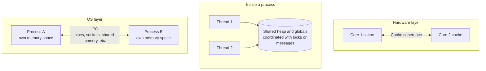
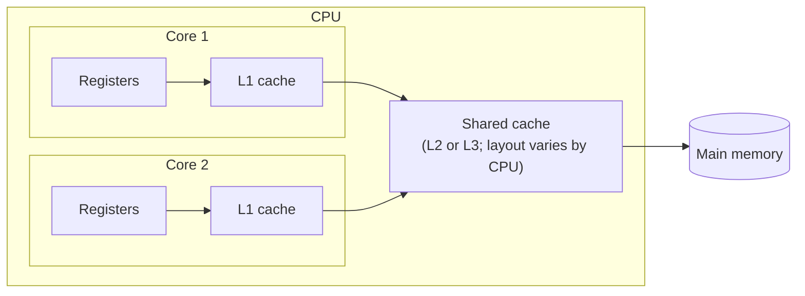

# Introduction
Talk about concurrency often mixes up "between processes," "between threads," and "between cores." All three ask how several units of execution share data, but each layer works in a different way.

This article gives a short overview of how data gets shared at each of these three layers. It assumes Linux and bases its claims on man pages and kernel documentation.

# TL;DR
- **Between processes**: memory spaces are separate, so one process cannot see another's data directly. Data moves through OS IPC such as pipes, sockets, or shared memory.
- **Between threads**: threads share one memory space and can read and write the same data directly. In return, you either protect it with locks or avoid sharing and pass messages instead.
- **Between cores**: data usually moves through memory. The hardware's cache coherence mechanism keeps the values in each core's cache consistent.

# Between Processes: Pass Data Through OS IPC
As the fork(2) man page states, the parent and child processes run in separate memory spaces. Right after fork they hold the same contents, but a write by one does not affect the other.

On Linux, fork uses copy-on-write pages. Instead of copying all memory at fork time, the kernel copies only the pages that get written.

Because the memory is separate, processes cannot read each other's variables. They use the inter-process communication (IPC) mechanisms the OS provides.

| Method | How it works | Typical use |
|---|---|---|
| Pipe | A one-way byte stream between related processes, such as parent and child | `ls \| grep` in a shell |
| Named pipe (FIFO) | A pipe opened through a name in the file system, usable by unrelated processes | Simple process coordination |
| Unix domain socket | A socket for communication within one machine, in both directions | Connecting to local daemons and databases |
| TCP/UDP socket | A socket that also works across the network | Talking to other machines |
| Shared memory | Maps the same memory region into several processes' address spaces | Sharing large data fast |
| Message queue | Passes messages through a queue the OS manages | Asynchronous notifications |
| Signal | Sends only a short notice, such as "terminate" | Stopping a process; by convention, some daemons reload their configuration on SIGHUP |

Broadly, there are two styles: copying the data across (pipes, sockets, queues) or looking at the same memory (shared memory). Copying keeps things safe but costs time for the copy.

Shared memory runs fast, but concurrent writes can corrupt it. The shm_overview(7) man page notes that processes typically must synchronize access to shared memory, for example with POSIX semaphores. Choosing shared memory brings in the same problem that threads face, covered next.

# Between Threads: Share Memory and Coordinate With Locks or Messages
According to pthreads(7), threads in one process share global memory (the data and heap segments), while each thread has its own stack. They also share open file descriptors.

| Shared between threads | Separate per thread |
|---|---|
| Heap, global variables | Stack (local variables) |
| Open file descriptors | Thread ID, signal mask, errno |

So threads can read and write the same data directly, without IPC. The problem: concurrent writes produce wrong results (a data race). Between threads, the challenge lies less in moving data and more in keeping accesses in a safe order.

The main tools:

| Tool | How it works |
|---|---|
| Mutex | Creates a section that one thread at a time can enter |
| Read-write lock | Lets many readers in at once but only one writer |
| Spinlock | Loops until the lock frees up; suited to short sections |
| Atomic operation | Uses CPU instructions to do things like compare-and-swap as one indivisible step |
| Condition variable, semaphore | Lets threads wait, for example until data becomes ready |
| Queue, channel | Passes data through a queue instead of sharing it |

The last option, queues and channels, avoids sharing memory even between threads and passes data the way processes do. Go's official guide, Effective Go, sums this up in a slogan:

> Do not communicate by sharing memory; instead, share memory by communicating.

The same guide adds that this approach can go too far: reference counts may work best as an integer guarded by a mutex. Choose locks or messages to fit the job.

# Between Cores: Hardware Keeps Values Consistent Through Cache Coherence
Now we reach the hardware. Data between cores usually moves through memory. Every core sees the same main memory, and the hardware keeps the caches in front of it consistent.

## The Cache Hierarchy
CPUs often stack small, fast per-core caches on top of larger caches that several cores share.

The layout varies by CPU. On my Apple M1, for example, `sysctl` shows four cores sharing each L2 cache and reports no L3 cache entry.

Caches and memory exchange data in units called cache lines. According to the kernel documentation, a cache line usually spans 64 bytes or more. The Apple M1 above uses 128 bytes.

## Cache Coherence
When core 1 changes a value while core 2's cache still holds the old one, the two disagree. Cache coherence mechanisms prevent this.

The kernel's memory barriers document explains that even when a load or store completes inside a core's own cache, it still appears to other cores as a full memory access. The coherence mechanism moves the cache line to the core that needs it and propagates changes when accesses conflict.

The earlier section said threads can read and write shared memory directly. At the hardware layer, this mechanism makes that possible.

## The Cost of Sharing Across Cores
The hardware keeps values consistent on its own, but not for free.

| Effect | What happens |
|---|---|
| Cache line ping-pong | When cores take turns writing the same data, the cache line bounces between them and slows things down |
| False sharing | Separate variables on the same cache line cause the same bouncing |
| Memory access ordering | A core may reorder instructions and memory accesses; guaranteeing the order other cores observe takes memory barriers |
| NUMA | On machines with several memory nodes, a CPU reads memory in its nearby node faster |

The kernel documentation on false sharing says it hurts when many CPUs access shared data and at least one access writes. Among its mitigations, it suggests putting frequently read and frequently written fields on different cache lines.

# Summary
Here are the three layers side by side.

| Layer | Memory | How data gets shared | Main pitfalls |
|---|---|---|---|
| Between processes | Separate | Passed through IPC (shared memory available too) | Copy cost; shared memory needs synchronization |
| Between threads | Shared | Read and written directly, coordinated with locks or messages | Data races |
| Between cores | Same memory, seen through caches | Hardware cache coherence keeps values consistent | Cache line ping-pong, false sharing, access ordering |

The higher the layer, the more the programmer handles explicitly; the lower the layer, the more the OS and hardware take care of. Still, the costs at lower layers shape the design at higher ones. Contended locks run slow, and designs that give each thread its own data run fast, partly because of how caches behave across cores.

# Related Posts
- [Processes vs Threads: Key Differences Every Developer Should Know](/posts/process-vs-thread/)
- [Go's Concurrency and Parallelism Model and Goroutine Scheduling](/posts/go-concurrency-parallelism-models/)
- [Redis vs Memcached vs Dragonfly: Single-Threaded and Shared-Nothing In-Memory Store Architectures](/posts/redis-memcached-dragonfly-architecture/)

# References
- [fork(2) — Linux manual page](https://man7.org/linux/man-pages/man2/fork.2.html)
- [pipe(7) — Linux manual page](https://man7.org/linux/man-pages/man7/pipe.7.html)
- [fifo(7) — Linux manual page](https://man7.org/linux/man-pages/man7/fifo.7.html)
- [shm_overview(7) — Linux manual page](https://man7.org/linux/man-pages/man7/shm_overview.7.html)
- [pthreads(7) — Linux manual page](https://man7.org/linux/man-pages/man7/pthreads.7.html)
- [numa(7) — Linux manual page](https://man7.org/linux/man-pages/man7/numa.7.html)
- [Effective Go: Share by communicating](https://go.dev/doc/effective_go#sharing)
- [Linux Kernel Memory Barriers](https://www.kernel.org/doc/Documentation/memory-barriers.txt)
- [False Sharing — The Linux Kernel documentation](https://docs.kernel.org/kernel-hacking/false-sharing.html)

