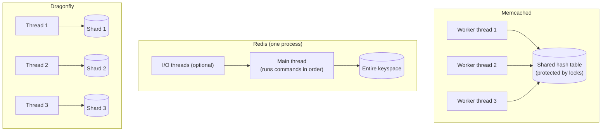

# Introduction
Memcached and Redis have long served as the in-memory data stores that speed up web applications. More recently, products such as Dragonfly have appeared, redesigned around multi-core machines from the start.

This article compares the three by threading model and by how they scale. It grounds each claim in the official documentation or repositories and notes the caveats.

# TL;DR
- Memcached is multi-threaded and focused on plain key-value caching. It has no persistence.
- Redis offers rich data structures and persistence. It runs commands on a single thread and uses more cores by running more processes or Redis Cluster.
- Dragonfly speaks the Redis and Memcached APIs and splits the keyspace across threads in a shared-nothing design, so a single process uses many cores.
- Benchmark conclusions flip depending on the setup, and licensing differences also affect the choice.

# Memcached vs Redis
First, a comparison of the two long-standing options.

| Aspect | Memcached | Redis |
|---|---|---|
| Design goal | A focused, simple cache | A feature-rich data structure server |
| Data model | Keys and values (values are arbitrary bytes) | Strings, hashes, lists, sets, sorted sets, and more |
| Persistence | None (Warm Restart covers planned restarts only) | RDB (snapshots) and AOF (append-only log) |
| Threading | Multi-threaded (one event loop per worker thread) | Single-threaded command execution (some work, such as I/O, on other threads) |
| Spreading across nodes | The client hashes keys to pick a server | Redis Cluster (server-side sharding) and replication |

Each Memcached worker thread runs its own event loop for its connections, and the threads share the cache through centralized locks. Since 1.5.18, Warm Restart lets Memcached keep its cache across a planned restart. As the official docs warn, the instance misses any updates sent during the downtime, so this is not persistence.

Redis provides atomic operations per data structure and can save data to disk with RDB and AOF. Beyond caching, teams use it for counters, leaderboards, queues, and more.

# Why Redis Runs Commands on a Single Thread
People call Redis "single-threaded," but strictly speaking, command execution is single-threaded. redis.conf itself says Redis is mostly single-threaded, with some operations such as UNLINK and slow I/O performed on side threads. With `io-threads` enabled, Redis also reads from and writes to sockets and parses the protocol on several threads.

Redis keeps command execution on one thread for three main reasons.

- **The CPU rarely becomes the bottleneck**: the official FAQ says CPU is seldom the limit for Redis, which is usually memory or network bound. It notes that with pipelining, a Redis instance on an average Linux system can deliver one million requests per second.
- **No locks needed**: commands run one at a time on a single thread, so the data structures need no locks. That rules out lock contention and the bugs that come with it.
- **Atomicity comes easily**: no other command runs in the middle of a command, so each command is atomic. Work grouped with MULTI/EXEC or a Lua script also runs without another client's commands slipping in.

## How Redis Uses Many Cores
Single-threaded command execution still leaves ways to use many cores. The official FAQ recommends starting several Redis instances on the same machine and treating them as separate servers when you want to use every CPU. Redis Cluster splits the keyspace into 16,384 hash slots and spreads them across processes and machines.

In other words, Redis uses cores and machines with the process, not the thread, as the unit. The accurate statement is that a single Redis process cannot use many cores on its own.

# The Challenge: Many Cores in One Process
Putting this together, the two make different trade-offs:

- **Memcached**: one process uses many cores, but it handles only plain key-value data and has no persistence.
- **Redis**: it offers rich features, but one process gets roughly one core's worth of command execution. To use more cores, you run more processes and shard across them.

Running many processes means managing shard placement, rebalancing, and cluster-aware clients. Multi-threaded data stores such as Dragonfly grew out of the question: can we get Redis-like features running fast on many cores within a single process?

# What Is Dragonfly?
Dragonfly is an in-memory data store written in C++ that claims compatibility with the Redis and Memcached APIs. According to its readme, it started as an experiment in what an in-memory store would look like if designed in 2022, aiming to fully use the CPU, memory, and I/O of large public cloud servers.

## Shared-Nothing Architecture
At Dragonfly's core sits a shared-nothing architecture.

- It splits the keyspace into "shards" and assigns each shard to a thread. Each thread manages only its own shard's data.
- A hash of the key decides its shard, and the thread that owns that shard processes it. No other thread touches that data directly.
- Operations that span shards go through a transactional framework based on the VLL (Very Lightweight Locking) paper. According to the readme, this lets Dragonfly run multi-key operations atomically without mutexes or spinlocks.

The diagram below contrasts the three threading models.

In Memcached, several threads share one area; in Redis, a single thread handles everything. Dragonfly gives each thread its own range, which avoids contention over shared data.

Dragonfly also bases its hash table on a design called Dash and implements snapshots without fork(). Its readme benchmark reports lower memory use than Redis during a snapshot.

# How to Read the Benchmarks
The figure most often quoted for Dragonfly is the "25X more throughput" in its readme. That result compares one Dragonfly instance against a single Redis process on an AWS c6gn.16xlarge.

In a 2022 blog post, Redis responded that a 40-shard Redis 7.0 Cluster on the same instance delivered 18% to 40% more throughput than Dragonfly. The conclusion flips depending on whether you compare one process against one process or a whole machine against a whole machine.

Both sets of numbers come from the vendors themselves, and results vary with workload and configuration. If you are considering adoption, measure with your own workload.

# Licensing and Ecosystem
Beyond technology, licensing also shapes the choice.

- **Redis**: in March 2024, Redis moved from BSD to source-available licenses including SSPL. Starting with Redis 8, it added the OSI-approved AGPLv3 as an option.
- **Valkey**: a BSD-licensed fork created after the Redis license change, developed under the Linux Foundation. AWS ElastiCache and Google Cloud Memorystore offer managed Valkey services.
- **Dragonfly**: licensed under BSL 1.1 (Business Source License), which is not OSI-approved open source. You may use it as part of your own product or service, but not to offer an in-memory data store as a service. Each version converts to Apache 2.0 on the earlier of four years after its release or November 1, 2030.

For a cache inside your own service, none of these usually causes trouble. Still, check the terms if you plan to offer it as a platform to other teams.

# Summary
Here is where each product fits.

- **Memcached**: an option for fast, plain key-value caching with many threads in one process.
- **Redis (and Valkey)**: the standard choice when you need rich data structures, persistence, replication, and clustering. It uses more cores by running more processes.
- **Dragonfly**: an option for keeping the Redis-compatible API while using many cores in one process. Check the extent of compatibility and the license first.

"Single-threaded means slow" and "multi-threaded means fast" are both oversimplifications. The real difference is whether the unit of scaling is the process or the thread. Weigh operational effort and licensing too, and choose what fits your requirements based on your own measurements.

# Related Posts
- [Basic Patterns of Cache Strategies](/posts/cache-strategy-patterns/)
- [Cache Write Methods](/posts/cache-write-methods/)
- [Practical Introduction to Redis: From Technical Mechanisms to Real-World Applications](/posts/redis-practical-introduction/)

# References
- [Redis FAQ](https://redis.io/docs/latest/develop/get-started/faq/)
- [redis.conf (THREADED I/O section)](https://github.com/redis/redis/blob/unstable/redis.conf)
- [Redis is now available under the AGPLv3 open source license](https://redis.io/blog/agplv3/)
- [13 Years Later – Does Redis Need a New Architecture?](https://redis.io/blog/redis-architecture-13-years-later/)
- [Valkey](https://valkey.io/)
- [Memcached Documentation: Performance and Efficiency](https://docs.memcached.org/serverguide/performance/)
- [Memcached Documentation: Warm Restart](https://docs.memcached.org/features/restart/)
- [dragonflydb/dragonfly (readme)](https://github.com/dragonflydb/dragonfly)
- [Dragonfly LICENSE (BSL 1.1)](https://github.com/dragonflydb/dragonfly/blob/main/LICENSE.md)

