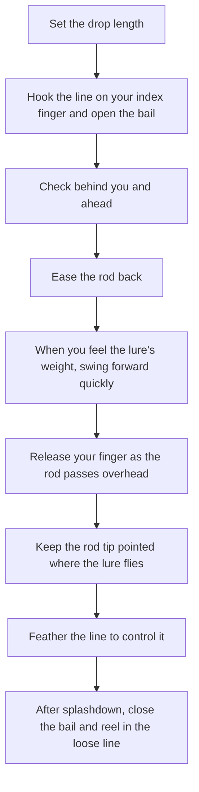
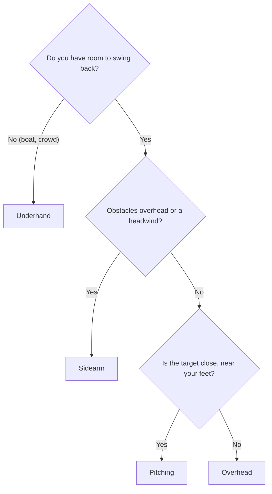

# Introduction
Lure fishing starts with getting your lure to the spot you aim for. This post walks through casting with a spinning reel in this order: the basic steps, choosing a cast type, accuracy and distance, and preventing line trouble.

The content applies to any lure fishing with spinning tackle, including sea bass, rockfish, and light game.

# The Basics: Let the Rod Do the Work
The rod's rebound as it straightens, not arm strength, sends the lure flying. Instead of swinging hard, focus on loading the lure's weight onto the rod.

When you cast with both hands, push your dominant hand forward and pull the butt of the grip toward you with the other hand. This bends the rod fully and produces the power you need for distance.

# Before You Cast
## Drop Length
Anglers call the length of line between the rod tip and the lure the "drop" (tarashi in Japanese). Shimano recommends about 30–50 cm and suggests starting on the short side. Daiwa gives about 10 cm as the short end and 70–80 cm as the long end, and adjusts it for lure weight and wind.

| Drop | Characteristics | Best for |
| --- | --- | --- |
| Short (10–30 cm) | Small swing, easier to aim | Short range, accuracy, beginners |
| Standard (30–50 cm) | Good balance of accuracy and distance | Start here |
| Long (50–80 cm) | Loads the rod more and adds distance, but aiming gets harder | Long casts, heavy lures |

## Grip
- Hold the reel foot between your middle and ring fingers.
- Turn the line roller toward the rod (straight up) and hook the line on the tip of your index finger.
- Keep the line on your finger and open the bail.

## Safety Check
Make sure no people or obstacles stand behind you and no boats sit in your casting direction before you cast.

# The Basic Cast (Overhead Cast)
The overhead cast swings straight down from above your head and forms the foundation of every other cast. The flow looks like this.

1. Set the drop to 30–50 cm. Keep it short until you get used to casting.
2. Grip the reel seat with your dominant hand, hook the line on the tip of your index finger, and open the bail.
3. Check behind you and in your casting direction.
4. Ease the rod back while you feel the lure's weight.
5. Fix your eyes on the target. When the weight of the lure swinging behind you reaches your fingertip, start the forward swing quickly.
6. Release your index finger from the line as the rod passes over your head.
7. Follow through and keep the rod tip pointed in the direction the lure flies.
8. While line pays out, touch the spool lip lightly with your index finger so no extra line comes off.
9. Close the bail between splashdown and the lure reaching bottom, then start reeling.

Keep three points in mind.

- Keep your elbow close to your body and swing the rod vertically to the water. An open elbow makes the path wobble and ruins your aim.
- If you release too early, the lure flies high. If you release too late, it slaps the water in front of you. When your direction drifts, check your release timing first.
- Don't cast at full power from the start. Use about 70–80% of your strength and focus on a straight cast toward the target.

# Cast Types and When to Use Each
The overhead cast can't handle every situation. Choose a cast that fits your surroundings.

| Cast | Motion | Strength | Best for |
| --- | --- | --- | --- |
| Overhead | Swing straight down from above your head | Stable direction, good distance | Open spots. Start with this |
| Sidearm | Swing level from your side | Low trajectory, less affected by wind | Headwinds, trees or bridges overhead, skipping low into cover |
| Underhand | Swing forward from below your waist | Works without room to swing back | Boats, crowded spots, short range |
| Pitching | Swing the lure like a pendulum and send it forward | Quiet splashdown, high accuracy at short range | Precise casts near your feet or around obstacles |

On a boat, anglers stand close together and have no room to swing back. Etiquette calls for an underhand cast in front of your own spot.

Work through these questions to pick a cast.

# Landing the Lure Where You Aim
- Pick a target before you cast and keep your eyes on the point where you want the lure to land.
- Line up your body and the rod with the target. Keep your elbow in and swing the rod vertically.
- Control distance with feathering. If the lure looks like it will overshoot, touch the spool lip with your index finger to slow the line.
- When you target the edge of cover, cast slightly past it and retrieve the lure along the edge. You miss less that way.

Feathering means controlling the line coming off the spool with your finger during the cast. With a baitcasting reel, you do the same with your thumb, which anglers call thumbing.

# Casting Farther
- Keep the lure weight within the lure-weight range printed on the rod. A lure that is too heavy bends the rod too far, makes it wobble, and tangles the line more.
- Fill the spool to the proper level. Too little line costs distance.
- Lengthen the drop a little and bend the rod fully.
- Stay relaxed. A light flick of the wrist uses the rod's spring better than a hard arm swing.
- Use a tailwind. Into a headwind, switch to a sidearm cast to keep the trajectory low.

# After the Lure Lands
- Stop the line with feathering at splashdown so the line doesn't go loose.
- Close the bail by hand, keep light tension on the line, and then start reeling. Reeling in loose line leaves loose wraps on the spool, which cause trouble on the next cast.
- For lures you work along the bottom, count the seconds from splashdown to bottom. The count gives you a rough depth and helps you work through depths on later casts.

# Preventing Line Trouble
Good preparation and care at the spot prevent most wind knots (small knots that form in the line) and line wrapping around the guides. The table lists the main causes and fixes from Shimano.

| Cause | What happens | Fix |
| --- | --- | --- |
| Too much line on the spool | Line comes off in clumps and forms wind knots | Fill to the spool lip. Remove a little if knots keep happening |
| Uneven spool shape (bulging at the bottom) | The most trouble-prone shape | Seat the spool fully. Remove a washer and respool |
| Casting with the leader wound onto the spool | The leader drags in the guides and the line behind it loosens and tangles | Cast with a leader length that stays off the spool |
| Knots that are too long | More wind knots and guide wraps | Tie the knot as short as you can while keeping it strong |
| Coil memory in the leader | More drag in the guides, which starts tangles | Retie the leader every trip |
| A mismatch with the rod | Line that is too thick runs poorly through the guides. A lure that is too heavy makes the rod wobble | Stay within the rod's line and lure-weight ratings |
| Misaligned rod sections | Guides point in different directions and the line comes off unevenly | Check that the guides line up straight across each joint |

At the water, the best fix is the one in the previous section: feather at splashdown and never reel in loose line.

# Safety and Etiquette
- Always check behind you and to both sides before you cast.
- On boats and at crowded spots, use an underhand cast without swinging back.
- A hooked lure passes behind you, so protect your eyes and head with polarized glasses and a cap.

# How to Practice
- Start with 70–80% of your strength and focus on casting straight toward the target. Work on distance after your direction becomes consistent.
- Practice with a casting weight that has no hooks.
- Use a bucket or a ring as a target, and practice feathering to stop the lure at a set distance.
- Before you practice in a park or similar place, confirm that the rules there permit casting practice.

# Field Summary
- Check behind you before you cast
- Set the drop to 30–50 cm. Hook the line on your finger before you open the bail
- Cast with the rod's bend, not your arm. Use 70–80% of your strength
- Release your finger as the rod passes overhead
- Feather if the lure flies too far. After splashdown, close the bail by hand and reel in the loose line
- No room behind you: underhand. Wind or overhead obstacles: sidearm

# Related posts
- [Rockfish lure fishing field guide](/posts/rockfish-worm-field-guide/)

# References
- [fish.shimano.com - How to cast a lure for beginners (Japanese)](https://fish.shimano.com/ja-JP/content/beginners/fishingstyle/lurefishing/action/index.html)
- [fish.shimano.com - Casting and line trouble prevention for saltwater spinning reels (Japanese)](https://fish.shimano.com/ja-JP/content/fishingstyle/article/2026/260430/index.html)
- [daiwa.com - Casting with a guided rod (Japanese)](https://www.daiwa.com/jp/beginner/throw/guide)

