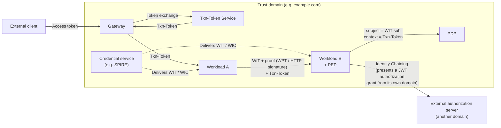
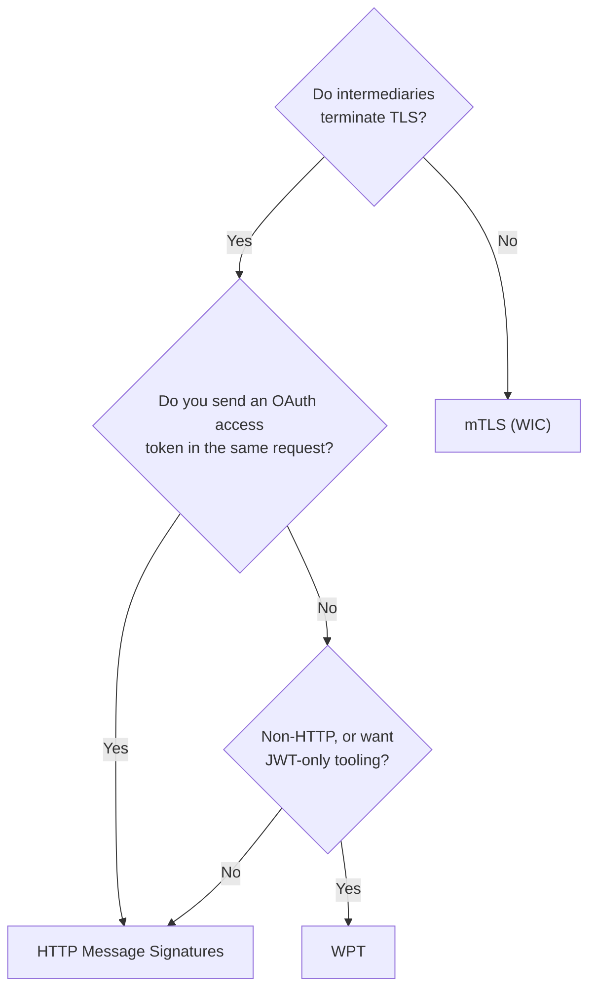
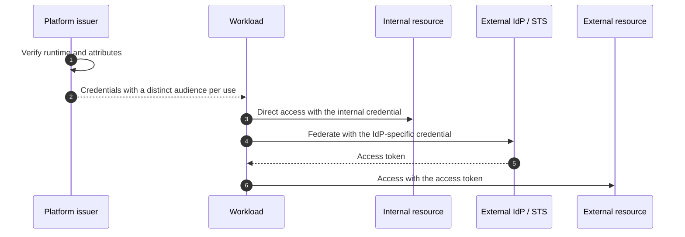
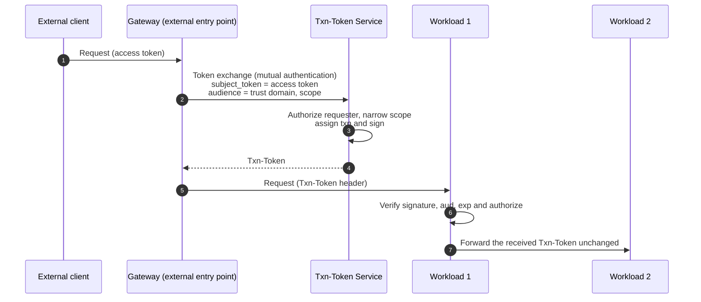
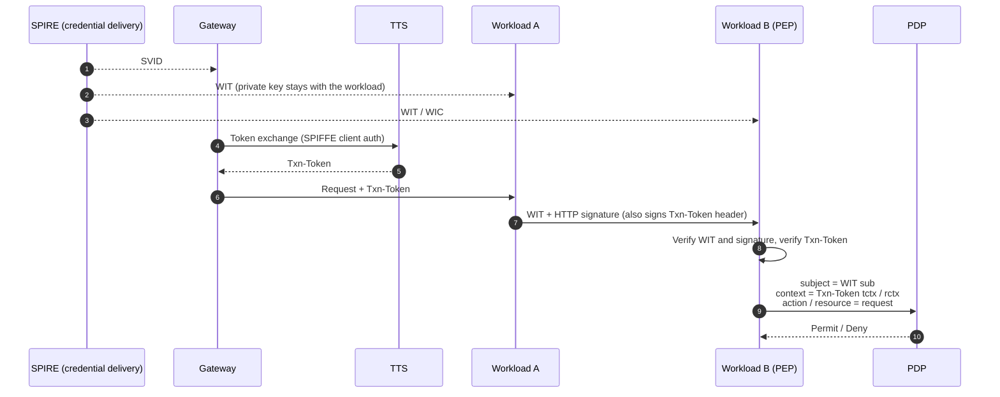

# Overview

In microservices, services act as principals for authentication and authorization, not only humans. When service A calls service B, B needs two answers: "which workload is calling?" and "on whose behalf, and for which transaction, does this call happen?"

The post "[What is the Big Picture of Service-to-Service Authentication?](/posts/service-to-service-authentication/)" covers the basic tools: mTLS, Token Exchange (RFC 8693), and SPIFFE/SPIRE. This post covers the standards work the IETF builds on top of them.

- **WIMSE** (Workload Identity in Multi System Environments): a set of IETF drafts that define workload identifiers, credentials (WIT/WIC), and authentication methods
- **Transaction Tokens**: a mechanism that exchanges an external access token (or a similar subject token) for an internal token bound to one transaction and propagates it along the call chain
- **OAuth SPIFFE Client Authentication**: a mechanism that uses SPIFFE SVIDs for OAuth client authentication and removes `client_secret`

This post answers the following questions.

- How does WIMSE differ from SPIFFE, and what does it add?
- What are WIT, WIC, and WPT, and when should you pick mTLS, HTTP signatures, or WPT?
- What must you protect when you deliver credentials to workloads?
- How do Transaction Tokens differ from access tokens, and how do they propagate?
- How do these pieces combine so that the PEP and PDP receive both the "subject" and the "context"?

These specifications all remain drafts, and their content changes between revisions. The end of this post lists each draft's revision and status, which I checked on the IETF Datatracker in October 2026.

# Why Standardize Workload Identity

Zero trust does not treat being inside the network as a reason to trust. Each workload holds a verifiable identity and credential, and the callee checks them on every call.

The problem splits into four questions.

| Question | What makes it hard | Main standards |
| --- | --- | --- |
| How do you give a workload an identity? | Pre-shared secrets create distribution, rotation, and leakage problems | SPIFFE/SPIRE, WIMSE practices guide |
| How do workloads authenticate each other? | When a proxy or load balancer terminates TLS, the peer identity stops there | WIMSE WIT/WIC, mTLS, HTTP signatures, WPT |
| How do you carry call context inside the system? | Reusing an external access token internally widens the damage when someone steals it | Transaction Tokens |
| How do you reach another trust domain? | You do not want to expose internal credentials or formats | Identity Chaining, the Transaction Token chaining profile |

The identity delivery and authentication rows share one approach: do not keep long-lived shared secrets (static API keys or `client_secret`). Instead, deliver short-lived credentials, bound to a key where possible, based on attestation of the environment.

The diagram below shows the whole picture first.



WIMSE credentials carry identity, and Transaction Tokens carry transaction context. With HTTP signatures or WPT, a proof of possession binds the two. The callee's PEP passes only verified values to the PDP. That forms the backbone.

# The WIMSE Architecture

The WIMSE architecture draft (draft-ietf-wimse-arch) does not define a protocol itself. As a basis for designing and standardizing protocols, it lays out terminology, use cases, and how the components relate.

## Three Building Blocks

The architecture rests on three elements.

| Element | Description |
| --- | --- |
| Trust domain | A group of systems that share security controls and policies. It SHOULD use an FQDN owned by the organization. It maps to X.509 trust anchors and to a JWK Set for verifying WITs, and that mapping MUST come from a secure mechanism |
| Workload identifier | A URI that names a workload uniquely within a trust domain. A separate draft (draft-ietf-wimse-identifier) defines the format. SPIFFE ID appears as a conforming example |
| Workload identity credential | A credential that binds the identifier to a cryptographic key. Two forms exist: the WIT (Workload Identity Token), a JWT, and the WIC (Workload Identity Certificate), an X.509 certificate |

An identifier's meaning depends on the trust domain that validates it. Per arch-08, two credentials with the same identifier value represent the same workload only when a verifier validates both under the same trust domain and issuer trust configuration. The later rule against authorizing on the path alone rests on the same idea.

Deployments SHOULD use bounded credential lifetimes and automated renewal. You do not generally need a new key pair for every request.

## Three Scenarios

arch-08 adds components step by step across three scenarios.

| Scenario | Added components | Key point |
| --- | --- | --- |
| Basic | Gateway, CA/credential service | Workloads authenticate each other with credentials. The callee decides which APIs the peer can call based on its identity and records it for audit |
| Context | Context service | The gateway exchanges the external access token for an internal context token. The gateway normally does not forward the access token inside |
| Cross-domain | Token service, external token service | Internal identity and context get exchanged for a token usable in another domain. The steps follow Identity Chaining |

arch-08 names Transaction Tokens as one example of this context token. Do not let an external bearer token flow inside; replace it with a token that has meaning only inside.

# Rules for Workload Identifiers

draft-ietf-wimse-identifier defines the format of workload identifiers. Identifiers become the subject of authorization policies and the key of audit logs, so they shape your data model directly.

A workload identifier is an absolute URI whose authority names the trust domain. The scheme is not fixed: you can use `spiffe` or the `wimse` scheme that the draft defines. A SPIFFE ID is one conforming format and works as is.

```text
spiffe://prod.example.org/ns/prod-01/sa/payment-api
wimse://trust.example.com/service/payment
```

Three points matter for an authorization platform.

- **Write policies against the full identifier.** Comparison and authorization MUST use the whole URI. Matching on the path alone lets through another trust domain that claims the same path. You SHOULD NOT interpret identifiers with wildcards or prefix matching either.
- **Look up groupings as attributes.** Get units such as namespaces or teams from a PIP such as a service catalog, not by parsing the path.
- **Keep a mapping from endpoints to identifiers.** You MUST NOT assume you can derive an identifier from a DNS name or IP address. Keep the mapping in configuration or service discovery.

# Credentials: WIT and WIC

draft-ietf-wimse-workload-creds defines two credentials that bind an identifier to a public key. To use one, the workload proves possession of the matching private key.

| Format | Contents | Main use |
| --- | --- | --- |
| WIT (Workload Identity Token) | A JWT signed by the credential service. `typ` is `wit+jwt` | Application-layer authentication |
| WIC (Workload Identity Certificate) | An X.509 certificate with exactly one identifier in a URI-type SAN | Transport-layer (mTLS) authentication |

The main WIT claims are `sub` (the workload identifier), `exp` (expiry), and `cnf.jwk` (the public key). Each credential carries exactly one identifier, so the subject stays stable and policies line up with audit logs.

Validators get the verification key from trust anchors configured out of band for the trust domain in `sub`. You MUST NOT fetch keys based only on information inside the token, such as an `iss` URL. You usually cannot revoke a WIT, so the main defense against leakage is a short lifetime, on the order of hours.

SPIFFE has started to adopt WIT-SVID, a SPIFFE profile of the WIT (stability: Incubating). Unlike the bearer JWT-SVID, a stolen WIT-SVID gives an attacker nothing without proof of possession.

# Three Authentication Methods and How to Choose

Three drafts define how workloads use WITs and WICs to authenticate each other.

| Aspect | mTLS (mutual-tls) | HTTP Message Signatures (http-signature) | WPT (wpt) |
| --- | --- | --- | --- |
| Layer | Transport | Application (HTTP only) | Application (format independent of protocol) |
| Credential | WIC | WIT | WIT |
| Intermediaries that terminate TLS | Authentication stops there | Survives them and detects changes to signed parts | Survives them, but cannot defend against an actively malicious intermediary |
| OAuth access token in the same request | Possible | Signature can cover `Authorization` | Not possible (WPT occupies `Authorization`) |

The questions below settle most choices. The main forks are two: whether intermediaries end TLS, and whether you also send an OAuth access token in the same request.



You can combine layers. Hop-by-hop mTLS plus an end-to-end HTTP signature is one example.

WIMSE methods prove "which workload is calling." OAuth sender-constrained tokens ("[What are Sender-Constrained Tokens?](/posts/sender-constrained-tokens-mtls-dpop/)") prove "who may use this access token." They protect different things.

# How to Deliver Credentials

draft-ietf-wimse-workload-identity-practices records how workloads get credentials on today's platforms. Instead of pre-distributing secrets, the platform checks the runtime environment and then issues credentials. For outside resources, the workload federates to an external IdP or STS and uses the token it gets back.



"[What is the Big Picture of Service-to-Service Authentication?](/posts/service-to-service-authentication/)" covers concrete examples on Kubernetes, cloud platforms, and SPIFFE. The requirements that shape design are these.

- **Use credentials with a different audience for each purpose, and put only one value in `aud`** (MUST). If you show the same bearer token to an internal resource and an external IdP, the IdP can impersonate the workload.
- **Keep token lifetimes within the instance lifetime, and invalidate credentials when an instance stops** (MUST).
- **Use proof of possession** (SHOULD). Where you cannot, compensate with short lifetimes, strict audiences, and network controls (MUST).
- **Evaluate the values of custom claims** (MUST). In CI/CD, allowing federation only from a protected `main` branch requires looking at the branch claim.
- **Do not deliver credentials through environment variables.** If the platform offers another delivery pattern, you MUST NOT use environment variables in production.

# Carrying Transaction Context with Transaction Tokens

WIMSE credentials carry "which workload" but not "on whose behalf, for which transaction." draft-ietf-oauth-transaction-tokens (Txn-Token) fills that gap.

A compromised internal workload can call other workloads without a legitimate transaction or tamper with parameters. A Txn-Token turns the identity of the user or workload and the transaction context into a short-lived signed JWT and carries it through the whole call chain in the trust domain. Downstream workloads make authorization decisions from it and detect tampering through the signature.



A single Transaction Token Service (TTS) per trust domain issues Txn-Tokens. Requests use RFC 8693 token exchange, with the external access token as `subject_token`. An internal job with no inbound token to pass may start a transaction with a self-signed JWT.

A Txn-Token is a JWT. Its main contents are the transaction identifier `txn`, the subject `sub`, the purpose `scope`, the immutable authorization details `tctx`, and the request environment `rctx`. The draft's example represents a stock trade like this (abridged).

```jsonc
{
  "aud": "trust-domain.example",
  "txn": "97053963-771d-49cc-a4e3-20aad399c312",
  "sub": "d084sdrt234fsaw34tr23t",
  "req_wl": "apigateway.trust-domain.example",
  "scope": "trade.stocks",
  "rctx": { "req_ip": "69.151.72.123", "authn": "face" },
  "tctx": { "action": "BUY", "ticker": "MSFT", "quantity": "100" }
}
```

With quantity and ticker in `tctx`, downstream workloads can detect an intermediate workload that rewrites the quantity in the request.

The handling rules are these.

- Over HTTP, send it in the `Txn-Token` header, not in `Authorization`. Receivers verify the signature, `aud`, and `exp`, and forward it downstream unmodified.
- You MUST NOT use it as an OAuth access token or to authenticate yourself. Do not put the external access token inside it.
- The TTS MUST NOT widen the scope beyond that of the `subject_token`.
- It does not resist replay, so keep its lifetime to minutes or less and reject a `txn` you have already seen.

A Txn-Token works only inside the trust domain in `aud`. To carry its context into another domain, you SHOULD use Identity Chaining. The individual draft draft-fletcher-oauth-txn-token-chaining-profile defines how to get a JWT authorization grant from a Txn-Token. "[Which OAuth Standards Does an Authorization Platform Need?](/posts/oauth-standards-map-authorization-platform/)" covers Identity Chaining itself.

# Using SPIFFE for OAuth Client Authentication

Using `client_secret` for service-to-service OAuth means you must distribute and manage that secret. draft-ietf-oauth-spiffe-client-auth removes it by using SPIFFE SVIDs directly as OAuth client credentials.

| Method | Credential | Proof of possession |
| --- | --- | --- |
| JWT-SVID | A JWT with the SPIFFE ID in `sub` | None (bearer) |
| X.509-SVID | A certificate with the SPIFFE ID in a URI SAN | TLS handshake |
| WIT-SVID | A WIMSE WIT | PoP JWT |

The AS gets verification keys from SPIFFE bundles configured per trust domain. It MUST NOT use the system trust store to check X.509-SVIDs. It also MUST NOT accept a token as a JWT-SVID just because its signature checks out under keys discovered from `iss`. Either mistake lets an unrelated CA or issuer claim any SPIFFE ID.

The design caveat: mapping SPIFFE IDs to `client_id` values is itself an authorization decision. Anyone who can create SPIRE registration entries can decide which workload acts as which OAuth client. Govern registration entries as strictly as client registration at the AS.

A practical default is an X.509-SVID on paths that reach the AS directly over TLS, and a short-lived JWT-SVID where something terminates TLS. A JWT-SVID is a bearer token, so this assumes you trust that intermediary.

# How the Pieces Fit Together

Each specification has a clear role.

| Specification | What it carries | Question it answers |
| --- | --- | --- |
| WIMSE identifier | The workload's name | Who does it refer to? |
| WIT / WIC | Binding between identifier and public key | Whose key is it? |
| mTLS / HTTP signatures / WPT | Proof of possession | Is the presenter the real holder? |
| Transaction Tokens | User and transaction context | On whose behalf, for which transaction? |
| SPIFFE client authentication | The workload's identity toward the AS | Which OAuth client is it? |
| Identity Chaining and its profile | A grant that crosses the boundary | How does it continue in another domain? |

Layered onto a single request flow, they look like this.



In PDP input, the subject is the WIT `sub` and the context is the Txn-Token claims. The key point is to **pass the PDP only values bound to proof of possession**. HTTP signatures cover the `Txn-Token` header, and WPT binds the Txn-Token hash in `tth`.

The binding stops an intermediary from swapping or stripping the Txn-Token on a legitimate request. It does not stop another legitimate workload that stole the Txn-Token from covering it with its own proof. Block that with an authorization policy on "may this workload present this transaction's Txn-Token?" and with the TTS issuance policy.

# Design Guidelines

- **Write subjects as full identifiers.** Avoid path-only matching and prefix matching.
- **Do not treat successful authentication as authorization.** Passing mTLS does not decide which resources a workload may access.
- **Choose the authentication method mainly by asking "do intermediaries terminate TLS?" and "do you send an OAuth token in the same request?"** For east-west HTTP traffic, a safe default is mTLS, plus an HTTP signature on paths where TLS terminates midway.
- **Do not reuse external access tokens internally.** Exchange them for Txn-Tokens at the gateway and narrow the scope to the transaction's purpose.
- **Give credentials a separate audience per purpose and keep them short-lived.**
- **Replace `client_secret` with SPIFFE client authentication, and govern the SPIFFE ID to `client_id` mapping as an authorization decision.**
- **Make immediate revocation work through policy as well.** You usually cannot revoke JWT credentials such as WITs, so combine short-lived credentials with PDP policies that take effect at once.

# Status of the Specifications (October 2026)

I checked these on the IETF Datatracker on October 26, 2026. Drafts change between revisions, so pin the revision you build against.

| Draft | Latest revision (date) | Status |
| --- | --- | --- |
| draft-ietf-wimse-arch | -08 (2026-07-06) | WG Document |
| draft-ietf-wimse-identifier | -04 (2026-10-23) | WG Document. The text says Standards Track |
| draft-ietf-wimse-workload-identity-practices | -07 (2026-09-22) | Submitted to IESG (AD Evaluation). Informational |
| draft-ietf-wimse-workload-creds | -02 (2026-07-02) | WG Document |
| draft-ietf-wimse-mutual-tls | -03 (2026-10-24) | WG Document |
| draft-ietf-wimse-http-signature | -08 (2026-10-20) | WG Document. Doc Shepherd Follow-up Underway. Intended as Proposed Standard |
| draft-ietf-wimse-wpt | -02 (2026-08-27) | WG Document |
| draft-ietf-oauth-transaction-tokens | -11 (2026-07-30) | WG Consensus: Waiting for Write-Up. The text says Standards Track |
| draft-ietf-oauth-spiffe-client-auth | -02 (2026-06-15) | WG Document |
| draft-ietf-oauth-identity-chaining | -17 (2026-07-19) | Approved by the IESG, in the RFC Editor Queue |
| draft-fletcher-oauth-txn-token-chaining-profile | -00 (2026-09-10) | Individual draft. Replaced draft-fletcher-transaction-token-chaining-profile |

Within WIMSE, the practices guide sits closest to an RFC, with HTTP signatures next. The credentials, mTLS, and WPT drafts remain WG Documents. Transaction Tokens has WG consensus and awaits submission to the IESG.

# Summary

- WIMSE expresses workload identity through three elements: trust domain, workload identifier, and credentials (WIT/WIC). A SPIFFE ID is a conforming example and works as is.
- WIMSE offers three authentication methods: mTLS, HTTP Message Signatures, and WPT. The choice turns mainly on whether TLS terminates midway and whether you send an OAuth token in the same request.
- Deliver credentials based on attestation, as short-lived credentials with a distinct audience per use. In production, avoid environment variables when another delivery pattern exists.
- Transaction Tokens exchange an external access token (or, when no inbound token exists, something like a self-signed JWT) for an internal token bound to one transaction and pass it unchanged along the call chain. Treat it as different from both access tokens and authentication credentials.
- SPIFFE client authentication removes `client_secret`, but you must manage the SPIFFE ID to `client_id` mapping as an authorization decision.
- Combined, with HTTP signatures or WPT, the PEP receives "subject = WIT `sub`" and "context = Txn-Token" bound by proof of possession, and can pass both to the PDP.

# Related Posts

- [What is Authorization? Mapping AuthN, AuthZ, and IAM Subdomains](/posts/authorization-domain-iam-subdomains/)
- [How Much Authorization Platform Do You Need? Scope, Ownership, and Decision Axes](/posts/authorization-platform-scope-stages/)
- [What Are Authorization Architectures and Models? PEP/PDP, RBAC/ABAC/ReBAC, and Choosing a Policy Engine](/posts/authorization-architecture-models-engines/)
- [What is the AuthZEN Authorization API? A Standard Between PEP and PDP](/posts/authzen-authorization-api/)
- [Which OAuth Standards Does an Authorization Platform Need? A Map of Delegation, Tokens, and Continuous Evaluation](/posts/oauth-standards-map-authorization-platform/)
- [What is Authorization for AI Agents? Delegation Chains, Human Approval, and Audit with MCP, AuthZEN, AIMS, and A2A/AP2](/posts/authorization-for-ai-agents/)
- [How Should You Design Authorization for MCP? Common Incidents and Decisions That Are Hard to Reverse](/posts/mcp-authorization-design/)
- [What Does an Authorization Platform Architecture Look Like? Containers, Key Sequences, PEP/PDP Placement, and Non-Functional Decisions](/posts/authorization-platform-architecture-decisions/)
- [What is the Big Picture of Service-to-Service Authentication? mTLS, Token Exchange, SPIFFE, and Zero Trust](/posts/service-to-service-authentication/)
- [What are Sender-Constrained Tokens? An Introduction to mTLS (RFC 8705) and DPoP (RFC 9449)](/posts/sender-constrained-tokens-mtls-dpop/)

# References

- [IETF WIMSE Working Group documents](https://datatracker.ietf.org/wg/wimse/documents/)
- [draft-ietf-wimse-arch](https://datatracker.ietf.org/doc/draft-ietf-wimse-arch/)
- [draft-ietf-wimse-identifier](https://datatracker.ietf.org/doc/draft-ietf-wimse-identifier/)
- [draft-ietf-wimse-workload-identity-practices](https://datatracker.ietf.org/doc/draft-ietf-wimse-workload-identity-practices/)
- [draft-ietf-wimse-workload-creds](https://datatracker.ietf.org/doc/draft-ietf-wimse-workload-creds/)
- [draft-ietf-wimse-mutual-tls](https://datatracker.ietf.org/doc/draft-ietf-wimse-mutual-tls/)
- [draft-ietf-wimse-http-signature](https://datatracker.ietf.org/doc/draft-ietf-wimse-http-signature/)
- [draft-ietf-wimse-wpt](https://datatracker.ietf.org/doc/draft-ietf-wimse-wpt/)
- [draft-ietf-oauth-transaction-tokens](https://datatracker.ietf.org/doc/draft-ietf-oauth-transaction-tokens/)
- [draft-fletcher-oauth-txn-token-chaining-profile](https://datatracker.ietf.org/doc/draft-fletcher-oauth-txn-token-chaining-profile/)
- [draft-ietf-oauth-identity-chaining](https://datatracker.ietf.org/doc/draft-ietf-oauth-identity-chaining/)
- [draft-ietf-oauth-spiffe-client-auth](https://datatracker.ietf.org/doc/draft-ietf-oauth-spiffe-client-auth/)
- [SPIFFE standards](https://github.com/spiffe/spiffe/tree/main/standards)
- [SPIRE Concepts](https://spiffe.io/docs/latest/spire-about/spire-concepts/)
- [RFC 8693: OAuth 2.0 Token Exchange](https://www.rfc-editor.org/rfc/rfc8693)
- [RFC 9421: HTTP Message Signatures](https://www.rfc-editor.org/rfc/rfc9421)
- [RFC 9449: OAuth 2.0 Demonstrating Proof of Possession (DPoP)](https://www.rfc-editor.org/rfc/rfc9449)
- [RFC 8705: OAuth 2.0 Mutual-TLS Client Authentication and Certificate-Bound Access Tokens](https://www.rfc-editor.org/rfc/rfc8705)
- [RFC 9334: Remote ATtestation procedureS (RATS) Architecture](https://www.rfc-editor.org/rfc/rfc9334)
