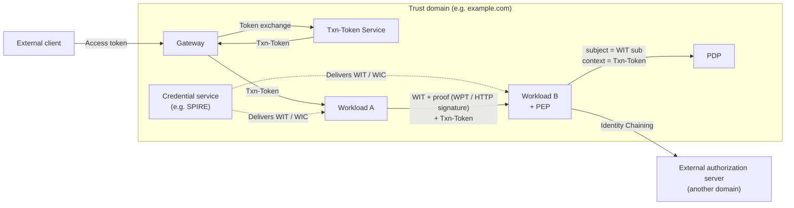
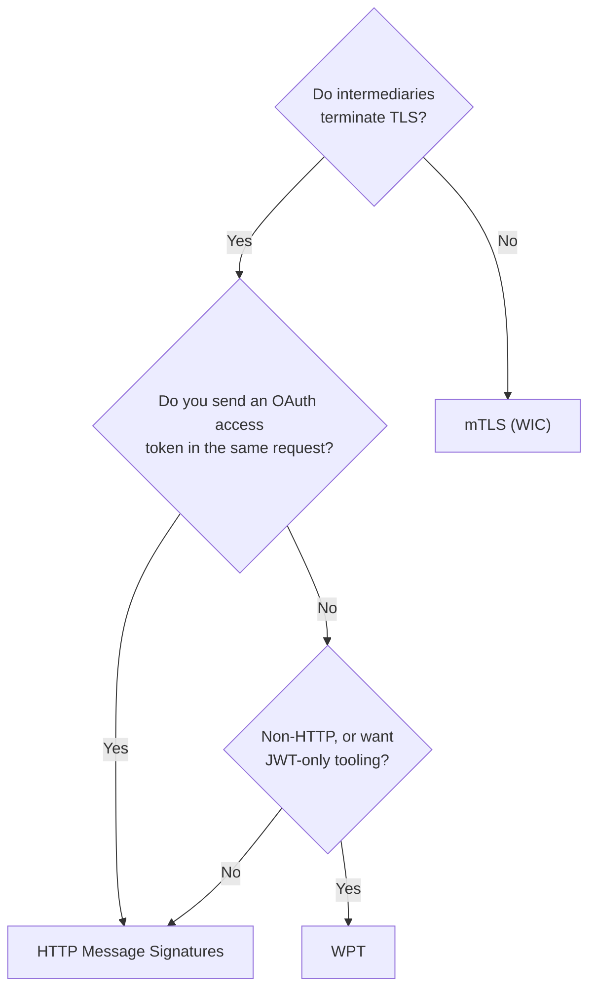
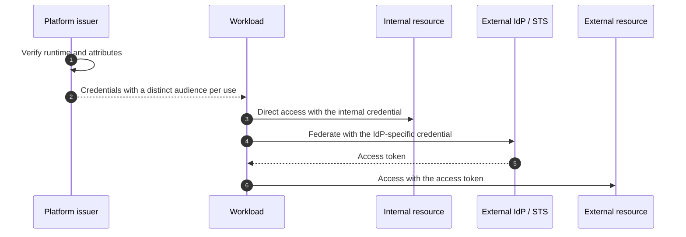
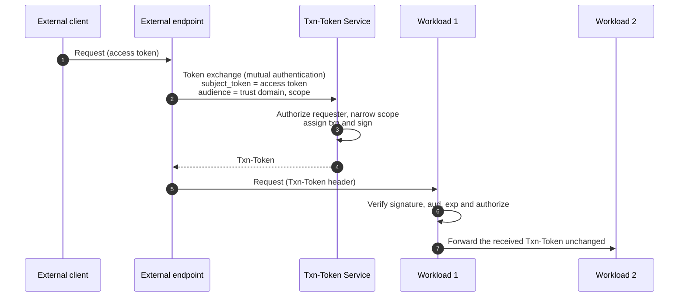
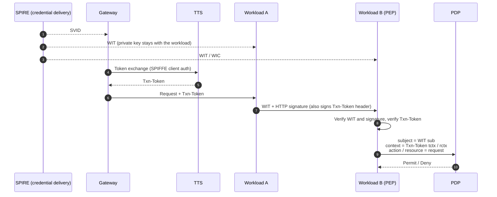

# Overview

In microservices, services act as principals for authentication and authorization, not only humans. When service A calls service B, B needs two answers: "which workload is calling?" and "on whose behalf, and for which transaction, does this call happen?"

The post "[What is the Big Picture of Service-to-Service Authentication?](/posts/service-to-service-authentication/)" covers the basic tools: mTLS, Token Exchange (RFC 8693), and SPIFFE/SPIRE. This post covers the standards work the IETF builds on top of them.

- **WIMSE** (Workload Identity in Multi System Environments): a set of IETF drafts that define workload identifiers, credentials (WIT/WIC), and authentication methods
- **Transaction Tokens**: a mechanism that exchanges an external access token for an internal token bound to one transaction and propagates it along the call chain
- **OAuth SPIFFE Client Authentication**: a mechanism that uses SPIFFE SVIDs for OAuth client authentication and removes `client_secret`

This post answers the following questions.

- How does WIMSE differ from SPIFFE, and what does it add?
- What are WIT, WIC, and WPT, and when should you pick mTLS, HTTP signatures, or WPT?
- What must you protect when you deliver credentials to workloads?
- How do Transaction Tokens differ from access tokens, and how do they propagate?
- How do these pieces combine so that the PEP and PDP receive both the "subject" and the "context"?

These specifications all remain drafts, and their content changes between revisions. The end of this post lists each draft's revision and status, which I checked on the IETF Datatracker in October 2026.

# Why Standardize Workload Identity

Zero trust does not treat being inside the network as a reason to trust. Each workload holds a verifiable identity and credential, and the callee checks them on every call.

The problem splits into four questions.

| Question | What makes it hard | Main standards |
| --- | --- | --- |
| How do you give a workload an identity? | Pre-shared secrets create distribution, rotation, and leakage problems | SPIFFE/SPIRE, WIMSE practices guide |
| How do workloads authenticate each other? | When a proxy or load balancer terminates TLS, the peer identity stops there | WIMSE WIT/WIC, mTLS, HTTP signatures, WPT |
| How do you carry call context inside the system? | Reusing an external access token internally widens the damage when someone steals it | Transaction Tokens |
| How do you reach another trust domain? | You do not want to expose internal credentials or formats | Identity Chaining, the Transaction Token chaining profile |

The shared principle: do not keep long-lived shared secrets (static API keys or `client_secret`). Instead, deliver short-lived, key-bound credentials based on attestation of the environment.

The diagram below shows the whole picture first.



WIMSE credentials carry identity, and Transaction Tokens carry transaction context. A proof of possession binds the two, and the callee's PEP passes only verified values to the PDP. That forms the backbone.

# The WIMSE Architecture

The WIMSE architecture draft (draft-ietf-wimse-arch) does not define a protocol. It aligns the vocabulary for components and their interactions.

## Three Building Blocks

The architecture rests on three elements.

| Element | Description |
| --- | --- |
| Trust domain | A group of systems that share security controls and policies. It SHOULD use an FQDN owned by the organization. It MUST map securely to X.509 trust anchors and to a JWK Set for verifying WITs |
| Workload identifier | A URI that names a workload uniquely within a trust domain. A separate draft (draft-ietf-wimse-identifier) defines the format. SPIFFE ID appears as a conforming example |
| Workload identity credential | A credential that binds the identifier to a cryptographic key. Two forms exist: the WIT (Workload Identity Token), a JWT, and the WIC (Workload Identity Certificate), an X.509 certificate |

An identifier's meaning depends on the trust domain that validates it. Per arch-08, two credentials with the same identifier value represent the same workload only when a verifier validates both under the same trust domain and issuer trust configuration. The later advice "never make access decisions on the path alone" rests on the same idea.

Credentials SHOULD have bounded lifetimes and automatic renewal. You do not need a new key per request.

## Three Scenarios

arch-08 adds components step by step across three scenarios.

| Scenario | Added components | Key point |
| --- | --- | --- |
| Basic | Gateway, CA/credential service | Workloads authenticate each other with credentials. The callee decides which APIs the peer can call based on its identity and records it for audit |
| Context | Context service | The gateway exchanges the external access token for an internal context token. The gateway normally does not forward the access token inside |
| Cross-domain | Token service, external token service | Internal identity and context get exchanged for a token usable in another domain. The steps follow Identity Chaining |

The context scenario matches the idea behind Transaction Tokens. Do not let an external bearer token flow inside; replace it with a token that has meaning only inside.

## Placing the PEP and PDP

arch-08 splits one call into stages: get credentials, set up transport, authenticate at the application layer, make the access decision, and respond. The PEP enforces authorization and may delegate decisions to a PDP. The PEP is a logical function on the callee's request path; you can place it inside the workload, in a sidecar, or in a gateway.

The architecture defines neither a policy language nor a PEP-PDP protocol. As a reference architecture, this matches the split in "[What Are Authorization Architectures and Models?](/posts/authorization-architecture-models-engines/)," and AuthZEN ("[What is the AuthZEN Authorization API?](/posts/authzen-authorization-api/)") can fill the PEP-PDP gap.

As a rule, the callee makes the decision. When the decision gets too fine-grained, as with a database, the caller MAY decide instead.

## Layered Authentication and "Authentication Is Not Authorization"

In real deployments, a workload often authenticates to a sidecar or gateway over mTLS and to the destination workload with an application-layer WIT. arch-08 calls this layered authentication and sets these rules.

- The destination MUST NOT assume that the transport-layer identity an intermediary authenticated equals the application-layer caller, unless the deployment states the relationship explicitly.
- Audit records SHOULD include the identities from both layers.

The security considerations also state that a valid credential does not give a workload access to every resource in the trust domain. The common service mesh setup "allow if mTLS succeeds" contradicts this principle. State allowed identifiers explicitly, and treat authorization as a separate decision.

arch-08 also covers AI agents. An agent is a special case of a delegated workload, and in a multi-hop chain each hop MUST explicitly scope and re-bind the security context. "[What is Authorization for AI Agents?](/posts/authorization-for-ai-agents/)" covers agent authorization in depth.

# Rules for Workload Identifiers

draft-ietf-wimse-identifier is the WIMSE draft that normatively defines the identifier format. It sets the requirements for the string that becomes the policy subject, the audit log key, and the PIP primary key, so it shapes your data model directly.

The main requirements as of -04 (2026-10-23) follow.

| Requirement | Strength |
| --- | --- |
| An absolute URI with a non-empty authority that names the trust domain | MUST |
| A non-empty path, with no `.` or `..` segments (both added in -04) | MUST / MUST NOT |
| No query, fragment, userinfo, or port | MUST NOT |
| Support identifiers up to 2048 bytes; do not exceed 2048 bytes | MUST / SHOULD NOT |
| Use an FQDN owned by the organization for the trust domain | SHOULD |
| Do not use IP addresses for trust domains, except for legacy compatibility (changed from MUST NOT to SHOULD NOT in -04) | SHOULD NOT |
| Compare and authorize on the complete URI, not on parts such as the path | MUST |
| Apply RFC 3986 syntax-based normalization, then compare byte for byte (added in -04) | MUST |
| Do not interpret identifiers with wildcard or prefix matching unless policy says so explicitly | SHOULD NOT |

The scheme stays open. You can use `spiffe`, or the `wimse` scheme that the draft defines.

```text
spiffe://prod.example.org/ns/prod-01/sa/payment-api
wimse://trust.example.com/service/payment
```

Three points matter for authorization platform design.

- **Write policies on the full identifier.** Matching only the path, such as `*/payments`, lets another trust domain through when it claims the same path. Combine identifier checks with an allowlist of trusted trust domains.
- **Look up groupings as attributes, not by parsing the path.** Units such as namespaces or teams hold up better when you fetch them as attributes from a PIP such as a service catalog, instead of prefix matching.
- **Keep a mapping from endpoints to identifiers.** Consumers MUST NOT assume they can derive an identifier from a DNS name or IP address. Without a mapping such as "the peer at this hostname should have this identifier," held in configuration or service discovery, the caller can only confirm "someone in the same trust domain."

Keep the relationship with SPIFFE ID in mind as well. A SPIFFE ID is one kind of WIMSE identifier, and WIMSE does not replace SPIFFE. If your data model treats the subject as a "workload identifier (URI)" without fixing the scheme to `spiffe`, principals from cloud platforms or CI/CD fit the same slot.

# Credentials: WIT and WIC

draft-ietf-wimse-workload-creds defines two credential formats. Both bind a public key to a workload identifier, and using either requires proof of possession of the matching private key. Other drafts define how to prove it.

| Format | Contents | Main use |
| --- | --- | --- |
| WIT (Workload Identity Token) | A JWT signed by the credential service. `typ` is `wit+jwt` | Application-layer authentication |
| WIC (Workload Identity Certificate) | An X.509 certificate with exactly one identifier in a URI-type SAN | Transport-layer (mTLS) authentication |

The main WIT claims follow.

| Claim | Required | Meaning |
| --- | --- | --- |
| `sub` | Required | The workload identifier. Exactly one identifier per credential |
| `exp` | Required | Expiration. Expect short lifetimes of a few hours |
| `cnf.jwk` | Required | The workload's public key (RFC 7800) |
| `cnf.jwk.alg` | Required | The algorithm for proofs. No `none` and no symmetric algorithms. General implementations support ES256 |
| `iss` | Recommended (optional) | The issuer, for audit and operations |
| `jti` | Optional | A unique token identifier |

```json
{
  "cnf": {
    "jwk": {
      "alg": "EdDSA",
      "crv": "Ed25519",
      "kty": "OKP",
      "x": "1CXXvflN_LVVsIsYXsUvB03JmlGWeCHqQVuouCF92bg"
    }
  },
  "exp": 1745512510,
  "iat": 1745508910,
  "jti": "x-_1CTL2cca3CSE4cwb_l",
  "sub": "wimse://example.com/specific-workload"
}
```

A WIT travels in the `Workload-Identity-Token` HTTP header. To verify it, use the key from the trust anchor you configured out of band for the trust domain in `sub`. You MUST NOT fetch keys based only on information inside the token, such as a URL in `iss`. If you take verification keys from a location the token itself points to, anyone can stand up an issuer.

"One identifier per credential" keeps the PDP side simple. The subject stays stable, which makes it easier to match policies against audit logs. Handle things like instance distinctions with `jti` or extra claims, separate from the authorization subject.

SPIFFE has also started to adopt the WIT as WIT-SVID, a profile narrowed for SPIFFE (its stability level is Incubating). A JWT-SVID is a bearer token, but a WIT-SVID binds to a key. Proof of possession closes the JWT-SVID gaps of "anyone who steals it can use it" and "the receiver can impersonate the caller downstream."

# Three Authentication Methods and How to Choose

Three drafts define how workloads use WITs and WICs to authenticate each other. They started as one draft, draft-ietf-wimse-s2s-protocol, which the WG split in November 2025 into four: one for credentials and three for methods.

| Aspect | mTLS (mutual-tls) | HTTP Message Signatures (http-signature) | WPT (wpt) |
| --- | --- | --- | --- |
| Layer | Transport | Application (HTTP only) | Application (format independent of protocol) |
| Credential | WIC | WIT | WIT |
| Proof of possession | TLS handshake | RFC 9421 signature | Signed JWT (`Authorization: WPT`) |
| What the proof covers | The whole connection on that hop | Method, path, query, body digest, `Authorization`, `Txn-Token`, WIT, and more | Target (`aud`), WIT hash (`wth`), Txn-Token hash (`tth`), hashes of other context tokens (`oth`). Not the method or body |
| Intermediaries that terminate TLS | Authentication stops there | Survives them and detects changes to signed parts | Survives them, but cannot defend against an actively malicious intermediary |
| Response protection | TLS handles it | Can sign responses too | None |
| OAuth access token in the same request | Possible | Signature can cover `Authorization` | Not possible (WPT occupies `Authorization`) |
| HTTP status on failure | Fails in TLS | 400 (401 NOT RECOMMENDED) | 401 with `WWW-Authenticate: WPT` |

Some notes on each.

- **mTLS**: You MUST check that the trust domain in the WIC matches the one you expect for that connection. When you connect by DNS name, you also run RFC 9525 hostname verification: Section 3.2.1 makes this a MUST, while the Security Considerations section says SHOULD. Identifier checks add to it rather than replace it. You MUST NOT let a self-asserted identity in an HTTP header override the identity that mTLS established.
- **HTTP Message Signatures**: To survive proxies that end TLS and rewrite `Host`, the profile does not sign `@authority`. Instead it puts the target in the signature parameter `wimse-aud`, and the receiver compares it exactly against trusted configuration. The `nonce` needs at least 64 bits of entropy, and the signature lifetime (`expires`) should stay in minutes.
- **WPT**: A short-lived JWT signed with the WIT key. The predecessor draft, s2s-protocol, described it as an option inspired by OAuth DPoP (RFC 9449). In -02, the draft moved it from a dedicated header to `Authorization: WPT`. As a result, you cannot send a Bearer or DPoP access token in the same request. The draft describes this exclusivity as intentional: it keeps a request from dropping to the strength of its weakest credential.

Two questions settle most choices.



You can combine layers. The mutual-tls draft says that when you need end-to-end workload authentication across intermediaries that end TLS, you SHOULD also use an application-layer WIMSE method on top of TLS. Hop-by-hop mTLS with an end-to-end HTTP signature on top is one example.

WIMSE methods and OAuth sender-constrained tokens (RFC 8705 mTLS, RFC 9449 DPoP) protect different things. WIMSE proves "which workload is calling," while sender constraint proves "who may use this access token." See "[What are Sender-Constrained Tokens?](/posts/sender-constrained-tokens-mtls-dpop/)" for the latter. If you use an X.509-SVID or WIC for RFC 8705 client authentication and certificate binding, one certificate covers both.

# How to Deliver Credentials

draft-ietf-wimse-workload-identity-practices records how workloads get credentials on today's platforms, without assuming WIMSE protocols. It has progressed furthest among the WIMSE drafts and is now under IESG review.

## The General Pattern

Instead of pre-distributing secrets, the platform checks the workload's runtime environment and then issues a credential. The workload uses that credential directly for internal resources. For external resources, it federates with an external IdP or STS and uses the token it receives.



The practices draft covers Kubernetes service account tokens, the SPIFFE Workload API, cloud instance metadata, CI/CD workflow identities, and service mesh sidecars. For overviews of Kubernetes, cloud platforms, and SPIFFE, see the identity foundation section of "[What is the Big Picture of Service-to-Service Authentication?](/posts/service-to-service-authentication/)."

## Three Delivery Patterns

| Pattern | Strengths | Cautions |
| --- | --- | --- |
| File system | Runs independently of updates; the workload just reads | Never expose a partially written file (write to a temp file and rename atomically). Keep it on in-memory storage |
| Local API (Unix domain socket, metadata service, and so on) | Can redeliver short-lived credentials | Needs SSRF defenses. Without per-process identification, any process on the host can get the identity |
| Environment variables | Simple | Leak through logs and process inspection. In production, MUST NOT pass credentials this way when another pattern exists |

## Requirements to Keep

These normative rules in the practices draft matter most for design.

- **Use credentials with distinct audiences per purpose** (MUST). If you use the same bearer token for internal resources and an external IdP, the IdP can present it to internal resources and impersonate the workload.
- **Put a single value in a JWT's `aud`** (two or more audiences MUST NOT). Otherwise any recipient listed in `aud` can present the token to the others.
- **Do not let a token outlive its instance** (MUST NOT). Invalidate credentials when the instance goes away (MUST).
- **Use proof of possession** (SHOULD). When you cannot, compensate with short lifetimes, strict audiences, and network controls (MUST).
- **Assume application vulnerabilities can leak credentials** (MUST). Untrusted input MUST NOT influence credential file paths or connections to the local API.
- **Evaluate the values of custom claims** (MUST). In CI/CD, allowing federation only from the protected `main` branch requires checking the branch claim's value.
- **Do not trust `iss` alone in multi-tenant platforms.** Where each tenant can configure the same issuer identifier, `iss` does not uniquely identify a trusted authority.

To turn a platform credential into an access token, the draft discourages Token Exchange or proprietary APIs because they hurt interoperability. It favors the JWT authorization grant from RFC 7521 and draft-ietf-oauth-rfc7523bis.

# Carrying Transaction Context with Transaction Tokens

WIMSE credentials carry "which workload," not "on whose behalf and for which transaction." draft-ietf-oauth-transaction-tokens (Txn-Token) fills that gap.

## The Problem It Solves

One external API call triggers many internal workload calls. If supply chain attacks or insiders compromise an internal workload, it can call other workloads without a legitimate transaction, tamper with parameters, or steal access tokens.

A Txn-Token holds the user or workload identity plus authorization and request context in a short-lived, signed JWT bound to one transaction. That JWT flows along the whole call chain within the trust domain. Downstream workloads use it to make authorization decisions within that transaction, and the signature reveals tampering along the way.

## Issuance and Propagation



The Transaction Token Service (TTS) issues the token, and each trust domain MUST have exactly one logical TTS. HTTP requests use RFC 8693 token exchange. The main parameters follow.

| Parameter | Description |
| --- | --- |
| `requested_token_type` | `urn:ietf:params:oauth:token-type:txn_token` |
| `audience` | The trust domain name |
| `scope` | The purpose of the transaction, as narrow as possible |
| `subject_token` | A token for the subject: an external access token, a self-signed JWT, unsigned JSON, and so on. Refresh tokens are not allowed |
| `request_context` | Environmental context such as the original request IP (recommended) |
| `request_details` | Request details such as API parameters (recommended) |

When no external request exists (batch or scheduled jobs), a workload can start a transaction with a self-signed JWT as `subject_token`. The TTS and the workload MUST authenticate each other. Examples for workload authentication include RFC 8705, WIMSE mTLS, HTTP signatures, WPT, and signed JWTs from RFC 7523.

## Token Format

A Txn-Token is a JWT with `typ` set to `txntoken+jwt`.

| Claim | Required | Description |
| --- | --- | --- |
| `aud` | Required | The trust domain where the token is valid. Outside it, recipients MUST NOT accept it |
| `iat`, `exp` | Required | Expect a lifetime of a few minutes or less |
| `txn` | Required | A unique transaction identifier (RFC 8417) |
| `sub` | Required | The subject of the transaction, unique within the trust domain |
| `scope` | Required | The purpose the TTS decides. It need not match the external scope |
| `req_wl` | Required | The workload that requested the Txn-Token |
| `tctx` | Recommended | Authorization details that stay fixed for the whole transaction, decided by the TTS |
| `rctx` | Recommended | Environmental context of the original request |
| `iss` | Optional | Helps identify the signer |

The draft's example represents a stock trade like this (trimmed).

```jsonc
{
  "aud": "trust-domain.example",
  "txn": "97053963-771d-49cc-a4e3-20aad399c312",
  "sub": "d084sdrt234fsaw34tr23t",
  "req_wl": "apigateway.trust-domain.example",
  "scope": "trade.stocks",
  "rctx": { "req_ip": "69.151.72.123", "authn": "face" },
  "tctx": { "action": "BUY", "ticker": "MSFT", "quantity": "100" }
}
```

With quantity and ticker in `tctx`, downstream workloads get those parameters as trustworthy values. If an intermediate workload changes the quantity, the mismatch with the signed `tctx` reveals it.

## Propagation Rules

- Over HTTP, send the token in the `Txn-Token` header (MUST). You MUST NOT use the `Authorization` header; keep it free for authenticating the call itself, such as an access token.
- A receiving workload MUST verify the signature, `aud`, and `exp` before using the token for authorization.
- Outbound calls MUST carry the received Txn-Token unchanged.

## Treat It as Different from an Access Token

The draft sets several prohibitions so that nobody confuses Txn-Tokens with other tokens.

| Rule | Reason |
| --- | --- |
| Do not use a Txn-Token as an OAuth access token (MUST NOT) | An access token grants rights to a client; a Txn-Token describes transaction context. Keeping them apart preserves least privilege |
| Do not use a Txn-Token to authenticate yourself (MUST NOT) | Proving identity belongs to WIMSE credentials and similar mechanisms |
| Do not embed the external access token in a Txn-Token (MUST NOT) | Someone could extract it and replay the access token after the Txn-Token expires |
| The TTS must not widen scope beyond the `subject_token` (MUST) | Prevents privileges from growing inside. Reject a `subject_token` whose scope is unknown |
| Do not log entire Txn-Tokens as-is (MUST NOT) | Prevents replay and personal data leaks. Log a hash or the payload without the signature |

Txn-Tokens do not resist replay. The defenses are short lifetimes and recording `txn` to reject repeated values. The TTS should be selective about which workloads it issues to and need not issue to every workload that asks. For example, a policy can limit Txn-Tokens that include a trade amount to the gateway that handles user requests.

## Replacement

A workload can also present a Txn-Token as `subject_token` to get a new one, which becomes a replacement Txn-Token. Revision -07 removed the dedicated section, and only these rules remain as a note in the security considerations.

| Rule | Strength |
| --- | --- |
| Changes that narrow the allowed operations, and added values | MAY |
| Changes that widen the allowed operations | MUST NOT |
| Changing `txn`, `sub`, or `aud` | MUST NOT |
| Issuing when the original has expired | MUST NOT |
| If the TTS can extend lifetimes, limit the number of replacements | SHOULD |
| Preserve the call chain of the workload that requested the original (method out of scope) | MUST |

The draft leaves the method for preserving the call chain open, so if you use replacement, you need your own way to trace which path a transaction took for audit.

## Crossing Trust Domains

A Txn-Token is valid only within the trust domain in `aud`. When you need resources in another domain, you SHOULD use Identity Chaining (draft-ietf-oauth-identity-chaining).

The individual draft draft-fletcher-oauth-txn-token-chaining-profile defines the concrete steps. Its earlier name was draft-fletcher-transaction-token-chaining-profile, and in September 2026 the -00 under the current name replaced it. In this profile, the workload presents a Txn-Token as `subject_token` in a token exchange and gets a JWT authorization grant for crossing the boundary. The `subject_token_type` is `urn:ietf:params:oauth:token-type:txn_token`. This carries transaction context to the other domain without exposing internal credentials or token formats. "[Which OAuth Standards Does an Authorization Platform Need?](/posts/oauth-standards-map-authorization-platform/)" covers Identity Chaining itself.

# Using SPIFFE for OAuth Client Authentication

Service-to-service OAuth (client_credentials, token exchange, requests to the TTS) tends to scatter `client_secret` values across config files and CI secrets. draft-ietf-oauth-spiffe-client-auth turns SPIFFE SVIDs into OAuth client credentials and removes that secret.

| Method | Credential | How to send | Proof of possession | Name in AS metadata |
| --- | --- | --- | --- | --- |
| JWT-SVID | A JWT with the SPIFFE ID in `sub` | `client_assertion_type=urn:ietf:params:oauth:client-assertion-type:jwt-spiffe` | None (bearer) | `spiffe_jwt` |
| X.509-SVID | A certificate with the SPIFFE ID in the URI SAN | Connect over mTLS and put the SPIFFE ID in `client_id` | TLS handshake | `spiffe_x509` |
| WIT-SVID | A WIMSE WIT | Attestation-Based Client Authentication headers | PoP JWT | `spiffe_wit` |

Key points follow.

- A JWT-SVID's `aud` MUST contain only the AS issuer identifier (following rfc7523bis). Unlike RFC 7523, the draft does not require `iss`; the AS maps the SPIFFE ID in `sub` to a registered client.
- The recommended source of verification keys is a SPIFFE bundle endpoint tied to each trust domain. The AS MUST NOT verify X.509-SVIDs against the system trust store. Otherwise any CA in that store could issue a certificate for any SPIFFE ID.
- The AS MUST NOT accept a token just because a key discovered via `iss` verifies its signature and `sub` looks like a SPIFFE ID. That invites token confusion, where an OIDC token meant for something else poses as a JWT-SVID.
- With a Client ID Metadata Document (CIMD), the metadata's `spiffe_id` can end with a `/*` wildcard. Matching works as a prefix match on whole path segments.

The design caveat: mapping SPIFFE IDs to `client_id` values is itself an authorization decision. Which workload may act as which OAuth client sets the upper bound on the scopes that client gets. Anyone who can create SPIRE registration entries can, in effect, create OAuth clients. Govern who can create registration entries as strictly as you govern client registration at the authorization server.

In my view, a practical default is `spiffe_x509` with proof of possession on paths that connect to the AS directly over TLS, and a short-lived `spiffe_jwt` on paths where something terminates TLS. `spiffe_wit` depends on drafts that still change, so I consider it too early to make it the production default.

# How the Pieces Fit Together

Each specification has a clear role.

| Specification | What it carries | Question it answers |
| --- | --- | --- |
| WIMSE identifier | The workload's name | Who does it refer to? |
| WIT / WIC | Binding between identifier and public key | Whose key is it? |
| mTLS / HTTP signatures / WPT | Proof of possession | Is the presenter the real holder? |
| Transaction Tokens | User and transaction context | On whose behalf, for which transaction? |
| SPIFFE client authentication | The workload's identity toward the AS | Which OAuth client is it? |
| Identity Chaining and its profile | A grant that crosses the boundary | How does it continue in another domain? |

Layered onto a single request flow, they look like this.



The workload-creds and wpt drafts give an example of the role split: the WIT identity decides which APIs a caller can invoke, and the context token decides which resources it can access. As PDP input, the subject comes from the WIT `sub` and the context from the Txn-Token claims.

The important rule: **pass only values bound to the proof to the PDP.** HTTP signatures MUST cover the `Txn-Token` header when present, and WPT binds the Txn-Token hash in `tth`. The wpt draft says that when `oth` is present, the receiver MUST NOT use other tokens that `oth` does not cover for authorization decisions. You can adopt that directly as a PEP implementation rule.

Binding has limits, though. It stops an intermediary from swapping or stripping the Txn-Token on a legitimate request. It does not stop another legitimate workload that stole a Txn-Token from wrapping it in its own WIT and proof. An authorization policy of the form "may this workload present a Txn-Token for this transaction?" and the TTS issuance policy handle that case.

# Design Guidelines

- **Write subjects as full identifiers.** Treat trust domain and path together, and avoid path-only or prefix matching.
- **Do not treat successful authentication as authorization.** Passing mTLS does not decide which resources a workload may access.
- **Pass transport-layer and application-layer identities to the PDP separately, and record both for audit.**
- **Choose the authentication method by asking "do intermediaries terminate TLS?" and "do you send an OAuth token in the same request?"** For east-west HTTP traffic, I consider a safe default to be mTLS, plus an end-to-end HTTP signature on paths where an intermediary terminates TLS.
- **Do not reuse external access tokens inside.** Exchange them for Txn-Tokens at the gateway and narrow the scope to the transaction's purpose.
- **Give credentials a distinct audience per use, keep them short-lived, and avoid environment variables.**
- **Replace `client_secret` with SPIFFE client authentication,** then manage the SPIFFE ID to `client_id` mapping as an authorization decision.
- **Revoke through policy, not credential revocation.** You cannot revoke a JWT credential such as a WIT on demand in most deployments, so pair short-lived credentials with PDP policies that take effect at once.

# Status of the Specifications (October 2026)

I checked these on the IETF Datatracker on October 24, 2026. Drafts change between revisions, so pin the revision you build against.

| Draft | Latest revision (date) | Status |
| --- | --- | --- |
| draft-ietf-wimse-arch | -08 (2026-07-06) | WG Document |
| draft-ietf-wimse-identifier | -04 (2026-10-23) | WG Document. The text says Standards Track |
| draft-ietf-wimse-workload-identity-practices | -07 (2026-09-22) | Submitted to IESG (AD Evaluation). Informational |
| draft-ietf-wimse-workload-creds | -02 (2026-07-02) | WG Document |
| draft-ietf-wimse-mutual-tls | -02 (2026-07-06) | WG Document |
| draft-ietf-wimse-http-signature | -08 (2026-10-20) | WG Document. Doc Shepherd Follow-up Underway. Intended as Proposed Standard |
| draft-ietf-wimse-wpt | -02 (2026-08-27) | WG Document |
| draft-ietf-oauth-transaction-tokens | -11 (2026-07-30) | WG Consensus: Waiting for Write-Up. The text says Standards Track |
| draft-ietf-oauth-spiffe-client-auth | -02 (2026-06-15) | WG Document |
| draft-ietf-oauth-identity-chaining | -17 (2026-07-19) | Approved by the IESG, in the RFC Editor Queue |
| draft-fletcher-oauth-txn-token-chaining-profile | -00 (2026-09-10) | Individual draft. Replaced draft-fletcher-transaction-token-chaining-profile |

Within WIMSE, the practices guide sits closest to an RFC, with HTTP signatures next. The credentials, mTLS, and WPT drafts remain WG Documents, and WPT changed how it travels in -02. Transaction Tokens has WG consensus and awaits submission to the IESG.

# Summary

- WIMSE builds on existing technologies such as OAuth, JWT, and SPIFFE, and expresses workload identity through three elements: trust domain, workload identifier, and credentials (WIT/WIC). A SPIFFE ID is a conforming example, not something WIMSE replaces.
- WIMSE offers three authentication methods: mTLS, HTTP Message Signatures, and WPT. Choose based on whether TLS terminates midway and whether you send an OAuth token in the same request.
- Deliver credentials based on attestation, as short-lived credentials with a distinct audience per use. Avoid environment variables.
- Transaction Tokens exchange an external access token for an internal token bound to one transaction and pass it unchanged along the call chain. Treat it as different from both access tokens and authentication credentials.
- SPIFFE client authentication removes `client_secret`, but you must manage the SPIFFE ID to `client_id` mapping as an authorization decision.
- Combined, the PEP receives "subject = WIT `sub`" and "context = Txn-Token" bound by proof of possession, and can pass both to the PDP.

# Related Posts

- [What is Authorization? Mapping AuthN, AuthZ, and IAM Subdomains](/posts/authorization-domain-iam-subdomains/)
- [How Much Authorization Platform Do You Need? Scope, Ownership, Stages, and Externalized Decisions](/posts/authorization-platform-scope-stages/)
- [What Are Authorization Architectures and Models? PEP/PDP, RBAC/ABAC/ReBAC, and Choosing a Policy Engine](/posts/authorization-architecture-models-engines/)
- [What is the AuthZEN Authorization API? A Standard Between PEP and PDP](/posts/authzen-authorization-api/)
- [Which OAuth Standards Does an Authorization Platform Need? A Map of Delegation, Tokens, and Continuous Evaluation](/posts/oauth-standards-map-authorization-platform/)
- [What is Authorization for AI Agents? Delegation Chains, Human Approval, and Audit with MCP, AuthZEN, AIMS, and A2A/AP2](/posts/authorization-for-ai-agents/)
- [How Should You Design Authorization for MCP? Common Incidents and Decisions That Are Hard to Reverse](/posts/mcp-authorization-design/)
- [What Does an Authorization Platform Architecture Look Like? Containers, Key Sequences, PEP/PDP Placement, and Non-Functional Decisions](/posts/authorization-platform-architecture-decisions/)
- [What is the Big Picture of Service-to-Service Authentication? mTLS, Token Exchange, SPIFFE, and Zero Trust](/posts/service-to-service-authentication/)
- [What are Sender-Constrained Tokens? An Introduction to mTLS (RFC 8705) and DPoP (RFC 9449)](/posts/sender-constrained-tokens-mtls-dpop/)

# References

- [IETF WIMSE Working Group documents](https://datatracker.ietf.org/wg/wimse/documents/)
- [draft-ietf-wimse-arch](https://datatracker.ietf.org/doc/draft-ietf-wimse-arch/)
- [draft-ietf-wimse-identifier](https://datatracker.ietf.org/doc/draft-ietf-wimse-identifier/)
- [draft-ietf-wimse-workload-identity-practices](https://datatracker.ietf.org/doc/draft-ietf-wimse-workload-identity-practices/)
- [draft-ietf-wimse-workload-creds](https://datatracker.ietf.org/doc/draft-ietf-wimse-workload-creds/)
- [draft-ietf-wimse-mutual-tls](https://datatracker.ietf.org/doc/draft-ietf-wimse-mutual-tls/)
- [draft-ietf-wimse-http-signature](https://datatracker.ietf.org/doc/draft-ietf-wimse-http-signature/)
- [draft-ietf-wimse-wpt](https://datatracker.ietf.org/doc/draft-ietf-wimse-wpt/)
- [draft-ietf-oauth-transaction-tokens](https://datatracker.ietf.org/doc/draft-ietf-oauth-transaction-tokens/)
- [draft-fletcher-oauth-txn-token-chaining-profile](https://datatracker.ietf.org/doc/draft-fletcher-oauth-txn-token-chaining-profile/)
- [draft-ietf-oauth-identity-chaining](https://datatracker.ietf.org/doc/draft-ietf-oauth-identity-chaining/)
- [draft-ietf-oauth-spiffe-client-auth](https://datatracker.ietf.org/doc/draft-ietf-oauth-spiffe-client-auth/)
- [SPIFFE standards](https://github.com/spiffe/spiffe/tree/main/standards)
- [SPIRE Concepts](https://spiffe.io/docs/latest/spire-about/spire-concepts/)
- [RFC 8693: OAuth 2.0 Token Exchange](https://www.rfc-editor.org/rfc/rfc8693)
- [RFC 9421: HTTP Message Signatures](https://www.rfc-editor.org/rfc/rfc9421)
- [RFC 9449: OAuth 2.0 Demonstrating Proof of Possession (DPoP)](https://www.rfc-editor.org/rfc/rfc9449)
- [RFC 8705: OAuth 2.0 Mutual-TLS Client Authentication and Certificate-Bound Access Tokens](https://www.rfc-editor.org/rfc/rfc8705)
- [RFC 9334: Remote ATtestation procedureS (RATS) Architecture](https://www.rfc-editor.org/rfc/rfc9334)
