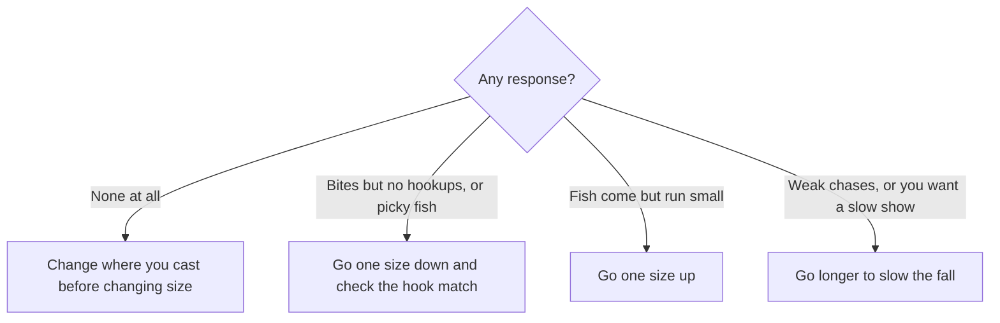

# Introduction
Worm size affects your catch, yet the guidelines feel vague. This post sorts out how to choose worm size for horse mackerel (*aji*) light game, scorpionfish (*kasago*, called *gashira* in the Kansai region), and groupers, using official product descriptions from tackle makers and data on fish growth and diet.

The [Rockfish Field Guide](/posts/rockfish-worm-field-guide/) covers worm types such as shads and craws. This post focuses on size.

# The Short Answer
- For aji and kasago light game, build around worms of about 2 inches. Ecogear calls its 2-inch aji worm "the basic" and its 2-inch kasago worm a "pilot lure."
- An inch label works more like a product name than a measurement. Two worms labeled "2 inches" can measure 41 mm and 65 mm.
- Size up or down based on three factors: the fish's size and food, the hook size, and how you want the worm to sink and fly.
- Large worms do not belong to rockfish alone. Makers sell aji worms of 3 inches and up for aji over 30 cm. Grouper worms mostly run 3 to 4.5 inches.
- When nothing bites at all, change where you cast before changing size. Adjust size once you know fish are there.

# Inch Labels and Real Length
One inch equals 25.4 mm, so 2 inches works out to 50.8 mm. A maker's inch label, though, works more like a product name and can differ from the published length.

| Product | Label | Published length |
| --- | --- | --- |
| Ecogear Aji Shokunin Aji Must | 2 in | 49 mm |
| Ecogear Aji Shokunin Aji Must | 2.4 in | 62 mm |
| Ecogear Aji Shokunin Aji Must LB | 3.3 in | 84 mm |
| Ecogear Kasago Shokunin Rock Max | 2 in | 41 mm |
| Ecogear Kasago Shokunin Rock Claw | 2 in | 65 mm |
| Ecogear Kasago Shokunin Mini Tank | 1-1/2 in | 37 mm |
| Ecogear Kijihata Grub | 3 in | 56 mm |
| Ecogear Kijihata Grub | 4.5 in | 88 mm |

Within the Kasago Shokunin series, the 2-inch Rock Max measures 41 mm and the 2-inch Rock Claw measures 65 mm, a difference of more than 1.5 times. Shapes with arms or legs, such as craws and hogs, tend to stretch the gap between label and length.

When you compare sizes, look at the published length and the shape rather than the inch label. Many makers do not publish a length; in that case, read the label as small or large within the same series.

# Size Guidelines by Target Fish
## Aji (Horse Mackerel)
Makers describe each aji worm size as follows.

| Size range | Products and descriptions |
| --- | --- |
| About 1.5 in | Jackall suggests 1.5 inches if the fish you catch run up to 15 cm. Daiwa's 1.5-inch Aji Hunter Worm Ring imitates plankton, and Ecogear's 1.6-inch Aji Must suits small aji and active fish |
| About 2 in | Ecogear calls the 2-inch Aji Must "the basic" and the core of a rotation. Jackall suggests 2 inches for fish over 15 cm. Daiwa's 2-inch version imitates small baitfish |
| 2.4 to 2.5 in | Ecogear's 2.4-inch Aji Must uses its length to slow the fall and show the worm slowly to inactive fish. Jackall's Pekering line pitches 2 inches for numbers of small aji and 2.5 inches as "a basic size for any use" |
| 3 in and up | Ecogear's Aji Must LB (3.3 in) targets aji over 30 cm. Jackall's 3.0-inch Pekering targets medium to large aji, though Jackall says it also works on 20 cm fish |

Aji eat bigger food as they grow. Juveniles of about 1 to 5 cm feed almost entirely on copepods and shift to wider prey as they grow (Hirota et al. 2004). In the East China Sea, fish made up a larger share of the diet in bigger aji (Xu et al. 2024). The idea of small worms for small aji and larger worms for large aji fits this shift in diet.

## Kasago (Scorpionfish)
Ecogear's Kasago Shokunin series consists of four worms from 1-1/2 to 2 inches.

| Product | Label and length | Maker's description |
| --- | --- | --- |
| Rock Max | 2 in (41 mm) | Versatile, the pilot lure for kasago |
| Bug Ants | 2 in (60 mm) | For inactive fish holding deep inside structure |
| Rock Claw | 2 in (65 mm) | The strongest appeal in the series |
| Mini Tank | 1-1/2 in (37 mm) | The smallest in the series, for pressured kasago |

Kasago grow slowly. According to the Tokyo Metropolitan Islands Area Research and Development Center of Agriculture, Forestry and Fisheries, they reach about 6 cm at one year, 13 cm at two, and 18 cm at three. Males pass 20 cm at four years, and females at six. With a top size of around 30 cm, light game for kasago centers on worms of about 2 inches.

## Groupers
Grouper worms run a size or more above kasago worms.

| Product | Size | Maker's description |
| --- | --- | --- |
| Daiwa HRF GR Craw | 3.5 in | Built for groupers. Recommended hook: offset #1/0 |
| Ecogear Kijihata Hog | 3 in (74 mm) | Shaped after crustaceans, a main food of groupers |
| Ecogear Kijihata Grub | 3, 4, and 4.5 in | 4 inches for finesse, 4.5 inches for heavy sinkers and searching far and deep |
| Ecogear Katakuchi Minnow | 4 in (110 mm) | "A new attacking move" against groupers |

# Three Factors That Decide Size
## 1. Fish Size and Food
Match the size of the fish you catch and the size of what they eat.

- When the fish run small or feed on small food, go smaller.
- When you target big fish, or when fish chase baitfish, go larger.
- The baseline shifts with the species. The same 2-inch worm counts as standard for aji and small for groupers.

## 2. Hook Size
Pair worm length with hook size rather than jig head weight. Daiwa lists these recommended worm sizes for its Gekka Bijin aji jig heads.

| Hook size | Recommended worm size |
| --- | --- |
| #12 | 0.9–1.5 in |
| #10 | 1.5–2.0 in |
| #8 | 1.8–2.2 in |

Daiwa sells every hook size of this jig head in the same 0.5 to 2.5 g weights. Let the hook decide the worm length, and let depth and current decide the weight. Ecogear likewise recommends a #1 hook for the 3-inch Kijihata Grub, #1/0 for the 4-inch, and #2/0 for the 4.5-inch.

## 3. How It Sinks and Flies
Worm size also changes sink speed and casting distance.

- A long worm sinks slowly because water resists it. Ecogear says the 2.4-inch Aji Must "uses its length to hold down the fall speed."
- Pair a worm with high water resistance with a heavier sinker. Jackall recommends fairly heavy sinkers for its Chunk Craw 2.8 inch, which has large parts.
- To search far and deep with a heavy sinker, a larger worm fits. Ecogear says the 4.5-inch Kijihata Grub works well with heavier weights and for searching farther and deeper.
- For long casts with a light rig, a smaller worm with less air drag helps. In a Daiwa column, the angler picks a smaller worm for long free rig casts to cut air drag.

Deep water or fast current often calls for a heavy rig with a larger worm. Distance favors smaller worms, though, so a heavy rig does not always mean a large worm.

# Adjust by How the Fish Bite
Change size only after you know fish are there. When nothing bites at all, first change the direction and distance of your casts, then move.

- Makers do describe sizing down for picky fish. For a rockfish worm, Jackall suggests building around 3 inches, sizing down when fish bite reluctantly, and sizing up to 3.8 inches when the fish stay small. Ecogear also recommends its smallest worm, the Mini Tank, for pressured kasago.
- Going smaller when you get bites but no hookups works as a common rule of thumb on the water. Before you shrink the worm, check that its length falls within the recommended range for your hook size.
- Change one thing at a time. If you change size and color together, you cannot tell which one worked.

# Sizes to Bring
For aji and kasago light game, bring about 2-inch worms as the core, plus one smaller and one larger size. Those three cover most situations.

| Fishing | Smaller | Core | Larger |
| --- | --- | --- | --- |
| Aji | About 1.5 in | About 2 in | 2.4 to 2.5 in, or 3 in and up for big aji |
| Kasago | About 1.5 in | About 2 in | Craws with a longer real length |
| Groupers | 3 in | 3.5 to 4 in | 4.5 in |

Pick the smaller, core, and larger worms so that they differ in real length and shape, not just in their labels. Two worms labeled 2 inches can differ a lot in real length.

# Summary
- Build around about 2 inches for aji and kasago light game, and use 3 to 4.5 inches for groupers. Big aji also take worms of 3 inches and up.
- Inch labels can differ from real length. Compare sizes by real length and shape.
- Decide size by fish size and food, hook size, and how the worm sinks and flies. Match worm length to hook size.
- When nothing bites, move first. Once you know fish are there, go smaller for picky fish and larger when the fish stay small.

# Related Posts
- [Rockfish Field Guide](/posts/rockfish-worm-field-guide/)
- [Spinning Reel Casting Guide](/posts/spinning-reel-casting-guide/)

# References
- [ecogear.jp - Aji Shokunin Aji Must (Japanese)](https://ecogear.jp/ecogear/aji_shokunin_aji_must/)
- [ecogear.jp - Aji Shokunin Aji Must LB (Japanese)](https://ecogear.jp/ecogear/aji_shokunin_aji_must-lb/)
- [ecogear.jp - Kasago Shokunin Rock Max (Japanese)](https://ecogear.jp/ecogear/kasago_shokunin_rock_max/)
- [ecogear.jp - Kasago Shokunin Bug Ants (Japanese)](https://ecogear.jp/ecogear/kasago_shokunin_bug_ants/)
- [ecogear.jp - Kasago Shokunin Rock Claw (Japanese)](https://ecogear.jp/ecogear/kasago_shokunin_rock_claw/)
- [ecogear.jp - Kasago Shokunin Mini Tank (Japanese)](https://ecogear.jp/ecogear/kasago_shokunin_mini_tank/)
- [ecogear.jp - Kijihata Hog (Japanese)](https://ecogear.jp/ecogear/kijihata_hog/)
- [ecogear.jp - Kijihata Grub (Japanese)](https://ecogear.jp/ecogear/kijihata_grub/)
- [ecogear.jp - Katakuchi Minnow (Japanese)](https://ecogear.jp/ecogear/katakuchi_minnow/)
- [daiwa.com - Aji Hunter Worm Ring (Japanese)](https://www.daiwa.com/jp/product/u2rumzj)
- [daiwa.com - Gekka Bijin Ajing Jig Head (Japanese)](https://www.daiwa.com/jp/product/w4snpkq)
- [daiwa.com - HRF GR Craw (Japanese)](https://www.daiwa.com/jp/product/i0fm4z5)
- [daiwa.com - HRF AGS column part 3, harbor greenling (Japanese)](https://www.daiwa.com/jp/column/hrf/d003)
- [jackall.co.jp - Pekering (Japanese)](https://www.jackall.co.jp/saltwater/shore-casting/products/lure/azi/pekering/)
- [jackall.co.jp - Pekering 3.0 inch in detail (Japanese)](https://www.jackall.co.jp/saltwater/shore-casting/column/p-3868/)
- [jackall.co.jp - Recommended worms for autumn rockfish (Japanese)](https://www.jackall.co.jp/saltwater/shore-casting/column/2022_11_kai/)
- [begood-funegg.jackall.co.jp - Spring aji and mackerel lure guide (Japanese)](https://begood-funegg.jackall.co.jp/tsuri-report/article-052/)
- [ifarc.metro.tokyo.lg.jp - Kasago, Tokyo Metropolitan Islands Area Research and Development Center (Japanese)](https://www.ifarc.metro.tokyo.lg.jp/archive/27,1065,55,227.html)
- [Hirota et al. (2004) Ontogenetic changes of feeding selectivity in juvenile jack mackerel Trachurus japonicus collected off south-east Kyushu, Japan. Fisheries Science 70](https://www.jstage.jst.go.jp/article/fishsci1994/70/1/70_1_100/_article)
- [Xu et al. (2024) Diet of jack mackerel in the East China Sea (J-GLOBAL abstract, Japanese)](https://jglobal.jst.go.jp/detail?JGLOBAL_ID=202402224007707837)

