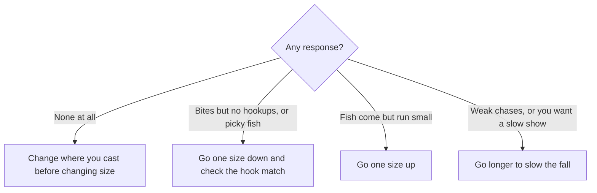

# Introduction
Worm size affects your catch, yet the guidelines feel vague. This post sorts out how to choose worm size regardless of target species or fishing style, using tackle makers' official descriptions.

The [Rockfish Field Guide](/posts/rockfish-worm-field-guide/) covers worm types such as shads and craws. This post focuses on size.

# The Short Answer
- An inch label does not always match the real length. Two worms labeled "2 inches" can measure 41 mm and 65 mm.
- Decide size by three factors: the fish's size and food, the hook size, and how you want the worm to sink and fly.
- Match worm length to hook size, and let depth and current decide the rig weight.
- Settle on one base size, and adjust with one smaller and one larger size.
- When nothing bites at all, change where you cast before changing size. Adjust size once you know fish are there.

# Inch Labels and Real Length
One inch equals 25.4 mm, so 2 inches works out to 50.8 mm. A maker's inch label, though, can differ from the published length. The table shows inch labels and published lengths from a single maker.

| Label | Calculated length | Published lengths |
| --- | --- | --- |
| 1.5 in | 38.1 mm | 37 mm |
| 2 in | 50.8 mm | 41 mm, 49 mm, 60 mm, 65 mm |
| 3 in | 76.2 mm | 56 mm, 74 mm |
| 4 in | 101.6 mm | 76 mm, 110 mm |

From the same maker, a 2-inch worm can measure 41 mm or 65 mm, a difference of more than 1.5 times. Shapes with arms or legs, such as craws and hogs, tend to stretch the gap between label and length.

When you compare sizes, look at the published length and the shape rather than the inch label. Many makers do not publish a length; in that case, read the label as small or large within the same series.

# Three Factors That Decide Size
## 1. Fish Size and Food
Match the size of the fish you catch and the size of what they eat.

- When the fish run small or feed on small food, go smaller.
- When you target big fish, or when fish chase baitfish, go larger.
- The baseline shifts with the size of the fish. The same 2-inch worm counts as standard for small fish and small for big fish.

What fish eat can change as they grow. Juvenile horse mackerel of about 1 to 5 cm, for example, feed almost entirely on copepods and shift to wider prey as they grow (Hirota et al. 2004). In the East China Sea, fish made up a larger share of the diet in bigger horse mackerel (Xu et al. 2024).

## 2. Hook Size
Pair worm length with hook size rather than jig head weight. One maker lists these recommended worm sizes for its light game jig heads.

| Hook size | Recommended worm size |
| --- | --- |
| #12 | 0.9–1.5 in |
| #10 | 1.5–2.0 in |
| #8 | 1.8–2.2 in |

The maker sells every hook size of this jig head in the same 0.5 to 2.5 g weights. Let the hook decide the worm length, and let depth and current decide the weight. For larger worms too, one maker recommends a #1 hook for 3 inches, #1/0 for 4 inches, and #2/0 for 4.5 inches, scaling the hook with the worm.

## 3. How It Sinks and Flies
Worm size also changes sink speed and casting distance.

- A long worm sinks slowly because water resists it. Makers also describe using length to hold down the fall speed.
- Pair a worm with high water resistance with a heavier sinker. Makers recommend fairly heavy sinkers for worms with large parts.
- To search far and deep with a heavy sinker, a larger worm fits. Makers describe larger worm sizes as effective with heavier weights and for searching farther and deeper.
- For long casts with a light rig, a smaller worm with less air drag helps. Some anglers pick a smaller worm for long free rig casts to cut air drag.

Deep water or fast current often calls for a heavy rig with a larger worm. Distance favors smaller worms, though, so a heavy rig does not always mean a large worm.

# Adjust by How the Fish Bite
Change size only after you know fish are there. When nothing bites at all, first change the direction and distance of your casts, then move.

- Makers do describe sizing down for picky fish. One suggests setting a base size, sizing down when fish bite reluctantly and sizing up when the fish stay small. Another recommends its smallest size for pressured fish.
- Going smaller when you get bites but no hookups works as a common rule of thumb on the water. Before you shrink the worm, check that its length falls within the recommended range for your hook size.
- Change one thing at a time. If you change size and color together, you cannot tell which one worked.

# Sizes to Bring
Settle on one base size, then bring one smaller and one larger size as well. With those three, you can try the adjustments above on the water.

The base size is the worm you throw first and the starting point you size up or down from as you watch how fish respond. Use the three factors above to pick one that meets these conditions:

- Its size comes close to the target fish and the food they eat.
- It falls within the recommended range for your hook.
- It suits your rig weight and how far you need to cast.

If these conditions still leave several candidates, pick the size that the maker positions as its basic or standard size among worms for your target fish.

| Role | When to use |
| --- | --- |
| Smaller | Picky fish. Bites but no hookups. Fish feeding on small food |
| Base | The first worm to throw, and the starting point for sizing up or down |
| Larger | Fish stay small. Targeting big fish. Searching far and deep with a heavy rig. Slowing the fall |

Pick the smaller, base, and larger worms so that they differ in real length and shape, not just in their labels. Two worms labeled 2 inches can differ a lot in real length.

# Summary
- Inch labels can differ from real length. Compare sizes by real length and shape.
- Settle on one base size, and bring one smaller and one larger size.
- Decide size by fish size and food, hook size, and how the worm sinks and flies. Match worm length to hook size.
- When nothing bites, move first. Once you know fish are there, go smaller for picky fish and larger when the fish stay small.

# Related Posts
- [Rockfish Field Guide](/posts/rockfish-worm-field-guide/)
- [Spinning Reel Casting Guide](/posts/spinning-reel-casting-guide/)

# References
- [ecogear.jp - Aji worms, 1.6 to 2.4 inches (Japanese)](https://ecogear.jp/ecogear/aji_shokunin_aji_must/)
- [ecogear.jp - Worm for big aji, 3.3 inches (Japanese)](https://ecogear.jp/ecogear/aji_shokunin_aji_must-lb/)
- [ecogear.jp - Kasago worm, 2 inches, 41 mm (Japanese)](https://ecogear.jp/ecogear/kasago_shokunin_rock_max/)
- [ecogear.jp - Kasago worm, 2 inches, 60 mm (Japanese)](https://ecogear.jp/ecogear/kasago_shokunin_bug_ants/)
- [ecogear.jp - Kasago worm, 2 inches, 65 mm (Japanese)](https://ecogear.jp/ecogear/kasago_shokunin_rock_claw/)
- [ecogear.jp - Kasago worm, 1.5 inches, 37 mm (Japanese)](https://ecogear.jp/ecogear/kasago_shokunin_mini_tank/)
- [ecogear.jp - Grouper worm, 3 inches, 74 mm (Japanese)](https://ecogear.jp/ecogear/kijihata_hog/)
- [ecogear.jp - Grouper worms, 3, 4, and 4.5 inches (Japanese)](https://ecogear.jp/ecogear/kijihata_grub/)
- [ecogear.jp - Grouper worm, 4 inches, 110 mm (Japanese)](https://ecogear.jp/ecogear/katakuchi_minnow/)
- [daiwa.com - Aji worms, 1.5 and 2 inches (Japanese)](https://www.daiwa.com/jp/product/u2rumzj)
- [daiwa.com - Recommended worm sizes for aji jig heads (Japanese)](https://www.daiwa.com/jp/product/w4snpkq)
- [daiwa.com - Choosing a smaller worm for free rig casts (Japanese)](https://www.daiwa.com/jp/column/hrf/d003)
- [jackall.co.jp - Aji worms, 2, 2.5, and 3 inches (Japanese)](https://www.jackall.co.jp/saltwater/shore-casting/products/lure/azi/pekering/)
- [jackall.co.jp - Recommended worms for autumn rockfish (Japanese)](https://www.jackall.co.jp/saltwater/shore-casting/column/2022_11_kai/)
- [begood-funegg.jackall.co.jp - Spring aji and mackerel lure guide (Japanese)](https://begood-funegg.jackall.co.jp/tsuri-report/article-052/)
- [Hirota et al. (2004) Ontogenetic changes of feeding selectivity in juvenile jack mackerel Trachurus japonicus collected off south-east Kyushu, Japan. Fisheries Science 70](https://www.jstage.jst.go.jp/article/fishsci1994/70/1/70_1_100/_article)
- [Xu et al. (2024) Diet of jack mackerel in the East China Sea (J-GLOBAL abstract, Japanese)](https://jglobal.jst.go.jp/detail?JGLOBAL_ID=202402224007707837)

