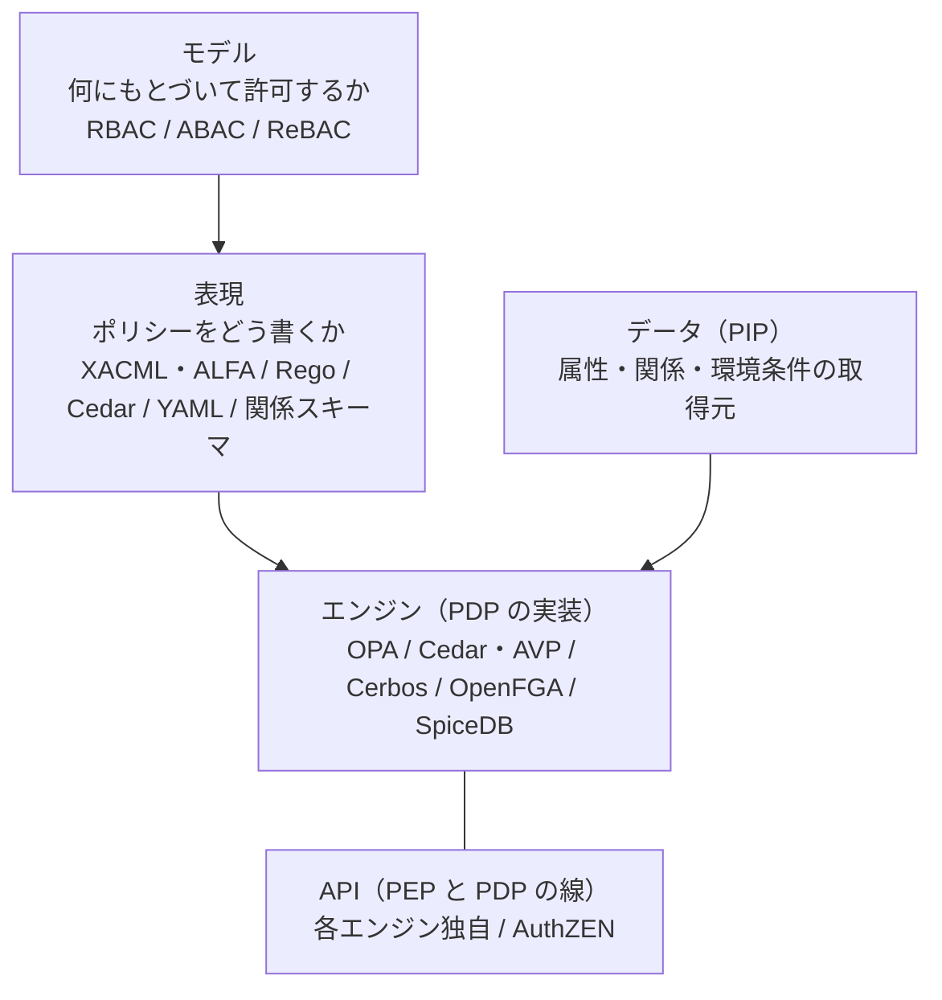
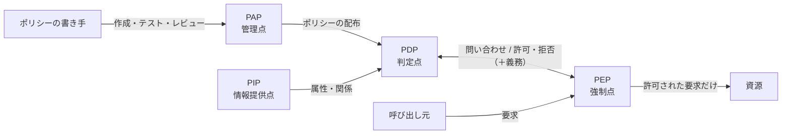
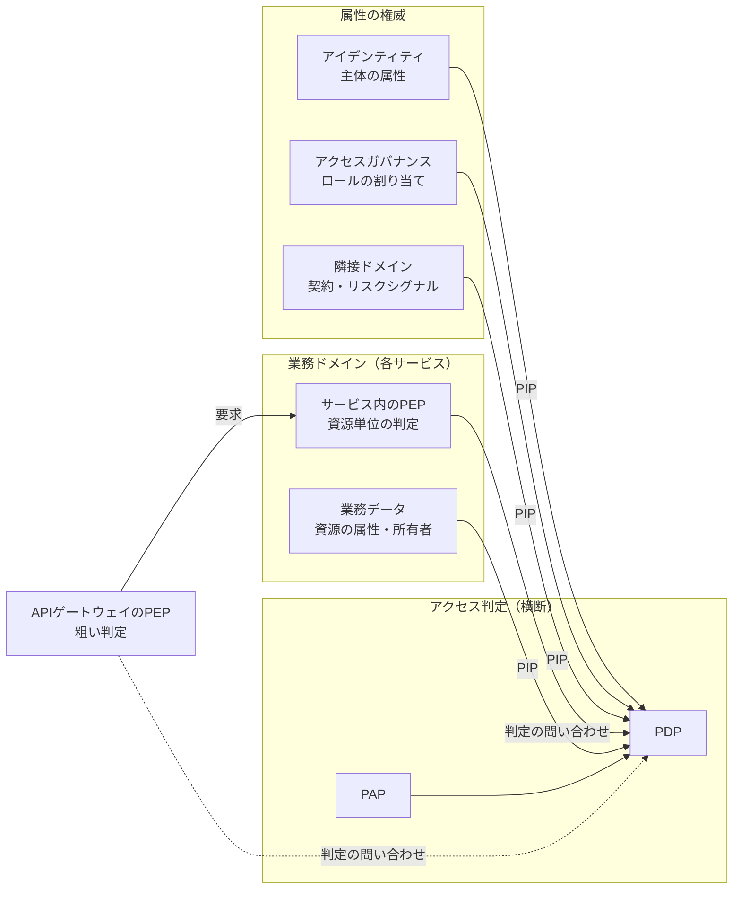
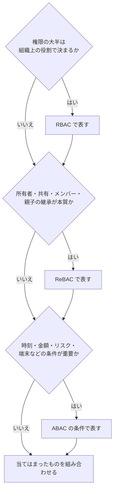

# 概要

認可基盤の心臓部は「権限をどう表現し、どこで・どう判定するか」である。この記事では、その答えを次の3つの問いに分けて整理する。

1. 判定に関わる部品は何で、業務ドメインに対してどこに置くのか（PEP/PDP/PIP/PAP）
2. 権限を何にもとづいて決めるのか（RBAC/ABAC/ReBACと、PBACの位置づけ）
3. ポリシーエンジン（OPA、Cedar、Cerbos、OpenFGA、SpiceDB）をどう選ぶのか

認可とは何か、IAMのどのサブドメインが関わるかは[認可とは何か](/ja/posts/authorization-domain-iam-subdomains/)で、認可基盤をどこまで作るかは[認可基盤はどこまで作るか](/ja/posts/authorization-platform-scope-stages/)で扱った。本記事はその続きで、アクセス判定の中身に踏み込む。ACL・RBAC・ABACの基本は[権限管理の設計](/ja/posts/permission-management-design/)にまとめたので、ここでは繰り返さない。

# 全体像：5つの層に分けて考える

認可の議論では「モデル」「言語」「エンジン」「API」が混ざりやすい。先に層を分けておくと、どの選択がどの選択を縛るかが見える。

| 層 | 決めること | 代表 |
|---|---|---|
| モデル | 許可の根拠を何に置くか | RBAC、ABAC、ReBAC |
| 表現 | ポリシーを書く言語と書き手 | XACML、ALFA、Rego、Cedar、YAML、関係スキーマ |
| エンジン | 評価の実装、配置、データの持ち方 | OPA、Cedar、Cerbos、OpenFGA、SpiceDB |
| API | PEPとPDPの間の要求と応答の形 | 各エンジンのAPI、AuthZEN |
| データ | 判定に使う属性や関係の権威と鮮度 | ディレクトリ、人事、契約、業務DB、関係ストア |

モデルを決めても表現やエンジンは1つに決まらない。逆に、エンジンを選ぶと表現とデータの持ち方はほぼ決まる。だから順序は「モデル → データ → エンジン」が安全である。

# 参照アーキテクチャ：PEP・PDP・PIP・PAP

## 4つの役割

PEPとPDPという呼び名は、IETFのRFC 2753（2000年、ポリシーベースのアドミッション制御の枠組み）が先に定めたものである。用語はPolicy Framework WGのRFC 3198にまとめられた。OASISのXACMLはこの2つを取り込み、PAPとPIPを加えて4つの役割にまとめた。NIST SP 800-162（ABACのガイド）もこの語彙で参照アーキテクチャを示し、NIST SP 800-207（ゼロトラスト）も同じPDPとPEPの語を使う。AuthZENもこの語彙を前提にしている。

| 役割 | 何をするか | 置き場所の例 |
|---|---|---|
| PDP（Policy Decision Point） | ポリシーと入力を評価し、許可・拒否を返す。義務（obligation）や助言（advice）を添えることもある | 認可サービス、サイドカー、ライブラリとして埋め込んだエンジン |
| PEP（Policy Enforcement Point） | 要求の経路でPDPに問い合わせ、結果を強制する | APIゲートウェイ、サービス内のミドルウェア、サイドカー、データ層 |
| PIP（Policy Information Point） | 判定に必要な属性や関係をPDPに渡す | ディレクトリ、人事DB、契約DB、業務DB、関係ストア |
| PAP（Policy Administration Point） | ポリシーの作成、テスト、レビュー、版管理、配布を担う | Gitリポジトリ、CI、管理画面 |

## 業務ドメインに対してどこに置くか

PEP/PDP/PIP/PAPは、組織の中で持ち主が違う。[認可とは何か](/ja/posts/authorization-domain-iam-subdomains/)で示したIAMのサブドメインに当てはめると、次のようになる。

ゲートウェイからPDPへの問い合わせを点線にしたのは、粗い判定をゲートウェイの中で済ませる構成もあるためである。

- 資源単位の判定を強制するPEPは、業務ドメインの側にある。資源を守るのは資源の持ち主であり、このPEPを外に出すと迂回路ができる。入口のAPIゲートウェイにもPEPを置けるが、そこで行うのは粗い判定（トークンの有効性やスコープなど）にとどめる。資源単位の判定はサービス内のPEPに任せる。
- PDPとPAPはアクセス判定のサブドメインに属する。ただし、ポリシーの中身をすべて中央で書く必要はない。テナント分離や全社の禁止事項は中央、業務固有のルールは各ドメインのチーム、と書き手を分け、PAPのレビューと配布で束ねる。SP 800-162も、下位組織が上位のポリシーと矛盾しない範囲で独自のポリシーを持つ階層を想定している。
- PIPは「属性の権威」がいる場所につながる。主体の属性はアイデンティティ、ロールの割り当てはアクセスガバナンス、資源の属性は業務ドメインが持つ。PDPが全データを抱えるのではなく、権威から引くか、権威から複製するかを属性ごとに決める。

どこまでを横断の基盤にするかを[認可基盤はどこまで作るか](/ja/posts/authorization-platform-scope-stages/)で、PEPとPDPの配置の詳細を[認可基盤のアーキテクチャと設計判断](/ja/posts/authorization-platform-architecture-decisions/)で扱う。

# 認可モデルの分類

## 3つの独立した軸

本記事では、認可モデルを次の3つの軸に分けて整理する。軸どうしは独立しているので、組み合わせて語る。たとえば「RBACでDACを実現し、ACLとして保存する」という構成もありうる。

| 軸 | 選択肢 | 区別の要点 |
|---|---|---|
| 何にもとづいて許可するか | RBAC、ABAC、ReBAC | ロール、属性と条件、主体と資源の関係のどれを中心にモデリングするか |
| 誰が権限を変えられるか | DAC、MAC | 資源の所有者が裁量で決めるか、中央のラベルで強制するか |
| 権限をどこに持つか | ACL、Capability | アクセス行列を資源ごと（列）に持つか、主体ごと（行）に持つか |

3つ目の軸はLampsonの1971年の論文が示したアクセス行列にさかのぼる。RBACでMACとDACを模倣できることは、Osborn、Sandhu、Munawerの2000年の論文が示している。本記事が主に扱うのは1つ目の軸である。

## RBAC・ABAC・ReBACの比較

| モデル | 判定の基準 | 強い場面 | 弱い場面 |
|---|---|---|---|
| RBAC | ロール（職務に結び付いた権限の束） | 管理と見直しが明快。「誰が何をできるか」を答えやすい | 時刻や場所などの文脈を扱えない。属性の組み合わせをロールにするとロールが爆発する |
| ABAC | 主体・資源・環境の属性と条件 | 細かい条件、組織をまたぐ判定、未知の利用者への対応 | 評価のコスト、ポリシーの複雑さ、事前の見直し（誰が何をできるか）の難しさ |
| ReBAC | 主体と資源の関係のグラフ | 所有者、共有、メンバー、フォルダ継承、組織の階層 | 関係データの一貫性の維持と運用 |

3つは排他ではない。SP 800-162は、ACLとRBACをある意味でABACの特殊な場合とみなす。ACLはidentityという属性、RBACはroleという属性で判定している、という見方である。関係も属性の一種として表せる。違いは「何を中心にモデリングするか」であり、1つのシステムで組み合わせて使える。

## PBACは「書き方」として捉える

PBAC（Policy-Based Access Control）には、定まった1つの定義がない。NISTの用語集も2つの定義を載せている。そのうちCNSSI 4009から引いた定義は、評価する要素（ID、ロール、クリアランス、リスクなど）を柔軟に選べる認可ポリシーを使うアクセス制御の一形態としている。筆者は、PBACを上の3軸とは別の、ポリシー言語で宣言的に書くという表現方法の名前として捉えると、議論を整理しやすいと考える。CNSSI 4009の定義はABACに近いが、RBACとReBACもポリシー言語で書ける。この捉え方に立つと、「RBACとPBACのどちらを選ぶ」という問いは軸が混ざっている。「RBACのモデルを、Policy-as-Codeで書く」のように分けて語ると議論がかみ合う。

# モデルの選び方と組み合わせ方

## どのモデルが要るかを確かめる

3つの問いを順に確かめ、当てはまるものを組み合わせる。

## 「判定」と「一覧」は別の問い

モデルを選ぶとき見落としやすいのが、答えるべき問いの種類である。

- 判定：「このユーザーはこの資源を読めるか」
- 一覧：「このユーザーが読める資源はどれか」「この資源を読めるのは誰か」

一覧の問いは、画面の検索結果の絞り込みや、権限の棚卸しでよく出てくる。NIST SP 800-178は、XACMLのような論理式でポリシーを書く方式では、この種の見直しを効率よく行えないと指摘する。属性の条件だけで書いたポリシーに「誰が読めるか」を問うのは本質的に難しい。

同じ文書は、NGACのように関係を列挙して持つ方式なら、この見直しは比較的単純だとする。ReBACも関係をデータとして持つので、この問いに答えやすい。属性中心のエンジンでは、部分評価やクエリプランでポリシーをDBの検索条件に変換して対処する。一覧の要件がある資源は、モデル選びの段階で印を付けておく。

## ロールで上限を決め、条件で絞る

組み合わせ方の指針として、NISTのKuhnらが示した「ロール中心」の方式が今も使える。Kuhn（NIST）、Coyne、Weilの2010年の論文は、RBACに属性を足す方式を3つに分けた。

| 方式 | 権限の決まり方 | 評価 |
|---|---|---|
| 動的ロール | 属性からロールを決め、ロールから権限を決める | 既存のRBACの上に層として足せる |
| 属性中心 | ロールを属性の1つとして扱う | 属性が増えるほどRBACの管理の簡潔さが急速に失われる |
| ロール中心 | ロールで決めた権限を属性の条件で制約する | 属性は権限を減らすだけで増やさない。権限の上限を求められる |

ロール中心の方式では、使える権限は「有効なロールの権限」と「ルールが認める権限」の積集合になる。ロールが上限を決めるので、最小権限を保ち、見直しもしやすい。代わりに、権限の集合がロールに縛られるので、ABACの柔軟性の一部は失われると論文は述べている。論文は、静的な属性（職位、技能、勤務地）をロールにし、動的な属性（時刻など）をルールにする設計も示している。属性が10個（静的4、動的6）なら、純粋なRBACかABACでは最大1,024のロールかルールが要る。分ければ最大16のロールと64のルールで済む。

認可基盤の設計に置き換えると、次の形になる。論文が扱うのはロールと属性だけで、関係の位置づけは筆者の整理である。

- ロールで「この人が最大で何をできるか」を決める。文書の共有のように、それだけで権限を与える関係も上限の側に入る。
- 関係（担当、所有、所属）と属性（時間帯、端末、リスク）の条件で絞る。たとえば、承認者のロールを、自分が担当する部署の申請だけに限る。
- 属性に権限を「足す」ルールは書かない。足したいならロールか、権限を与える関係として表す。

# ポリシーエンジンの比較

## 一覧

次の表は、2026年10月時点で各プロジェクトの公式サイト、GitHub、CNCFのランドスケープで確かめた情報である。

| エンジン | モデルの中心 | ポリシーの表現 | データの持ち方 | 一覧・絞り込み | 状態・提供形態 |
|---|---|---|---|---|---|
| OPA | ABAC（汎用のポリシー） | Rego | ステートレス。入力とバンドルで配るデータを評価 | 部分評価で検索条件に変換 | CNCF Graduated、Apache-2.0 |
| Cedar | RBAC・ABAC（関係も表せる） | Cedar（permit/forbid） | ステートレス。要求ごとにエンティティを渡す | 部分評価は実験的な機能。主用途は個々の判定 | CNCF Sandbox、Apache-2.0。マネージドはAmazon Verified Permissions |
| Cerbos | RBAC・ABAC | YAML | ステートレスなPDP | クエリプランAPIで検索条件を返す | Apache-2.0。商用の管理面としてCerbos Hub |
| OpenFGA | ReBAC（Zanzibar系） | 認可モデルのDSL＋関係タプル | 関係をストアに持つ | ListObjects、ListUsers | CNCF Incubating、Apache-2.0。商用版にAuth0 FGA |
| SpiceDB | ReBAC（Zanzibar系） | スキーマ言語＋関係 | 関係をストアに持つ | LookupResources、LookupSubjects | Apache-2.0。開発元はAuthZed |

Zanzibarは製品ではなく、Googleが2019年にUSENIX ATCで発表した論文の社内システムである。OpenFGAとSpiceDBはこの論文から着想を得たOSSである。

## 汎用のポリシーエンジン

OPAは、アプリの認可だけでなく、Kubernetesのアドミッション制御やIaCの検査まで、Regoという1つの言語で扱える。OPA自体の解説は[Open Policy Agent（OPA）とは](/ja/posts/open-policy-agent/)、使い方のパターンは[OPAを利用したアクセス制御のパターン](/ja/posts/access-control-patterns-using-opa/)と[OPAを使用したマイクロサービスのアクセス制御システムの実装](/ja/posts/microservices-access-control-opa/)にまとめた。

Cedarは認可に絞った言語で、既定は拒否、forbidがpermitに優先する。書き方が制約される分、スキーマでの検証や記号的な解析がしやすく、言語の仕様はLeanで形式化されている。

## 関係ベースのエンジン（Zanzibar系）

Zanzibar系のエンジンに固有の論点は一貫性である。ACLの更新の順序を無視すると、外したはずの利用者に新しい内容が見えてしまう。Zanzibarの論文はこれを「new enemy」問題と呼び、zookieという一貫性のトークンで読み取りの鮮度の下限を決めて防ぐ。SpiceDBは、ZedTokenと要求ごとの一貫性の指定で同じ問題を避ける。

ReBACのエンジンをポリシーエンジンと組み合わせる場合、ReBACのエンジンはPDPであると同時に、ポリシーエンジンから見たPIPにもなる。

ReBACのエンジンを入れた後も業務DBに所有者や所属などの関係が残るなら、同じ関係データを2か所で持つことになる。その場合、業務の更新と関係の更新をどう同期するか、どちらを正とするかが、導入で特に重い判断になる。

# エンジンの選び方

| 軸 | 問い | 傾き |
|---|---|---|
| モデルの中心 | ロールと条件か、関係のグラフか | 前者はOPA・Cedar・Cerbos、後者はOpenFGA・SpiceDB |
| データの持ち方 | 判定に使うデータを要求ごとに渡せるか、エンジンが持つべきか | 渡せるならステートレス、関係が大きく深いならストア型 |
| 一覧の要件 | 「読める資源の一覧」を高速に返す必要があるか | ストア型のReBACが得意。属性型なら部分評価やクエリプランで補う |
| 書き手と検証 | 誰がポリシーを書き、どこまで機械で検査したいか | 汎用性ならRego、解析のしやすさならCedar、設定に近い形ならYAML |
| 用途の広さ | アプリの認可だけか、インフラの制御も含めるか | インフラまで1つの言語でそろえるならOPA |
| 運用 | 自前で動かすか、マネージドを使うか | AWS中心ならAmazon Verified Permissions、ReBACならAuth0 FGAなどの商用版 |
| 差し替え | 将来エンジンを替える余地を残すか | PEPとPDPの間をAuthZENに寄せておく。関係の書き込みやポリシーの配布はAuthZENの対象外である |

# まとめ

- 認可は「モデル」「表現」「エンジン」「API」「データ」の層に分けて考える。選ぶ順序は、モデル、データ、エンジンが安全である。
- 資源単位の判定を強制するPEPは業務ドメインの側、PDPとPAPはアクセス判定の側、PIPは属性の権威の側に置く。
- RBAC・ABAC・ReBACは排他ではない。ロール（と権限を与える関係）で上限を決め、属性や関係の条件で絞る構成が見直しやすい。PBACは、モデルではなく書き方の名前として捉えると整理しやすい。
- エンジンは、モデルの中心、データの持ち方、一覧の要件で絞り込む。PEPとPDPの間を標準に寄せておけば、選び直しの余地が残る。

# 関連記事

- [認可とは？認証との違いとIAMのサブドメインで見る全体像](/ja/posts/authorization-domain-iam-subdomains/)
- [認可基盤はどこまで作るべきか？横断と各ドメインの分担、判断の軸](/ja/posts/authorization-platform-scope-stages/)
- [AuthZEN Authorization APIとは？PEPとPDPをつなぐ認可判定の標準](/ja/posts/authzen-authorization-api/)
- [認可基盤に必要なOAuth関連標準とは？委譲・トークン・継続評価の地図](/ja/posts/oauth-standards-map-authorization-platform/)
- [ワークロードアイデンティティとは？WIMSE・Transaction Tokens・SPIFFEクライアント認証で見るサービス間の身元と文脈](/ja/posts/workload-identity-wimse-transaction-tokens/)
- [AIエージェントの認可とは？委譲の連鎖・人の承認・監査をMCP、AuthZEN、AIMS、A2A/AP2で整理する](/ja/posts/authorization-for-ai-agents/)
- [MCPの認可はどう設計する？起きうる事故と後から直せない判断](/ja/posts/mcp-authorization-design/)
- [認可基盤のアーキテクチャとは？コンテナ構成・代表シーケンス・PEPとPDPの配置と非機能の設計判断](/ja/posts/authorization-platform-architecture-decisions/)
- [権限管理の設計｜アクセス制御の考え方を整理する](/ja/posts/permission-management-design/)
- [Open Policy Agent (OPA)とは？ポリシー・アズ・コードの実践ガイド](/ja/posts/open-policy-agent/)
- [OPAを利用したアクセス制御のパターン](/ja/posts/access-control-patterns-using-opa/)
- [OPAを使用したマイクロサービスのアクセス制御システムの実装](/ja/posts/microservices-access-control-opa/)
- [PostgreSQLのRow Level Security（RLS）｜行単位のアクセス制御](/ja/posts/postgresql-row-level-security/)

# 参考リンク

- [NIST CSRC Glossary: policy-based access control](https://csrc.nist.gov/glossary/term/policy_based_access_control)
- [R. Kuhn, E. Coyne, T. Weil: Adding Attributes to Role-Based Access Control (2010)](https://csrc.nist.gov/pubs/journal/2010/06/adding-attributes-to-rolebased-access-control/final)
- [RFC 2753: A Framework for Policy-based Admission Control](https://www.rfc-editor.org/rfc/rfc2753) / [RFC 3198: Terminology for Policy-Based Management](https://www.rfc-editor.org/rfc/rfc3198)
- [NIST SP 800-162: Guide to Attribute Based Access Control (ABAC) Definition and Considerations](https://csrc.nist.gov/pubs/sp/800/162/upd2/final)
- [NIST SP 800-178: A Comparison of Attribute Based Access Control (ABAC) Standards for Data Service Applications](https://csrc.nist.gov/pubs/sp/800/178/final)
- [NIST SP 800-207: Zero Trust Architecture](https://csrc.nist.gov/pubs/sp/800/207/final)
- [OASIS: XACML Version 3.0 Plus Errata 01](https://docs.oasis-open.org/xacml/3.0/errata01/os/xacml-3.0-core-spec-errata01-os-complete.html)
- [OASIS XACML TC: alfa-for-xacml-v1.0-wd01.doc uploaded（2015-03-10）](https://groups.oasis-open.org/communities/community-home/digestviewer/viewthread?GroupId=19&MessageKey=4d628175-5a72-4e71-9f75-1bd70a4309d1&CommunityKey=67afe552-0921-49b7-9a85-018dc7d3ef1d)
- [B. Lampson: Protection (1971)](https://bwlampson.site/08-Protection/WebPage.html)
- [S. Osborn, R. Sandhu, Q. Munawer: Configuring role-based access control to enforce mandatory and discretionary access control policies (2000)](https://doi.org/10.1145/354876.354878)
- [Zanzibar: Google's Consistent, Global Authorization System (USENIX ATC 2019)](https://research.google/pubs/pub48190/)
- [Open Policy Agent ドキュメント](https://www.openpolicyagent.org/docs/)
- [Cedar](https://www.cedarpolicy.com/) / [cedar-policy/cedar-spec（Leanによる形式化）](https://github.com/cedar-policy/cedar-spec)
- [Amazon Verified Permissions](https://docs.aws.amazon.com/verifiedpermissions/latest/userguide/what-is-avp.html)
- [Cerbos ドキュメント](https://docs.cerbos.dev/)
- [OpenFGA ドキュメント](https://openfga.dev/docs)
- [CNCF: OpenFGA Becomes a CNCF Incubating Project](https://www.cncf.io/blog/2025/11/11/openfga-becomes-a-cncf-incubating-project/)
- [SpiceDB ドキュメント](https://authzed.com/docs)
- [CNCF Landscape](https://landscape.cncf.io/)
- [OpenID AuthZEN Authorization API 1.0](https://openid.net/specs/authorization-api-1_0.html)
