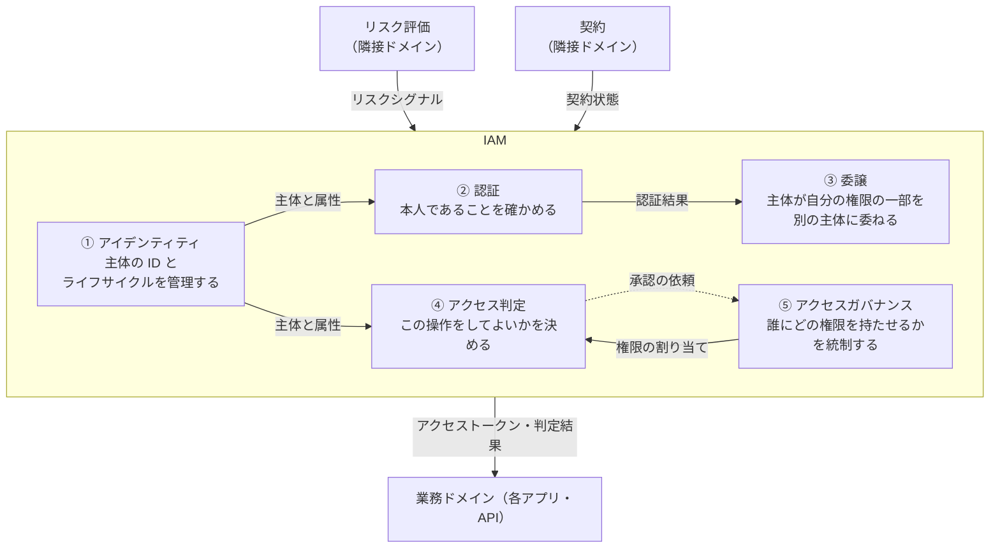

# 概要

「認可」という言葉は、人によって指す範囲が違う。ログインの話をしている人もいれば、OAuthのスコープの話をしている人も、管理画面のロール設計の話をしている人もいる。範囲がずれたまま認可基盤の議論を始めると、何を作るのかが定まらない。

この記事では、認可を設計の対象として扱うための全体の地図を作る。わかることは次のとおりである。

- 認証（AuthN）と認可（AuthZ）がそれぞれ何に答えるのか、なぜ分けるのか
- OAuthの「authorization」が実際には委譲であること
- IAMを5つのサブドメイン（アイデンティティ、認証、委譲、アクセス判定、アクセスガバナンス）に分けた地図
- DDDのCore / Supporting / Genericで見たときのIAMの位置づけ
- IAMの外にある隣接ドメインと、権限の業務上の意味の置き場所
- AIエージェントが増えると委譲の区切りが重くなる理由

この記事は、認可を扱うシリーズの1本目である。以降の記事で扱う個別の仕様やアーキテクチャは、この地図のどこかに対応する。

既存の記事との関係も先に書いておく。識別・認証・認可という言葉の基本は[認証・認可の基本](/ja/posts/authentication-authorization-basics/)にまとめた。ACL・RBAC・ABACと機能スコープ・データスコープの設計は[権限管理の設計](/ja/posts/permission-management-design/)で扱った。OAuth 2.0の仕様は[OAuth 2.0とは？](/ja/posts/oauth-2-0/)にある。この記事はそれらを繰り返さず、それらがIAMの地図のどこに収まるかを示す。

# 認証と認可は別の問いに答える

## 2つの問い

認証と認可は、答える問いが違う。

| | 認証（Authentication） | 認可（Authorization） |
|---|---|---|
| 問い | あなたは誰か | その主体は、この資源に対し、この操作を、この文脈で行ってよいか |
| 結果 | 確かめられたアイデンティティ（人、サービス、エージェント） | 許可か拒否か（条件つきのこともある） |
| 主な入力 | 資格情報（パスワード、パスキー、証明書、署名など） | 主体、資源、操作、文脈、ポリシー |
| 失敗したとき | なりすましを許す | 権限のない操作を許す、または正当な操作を止める |

認証の結果は認可の入力の1つにすぎない。認可は、認証で確かめた主体に3つの情報を加えて判断する。資源（どのデータか）、操作（読む・書く・承認するなど）、文脈（時刻・接続元・テナント・リスク）である。

## 認証の成功は認可を意味しない

最初に押さえておきたい原則は「認証に成功したことは、アクセスしてよいことを意味しない」である。有効な資格情報を持っていることと、ある資源にアクセスしてよいことは別の事実である。

IETFのWIMSE WGが策定中のアーキテクチャ文書（draft-ietf-wimse-arch-08、RFC化前のInternet-Draft）は、§4.5でこの点を明示している。ワークロードが有効な資格情報を持っていても、信頼ドメイン内のすべての資源にアクセスしてよいことにはならない。さらに発行者・リライングパーティ・ゲートウェイ・ワークロードのいずれにも、認証の成功を暗黙の認可として扱わないよう求めている。

この原則は人にも当てはまる。ログインしている利用者が、URLのIDを書き換えるだけで他人の請求書を読めるなら、認証は正しく動いていても認可が欠けている。OWASP Top 10:2025でもアクセス制御の不備（A01 Broken Access Control）は1位であり、テストしたアプリケーションのすべてに何らかのアクセス制御の不備が見つかったと書かれている。認証と認可を分けて設計する理由はここにある。

## 認可は「決める」と「強制する」に分かれる

認可はさらに2つに分かれる。

- 判定（decision）: ポリシーに照らして、許可か拒否かを決める
- 強制（enforcement）: 判定の結果に従って、リクエストを通すか止める

NIST SP 800-162やXACMLは、判定する部品をPDP（Policy Decision Point）、強制する部品をPEP（Policy Enforcement Point）と呼ぶ。両者を分けておくと、判定のロジックを1か所に集めつつ、強制は各アプリケーションの入口で行える。この参照アーキテクチャと認可モデルの選び方は[認可のアーキテクチャ、モデル、エンジンの比較](/ja/posts/authorization-architecture-models-engines/)で扱う。

# OAuthの「認可」は委譲である

OAuthは自らを「認可フレームワーク」と呼ぶ。しかし、その中心は委譲されたアクセス（delegated access）のためのトークン発行である。

RFC 6749の冒頭は、OAuth 2.0を次のように説明している。サードパーティのアプリケーションが、HTTPサービスへの限定されたアクセスを得られるようにする。リソースオーナーに代わって得る場合と、アプリケーション自身として得る場合がある。

クライアントが自身としてアクセスを得る場合（Client Credentials）を除けば、OAuthが答えるのは「利用者は自分の権限のうちどの範囲を、いつまでこのクライアントに委ねるか」という問いである。どちらの場合も、「この利用者はこの請求書を読めるか」という問いには答えない。

| | OAuthが決めること | OAuthが決めないこと |
|---|---|---|
| 対象 | クライアントに委ねる範囲（スコープ、宛先、期限） | 資源ごと、行ごとのアクセスの可否 |
| 例 | このアプリに「請求書の読み取り」を委ねる | 営業部の請求書だけ読める、承認は課長以上 |
| 結果 | アクセストークン | 許可か拒否か |
| 担い手 | 認可サーバー | リソースサーバー、またはその背後の判定の仕組み |

スコープが`invoices:read`であっても、どの請求書を読めるかはリソースサーバー側で別に判定する必要がある。トークンの中身だけで資源ごとのアクセスを決めようとすると、トークンが肥大化するか、判定が粗くなる。この区別は混同しやすく、OAuthを認可基盤の議論に持ち込むときの大きな落とし穴になる。

OAuth 2.0の仕様は[OAuth 2.0とは？](/ja/posts/oauth-2-0/)に、OAuth 2.1とSecurity BCPは[OAuth 2.1とは？](/ja/posts/oauth-2-1-security-bcp/)にまとめた。認可基盤から見たOAuthと周辺標準の地図は[OAuthと周辺標準の地図](/ja/posts/oauth-standards-map-authorization-platform/)で扱う。

# IAMをDDDのサブドメインで切る

## なぜDDDの言葉を使うのか

認証と認可を分けるだけでは、まだ地図として粗い。OAuthの委譲、ロールの申請と承認、IDのプロビジョニングなど、「認可」と呼ばれがちな仕事は多い。そこで、認証と認可を含むIAM（Identity and Access Management）全体を、業務上の問題の区切りで分ける。

区切り方にはDDD（ドメイン駆動設計）の言葉を使う。用語はVaughn Vernonの『実践ドメイン駆動設計（IDDD）』に従う。ここで示すのは分け方の一例であり、唯一の正解ではない。

## IAMとは何か

NISTの用語集は、IAMを広くシステム（企業、ネットワーク、国など）の中で個々のIDを管理することだと説明している。企業ITでのアイデンティティ管理（identity management）は、個々のネットワーク利用者のロールとアクセス権限を確立し管理することだとも書く。

この記事では、主体（人、サービス、AIエージェント）のIDを管理し、その主体が何にアクセスしてよいかを決めて統制する領域をIAMと呼ぶ。具体的には、認証、認可（委譲、アクセス判定、アクセスガバナンス）、その前提となるIDの管理をまとめたものである。

## DDDの用語

| 用語 | 意味 |
|---|---|
| ドメイン | 組織が行う事業と、その事業が置かれた世界 |
| サブドメイン | ドメインを業務の問題で分けた区画 |
| コアドメイン（Core） | 事業の成功にとってもっとも重要で、差別化の源になるサブドメイン |
| 支援サブドメイン（Supporting） | 事業に必要で固有の要素もあるが、Coreではないサブドメイン |
| 汎用サブドメイン（Generic） | 事業に固有のものはないが、事業全体には必要なサブドメイン |

IDDDの第1章は、Core以外のモデルも重要だと書く。ただし、Coreほどの優先度と労力はかけないことがあるとしている。EvansのDDD Referenceも、Genericな要素はシステムが動くのに欠かせないとしたうえで、既製品や公開済みのモデルの利用を検討するよう勧めている。だからGenericは、既製品や標準で済ませる選択をとりやすい。

Core / Supporting / Genericはサブドメインの分類である。どれになるかは、どの組織の事業から見るかで決まる。同じ認証の仕組みでも、IdPを売る会社にとってはCoreであり、ECサイトにとってはGenericである。

## 事業によってIAMの位置づけは変わる

| 組織の事業 | IAMの位置づけ |
|---|---|
| IAM以外（EC、SaaSなどの業務アプリ） | 事業ドメインの中のGenericサブドメイン（事業によってはSupporting） |
| IAMそのもの（IdP、認可エンジン、IGAのベンダー） | IAMがドメインそのもの。その中のサブドメインをCore / Supporting / Genericに分ける |

業務アプリの組織にとって、IAMは基本的にGenericである。IDDDの本はIdentity and Access ContextをGenericサブドメインの例として扱っており、公式サンプルの`iddd_identityaccess`がその実装である。Genericであれば、標準仕様と既製品で済ませる方向に倒すのが自然な判断になる。

ただし、テナントごとに複雑な権限を設定できることが売りのSaaSでは、アクセス判定やアクセスガバナンスがSupportingに寄ることがある。IAMのベンダーであれば、IdPなら認証と委譲、認可エンジンならアクセス判定、IGA（Identity Governance and Administration）ならアクセスガバナンスがCoreになりやすい。

自分の組織にとってどこがCoreかを先に決めておくと、どこに投資し、どこを買うかの判断がぶれにくくなる。範囲の決め方を[認可基盤はどこまで作るか](/ja/posts/authorization-platform-scope-stages/)で扱う。

# IAMの全体図

IAMを5つのサブドメインに分け、外側に隣接ドメインと業務ドメインを置いた図である。

実線はデータの受け渡し、点線は依頼を表す。リスクシグナルは主に認証とアクセス判定が受け取り、契約状態はアクセス判定が受け取る。業務ドメインには、委譲がアクセストークンを、アクセス判定が判定結果を渡す。

# 5つのサブドメイン

| # | サブドメイン | 責務 | 含むもの |
|---|---|---|---|
| ① | アイデンティティ（Identity） | 主体の識別子と属性を持ち、生成から削除までのライフサイクルを管理する | 識別子、属性、身元確認、プロビジョニング |
| ② | 認証（Authentication） | 主体が名乗っているとおりの本人であることを確かめ、その結果を保つ | 認証器とクレデンシャルの管理、MFAやステップアップ、フェデレーション、セッション、アカウントリカバリ、非人間主体の認証 |
| ③ | 委譲（Delegation） | 主体が自分の権限の一部を別の主体に委ね、その範囲と期限を管理する | 委ねる先の登録、同意、スコープ、トークンの発行・交換・失効、委譲の連鎖 |
| ④ | アクセス判定（Access Decision） | 主体がある資源にある操作をしてよいかを、ポリシーに基づいて決める | ポリシーの定義、評価、判定結果の提供 |
| ⑤ | アクセスガバナンス（Access Governance） | 誰にどの権限を持たせるかを決め、それが妥当であり続けるよう統制する | 申請・承認、割り当て、棚卸し、職務分掌、一時的な権限付与（JIT） |

以下、それぞれが何を決めるのか、どの標準と結びつくのかを短く見る。

## ① アイデンティティ

主体が「誰であるか」を表すデータを持つ。識別子、属性（所属、役職、雇用形態など）、身元確認の結果、入社から退職までのライフサイクルがここに入る。ほかのシステムへのアカウントの配布（プロビジョニング）もここである。代表的な標準はSCIMである。

アクセス判定は、このサブドメインが持つ属性を入力に使う。属性が古いまま残ると、異動した人が前の部署のデータを読めてしまう。認可の事故の一部は、判定ではなく属性の鮮度で起きる。

## ② 認証

主体が名乗っているとおりの本人であることを確かめ、その結果をセッションとして保つ。パスワード、パスキー、MFA、フェデレーション（OpenID ConnectやSAML）、アカウントリカバリが含まれる。人だけでなく、サービスやワークロードといった非人間の主体の認証もここに入る。

NIST SP 800-63-4（2025年7月に確定）は、身元確認（63A）、認証（63B）、フェデレーション（63C）を分けて扱う。①と②の境界を考えるときの参考になる。

## ③ 委譲

主体が自分の権限の一部を、別の主体に委ねる。委ねる先（クライアント）の登録、委ねてよいかの同意、委ねる範囲（スコープや宛先）、トークンの発行・交換・失効、さらに委ねた先がさらに委ねる連鎖までを扱う。OAuthの中心はここにある。

## ④ アクセス判定

主体がある資源にある操作をしてよいかを、ポリシーに基づいて決める。RBAC、ABAC、ReBACといったモデル、OPAやCedarのようなポリシーエンジン、PDPとPEPの分離はこのサブドメインの話である。狭い意味の「認可」はここを指す。標準化されたPEPとPDPの間のAPIについては[AuthZEN Authorization APIとは？](/ja/posts/authzen-authorization-api/)で扱う。

## ⑤ アクセスガバナンス

誰にどの権限を持たせるかを決め、それが妥当であり続けるよう統制する。権限の申請と承認、ロールの割り当て、定期的な棚卸し、職務分掌（承認者と申請者を同じ人にしないなど）、一定時間だけ権限を与えるJIT（Just-In-Time）が含まれる。

④が「今この操作をしてよいか」を毎回決めるのに対し、⑤は「そもそもこの人にこの権限を持たせてよいか」を時間をかけて決める。⑤が決めた割り当てを、④が判定の入力として使う。④の判定の中で人の承認が必要になれば、⑤に依頼が戻る。

## 委譲を独立させる理由

委譲を認証やアクセス判定の一部として扱う整理も多い。それでもこの地図で③を独立させるのは、OAuthの中心概念（クライアント、同意、グラント）がどこにも収まらないためである。

- ②認証には収まらない。同意は「本人であること」を確かめる行為ではない
- ④アクセス判定には収まらない。委ねる範囲を決めるのは、資源ごとの判定ではなく主体自身の意思である
- ⑤アクセスガバナンスには収まらない。権限を与えるのは管理者ではなく、権限を持つ本人である

委譲の同意は、GDPRなどが定める「個人データを特定の目的で使うことへの同意」とも別物である。前者は自分の権限を別の主体に委ねる同意であり、後者はプライバシーの同意である。画面上は似ていても、記録する内容も撤回したときの影響も違う。

## 「認可」の広い意味と狭い意味

日常で「認可」と呼ぶものは、③④⑤にまたがる総称である。議論のずれは、ここを区別しないことから生まれる。

| 呼び方 | 指すもの | 典型的な問い |
|---|---|---|
| 狭い意味の認可 | ④ アクセス判定 | この操作をしてよいか |
| OAuthの「authorization」 | ③ 委譲 | このクライアントに何を委ねるか |
| 権限管理 | ⑤ アクセスガバナンス | 誰にどの権限を持たせるか |
| 広い意味の認可 | ③④⑤の総称 | 上のすべて |

「認可基盤を作る」と言ったとき、どの行の話なのかを最初に合わせておくと、議論が早く進む。

# 隣接ドメイン

IAMの外にも、認証やアクセス判定に入力を渡すドメインがある。代表的なものが次の2つである。

| 隣接ドメイン | 責務 | IAMに渡すもの | 受け取るサブドメイン |
|---|---|---|---|
| リスク評価（Risk Assessment） | 主体の振る舞いが疑わしいかを評価する | リスクシグナル | ② 認証、④ アクセス判定 |
| 契約（Subscription） | テナントがどの機能を契約しているかを管理する | 契約状態 | ④ アクセス判定 |

リスク評価は、普段と違う場所からのログインや不審な操作の連続を見つける。その結果を受けて、認証は追加の要素を求め（ステップアップ）、アクセス判定は危険な操作を止める。継続的にシグナルを共有するための標準として、SSF・CAEP・RISCがある。

契約は「このテナントはこの機能を使ってよいか」を決める入力になる。プランによって使える機能が変わるSaaSでは、アクセス判定は利用者の権限と契約状態の両方を見る。

これらをIAMの外に置くのは、責務の持ち主が違うためである。不正検知のルールや料金プランの定義はIAMの知識ではない。IAMはそれを入力として受け取り、判定に使うだけにとどめる。

# 権限の「意味」は業務ドメインが持つ

地図の中で見落としやすいのが、権限の業務上の意味をどこに置くかである。

「この請求書を承認してよいか」という問いには、業務の知識が詰まっている。請求書という資源があること、承認という操作があること、金額によって承認者が変わること、申請者本人は承認できないこと。これらは業務ドメインの言葉であり、業務ドメインが持つべきものである。IAMが持つのは、判定と強制の仕組みである。

| | 業務ドメインが持つもの | IAMが持つもの |
|---|---|---|
| 語彙 | 請求書、承認、課長、申請者 | 主体、資源、操作、ポリシー |
| ルール | 金額による承認者の違い、本人承認の禁止 | ルールを評価する仕組み、評価結果の提供 |
| 変更の頻度と担い手 | 業務の変化に合わせて業務チームが変える | 基盤の変化に合わせて基盤チームが変える |

IDDDの公式サンプルがこの関係をよく表している。業務側のCollaboration Contextは、Identity and Access Contextのユーザーとロールをそのまま使わない。`UserInRoleAdapter`と`CollaboratorTranslator`を通して、自分の言葉であるAuthorやModeratorに翻訳して受け取る。

ここを混ぜると、IAMが業務知識を抱え込む。業務のルールが変わるたびに基盤チームへの依頼が必要になり、基盤チームは業務を理解しないとポリシーを書けなくなる。逆に業務ドメインが判定の仕組みまで抱え込むと、アプリケーションごとに判定がばらつく。仕組みは横断で持ち、意味は各ドメインが持つという分担が、認可基盤の範囲を考えるときの出発点になる。

権限を構成する要素（誰が、何に、何をしてよいか）と、機能スコープ・データスコープの設計は[権限管理の設計](/ja/posts/permission-management-design/)にまとめた。

# AIエージェントで委譲が重くなる理由

この地図で③委譲を独立させた理由は、AIエージェントが増えるほど重くなる。

従来の委譲は、利用者がアプリケーションに権限の一部を委ねる、という1段の関係が中心だった。AIエージェントでは、これが次のように変わる。

- 委譲が連鎖する。利用者がエージェントに委ね、エージェントがツールや別のエージェントに委ねる
- 誰の権限で動いているかが見えにくくなる。エージェント自身の権限なのか、利用者から委ねられた権限なのかを区別する必要がある
- 委ねる範囲を事前に決めにくい。エージェントがどのツールを呼ぶかは、実行するまで決まらないことがある
- 主体が人ではない。非人間の主体を認証し、その主体に権限を委ねる場面が増える

このため、委譲の範囲、期限、連鎖を記録し、途中で絞り込む仕組みが必要になる。トークン交換（RFC 8693）は、元の主体と代理で動く主体（actor）をトークンの中で区別する手段を用意している。MCP（Model Context Protocol）の認可仕様（2026-07-28版）も、保護されたMCPサーバーをOAuth 2.1のリソースサーバー、MCPクライアントをOAuth 2.1のクライアントとして位置づけている。なお、MCPでは認可への対応自体が任意（OPTIONAL）であり、OAuth 2.1もRFC化前のInternet-Draftである。

一方で、委譲だけでは足りない。エージェントが委ねられた範囲の中で、個々の操作をしてよいかは④アクセス判定が決める。危険な操作の前に人の承認を挟むなら⑤アクセスガバナンスの出番になる。AIエージェントの認可は③④⑤のすべてにまたがる。詳しくは[AIエージェントで認可の何が変わるか](/ja/posts/authorization-for-ai-agents/)と[MCPの認可を設計するときの勘所](/ja/posts/mcp-authorization-design/)で扱う。

# この地図の使い方

認可について議論するとき、または仕様を読むとき、次の順で地図に当てはめると混乱が減る。

1. その問題は5つのサブドメインのどれに属するか。複数にまたがるなら、どこが主か
2. 自分の組織にとって、そのサブドメインはCore / Supporting / Genericのどれか
3. 入力はどこから来るか。アイデンティティの属性か、隣接ドメインのシグナルや契約状態か
4. 権限の業務上の意味は、どの業務ドメインが持っているか
5. その仕様や製品は、どのサブドメインの問題を解くものか

たとえば「OAuthで認可基盤を作る」という提案は、③委譲の話をしているのか、④アクセス判定の話をしているのかで中身がまったく違う。この地図はその区別を早い段階でつけるためのものである。

# まとめ

- 認証は「あなたは誰か」、認可は「この主体はこの資源にこの操作をこの文脈で行ってよいか」に答える。認証の成功は認可を意味しない
- OAuthの「authorization」の中心は委譲されたアクセスのためのトークン発行であり、資源ごとのアクセス判定は別の層にある
- IAMはアイデンティティ、認証、委譲、アクセス判定、アクセスガバナンスの5つのサブドメインに分けられる。日常の「認可」は委譲、アクセス判定、アクセスガバナンスの総称である
- IAMがCore / Supporting / Genericのどれになるかは、組織の事業で決まる。業務アプリの組織では基本的にGenericである
- リスク評価や契約のような隣接ドメインはIAMの外にあり、IAMに入力を渡す
- 権限の業務上の意味は業務ドメインが持ち、IAMは判定と強制の仕組みを持つ
- AIエージェントでは委譲が連鎖し、委譲を独立したサブドメインとして扱う意味が大きくなる

# 関連記事

- [認証・認可の基本](/ja/posts/authentication-authorization-basics/)
- [権限管理の設計｜アクセス制御の考え方を整理する](/ja/posts/permission-management-design/)
- [OAuth 2.0とは？フロー・トークン・実装の完全解説](/ja/posts/oauth-2-0/)
- [OAuth 2.1とは？OAuth 2.0からの変更点とSecurity BCP（RFC 9700）](/ja/posts/oauth-2-1-security-bcp/)
- [サービス間認証の全体像とは？mTLS・Token Exchange・SPIFFE・ゼロトラスト](/ja/posts/service-to-service-authentication/)
- [はじめてのデジタルアイデンティティ―Webサービスに欠かせない認証・認可・ID管理](/ja/posts/introduction-digital-identity/)
- [デジタルアイデンティティのすべて―安全かつユーザー中心のアイデンティティシステムを実現するための知識](/ja/posts/digital-identity-overview/)
- [認可基盤はどこまで作るべきか？横断と各ドメインの分担、必要な段階、判定の外部化](/ja/posts/authorization-platform-scope-stages/)
- [認可のアーキテクチャとモデルとは？PEP/PDP・RBAC/ABAC/ReBAC・ポリシーエンジンの選び方](/ja/posts/authorization-architecture-models-engines/)
- [AuthZEN Authorization APIとは？PEPとPDPをつなぐ認可判定の標準](/ja/posts/authzen-authorization-api/)
- [認可基盤に必要なOAuth関連標準とは？委譲・トークン・継続評価の地図](/ja/posts/oauth-standards-map-authorization-platform/)
- [ワークロードアイデンティティとは？WIMSE・Transaction Tokens・SPIFFEクライアント認証で見るサービス間の身元と文脈](/ja/posts/workload-identity-wimse-transaction-tokens/)
- [AIエージェントの認可とは？委譲の連鎖・人の承認・監査をMCP、AuthZEN、AIMS、A2A/AP2で整理する](/ja/posts/authorization-for-ai-agents/)
- [MCPの認可はどう設計する？起きうる事故と後から直せない判断](/ja/posts/mcp-authorization-design/)
- [認可基盤のアーキテクチャとは？コンテナ構成・代表シーケンス・PEPとPDPの配置と非機能の設計判断](/ja/posts/authorization-platform-architecture-decisions/)

# 参考リンク

- [RFC 6749 The OAuth 2.0 Authorization Framework](https://www.rfc-editor.org/rfc/rfc6749)
- [RFC 8693 OAuth 2.0 Token Exchange](https://www.rfc-editor.org/rfc/rfc8693)
- [The OAuth 2.1 Authorization Framework (draft-ietf-oauth-v2-1)](https://datatracker.ietf.org/doc/draft-ietf-oauth-v2-1/)
- [Workload Identity in a Multi System Environment (WIMSE) Architecture (draft-ietf-wimse-arch)](https://datatracker.ietf.org/doc/draft-ietf-wimse-arch/)
- [NIST CSRC Glossary: identity and access management](https://csrc.nist.gov/glossary/term/identity_and_access_management)
- [NIST SP 800-63-4 Digital Identity Guidelines](https://csrc.nist.gov/pubs/sp/800/63/4/final)
- [NIST SP 800-162 Guide to Attribute Based Access Control (ABAC) Definition and Considerations](https://nvlpubs.nist.gov/nistpubs/SpecialPublications/NIST.SP.800-162.pdf)
- [OASIS eXtensible Access Control Markup Language (XACML) Version 3.0](https://docs.oasis-open.org/xacml/3.0/xacml-3.0-core-spec-os-en.html)
- [OWASP Top 10:2025 A01 Broken Access Control](https://owasp.org/Top10/2025/A01_2025-Broken_Access_Control/)
- [OWASP Authorization Cheat Sheet](https://cheatsheetseries.owasp.org/cheatsheets/Authorization_Cheat_Sheet.html)
- [Model Context Protocol Specification: Authorization](https://modelcontextprotocol.io/specification/2026-07-28/basic/authorization)
- [Eric Evans, DDD Reference](https://www.domainlanguage.com/ddd/reference/)
- [Vaughn Vernon, Implementing Domain-Driven Design 第1章の抜粋: The Business Value of Using DDD（InformIT）](https://www.informit.com/articles/article.aspx?p=1944876&seqNum=4)
- [Vaughn Vernon, IDDD_Samples](https://github.com/VaughnVernon/IDDD_Samples)
