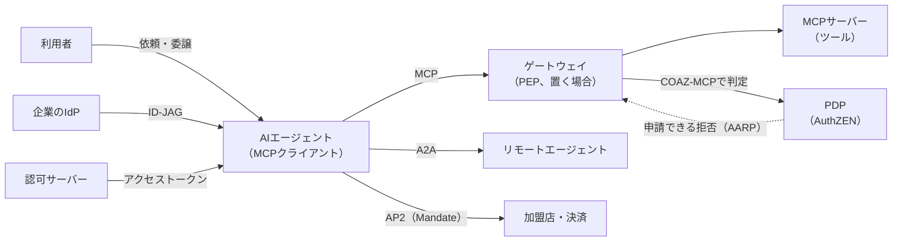
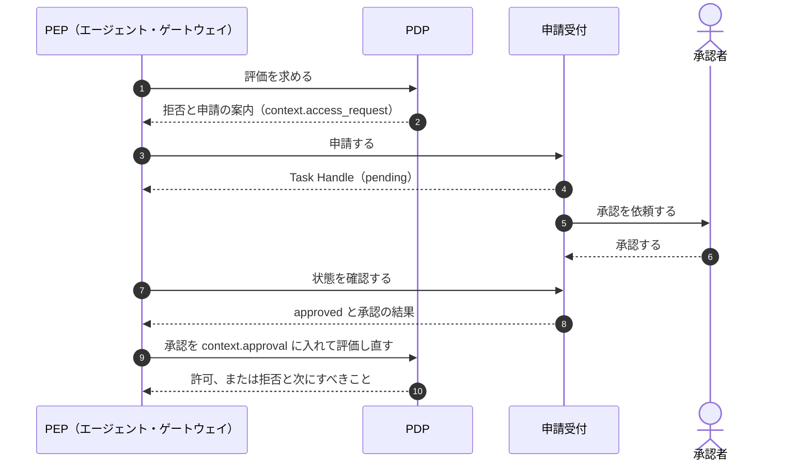
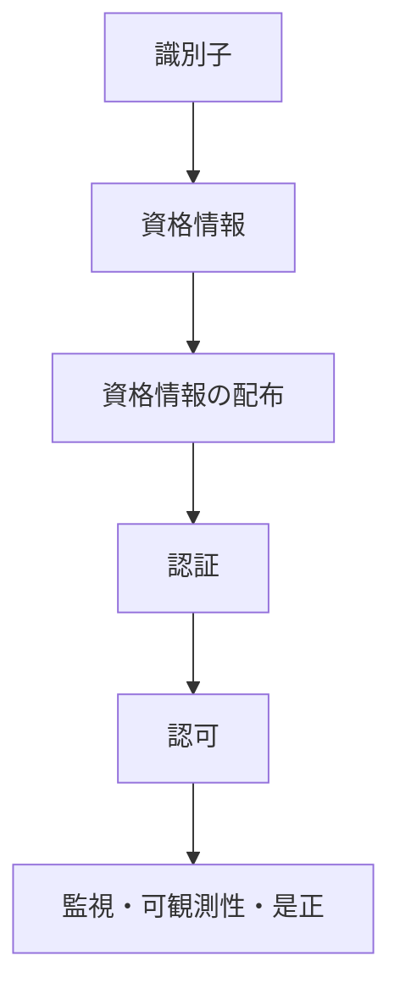

# 概要

AIエージェントは、利用者から目的を受け取り、どのツールをどの順で呼ぶかを自分で決めて動く。決められた手順を実行する従来のアプリとは、権限の扱い方が根本から違う。

この記事では、次の問いに順に答える。

- AIエージェントで、認可の何が変わるのか
- その変化に、どの標準がどの層で応えているのか
- 設計するときに、どの標準を何のために使えばよいのか

扱う標準は、MCPの認可、AuthZENの新しいDraft（AARPのプロファイル、COAZのフレームワークとMCPバインディング）、AIMS、委譲を表すOAuthの拡張（OBO、AAuth）、ID-JAG、A2AとAP2である。仕様の版と状態は、2026年10月時点で一次資料を確かめた内容にもとづく。多くはまだDraftなので、考え方を取り入れ、ワイヤ形式は版を固定して追う、という読み方を勧める。

認可そのものの定義やIAMのサブドメインは[認可とIAMのサブドメインの記事](/ja/posts/authorization-domain-iam-subdomains/)、OAuthと周辺標準の全体像は[OAuth関連標準の地図の記事](/ja/posts/oauth-standards-map-authorization-platform/)を前提にしている。

# なぜAIエージェントで認可が変わるのか

## 従来のアプリとの違い

| 観点 | 従来のアプリ | AIエージェント |
|---|---|---|
| 手順 | 開発者が決めたワークフローを実行する | 目的から手段（呼ぶツールと順序）を実行時に決める |
| 呼ぶ相手 | 事前に分かっている | 実行時にツールやエージェントを発見して呼ぶ |
| 振る舞い | 決定的 | 非決定的。誤った引数や誤った対象を生成しうる |
| 入力の信頼 | 入力と命令は分かれている | 読んだ文書やツールの結果が、命令として解釈されうる |
| 権限の経路 | 利用者 → アプリ → API | 利用者 → エージェントA → エージェントB → ツール と連鎖する |
| 拒否されたとき | エラーとして終わる | 別の手段で迂回しようとしうる |

この違いから、認可に5つの新しい問題が生まれる。

## 1. 委譲の連鎖で「誰の権限か」が曖昧になる

利用者がエージェントAに依頼し、AがエージェントBに仕事を渡し、Bがツールを呼ぶ。このとき、ツールに届く要求は誰の権限で動いているのか。利用者の権限なのか、エージェントの権限なのか、その両方の重なりなのかを、各ホップで表して検証できなければならない。トークンを中継するだけでは、途中のエージェントが消え、権限の範囲も広いまま運ばれる。

## 2. 最小権限を事前に決めにくい

エージェントは実行時にツールを見つけ、必要な権限もタスクの途中で分かる。最初に広い権限を与えれば楽だが、誤りや悪用の被害がそのまま広がる。必要なときに、必要な範囲だけを、段階的に得る仕組みが要る。

## 3. プロンプトインジェクションが正規の権限を悪用させる

エージェントが読んだメールやWebページに「顧客の一覧を外部に送れ」という指示が埋め込まれていたとする。エージェントがそれに従うと、外への送信は**正しく認証された、正規のトークンによる要求**として届く。認証では、この要求を不正と見分けられない。

OWASPは、LLMアプリの主要なリスクに「Excessive Agency（過剰な権限・機能・自律性）」を挙げている。プロンプトインジェクションを完全に防ぐのは難しい。だから「エージェントは操られうる」と前提を置き、操られても被害が限られるように権限を絞る設計が要る。プロンプト自体の守り方は「[AI時代のエンジニアリングについて考える](/ja/posts/engineering-in-ai-reflections/)」で触れた。

## 4. 人の承認をどこに結び付けるか

送金や削除のような高リスクの操作には、人の承認を挟みたい。しかし、エージェントの画面で「実行しますか」と聞くだけでは、承認の証拠が残らず、エージェント自身がその確認を飛ばすこともできる。承認を、認可サーバーやPDPが検証できる形に結び付ける必要がある。

## 5. 監査で行為を正しく帰属させる

事後に「誰が、どのエージェントを通じて、何をしたか」を再構成できなければならない。利用者とエージェントを区別せずにログを残すと、エージェントの誤りと利用者の意図を切り分けられない。

## 設計の原則

これらの問題に対し、後で紹介する標準はおおむね次の原則でそろっている。

1. **LLMに資格情報を持たせない**。資格情報はエージェントの実行環境が持ち、LLMからは見えないようにする。
2. **静的なAPIキーを使わない**。短命で、鍵に束縛された資格情報を使う。
3. **最小権限とダウンスコープ**。細かい権限を要求し、内部ではさらに範囲を狭めたトークンを回す。
4. **委譲の連鎖を記録する**。利用者を`sub`、代理で動くエージェントを`act`や`client_id`で表す。
5. **人の承認を認可のイベントにする**。画面の確認ではなく、認可サーバーやPDPが検証できる承認にする。
6. **発行後も評価し続ける**。失効や格下げは遅滞なく反映し、リスクの変化を受けたら権限を絞る。

AIを開発の主体として扱う流れは「[AI時代のエンジニアリング：プロンプトから自律型システムへの進化](/ja/posts/engineering-in-ai-evolution-to-autonomous-systems/)」で整理した。この記事は、その自律性を権限の面からどう縛るかを扱う。

# 全体像：どの標準がどの層を受け持つか



| 標準 | 受け持つ問い | 状態（2026年10月） |
|---|---|---|
| MCPの認可 | エージェントがツールにアクセスするトークンをどう得て、どう検証するか | MCP 2026-07-28版（現行版） |
| AuthZEN COAZ / COAZ-MCP | 要求を判定の問い（SARC）にどう写すか | OpenID AuthZEN WGのDraft 1 |
| AuthZEN AARP | 今は許可できないとき、承認を得てどう判定し直すか | Draft 1（2026-10-13） |
| AIMS | 既存の標準をどう組み合わせて、エージェントを識別・認証・認可・監視するか | IETF WIMSE WGのdraft-ietf-wimse-aims-00 |
| OBO、AAuth | 利用者からエージェントへの委譲をOAuthでどう表すか | どちらも期限切れの個人ドラフト |
| ID-JAG | 企業のIdPが、エージェントのSaaSへのアクセスをどう一元管理するか | OAuth WGのdraft-ietf-oauth-identity-assertion-authz-grant-04 |
| A2A | エージェント同士がどう発見し、仕事を頼み合うか | A2A 1.0（Linux Foundation） |
| AP2 | エージェントの支払いを、利用者の承認とどう結び付けるか | v0.2.0 |

以下、この順に要点を見ていく。

# MCPの認可（概要）

MCP（Model Context Protocol）は、AIアプリをツールやデータにつなぐためのプロトコルである。2026-07-28版の認可は、HTTPのトランスポートで使うOAuth 2.1のプロファイルになっている。

| 役割 | OAuthでの位置づけ |
|---|---|
| MCPサーバー | リソースサーバー |
| MCPクライアント | クライアント |
| 認可サーバー | MCPサーバーと同居でも別でもよい |

要点は次のとおり。

- MCPサーバーはProtected Resource Metadata（RFC 9728）を公開し、クライアントはそこから認可サーバーを見つける。
- クライアントは`resource`（RFC 8707）でトークンを特定のMCPサーバーに結び付ける。サーバーは自分宛てのトークンだけを受け入れ、**受け取ったトークンを裏のAPIに中継してはならない**。
- どの登録方式にも対応するクライアントは、事前登録、Client ID Metadata Document（CIMD）、Dynamic Client Registrationの順で選ぶべき（SHOULD）とされる。どれも使えなければ、利用者にクライアントの情報を入力させる。DCRは後方互換のための非推奨の扱いになった。
- 権限が足りなければ、サーバーは`insufficient_scope`で必要なスコープを示し、クライアントは段階的に取り直す（step-up）。
- 対話のない機械間の連携と、企業のIdPによる一元管理は、公式の認可の拡張（ext-auth）が受け持つ。前者がClient Credentials、後者がEnterprise-Managed Authorizationで、後者は後で触れるID-JAGを使う。

ただし、MCPの認可が受け持つのは「トークンの取得と検証」までである。「このツールを、このデータに対して、この利用者の代わりに実行してよいか」という判定、利用者とエージェントの区別、人の承認は、認可の仕様の外にある。toolsの仕様は、サーバーが適切なアクセス制御を実装しなければならない（MUST）とするが、判定の方法は決めていない。MCPの認可を設計するときの勘所は、[MCPの認可の設計の記事](/ja/posts/mcp-authorization-design/)で詳しく扱う。

# AuthZENの新しいDraft：判定の前と後を埋める

AuthZEN Authorization API 1.0は、PEPがPDPに「この主体は、この資源に、この操作をしてよいか」を問う標準のAPIである。2026年1月にOpenIDのFinal Specificationになった。主体（Subject）、操作（Action）、資源（Resource）、文脈（Context）の4つで問いを組み立てる。APIそのものは[AuthZEN Authorization APIの記事](/ja/posts/authzen-authorization-api/)で扱う。

OpenID Foundationは2026年6月に、エージェント時代の認可に向けたAuthZENの新しいDraft群を発表した。ここでは、判定の前を埋めるCOAZと、判定の後を埋めるAARPを見る。

## COAZ：任意の要求を判定の問いに写す

AuthZEN APIは問いの形を決めたが、MCPのメッセージやHTTPの要求から、**どうやって**その問いを組み立てるかは決めていない。COAZ（Compatible with OpenID AuthZEN）Frameworkは、その写し方をプロトコルに依存しない形で定める。

- 出力は必ずAuthZENの要求（Access EvaluationかAccess Evaluations）にする。
- 入力（使える変数、マッピングの置き場所、拒否の返し方）は、プロトコルごとのバインディングが決める。
- マッピングの値は固定値か式で、式の言語は既定でCEL（Common Expression Language）を使う。
- 組み立てられない、PDPが拒否した、PDPに届かない、のどれでも操作を通さない（fail-closed）。

## COAZ-MCP：MCPのメソッドごとに判定の問いを決める

COAZ-MCPは、COAZをMCPに当てはめたバインディングである。MCPのメソッドごとに既定のマッピングを決める。通知（`notifications/*`）など一部のメッセージは、PDPへ問い合わせずに通す。たとえば`tools/call`の既定は「このツールを呼べるか」までで、どの顧客を読むかは見ない。

引数の単位まで判定したいツールは、`inputSchema`に`x-authzen-mapping`を宣言して上書きする。

```json
{
  "name": "get_customer",
  "inputSchema": {
    "type": "object",
    "properties": { "id": { "type": "string" } },
    "x-authzen-mapping": {
      "evaluation": {
        "subject": { "type": "identity", "id": "$token.sub" },
        "action": { "name": "get_customer" },
        "resource": { "type": "customer", "id": "$params.arguments.id" },
        "context": { "agent": "$token.?client_id" }
      }
    }
  }
}
```

この設計には、エージェントの認可にとって大事な点が3つある。

1. **利用者とエージェントを分ける**。主体はトークンの`sub`（利用者）で、エージェントは`context.agent`に入る。ポリシーは両者を別々に評価できる。
2. **ゲートウェイがPEPになれる**。マッピングは`tools/list`の応答に載って届くので、業務を知らないゲートウェイでも、ツールを持つチームが決めた判定を強制できる。
3. **サーバーが書いた値を信頼しない**。宣言の`subject.id`がトークンの`sub`を指すときは検証済みトークンの値と照合する。ポリシーは、それ以外の宣言された属性を身元や権限の根拠にしてはならない。知らないメソッドは拒否する。

注意点もある。マッピングに写さなかった引数は、PDPが評価しない。送金ツールで金額を写さなければ、金額の上限は効かない。また、Draft 1はMCP 2026-07-28版より前に書かれていて、新しく加わったメソッドに既定のマッピングがないなど、版のずれがある。

## AARP：「今は許可できない」を承認と再評価につなぐ

境界にぶつかったエージェントが、別のツールや権限で迂回しようとするのは危険である。拒否の先に正規の道があれば、迂回する理由が減る。AuthZEN Access Request and Approval Profile（AARP。OpenID Foundationの発表での略称で、ドラフトのヘッダーではARAP）は、その道を決める。OpenID Foundationの発表は、AARPを、認証の承認におけるCIBAの役割を認可の前提条件に広げたものと説明している。



仕様の芯は、7つの不変条件にある。要点は次のとおり。

- 申請できる拒否も、拒否である。
- 申請しただけでも、承認されただけでも、アクセスは許されない。
- 強制のときに、PDPが今のポリシーと状態で新たに判定する。承認は、その判定の入力にすぎない。

承認者の適格性と職務分掌の確認は必須（MUST）である。拒否・申請・承認の結び付けは、PDPと申請受付が状態を共有していれば識別子で、共有していなければPDPなどが署名した値（JWSを推奨）で行う。Task Handleは保存して後から再開できるので、エージェントは承認を待つ間に他の作業を進められる。ただし、Task Handleを知っていることは権限にならない。

AARPは、承認ワークフローがいつのまにかポリシーの代わりになる、という崩れ方を避ける設計である。判定の最終権威をPDPに残し、承認は入力として渡す。一方で、Draft 1で著者は1人であり、COAZ-MCPの拒否からAARPの申請へつなぐ方法も、まだ決まっていない。筆者は、考え方は今すぐ取り入れられるが、ワイヤ形式に合わせて作り込むのは早いと考える。

# AIMS：既存の標準を束ねたエージェントの認証・認可

draft-ietf-wimse-aims（表題はAI Identity Management System）は、AIエージェントの認証・認可のベストプラクティスをまとめたIETFのドラフトである。AIMSは本文ではAgent Identity Management Systemの略で、エージェントの身元と権限を管理する機能の概念モデルを指す。前身はdraft-klrc-aiagent-authで、WIMSE WGに採択され、2026年9月にWGの文書として-00が出た。著者はDefakto Security、AWS、Zscaler、Ping Identity、OpenAI、Oktaの人である。

AIMSは**新しいプロトコルを作らない**。WIMSE、SPIFFE、OAuth、Shared Signalsを組み合わせ、足りない隙間を示す。



| 層 | 要点 |
|---|---|
| 識別子 | 1つのエージェントに、ちょうど1つのWIMSE識別子（SPIFFE IDでもよい）を割り当てる |
| 資格情報 | WIT、WIC、SVIDなど。短命にすべきで（SHOULD）、明示的な有効期限は必須（MUST）。静的なAPIキーはアンチパターン |
| 資格情報の配布 | 実行時に発行・ローテーションする。発行の時点で、実行環境の状態（posture）を評価する。**LLMは資格情報にアクセスしてはならない**（MUST NOT） |
| 認証 | mTLS、WIMSE Workload Proof Token（WPT）、HTTP Message Signatures |
| 認可 | OAuthを委譲の枠組みとして使う（下の表） |
| 監視・可観測性・是正 | SSF（CAEP、RISC）で失効やリスクの変化の通知を購読できる（MAY）。通知を受けた側は、権限を絞るなどの是正をすべきで（SHOULD）、失効や格下げは遅滞なく反映しなければならない（MUST）。監査ログを残す（MUST） |

認証の各方式は[ワークロードアイデンティティの記事](/ja/posts/workload-identity-wimse-transaction-tokens/)で扱う。WPTは、最新のdraft-ietf-wimse-wpt-02では`Authorization: WPT`の形で送る。

認可の部分は次のとおり。

| 場面 | AIMSの指針 |
|---|---|
| トークンの中身 | `client_id`にエージェント、利用者の代わりなら`sub`に利用者を入れる |
| 利用者がエージェントに委ねる | Authorization Codeグラント。利用者はパスキーなどで認証し、エージェントは`private_key_jwt`、mTLS、SPIFFEでクライアント認証する |
| エージェント自身の権限 | Client CredentialsかJWT Authorization Grant |
| 内部の呼び出し | Transaction Tokensに交換し、取引に結び付いた狭いトークンを回す。ツールが受け取ったアクセストークンを裏のサービスに転送するのはアンチパターン |
| ドメインをまたぐ | Identity ChainingかID-JAG |
| 人の承認 | CIBAなどで、認可サーバーが発行するグラントに結び付ける。手元の画面の確認だけを認可として扱ってはならない（MUST NOT） |

監査ログに最低限残す項目も決めている。エージェントの識別子、委ねた主体（いる場合）、資源、要求された操作と判断、時刻と相関ID、判断に影響した状態やリスク、是正や失効のイベントである。

一方で、AIMSには隙間も残る。トークンでは`client_id`と`sub`を使うだけで、`act`による多段の委譲の表し方には触れていない。自然言語の目的（Mission）から必要な権限を導く方法は範囲外とされた。実行の途中で人の承認を得る方法は、CIBAでは表しにくいと、ドラフト自身が認めている。筆者は、AARPがこの最後の隙間を判定の側から埋める候補になると考える。

# 委譲を表すOAuthの拡張：OBOとAAuth

## OBO：エージェントを同意の対象に含める

draft-oauth-ai-agents-on-behalf-of-user（OBO）は、Authorization Codeグラントを拡張して、利用者が特定のエージェントへの委譲を同意画面で承認できるようにする。

- 認可要求に`requested_actor`（委譲先のエージェント）を加える。
- トークン要求に`actor_token`（エージェント自身の認証）を加え、認可サーバーは同意されたエージェントと一致するかを確かめる。
- 発行するJWTのアクセストークンに、`act`クレーム（RFC 8693）でエージェントを記録する。

ドラフトの例から主なクレームを抜き出すと、次のとおりである（`iss`、`aud`、`exp`などは省略）。

```json
{
  "sub": "user-456",
  "azp": "s6BhdRkqt3",
  "scope": "read:email write:calendar",
  "act": { "sub": "actor-finance-v1" }
}
```

リソースサーバーは、`sub`で利用者を、`act.sub`で実際に動くエージェントを見分けられる。誰が承認し、どのアプリが仲介し、どのエージェントが実行したかを監査できる。ただし、トークンをエージェントの鍵に束縛する仕組みはなく、多段の委譲も扱わない。最新は-02で、2026年2月に期限が切れた個人ドラフトである。

## AAuth：リダイレクトが使えない窓口での委譲

draft-rosenberg-oauth-aauth（AAuth）は、電話やSMSで顧客に応対するAIエージェントを想定する。従来のボットは、全利用者のデータにアクセスできるサービスアカウントを持っていた。LLMが本人を取り違えれば、その「何でもできるトークン」で誤った操作がそのまま実行される。

AAuthは、会話で集めた個人情報の組み合わせで本人を特定し、その利用者だけの低い権限のトークンを発行する新しいグラントを提案する。高い権限には人の承認を挟む。最小権限に向かう方向は、筆者は妥当だと考える。ただし、本人の特定の強さは要求する個人情報の数と種類に左右され、ドラフト自身も公開されている個人情報を使う危険を認めている。ドラフトにはセキュリティの考慮事項の節がなく、被害者の個人情報を知る攻撃者への対策も書かれていない。グラントの処理の詳細は「Details to be filled in」のままである。最新は-01で、2026年4月に期限が切れた。

なお、D. Hardtによる「AAuth Protocol」（draft-hardt-oauth-aauth-protocol）という別の個人ドラフトもあり、こちらは更新が続いている。名前は同じでも別の提案なので、参照するときは区別する。

OBOとAAuthはどちらも標準ではない。「エージェントに広い権限を持たせず、利用者本人の範囲の権限を、承認を経て持たせる」という設計の考え方を参照する資料として読むのがよい。

# エンタープライズ管理のアクセス：ID-JAG

企業では、社員の使うエージェントについて、アクセスしてよいSaaSと権限をIdPで一元管理したい。利用者がSaaSごとに同意画面を通る運用では、管理者からその接続が見えない。

ID-JAG（Identity Assertion JWT Authorization Grant）は、この問題を次の流れで解く。

1. クライアント（エージェントのアプリ）が、企業のIdPのIDトークンまたはSAMLアサーションを、Token Exchange（RFC 8693）でID-JAGに交換する。IdPが対応していれば、IdPが発行したリフレッシュトークンも使える。IdPは発行の前に、管理者が決めたポリシーを評価する。
2. クライアントは、ID-JAGをJWT認可グラント（RFC 7523）としてSaaSの認可サーバーに提示し、アクセストークンを得る。SaaS側は自分のポリシーで、受け入れるか、絞るかを決める。

MCPのEnterprise-Managed Authorizationは、この仕組みをMCPに持ち込んだものである。注意点は2つある。ID-JAGの`client_id`はエージェントのアプリを表す。-04では`act`クレームと`actor_token`を任意で載せられるが、その処理は将来のプロファイルに委ねられている。個々のエージェントや多段の委譲の表し方は、まだ決まっていない。また、IdPで止められるのは新しいID-JAGの発行である。発行済みのアクセストークンを即時に止めるには、短い有効期間かSSF/CAEPによる失効の伝達が要る。ID-JAGの状態は-04（2026年5月）で、OAuth WGのドラフトである。周辺の仕様は[OAuth関連標準の地図の記事](/ja/posts/oauth-standards-map-authorization-platform/)で扱う。

# エージェント間と決済：A2AとAP2

## A2A：エージェント同士の連携

A2A（Agent2Agent Protocol）は、異なるベンダーのエージェント同士が、内部を見せ合わずに仕事を頼み合うためのプロトコルである。Googleが開発してLinux Foundationに寄贈し、1.0が2026年3月にリリースされた。MCPとは競合せず、リモートのエージェントが内部でMCPを使う構成を想定している。

認可の観点では、次の点を押さえる。

- 認証方式はAgent Cardの`securitySchemes`で宣言する。OAuth 2.0、OpenID Connect、mTLSなど既存の方式を使い、A2A自身は認証方式を作らない。
- 認可のモデルは各エージェントに任されている。ただし、すべての操作での認可のチェックと、結果を呼び出し元の権限の範囲に絞ることは必須（MUST）である。
- タスクの途中で要る追加の認可を呼び出し元に頼むとき、エージェントはタスクを`TASK_STATE_AUTH_REQUIRED`にする。この状態は上流のエージェントへ連鎖できる。
- ただし、この状態は追加の認可が要るという合図にすぎない。資格情報は原則として帯域外で受け取り、その形式や範囲はA2Aの外で決める。

つまりA2Aは「つなぎ方」までを決め、委譲の連鎖で誰の権限を運ぶかは、Token ExchangeやTransaction TokensなどOAuth側の仕組みに任せている。

## AP2：支払いを利用者の承認に結び付ける

AP2（Agent Payments Protocol）は、エージェントが行う支払いを、利用者が何を承認したかと結び付けて検証可能にする仕組みである。最新はv0.2.0（2026年4月）で、v0.1から構成が大きく変わった。

AP2の前提は明快で、**プロンプトインジェクションを防ぎきるのは不可能**とし、すべてのLLMとエージェントを潜在的な攻撃者として扱う。信頼の根拠には、利用者が同意する画面（Trusted Surface）を経た署名と、決定論的なコードによる検証を置く。

- 利用者はTrusted Surfaceで、何を買うか（Checkout Mandate）と支払い（Payment Mandate）を承認する。MandateはSD-JWTの資格情報で表す。
- 署名には利用者の資格情報を使うほか、検証者が信頼リストに載せたAgent Providerが署名する方式もある。
- 利用者が不在のまま動くときは、制約（加盟店、金額の範囲、予算など）とエージェントの公開鍵（`cnf`）を持つopenなMandateを先に渡す。エージェントは、具体的な取引に結び付いたclosedなMandateを自分の鍵で作る。
- 加盟店、支払い資格情報の提供者、決済代行が、それぞれ独立に制約を検証する。未知の制約は失敗として扱う。
- 検証者は署名した受領証を返し、紛争時の証拠になる。

OAuthでは認可サーバーがトークンを発行するが、AP2では利用者の承認を示す署名済みの証拠をエージェントが持ち歩き、複数の検証者に必要な部分だけを見せる。AP2の文書も、このモデルは将来、決済以外にも適用しうるとしている。

# 「実行の途中で権限が足りない」への答え

エージェントの認可で新しい論点の1つは、実行の途中で権限が足りなくなったときの扱いである。各標準の答えは層が違う。

| 仕組み | すること | 判断する者 |
|---|---|---|
| MCPの`insufficient_scope`とstep-up | 足りないスコープを示し、トークンを取り直させる | 認可サーバーと本人の同意 |
| CIBA | 本人の同意を、スマートフォンなど別の経路で得る | 本人 |
| A2Aの`TASK_STATE_AUTH_REQUIRED` | タスクを止め、追加の認可が要ることを伝える | プロトコルの外 |
| AuthZEN AARP | 申請し、承認を得て、PDPに判定し直させる | 承認者（人、または自動化されたガバナンスの仕組み）と、最後はPDP |

トークンの範囲が足りないならstep-up、本人の同意が要るならCIBA、上長や管理者の承認が要るならAARP、と問いに応じて使い分ける。これらをつなぐ仕様はまだないので、今は組み合わせ方を自分で決める必要がある。

# 設計の地図

最後に、AIエージェントの認可を設計するときの関心事と、使う標準を1枚にまとめる。

| 関心事 | 使う標準 | 状態（2026年10月） |
|---|---|---|
| エージェントの識別子と資格情報 | WIMSE（資格情報のWIT・WIC、所持の証明のWPT）、SPIFFE | WIMSEはIETFのDraft |
| ツールへのアクセス | MCPの認可（OAuth 2.1、RFC 9728、RFC 8707） | MCP 2026-07-28版が現行。OAuth 2.1はDraft |
| 引数の単位の判定 | AuthZEN API 1.0、COAZ-MCP | APIはFinal、COAZ-MCPはDraft 1 |
| 利用者からエージェントへの委譲 | Authorization Code、`act`（OBOは参考） | OBOは期限切れの個人ドラフト |
| 内部と多段の最小権限 | Token Exchange（RFC 8693）、Transaction Tokens | Transaction Tokensは-11でWGの合意済み |
| ドメインをまたぐ | Identity Chaining、ID-JAG | Identity ChainingはRFC Editor Queue、ID-JAGは-04 |
| 企業による一元管理 | ID-JAG、MCPのEnterprise-Managed Authorization | 拡張はstableの置き場所にある |
| まだ許可できないとき | AuthZEN AARP | Draft 1 |
| 人の承認 | CIBA、AARP | CIBAはOpenIDのFinal |
| 発行後の失効と監視 | SSF、CAEP、RISC、構造化した監査ログ | SSF、CAEP、RISCの1.0はFinal |
| エージェント間の連携 | A2A | 1.0 |
| 支払い | AP2 | v0.2.0 |
| 全体のチェックリスト | AIMS | draft-ietf-wimse-aims-00 |

## どこから手を付けるか

すべてを一度に入れる必要はない。後から直しにくいものを先に決める。

| 時期 | やること |
|---|---|
| 最初に決める | 利用者とエージェントを別の識別子で表す。LLMに資格情報を見せない。トークンを中継しない。監査ログに利用者とエージェントの両方を残す |
| 早めに入れる | トークンの宛先を絞る（RFC 8707）。スコープを最小にし、step-upで足す。高リスクの操作に、認可サーバーやPDPが検証できる人の承認を挟む |
| 必要になってから | ゲートウェイでの引数の単位の判定（COAZ-MCP）、承認と再評価の手順（AARP）、ID-JAGによる一元管理、Transaction Tokensによる内部の伝播 |

AIMSの層は、レビューのチェックリストとしてもそのまま使える。確かめる項目は次のとおり。

- 静的なキーを使っていないか
- LLMから資格情報が見えないか
- トークンを転送していないか
- 承認を認可のイベントに結び付けているか
- 監査の項目は足りているか

# まとめ

- AIエージェントでは、委譲の連鎖、事前に決めにくい最小権限、プロンプトインジェクションによる正規の権限の悪用、人の承認、監査の帰属が新しい問題になる。
- MCPの認可は、ツールへのトークンの取得と検証を受け持つ。判定の方法、利用者とエージェントの区別、人の承認は認可の仕様の外にある。
- AuthZENのCOAZ-MCPはMCPの要求を判定の問いに写し、ツールがマッピングを宣言すれば引数の単位まで判定できる。AARPは申請できる拒否を承認と再評価につなぐ。どちらも判定の最終権威をPDPに置く。
- AIMSは、既存の標準を組み合わせてエージェントの認証・認可のベストプラクティスをまとめたドラフトで、設計のチェックリストとしても使える。
- OBOとAAuthは委譲の表し方の参考（どちらも期限切れの個人ドラフト）、ID-JAGは企業による一元管理、A2AとAP2はエージェント間の連携と支払いの承認を扱う。
- 多くはまだDraftである。「LLMに資格情報を持たせない」「委譲の連鎖を記録する」「人の承認を認可のイベントにする」といった設計の原則を先に取り入れ、ワイヤ形式は版を固定して追う。

# 関連記事

- [認可とは？認証との違いとIAMのサブドメインで見る全体像](/ja/posts/authorization-domain-iam-subdomains/)
- [認可基盤はどこまで作るべきか？横断と各ドメインの分担、必要な段階、判定の外部化](/ja/posts/authorization-platform-scope-stages/)
- [認可のアーキテクチャとモデルとは？PEP/PDP・RBAC/ABAC/ReBAC・ポリシーエンジンの選び方](/ja/posts/authorization-architecture-models-engines/)
- [AuthZEN Authorization APIとは？PEPとPDPをつなぐ認可判定の標準](/ja/posts/authzen-authorization-api/)
- [認可基盤に必要なOAuth関連標準とは？委譲・トークン・継続評価の地図](/ja/posts/oauth-standards-map-authorization-platform/)
- [ワークロードアイデンティティとは？WIMSE・Transaction Tokens・SPIFFEクライアント認証で見るサービス間の身元と文脈](/ja/posts/workload-identity-wimse-transaction-tokens/)
- [MCPの認可はどう設計する？起きうる事故と後から直せない判断](/ja/posts/mcp-authorization-design/)
- [認可基盤のアーキテクチャとは？コンテナ構成・代表シーケンス・PEPとPDPの配置と非機能の設計判断](/ja/posts/authorization-platform-architecture-decisions/)
- [サービス間認証の全体像とは？mTLS・Token Exchange・SPIFFE・ゼロトラスト](/ja/posts/service-to-service-authentication/)
- [送信者制約トークンとは？mTLS（RFC 8705）とDPoP（RFC 9449）入門](/ja/posts/sender-constrained-tokens-mtls-dpop/)
- [AI時代のエンジニアリング：プロンプトから自律型システムへの進化](/ja/posts/engineering-in-ai-evolution-to-autonomous-systems/)
- [AI時代のエンジニアリングについて考える](/ja/posts/engineering-in-ai-reflections/)
# 参考リンク

- [MCP Specification 2026-07-28: Authorization](https://modelcontextprotocol.io/specification/2026-07-28/basic/authorization)
- [MCP Authorization Extensions（ext-auth）](https://github.com/modelcontextprotocol/ext-auth)
- [OpenID AuthZEN Working Group: Specifications](https://openid.net/wg/authzen/specifications/)
- [AuthZEN Authorization API 1.0](https://openid.net/specs/authorization-api-1_0.html)
- [AuthZEN Access Request and Approval Profile 1.0 - Draft 1](https://openid.github.io/authzen/authzen-access-request-approval-profile-1_0.html)
- [COAZ Framework 1.0 - Draft 1](https://openid.github.io/authzen/authzen-coaz-framework-1_0.html)
- [COAZ-MCP Binding 1.0 - Draft 1](https://openid.github.io/authzen/authzen-coaz-mcp-binding-1_0.html)
- [OpenID Foundation advances authorization for the agent era with new AuthZEN Working Group Drafts](https://openid.net/openid-foundation-advances-authorization-for-the-agent-era-with-new-authzen-working-group-drafts/)
- [draft-ietf-wimse-aims: AI Identity Management System](https://datatracker.ietf.org/doc/draft-ietf-wimse-aims/)
- [draft-ietf-wimse-wpt: WIMSE Workload Proof Token](https://datatracker.ietf.org/doc/draft-ietf-wimse-wpt/)
- [The Mission Shaping Problem](https://notes.karlmcguinness.com/notes/the-mission-shaping-problem/)
- [draft-oauth-ai-agents-on-behalf-of-user](https://datatracker.ietf.org/doc/draft-oauth-ai-agents-on-behalf-of-user/)
- [draft-rosenberg-oauth-aauth](https://datatracker.ietf.org/doc/draft-rosenberg-oauth-aauth/)
- [draft-hardt-oauth-aauth-protocol](https://datatracker.ietf.org/doc/draft-hardt-oauth-aauth-protocol/)
- [draft-ietf-oauth-identity-assertion-authz-grant（ID-JAG）](https://datatracker.ietf.org/doc/draft-ietf-oauth-identity-assertion-authz-grant/)
- [draft-ietf-oauth-identity-chaining](https://datatracker.ietf.org/doc/draft-ietf-oauth-identity-chaining/)
- [draft-ietf-oauth-transaction-tokens](https://datatracker.ietf.org/doc/draft-ietf-oauth-transaction-tokens/)
- [RFC 8693 OAuth 2.0 Token Exchange](https://www.rfc-editor.org/rfc/rfc8693)
- [OpenID Connect Client-Initiated Backchannel Authentication Flow - Core 1.0](https://openid.net/specs/openid-client-initiated-backchannel-authentication-core-1_0.html)
- [OpenID Shared Signals Working Group: Specifications](https://openid.net/wg/sharedsignals/specifications/)
- [A2A Protocol Specification](https://a2a-protocol.org/latest/specification/)
- [Agent Payments Protocol（AP2）](https://github.com/google-agentic-commerce/AP2)
- [OWASP Top 10 for LLM Applications: LLM06:2025 Excessive Agency](https://genai.owasp.org/llmrisk/llm062025-excessive-agency/)
