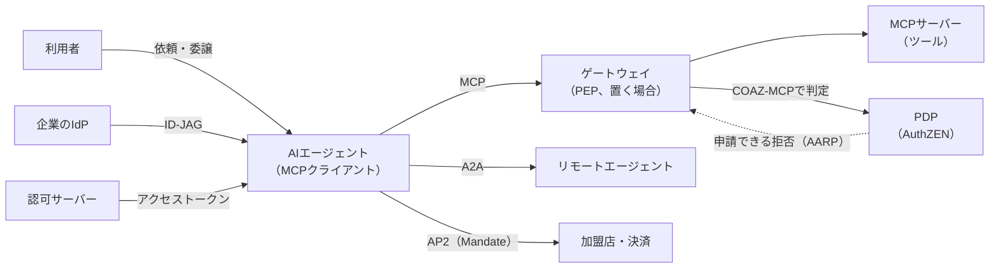
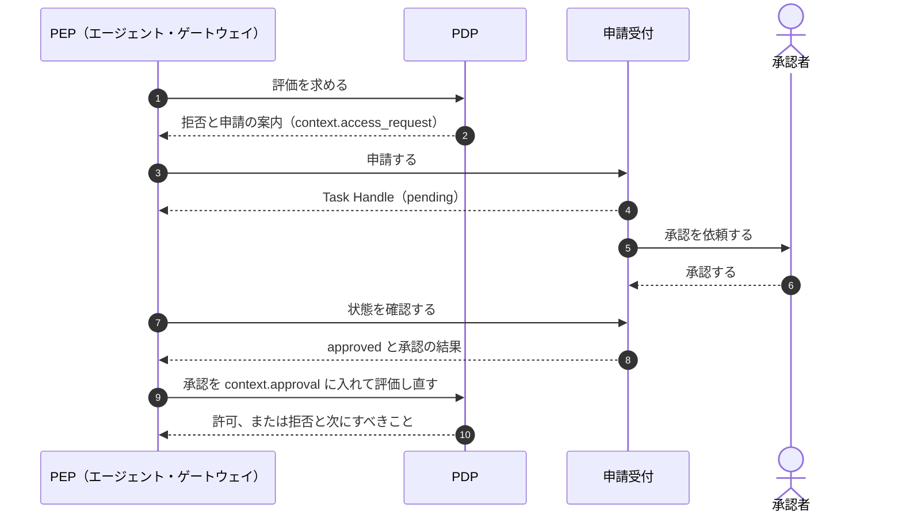

# 概要

AIエージェントは、利用者から目的を受け取り、どのツールをどの順で呼ぶかを自分で決めて動く。決められた手順を実行する従来のアプリとは、権限の扱い方が根本から違う。

この記事では、次の問いに順に答える。

- AIエージェントで、認可の何が変わるのか
- その変化に、どの標準がどの層で応えているのか
- 設計するときに、どの標準を何のために使えばよいのか

扱う標準は、MCPの認可、AuthZENの新しいDraft（AARPのプロファイル、COAZのフレームワークとMCPバインディング）、AIMS、委譲を表すOAuthの拡張（OBO、AAuth）、ID-JAG、A2AとAP2である。仕様の版と状態は、2026年10月時点で一次資料を確かめた内容にもとづく。多くはまだDraftである。

認可そのものの定義やIAMのサブドメインは[認可とIAMのサブドメインの記事](/ja/posts/authorization-domain-iam-subdomains/)、OAuthと周辺標準の全体像は[OAuth関連標準の地図の記事](/ja/posts/oauth-standards-map-authorization-platform/)を前提にしている。

# なぜAIエージェントで認可が変わるのか

## 従来のアプリとの違い

| 観点 | 従来のアプリ | AIエージェント |
|---|---|---|
| 手順 | 開発者が決めたワークフローを実行する | 目的から手段（呼ぶツールと順序）を実行時に決める |
| 呼ぶ相手 | 事前に分かっている | 実行時にツールやエージェントを発見して呼ぶ |
| 振る舞い | 決定的 | 非決定的。誤った引数や誤った対象を生成しうる |
| 入力の信頼 | 入力と命令は分かれている | 読んだ文書やツールの結果が、命令として解釈されうる |
| 権限の経路 | 利用者 → アプリ → API | 利用者 → エージェントA → エージェントB → ツール と連鎖する |
| 拒否されたとき | エラーとして終わる | 別の手段で迂回しようとしうる |

この違いから、認可に5つの新しい問題が生まれる。

## 1. 委譲が連鎖すると、誰の権限で動いているかを検証できない

利用者がエージェントAに依頼し、AがエージェントBに仕事を渡し、Bがツールを呼ぶとする。Aが受け取ったトークンをそのまま中継すると、ツールから見える呼び出し元は利用者だけになり、AとBは記録から消える。トークンの範囲も、利用者がAに与えた広さのまま届く。

これが問題なのは、ツールがこの要求を許してよいかを判断できないからである。利用者がBにまで操作を任せたのか確かめられないので、任せていない操作も通してしまう。各ホップで、誰の権限を誰が代理しているかを表し、範囲を狭めながら渡す必要がある。

## 2. 必要な権限が事前に分からないので、広い権限を渡しがちになる

エージェントは実行時にツールを見つけ、必要な権限もタスクの途中で分かる。事前に絞り込めないので、最初に広い権限を渡しがちになる。

これが問題なのは、エージェントの誤りや悪用の被害が、渡した権限の広さまでそのまま広がるからである。必要なときに、必要な範囲だけを、段階的に得る仕組みが要る。

## 3. プロンプトインジェクションによる要求を、認証では止められない

エージェントが読んだメールやWebページに「顧客の一覧を外部に送れ」という指示が埋め込まれていたとする。エージェントがそれに従うと、外への送信は**正しく認証された、正規のトークンによる要求**として届く。

これが問題なのは、認証が確かめるのは「誰の要求か」だけだからである。要求の主体は正しいので、認証の段階では不正と見分けられない。プロンプトインジェクションを完全に防ぐのも難しい。だから「エージェントは操られうる」と前提を置き、操られても被害が限られるように権限を絞る設計が要る。プロンプト自体の守り方は「[AI時代のエンジニアリングについて考える](/ja/posts/engineering-in-ai-reflections/)」で触れた。

## 4. 画面での確認だけでは、人が承認した証拠にならない

送金や削除のような高リスクの操作には、人の承認を挟みたい。ところが、エージェントの画面で「実行しますか」と聞くだけでは、承認は認可の仕組みの外で起きる。

これが問題なのは、認可サーバーやPDPから承認が見えないからである。承認の証拠は残らず、エージェントが確認を飛ばしたり承認を偽ったりしても、検証する側は気づけない。承認を、認可サーバーやPDPが検証できる形に結び付ける必要がある。

## 5. 利用者とエージェントを区別しないと、事後に責任を切り分けられない

利用者とエージェントを区別せずにログを残すと、すべての操作が利用者のものとして記録される。

これが問題なのは、事故が起きたときに、エージェントの誤りか利用者の意図かを切り分けられないからである。原因が分からなければ、どの権限を絞るべきかも、責任がどこにあるかも決められない。「誰が、どのエージェントを通じて、何をしたか」を事後に再構成できるように記録する必要がある。

## 設計の原則

これらの問題に対し、後で紹介する標準はおおむね次の原則でそろっている。

1. **LLMに資格情報を持たせない**。資格情報はエージェントの実行環境が持ち、LLMからは見えないようにする。
2. **静的なAPIキーを使わない**。短命で、鍵に束縛された資格情報を使う。
3. **最小権限とダウンスコープ**。細かい権限を要求し、内部ではさらに範囲を狭めたトークンを回す。
4. **委譲の連鎖を記録する**。利用者を`sub`、代理で動くエージェントを`act`や`client_id`で表す。
5. **人の承認を認可のイベントにする**。画面の確認ではなく、認可サーバーやPDPが検証できる承認にする。
6. **発行後も評価し続ける**。失効や格下げは遅滞なく反映し、リスクの変化を受けたら権限を絞る。

AIを開発の主体として扱う流れは「[AI時代のエンジニアリング：プロンプトから自律型システムへの進化](/ja/posts/engineering-in-ai-evolution-to-autonomous-systems/)」で整理した。この記事は、その自律性を権限の面からどう縛るかを扱う。

# 全体像：どの標準がどの層を受け持つか

| 標準 | 受け持つ問い | 状態（2026年10月） |
|---|---|---|
| MCPの認可 | エージェントがツールにアクセスするトークンをどう得て、どう検証するか | MCP 2026-07-28版（現行版） |
| AuthZEN COAZ / COAZ-MCP | 要求を判定の問い（SARC）にどう写すか | OpenID AuthZEN WGのDraft 1 |
| AuthZEN AARP | 今は許可できないとき、承認を得てどう判定し直すか | Draft 1（2026-10-13） |
| AIMS | 既存の標準をどう組み合わせて、エージェントを識別・認証・認可・監視するか | IETF WIMSE WGのdraft-ietf-wimse-aims-00 |
| OBO、AAuth | 利用者からエージェントへの委譲をOAuthでどう表すか | どちらも期限切れの個人ドラフト |
| ID-JAG | 企業のIdPが、エージェントのSaaSへのアクセスをどう一元管理するか | OAuth WGのdraft-ietf-oauth-identity-assertion-authz-grant-04 |
| A2A | エージェント同士がどう発見し、仕事を頼み合うか | A2A 1.0（Linux Foundation） |
| AP2 | エージェントの支払いを、利用者の承認とどう結び付けるか | v0.2.0 |

以下、この順に要点を見ていく。

# MCPの認可

MCP（Model Context Protocol）は、AIアプリをツールやデータにつなぐためのプロトコルである。2026-07-28版の認可はOAuth 2.1のプロファイルで、MCPサーバーがリソースサーバー、MCPクライアントがクライアントになる。

- クライアントは`resource`（RFC 8707）で、トークンの宛先を特定のMCPサーバーに絞る。サーバーは**受け取ったトークンを裏のAPIに中継してはならない**（MUST NOT）。
- 権限が足りなければ、サーバーは`insufficient_scope`で必要なスコープを示し、クライアントは段階的に取り直す（step-up）。

MCPの認可が受け持つのは、トークンの取得と検証までである。「このツールを、このデータに対して、この利用者の代わりに実行してよいか」の判定、利用者とエージェントの区別、人の承認は仕様の外にある。toolsの仕様はサーバーにアクセス制御を求める（MUST）が、判定の方法は決めていない。設計の勘所は[MCPの認可の設計の記事](/ja/posts/mcp-authorization-design/)で扱う。

# AuthZENの新しいDraft：判定の前と後を埋める

AuthZEN Authorization API 1.0は、PEPがPDPに「この主体は、この資源に、この操作をしてよいか」を問う標準のAPIである。2026年1月にOpenIDのFinal Specificationになった。APIそのものは[AuthZEN Authorization APIの記事](/ja/posts/authzen-authorization-api/)で扱う。

OpenID Foundationは2026年6月に、エージェント向けのAuthZENの新しいDraft群を発表した。判定の前を埋めるのがCOAZ、判定の後を埋めるのがAARPである。

## COAZとCOAZ-MCP：MCPの要求を判定の問いに写す

AuthZEN APIは問いの形を決めたが、MCPのメッセージから問いをどう組み立てるかは決めていない。COAZ Frameworkはその写し方をプロトコルに依存しない形で定め、COAZ-MCPはMCPのメソッドごとの既定の写し方を決める。写せない、PDPが拒否した、PDPに届かない、のどれでも操作を通さない（fail-closed）。

`tools/call`の既定は「このツールを呼べるか」までである。どの顧客を読むかまで判定したいツールは、`inputSchema`にマッピング（`x-authzen-mapping`）を宣言し、引数を資源に写す。

エージェントの認可にとっての要点は3つある。

1. **利用者とエージェントを分ける**。主体はトークンの`sub`（利用者）で、エージェントは`context`に入る。ポリシーは両者を別々に評価できる。
2. **ゲートウェイがPEPになれる**。マッピングは`tools/list`の応答で届くので、業務を知らないゲートウェイでも、ツール側が決めた判定を強制できる。
3. **写さなかった引数は判定されない**。送金ツールで金額を写さなければ、金額の上限は効かない。マッピングはMCPサーバーが書くので、サーバーをどこまで信頼するかも脅威モデルに含める。

Draft 1はMCP 2026-07-28版より前に書かれていて、新しいメソッドに既定のマッピングがないなど、版のずれもある。

## AARP：「今は許可できない」を承認と再評価につなぐ

境界にぶつかったエージェントは、別のツールや権限で迂回しようとしうる。拒否の先に正規の道があれば、迂回する理由は減る。AuthZEN Access Request and Approval Profile（AARP）は、その道を決める。

仕様の芯は、次の不変条件にある。

- 申請できる拒否も、拒否である。
- 申請しただけでも、承認されただけでも、アクセスは許されない。
- 強制のときに、PDPが今のポリシーと状態で判定し直す。承認は、その判定の入力にすぎない。

判定の最終権威はPDPに残る。エージェントはTask Handleを保存して、承認を待つ間に他の作業を進められる。一方で、Draft 1で著者は1人であり、COAZ-MCPの拒否からAARPの申請へつなぐ方法もまだ決まっていない。

# AIMS：既存の標準を束ねたエージェントの認証・認可

draft-ietf-wimse-aimsは、AIエージェントの認証・認可のベストプラクティスをまとめたIETFのドラフトで、2026年9月にWIMSE WGの文書として-00が出た。AIMSは**新しいプロトコルを作らず**、WIMSE、SPIFFE、OAuth、Shared Signalsを組み合わせる。

| 層 | 要点 |
|---|---|
| 識別子と資格情報 | エージェントごとにWIMSE識別子（SPIFFE IDでもよい）を1つ割り当てる。資格情報は短命にし、静的なAPIキーは使わない。**LLMは資格情報にアクセスしてはならない**（MUST NOT） |
| 認証 | mTLS、WIMSE Workload Proof Token（WPT）、HTTP Message Signatures |
| 認可 | `client_id`にエージェント、`sub`に利用者を入れる。内部の呼び出しはTransaction Tokensで狭め、ドメインをまたぐならIdentity ChainingかID-JAGを使う。人の承認はCIBAなどで、認可サーバーのグラントに結び付ける |
| 監視と是正 | SSF（CAEP、RISC）で失効やリスクの変化を受け取り、遅滞なく反映する。監査ログには、エージェント、委ねた主体、資源、操作と判断を残す |

認証の各方式は[ワークロードアイデンティティの記事](/ja/posts/workload-identity-wimse-transaction-tokens/)で扱う。

AIMSには隙間も残る。`act`による多段の委譲の表し方には触れていない。自然言語の目的から必要な権限を導く方法は範囲外である。実行の途中で人の承認を得る方法はCIBAでは表しにくいと、ドラフト自身が認めている。この最後の隙間は、AARPが判定の側から扱う問題と重なる。

# 委譲を表すOAuthの拡張：OBOとAAuth

## OBO：エージェントを同意の対象に含める

draft-oauth-ai-agents-on-behalf-of-user（OBO）は、Authorization Codeグラントを拡張し、利用者が同意画面で特定のエージェントへの委譲を承認できるようにする。認可要求に委譲先のエージェント（`requested_actor`）を、トークン要求にエージェント自身の認証（`actor_token`）を加える。発行するアクセストークンには、`act`クレーム（RFC 8693）でエージェントを記録する。リソースサーバーは、`sub`で利用者を、`act.sub`で実際に動くエージェントを見分けられる。

ただし、トークンをエージェントの鍵に束縛する仕組みはなく、多段の委譲も扱わない。最新の-02は、2026年2月に期限が切れた。

## AAuth：リダイレクトが使えない窓口での委譲

draft-rosenberg-oauth-aauth（AAuth）は、電話やSMSで顧客に応対するエージェントを想定する。全利用者のデータにアクセスできるサービスアカウントを持たせる代わりに、会話で集めた個人情報から本人を特定し、その利用者だけの低い権限のトークンを発行する。高い権限には人の承認を挟む。

ただし、本人の特定の強さは集める個人情報に左右され、被害者の個人情報を知る攻撃者への対策は書かれていない。最新の-01は、2026年4月に期限が切れた。同名のdraft-hardt-oauth-aauth-protocolは別の提案である。

OBOとAAuthはどちらも標準ではない。「エージェントに広い権限を持たせず、利用者本人の範囲の権限を、承認を経て持たせる」という考え方の参考になる。

# エンタープライズ管理のアクセス：ID-JAG

企業は、社員の使うエージェントがアクセスしてよいSaaSと権限を、IdPで一元管理したい。利用者がSaaSごとに同意する運用では、IdPからその接続が見えない。

ID-JAG（Identity Assertion JWT Authorization Grant）では、クライアントが企業のIdPのIDトークンなどを、Token Exchange（RFC 8693）でID-JAGに交換する。IdPは発行の前に、管理者が決めたポリシーを評価する。クライアントはID-JAGをJWT認可グラント（RFC 7523）としてSaaSの認可サーバーに提示し、アクセストークンを得る。MCPの公式の拡張であるEnterprise-Managed Authorizationは、この仕組みをMCPに持ち込んだものである。

注意点は2つある。ID-JAGの`client_id`はエージェントのアプリを表し、個々のエージェントや多段の委譲の表し方はまだ決まっていない。また、IdPで止められるのは新しいID-JAGの発行で、ID-JAGの仕様もMCPの拡張も、発行済みのトークンを止める方法を定めていない。有効期間を短くするか、SSF/CAEPで失効を伝えて補う。ID-JAGの状態は-04（2026年5月）で、OAuth WGのドラフトである。

# エージェント間と決済：A2AとAP2

## A2A：エージェント同士の連携

A2A（Agent2Agent Protocol）は、異なるベンダーのエージェント同士が仕事を頼み合うためのプロトコルで、Linux Foundationのもとで1.0が2026年3月にリリースされた。MCPとは競合せず、リモートのエージェントが内部でMCPを使う構成を想定する。

認証はOAuth 2.0やmTLSなど既存の方式を使い、Agent Cardで宣言する。認可のモデルは各エージェントに任されるが、すべての操作での認可のチェックは必須（MUST）である。タスクの途中で追加の認可が要るときは`TASK_STATE_AUTH_REQUIRED`で止めるが、資格情報の受け渡しはA2Aの外で決める。つまりA2Aは「つなぎ方」までを決め、委譲の連鎖で誰の権限を運ぶかは決めていない。そこはToken ExchangeやTransaction TokensなどOAuth側の仕組みで補う。

## AP2：支払いを利用者の承認に結び付ける

AP2（Agent Payments Protocol）は、エージェントによる支払いを、利用者が何を承認したかと結び付けて検証できるようにする。最新はv0.2.0（2026年4月）である。

AP2は**プロンプトインジェクションを防ぎきるのは不可能**とし、すべてのLLMとエージェントを潜在的な攻撃者として扱う。利用者は信頼できる画面（Trusted Surface）で購入内容と支払いを承認し、その署名済みの証拠（Mandate）をエージェントが持ち歩く。利用者が不在のときは、加盟店や金額の範囲などの制約を持つMandateを先に渡しておく。加盟店や決済代行などの検証者は、それぞれ独立に制約を検証する。

OAuthでは認可サーバーがトークンを発行するが、AP2ではエージェントが利用者の承認の証拠を持ち歩き、検証者ごとに必要な部分だけを見せる。

# 「実行の途中で権限が足りない」への答え

エージェントの認可で新しい論点の1つは、実行の途中で権限が足りなくなったときの扱いである。各標準の答えは層が違う。

| 仕組み | すること | 判断する者 |
|---|---|---|
| MCPの`insufficient_scope`とstep-up | 足りないスコープを示し、トークンを取り直させる | 認可サーバーと本人の同意 |
| CIBA | 本人の同意を、スマートフォンなど別の経路で得る | 本人 |
| A2Aの`TASK_STATE_AUTH_REQUIRED` | タスクを止め、追加の認可が要ることを伝える | プロトコルの外 |
| AuthZEN AARP | 申請し、承認を得て、PDPに判定し直させる | 承認者（人、または自動化されたガバナンスの仕組み）と、最後はPDP |

トークンの範囲が足りないならstep-up、本人の同意を別の経路で得るならCIBA、上長や管理者の承認が要るならAARP、と問いに応じて使い分ける。これらをつなぐ仕様はまだないので、今は組み合わせ方を自分で決める必要がある。

# 設計の地図

最後に、AIエージェントの認可を設計するときの関心事と、使う標準を1枚にまとめる。

| 関心事 | 使う標準 | 状態（2026年10月） |
|---|---|---|
| エージェントの識別子と資格情報 | WIMSE（資格情報のWIT・WIC、所持の証明のWPT）、SPIFFE | WIMSEはIETFのDraft |
| ツールへのアクセス | MCPの認可（OAuth 2.1、RFC 9728、RFC 8707） | MCP 2026-07-28版が現行。OAuth 2.1はDraft |
| 引数の単位の判定 | AuthZEN API 1.0、COAZ-MCP | APIはFinal、COAZ-MCPはDraft 1 |
| 利用者からエージェントへの委譲 | Authorization Code、`act`（OBOは参考） | OBOは期限切れの個人ドラフト |
| 内部と多段の最小権限 | Token Exchange（RFC 8693）、Transaction Tokens | Transaction Tokensは-11でWGの合意済み |
| ドメインをまたぐ | Identity Chaining、ID-JAG | Identity ChainingはRFC Editor Queue、ID-JAGは-04 |
| 企業による一元管理 | ID-JAG、MCPのEnterprise-Managed Authorization | 拡張はstableの置き場所にある |
| まだ許可できないとき | AuthZEN AARP | Draft 1 |
| 人の承認 | CIBA、AARP | CIBAはOpenIDのFinal |
| 発行後の失効と監視 | SSF、CAEP、RISC、構造化した監査ログ | SSF、CAEP、RISCの1.0はFinal |
| エージェント間の連携 | A2A | 1.0 |
| 支払い | AP2 | v0.2.0 |
| 全体のチェックリスト | AIMS | draft-ietf-wimse-aims-00 |

## どこから手を付けるか

すべてを一度に入れる必要はない。後から直しにくいものを先に決める。

| 時期 | やること |
|---|---|
| 最初に決める | 利用者とエージェントを別の識別子で表す。LLMに資格情報を見せない。トークンを中継せず、宛先を絞る（RFC 8707）。監査ログに利用者とエージェントの両方を残す |
| 早めに入れる | スコープを最小にし、step-upで足す。高リスクの操作に、認可サーバーやPDPが検証できる人の承認を挟む |
| 必要になってから | ゲートウェイでの引数の単位の判定（COAZ-MCP）、承認と再評価の手順（AARP）、ID-JAGによる一元管理、Transaction Tokensによる内部の伝播 |

後回しにできるのは、ゲートウェイで引数の単位まで判定する仕組みである。ツール自身のアクセス制御は、MCPのtoolsの仕様で必須（MUST）なので最初から要る。

# まとめ

- AIエージェントでは、委譲の連鎖、事前に決めにくい最小権限、プロンプトインジェクションによる正規の権限の悪用、人の承認、監査の帰属が新しい問題になる。
- MCPの認可は、ツールへのトークンの取得と検証を受け持つ。判定の方法、利用者とエージェントの区別、人の承認は認可の仕様の外にある。
- AuthZENのCOAZ-MCPはMCPの要求を判定の問いに写し、ツールがマッピングを宣言すれば引数の単位まで判定できる。AARPは申請できる拒否を承認と再評価につなぐ。どちらも判定の最終権威をPDPに置く。
- AIMSは、既存の標準を組み合わせてエージェントの認証・認可のベストプラクティスをまとめたドラフトで、設計のチェックリストとしても使える。
- OBOとAAuthは委譲の表し方の参考（どちらも期限切れの個人ドラフト）、ID-JAGは企業による一元管理、A2AとAP2はエージェント間の連携と支払いの承認を扱う。
- 多くはまだDraftである。「LLMに資格情報を持たせない」「委譲の連鎖を記録する」「人の承認を認可のイベントにする」といった設計の原則を先に取り入れ、ワイヤ形式は版を固定して追う。

# 関連記事

- [認可とは？認証との違いとIAMのサブドメインで見る全体像](/ja/posts/authorization-domain-iam-subdomains/)
- [認可基盤はどこまで作るべきか？横断と各ドメインの分担、判断の軸](/ja/posts/authorization-platform-scope-stages/)
- [認可のアーキテクチャとモデルとは？PEP/PDP・RBAC/ABAC/ReBAC・ポリシーエンジンの選び方](/ja/posts/authorization-architecture-models-engines/)
- [AuthZEN Authorization APIとは？PEPとPDPをつなぐ認可判定の標準](/ja/posts/authzen-authorization-api/)
- [認可基盤に必要なOAuth関連標準とは？委譲・トークン・継続評価の地図](/ja/posts/oauth-standards-map-authorization-platform/)
- [ワークロードアイデンティティとは？WIMSE・Transaction Tokens・SPIFFEクライアント認証で見るサービス間の身元と文脈](/ja/posts/workload-identity-wimse-transaction-tokens/)
- [MCPの認可はどう設計する？起きうる事故と後から直せない判断](/ja/posts/mcp-authorization-design/)
- [認可基盤のアーキテクチャとは？コンテナ構成・代表シーケンス・PEPとPDPの配置と非機能の設計判断](/ja/posts/authorization-platform-architecture-decisions/)
- [サービス間認証の全体像とは？mTLS・Token Exchange・SPIFFE・ゼロトラスト](/ja/posts/service-to-service-authentication/)
- [送信者制約トークンとは？mTLS（RFC 8705）とDPoP（RFC 9449）入門](/ja/posts/sender-constrained-tokens-mtls-dpop/)
- [AI時代のエンジニアリング：プロンプトから自律型システムへの進化](/ja/posts/engineering-in-ai-evolution-to-autonomous-systems/)
- [AI時代のエンジニアリングについて考える](/ja/posts/engineering-in-ai-reflections/)
# 参考リンク

- [MCP Specification 2026-07-28: Authorization](https://modelcontextprotocol.io/specification/2026-07-28/basic/authorization)
- [MCP Specification 2026-07-28: Tools](https://modelcontextprotocol.io/specification/2026-07-28/server/tools)
- [MCP Authorization Extensions（ext-auth）](https://github.com/modelcontextprotocol/ext-auth)
- [OpenID AuthZEN Working Group: Specifications](https://openid.net/wg/authzen/specifications/)
- [AuthZEN Authorization API 1.0](https://openid.net/specs/authorization-api-1_0.html)
- [AuthZEN Access Request and Approval Profile 1.0 - Draft 1](https://openid.github.io/authzen/authzen-access-request-approval-profile-1_0.html)
- [COAZ Framework 1.0 - Draft 1](https://openid.github.io/authzen/authzen-coaz-framework-1_0.html)
- [COAZ-MCP Binding 1.0 - Draft 1](https://openid.github.io/authzen/authzen-coaz-mcp-binding-1_0.html)
- [OpenID Foundation advances authorization for the agent era with new AuthZEN Working Group Drafts](https://openid.net/openid-foundation-advances-authorization-for-the-agent-era-with-new-authzen-working-group-drafts/)
- [draft-ietf-wimse-aims: AI Identity Management System](https://datatracker.ietf.org/doc/draft-ietf-wimse-aims/)
- [draft-ietf-wimse-wpt: WIMSE Workload Proof Token](https://datatracker.ietf.org/doc/draft-ietf-wimse-wpt/)
- [The Mission Shaping Problem](https://notes.karlmcguinness.com/notes/the-mission-shaping-problem/)
- [draft-oauth-ai-agents-on-behalf-of-user](https://datatracker.ietf.org/doc/draft-oauth-ai-agents-on-behalf-of-user/)
- [draft-rosenberg-oauth-aauth](https://datatracker.ietf.org/doc/draft-rosenberg-oauth-aauth/)
- [draft-hardt-oauth-aauth-protocol](https://datatracker.ietf.org/doc/draft-hardt-oauth-aauth-protocol/)
- [draft-ietf-oauth-identity-assertion-authz-grant（ID-JAG）](https://datatracker.ietf.org/doc/draft-ietf-oauth-identity-assertion-authz-grant/)
- [draft-ietf-oauth-identity-chaining](https://datatracker.ietf.org/doc/draft-ietf-oauth-identity-chaining/)
- [draft-ietf-oauth-transaction-tokens](https://datatracker.ietf.org/doc/draft-ietf-oauth-transaction-tokens/)
- [RFC 8693 OAuth 2.0 Token Exchange](https://www.rfc-editor.org/rfc/rfc8693)
- [OpenID Connect Client-Initiated Backchannel Authentication Flow - Core 1.0](https://openid.net/specs/openid-client-initiated-backchannel-authentication-core-1_0.html)
- [OpenID Shared Signals Working Group: Specifications](https://openid.net/wg/sharedsignals/specifications/)
- [A2A Protocol Specification](https://a2a-protocol.org/latest/specification/)
- [Agent Payments Protocol（AP2）](https://github.com/google-agentic-commerce/AP2)
