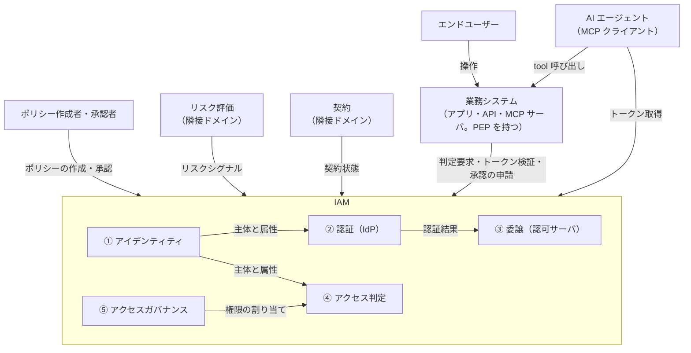
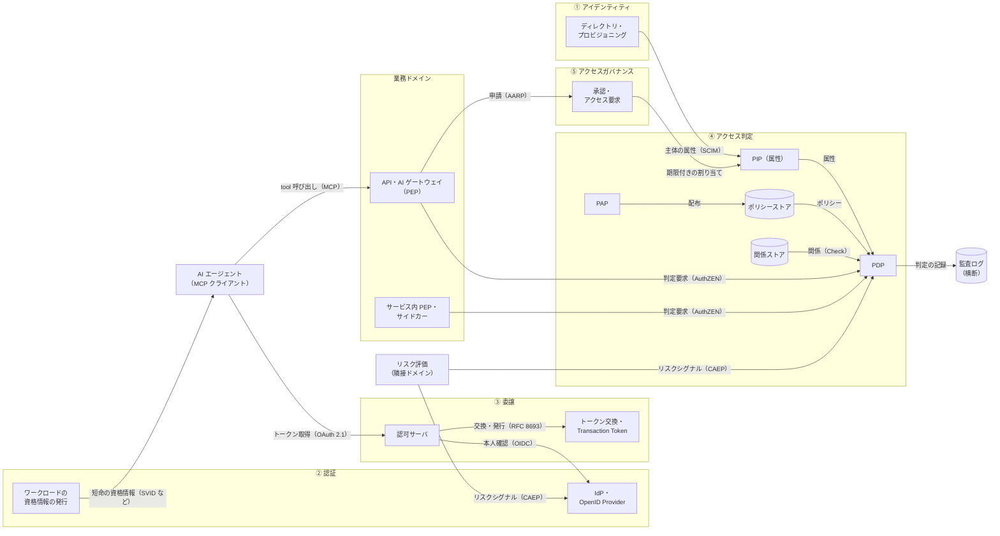
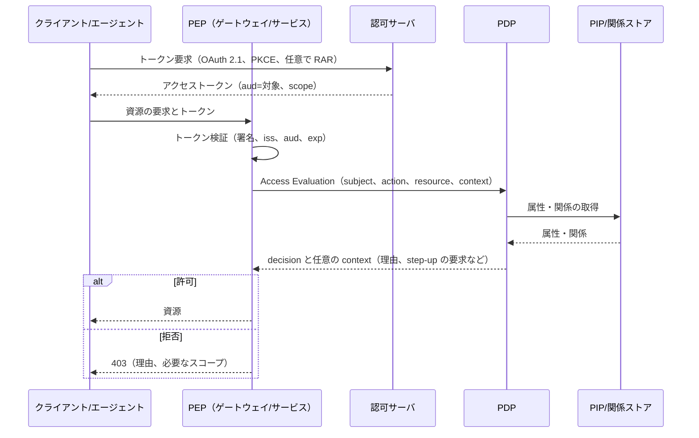
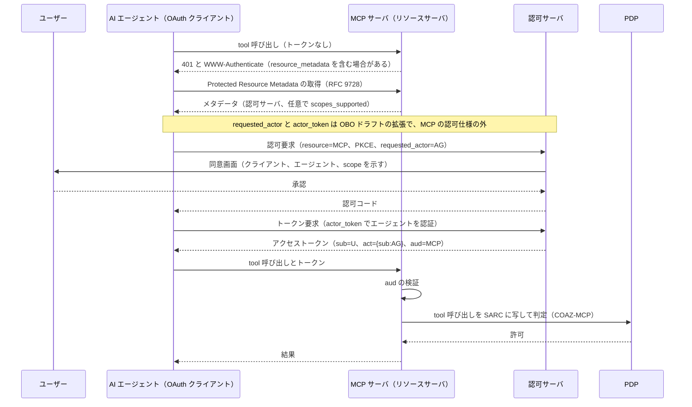
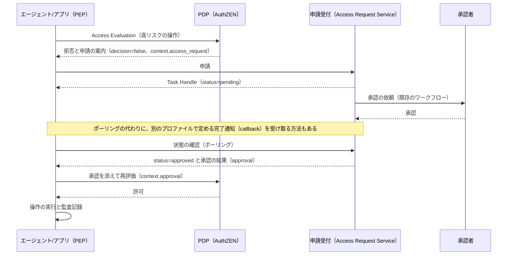
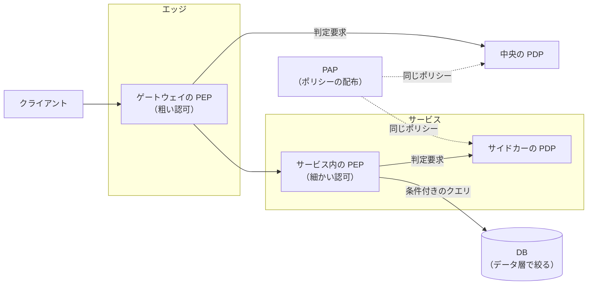

# 概要

認可基盤を作ると決めたあとに残る問いは「どの部品をどこに置き、何でつなぐか」である。この記事はその問いに、図と設計判断の2つの面から答える。

この記事でわかることは次のとおりである。

- IAMのサブドメインに沿って、認可基盤のシステムコンテキストとコンテナをどう切るか
- 各コンテナがどの標準（OAuth、OIDC、SCIM、AuthZENなど）に対応するか
- 代表的な3つの流れ（リクエスト時の判定、AIエージェントへの委譲とMCP、「まだ許可できない」を扱う承認フロー）
- PEPとPDPの配置、粗い認可と細かい認可の分担、トークンに何を載せるか
- レイテンシ、キャッシュ、可用性とfail-closed、一貫性、監査などの非機能の判断

図はC4モデルのContext（システムと外界）とContainer（アプリケーションやデータストアのように、動いている必要がある構成要素）の2段で描く。C4の考え方は[C4 model](https://c4model.com/)を参照。アーキテクチャを文書にするときの心構えは[アーキテクチャドキュメントを書くときに気をつけること](/ja/posts/writing-architecture-documentation/)にまとめた。

ここで扱う構成は、ある組織が必要とする要素を一通り並べた参照の形である。全部を最初から作る必要はない。どこまで作るか、判定をアプリの外に出すかを決める話も[認可基盤はどこまで作るべきか](/ja/posts/authorization-platform-scope-stages/)で扱った。

# 前提: 境界は IAM のサブドメインに揃える

アーキテクチャの境界は、IAMを業務上の問題で区切ったサブドメインに揃える。区切り方の詳細は[認可とは何か](/ja/posts/authorization-domain-iam-subdomains/)で説明した。ここでは要点だけを表にする。

| # | サブドメイン | 責務 |
|---|---|---|
| ① | アイデンティティ | 主体の識別子と属性を持ち、生成から削除までを管理する |
| ② | 認証 | 主体が名乗っているとおりの本人であることを確かめる |
| ③ | 委譲 | 主体が自分の権限の一部を別の主体に委ね、その範囲と期限を管理する |
| ④ | アクセス判定 | ある主体がある資源にある操作をしてよいかを、ポリシーで決める |
| ⑤ | アクセスガバナンス | 誰にどの権限を持たせるかを決め、妥当であり続けるよう統制する |

IAMの外には、リスク評価（主体の振る舞いが疑わしいか）や契約（テナントがどの機能を契約しているか）といった隣接ドメインがあり、判定に入力を渡す。

この区切りから、アーキテクチャについて2つの決まりが出てくる。

1. **PEPは業務ドメインの側に置く**。判定（PDP）は ④ に集めても、強制（PEP）は要求を受ける業務システムが持つ。
2. **権限の「意味」は業務ドメインが持つ**。「この請求書を承認してよいか」がどんな資源と操作で、業務上どんなルールかは業務ドメインが決める。IAMが持つのは判定と強制の仕組みである。

PEP（Policy Enforcement Point）は強制、PDP（Policy Decision Point）は判定を受け持つ。PIP（Policy Information Point）は属性を供給し、PAP（Policy Administration Point）はポリシーを管理する。この参照アーキテクチャは[認可のアーキテクチャとモデルとは](/ja/posts/authorization-architecture-models-engines/)で説明した。

# システムコンテキスト: 認可基盤は誰と関わるか

まず、IAMの各サブドメインがどんなアクター・外部システムと関わるかを見る。矢印のラベルは何が流れるかを示す。

この図から読み取れる点は3つある。

- **業務システムはPEPを持ち、判定を ④ に外部化する**。アプリ、API、MCPサーバのどれも、IAMから見れば「判定を問い合わせ、結果を強制する側」である。
- **入口になる主体は3種類ある**。人間、ワークロード（サービス）、AIエージェントである。図では人間とAIエージェントを描き、ワークロードはコンテナ図で扱う。
- **入力はIAMの外からも来る**。リスクシグナルは主に ② と ④ が、契約状態は ④ が受け取る。

# コンテナ: サブドメインの中をアプリとデータストアに分ける

次に、各サブドメインの中を、アプリケーションやデータストアといったコンテナに分ける。矢印のラベルは「何を（どの標準で）」渡すかを示す。

## コンテナと標準の対応

各コンテナが受け持つ役割と、対応する標準・実装を表にする。状態は2026年10月時点のもので、Internet-DraftやOpenIDのDraftは今後も変わりうる。

| コンテナ | サブドメイン | 役割 | 対応する標準・実装 |
|---|---|---|---|
| ディレクトリ・プロビジョニング | ① アイデンティティ | 主体と属性の管理・配布 | SCIM（RFC 7643 / RFC 7644） |
| IdP・OpenID Provider | ② 認証 | 本人確認 | OpenID Connect |
| ワークロードの資格情報の発行 | ② 認証 | 短命の資格情報の発行とローテーション | SPIFFE / SPIRE、WIMSE（策定中） |
| 認可サーバ | ③ 委譲 | トークンの発行 | OAuth 2.1（Internet-Draft）、PKCE、PAR（RFC 9126）、RAR（RFC 9396）、メタデータ（RFC 8414） |
| トークン交換・Transaction Token | ③ 委譲 | 委譲の連鎖、ダウンスコープ | Token Exchange（RFC 8693）、Transaction Tokens（Internet-Draft）、Identity Chaining（RFC 編集待ち） |
| PDP | ④ アクセス判定 | ポリシーの評価 | AuthZEN Authorization API 1.0（Final）、OPA / Rego、Cedar |
| PAP・ポリシーストア | ④ アクセス判定 | ポリシーの作成・配布・版管理 | Policy-as-Code（Rego、Cedar など） |
| PIP（属性） | ④ アクセス判定 | 判定に使う属性の供給 | ディレクトリ、SCIM 連携 |
| 関係ストア | ④ アクセス判定 | 所有・共有・継承の関係 | Zanzibar 型（OpenFGA、SpiceDB） |
| 承認・アクセス要求 | ⑤ アクセスガバナンス | 拒否のあとの承認、期限付きの割り当て | AuthZEN AARP（Draft）、CIBA |
| API・AI ゲートウェイ（PEP） | 業務ドメイン | 入口での粗い認可、トークン検証 | Bearer トークン（RFC 6750）、Protected Resource Metadata（RFC 9728）、COAZ-MCP（Draft） |
| サービス内 PEP・サイドカー | 業務ドメイン | 細かい認可の強制 | AuthZEN（PEP 側）。問い合わせ先の PDP を OPA などのサイドカーで動かせる |
| リスク評価 | 隣接ドメイン | リスクシグナルの送信 | OpenID SSF、CAEP、RISC |
| 監査ログ | 横断 | 判定と操作の記録 | 構造化された監査ログ |

表の各行は、シリーズの他の記事で詳しく扱っている。

- PDPと関係ストア、エンジンの選び方は[認可のアーキテクチャとモデルとは](/ja/posts/authorization-architecture-models-engines/)にある。
- PEPとPDPをつなぐAPIは[AuthZEN Authorization API とは](/ja/posts/authzen-authorization-api/)にある。
- 認可サーバとトークン、SCIM、SSF / CAEPは[認可基盤に必要なOAuth関連標準とは](/ja/posts/oauth-standards-map-authorization-platform/)にまとめた。
- ワークロードの資格情報とTransaction Tokensは[ワークロードアイデンティティとは](/ja/posts/workload-identity-wimse-transaction-tokens/)にある。サービス間の通信の認証は[サービス間認証の全体像](/ja/posts/service-to-service-authentication/)で整理した。
- AIエージェント向けの承認やMCPは[AI エージェントの認可](/ja/posts/authorization-for-ai-agents/)にある。

コンテナ図で押さえたい点は、**PDPの入力が多方向から来る**ことである。ポリシーはPAPからポリシーストアを経て、属性はPIPから、関係は関係ストアから、リスクシグナルは隣接ドメインから届く。PDP自体はステートレスに保ち、状態はこれらの入力側に置く。OPAを例にしたPEP・PDP・PIPの分担と実装は[OPAを使用したマイクロサービスのアクセス制御システムの実装](/ja/posts/microservices-access-control-opa/)に書いた。

# 代表シーケンス

コンテナ同士が実際にどうやり取りするかを、3つの代表的な流れで示す。

## リクエスト時の判定

外部化認可の基本形である。クライアントはトークンを取り、PEPはトークンを検証してからPDPに判定を問い合わせる。

流れの中で役割が分かれている点に注目したい。

- **トークンの検証はPEPの仕事**である。署名、発行者（iss）、宛先（aud）、期限（exp）を確かめるまでは、PDPに問い合わせる価値がない。
- **判定はPDPの仕事**である。PEPは「誰が・何を・どの資源に・どんな文脈で」をAuthZENのSubject・Action・Resource・Contextの形で渡す。
- **判定の応答はtrue / falseだけではない**。AuthZEN 1.0の判定には任意でcontextを付けられる。中身の形は実装に任されており、仕様の例では拒否の理由やstep-up認証の要求（acr_valuesなど）を返している。

## AI エージェントへの委譲と MCP

AIエージェントがMCPサーバのツールを使う流れである。MCPの認可仕様では、保護されたMCPサーバはOAuth 2.1のリソースサーバとして振る舞い、エージェント（MCPクライアント）はOAuth 2.1のクライアントになる。

この流れは3つの層を重ねている。

1. **MCPの認可仕様の範囲**。401から始まり、RFC 9728のメタデータで認可サーバを見つけ、RFC 8707のresourceパラメータで宛先を指定してトークンを取る。MCPサーバはメタデータの場所を、WWW-Authenticateの`resource_metadata`かwell-known URIのどちらかで示す。MCPサーバは、トークンが自分宛てに発行されたことを検証しなければならない（MUST）。
2. **誰の権限で動いているかを表す拡張**。図の`requested_actor`と`actor_token`は「On-Behalf-Of User Authorization for AI Agents」という個人のInternet-Draftの拡張である。このドラフトは2026年10月時点で期限切れになっている。ドラフトはクライアント（アプリ）とアクター（エージェント）を別の役割として定めるが、図では1つにまとめた。トークンの`act`クレームでユーザーとエージェントを分けて残す考え方は、Token Exchange（RFC 8693）の`act`と同じである。
3. **細かい認可の外部化**。COAZ-MCP（AuthZENのDraft）は、MCPのメッセージをAuthZENのSARCに写してPDPに問い合わせる方法を決める。スコープでは表しきれない「このユーザーがこの引数でこのツールを呼んでよいか」をPDPに任せられる。

MCPの認可を設計するときの注意点、たとえば自分宛てか確かめずに受け取ったトークンを下流のAPIに渡す「Token Passthrough」の危険は[MCPの認可はどう設計するか](/ja/posts/mcp-authorization-design/)で詳しく扱う。

## 「まだ許可できない」を扱う承認フロー（AARP）

役割やスコープで権限を事前に与えておく方式では、実行時に拒否されたらそこで終わる。AuthZENのAccess Request and Approval Profile（AARP、Draft）は、拒否を承認と再評価につなぐ。AARPはOpenID Foundationの発表での略称で、ドラフトのヘッダーではARAPと書かれている。

アーキテクチャの観点で大事な点は、**承認されただけでアクセスが許されるわけではなく、最後にPDPが改めて判定する**ことである。AARPは「申請できる拒否も拒否である」「承認されただけでもアクセスは許されない」といった不変条件の上に立つ。承認を出す仕組み（⑤）と判定する仕組み（④）を分けたまま、拒否から許可までを一本の流れにできる。承認の画面やワークフローエンジンはAARPの範囲外で、既存の承認の仕組みを裏側に置ける。

# 設計判断

ここからは、図の各部品をどう選ぶかを扱う。

## 判定を外部化するか

判定ロジックをアプリから切り離してPDPに集めるかどうかの判断は、[認可基盤はどこまで作るべきか](/ja/posts/authorization-platform-scope-stages/)で扱った。以下は外部化すると決めた前提で、その先の判断を並べる。

## PEP と PDP の配置

配置は2つの独立した軸で決める。「PEP（強制）を要求の経路のどこに置くか」と「PDP（判定）をPEPから見てどこで動かすか」である。

| 軸 | 選択肢 | 向いている場面 |
|---|---|---|
| PEP をどこに置くか | エッジ・ゲートウェイ | 入口でまとめて弾く。典型的にはスコープやロールによる粗い認可 |
| | サービスメッシュのプロキシ | サービスのコードを変えずに、サービス間の通信で強制する |
| | サービス内（ミドルウェア、コード） | 業務の文脈を使った細かい認可 |
| | データ層（行レベルセキュリティ、部分評価による SQL 条件） | 「見てよい一覧」を DB で絞る |
| PDP をどこで動かすか | プロセス内ライブラリ（OPA、Cedar、Cerbos の組み込み PDP など） | 最も低遅延 |
| | サイドカー | 言語に依存せず、低遅延 |
| | 中央サービス（マネージドを含む） | 判定の一貫性、監査の一元化、複数の PEP での共有 |

2つの軸は組み合わせて選ぶ。たとえば「ゲートウェイのPEPが中央のPDPを呼ぶ」「サービス内のPEPがサイドカーのPDPを呼ぶ」といった形になる。

選ぶときの目安は次のとおりである。

- **二段構えが基本になる**。粗い認可はエッジで、細かい認可はサービス内やデータ層で行う。入口で明らかに無理な要求を早く弾き、資源ごとの判断は文脈を持つ側に任せる。
- **管理の一元化と実行場所は別の話である**。ライブラリやサイドカーで動かしても、ポリシーを中央のPAPから配れば管理は一元化できる。
- **APIは配置に依存させない**。AuthZENはAPIを転送方式に依存しない形で定めており（HTTPSの結び付けは必須）、サイドカーのPDPにも中央のPDPにも同じ形で問い合わせられる。PEPとPDPの間を標準の形にしておけば、あとから配置を変えやすい。
- **一覧の取得は別に設計する**。「この資源を読んでよいか」の判定を一覧の全件に繰り返すと、件数やページ境界が崩れ、負荷も上がる。OPAで起きるこの問題と解き方を[OPAにおけるページネーションへの影響と解決策](/ja/posts/pagination-impact-solutions-opa/)で検討した。部分評価でDBの条件を返す方式や、条件を構造で返す方式の比較は[OPAを利用したアクセス制御のパターン](/ja/posts/access-control-patterns-using-opa/)にある。PDPが対応していれば、AuthZEN 1.0のResource Search APIも「この主体が見てよい資源は何か」に答える手段として使える。Search APIとページングは、どちらも実装するかがPDPの任意である。

## 粗い認可と細かい認可、トークンの役割

認可には粒度の違う2つの層がある。

| 層 | 判断の単位 | 主な置き場所 | 使う情報 |
|---|---|---|---|
| 粗い認可（coarse-grained） | スコープ、ロール | ゲートウェイ、リソースサーバの入口 | アクセストークンの scope や roles |
| 細かい認可（fine-grained） | この資源のこの操作 | サービス内、データ層 | PDP、PIP、関係ストア（ReBAC / ABAC） |

この2層を分けると、トークンの役割がはっきりする。

- **トークンは粗い認可を運ぶものである**。境界を越えて「このクライアントはこのAPIのreadを許されている」を伝えるのに向いている。
- **細かい認可をトークンに詰め込まない**。資源ごとの権限をクレームに並べると、トークンが肥大化し、権限を取り消してもトークンの期限まで残る。細かい判断はPDPとPIPに任せる。
- **内部に伝えるときは絞る**。サービス間でアクセストークンを使い回さず、Token ExchangeやTransaction Tokensで宛先と権限を絞ったトークンに替える（ダウンスコープ）。詳しくは[ワークロードアイデンティティとは](/ja/posts/workload-identity-wimse-transaction-tokens/)で扱う。

RAR（RFC 9396）を使えば、トークン要求に「この相手に、この金額を支払う」のような構造化した権限を載せられる。それでも、要求のたびに変わる資源ごとの判断をPDPに寄せる方が、取り消しと監査の面で扱いやすい。

## 非機能の判断

判定をアプリの外に出すと、判定の往復が要求の経路に入る。そのため非機能の判断がアーキテクチャの成否を分ける。

### レイテンシとキャッシュ

判定を同期の経路に入れるなら、往復の時間をどう抑えるかを決める。

- **PDPを近くに置く**。プロセス内ライブラリやサイドカーにすればネットワークの往復が減る。
- **まとめて問い合わせる**。AuthZENのAccess Evaluations APIは複数の判定を1回の要求で送れる（boxcarring）。`execute_all`、`deny_on_first_deny`、`permit_on_first_permit`の評価の仕方を選べる。ただし、このAPIを実装するかはPDPの任意である。
- **判定をキャッシュする**。Subject・Action・Resource・Contextをキーにした短いTTLのキャッシュは効くが、権限の取り消しが遅れて効く。TTLの長さは「取り消しがどれだけ遅れてよいか」で決める。
- **一覧は事前に絞る**。前節のとおり、部分評価や、PDPが対応していればSearch APIでまとめて求める。

### 可用性と fail-closed

PDPが落ちたときや応答が遅いときに、通す（fail-open）か止める（fail-closed）かを決める。

- **原則はfail-closedにする**。判定できないなら拒否する。AARPでも、申請できる拒否は拒否のままであり、PEPはそれを根拠にアクセスを許してはならない（MUST NOT）。さらに、申請の状態を確かめられないときは、PEPはfail-closedにすべき（SHOULD）としている。
- **止まる範囲を設計で狭める**。PDPの冗長化、サイドカーへの配置、ポリシーと属性の手元への複製といった手で、fail-closedが発動する場面そのものを減らす。
- **タイムアウトを決める**。PDPの応答を待つ上限を決め、超えたら拒否として扱う。
- **縮退を明示する**。例外的に縮退運転を許すなら（読み取りだけは通すなど）、どの操作をどの条件で通すかをポリシーとして書き、監査に残す。

### 一貫性

関係や属性の更新が、判定にいつ反映されるかを決める。

- ReBACの関係ストアでは、更新の伝播に遅れがある。Zanzibarは「権限を外した直後に、古い状態で判定してしまう」問題（new enemy problem）を、zookieという一貫性のトークンで扱う。SpiceDBのZedTokenも同じ考え方である。
- 権限の取り消しをどれだけ早く効かせるかは、キャッシュのTTL、トークンの期限、関係ストアの一貫性の設定の組み合わせで決まる。どれか1つだけを短くしても、他が長ければ取り消しは遅れる。

### 監査

全判定を後から再構成できるようにする。

- **拒否も記録する**。許可だけでなく、拒否とその理由、判定に使ったポリシーの版、主要な入力を残す。OPAには判定ログ（decision log）の仕組みがある。
- **PEPの実行も記録する**。PDPの判定ログだけでは「実際に操作が行われたか」はわからない。PEP側で実行の結果を記録し、判定と突き合わせられる識別子を持たせる。
- **秘密を出さない**。トークンや資格情報そのものをログに残さない。

### 最小権限と資格情報の保護

- **境界ごとに絞る**。前節のダウンスコープを、境界を越えるたびに行う。
- **資格情報を短命にする**。ワークロードの資格情報はSPIFFE / SPIREのように短命のものを自動で回す。
- **盗まれても使えないようにする**。高い保証が要る経路では、トークンを送信者に結び付ける（DPoPのRFC 9449、mTLSのRFC 8705）。

### テストと継続的な評価

- **ポリシーをコードとして試す**。Policy-as-Codeにしてユニットテストと回帰テストを回す。OPAなら`opa test`がある。ポリシーの変更で「誰の判定が変わるか」を、本番より前に確かめる仕組みを用意する。
- **一度出したトークンを見直す**。OpenIDのCAEPは、セッションの失効やリスクレベルの変化といったイベントの種類を決め、SSFがその送受信の方法を決める。これを受けて、発行済みのトークンやセッションを途中で止める。

## その他の判断

ほかに決めることを表にまとめる。

| 判断 | 選択肢 | 目安 |
|---|---|---|
| トークンの検証 | JWT の自己検証（RFC 9068）、イントロスペクション（RFC 7662） | 低遅延なら JWT、即時の失効が要るならイントロスペクション。併用もできる |
| トークンの盗難対策 | Bearer、DPoP、mTLS での結び付け | 高い保証が要るなら送信者に結び付ける |
| ReBAC を採るか | 関係が判定の本質か | 所有・共有・継承が主役なら採る |
| エージェント対応 | 委譲の記録（act）、COAZ-MCP、AARP | AI エージェントを扱う基盤ではほぼ必須になる。ただし COAZ-MCP と AARP は Draft である |
| 判定の API | 製品固有の API、AuthZEN | PEP を多くの言語・チームで書くなら標準の API に揃える |

# まとめ

- 認可基盤のアーキテクチャは、IAMのサブドメイン（アイデンティティ、認証、委譲、アクセス判定、アクセスガバナンス）に境界を揃えると整理しやすい。
- PEPは業務ドメインの側に置き、判定はPDPに外部化する。PEPとPDPの間はAuthZENのような標準のAPIでつなぐと、配置を変えやすい。
- 代表的な流れは、リクエスト時の判定、AIエージェントへの委譲とMCP、拒否から承認を経て再評価する流れの3つである。3つの図では、どれも最後にPDPが判定する。MCPの流れでPDPに問い合わせるのは、COAZ-MCP（Draft）を使う場合である。
- トークンは粗い認可を運ぶものとし、細かい認可はPDPとPIPに任せる。内部ではダウンスコープする。
- 非機能では、レイテンシとキャッシュ、fail-closedと可用性、一貫性、監査などを組み合わせて設計する。取り消しの速さは複数の設定の組み合わせで決まる。

# 関連記事

- [認可とは？認証との違いとIAMのサブドメインで見る全体像](/ja/posts/authorization-domain-iam-subdomains/)
- [認可基盤はどこまで作るべきか？横断と各ドメインの分担、必要な段階、判定の外部化](/ja/posts/authorization-platform-scope-stages/)
- [認可のアーキテクチャとモデルとは？PEP/PDP・RBAC/ABAC/ReBAC・ポリシーエンジンの選び方](/ja/posts/authorization-architecture-models-engines/)
- [AuthZEN Authorization APIとは？PEPとPDPをつなぐ認可判定の標準](/ja/posts/authzen-authorization-api/)
- [認可基盤に必要なOAuth関連標準とは？委譲・トークン・継続評価の地図](/ja/posts/oauth-standards-map-authorization-platform/)
- [ワークロードアイデンティティとは？WIMSE・Transaction Tokens・SPIFFEクライアント認証で見るサービス間の身元と文脈](/ja/posts/workload-identity-wimse-transaction-tokens/)
- [AIエージェントの認可とは？委譲の連鎖・人の承認・監査をMCP、AuthZEN、AIMS、A2A/AP2で整理する](/ja/posts/authorization-for-ai-agents/)
- [MCPの認可はどう設計する？起きうる事故と後から直せない判断](/ja/posts/mcp-authorization-design/)
- [OPAを使用したマイクロサービスのアクセス制御システムの実装](/ja/posts/microservices-access-control-opa/)
- [OPAを利用したアクセス制御のパターン](/ja/posts/access-control-patterns-using-opa/)
- [OPAにおけるページネーションへの影響と解決策に関する検討](/ja/posts/pagination-impact-solutions-opa/)
- [サービス間認証の全体像とは？mTLS・Token Exchange・SPIFFE・ゼロトラスト](/ja/posts/service-to-service-authentication/)
- [アーキテクチャドキュメントを書くときに気をつけること](/ja/posts/writing-architecture-documentation/)

# 参考リンク

- [The C4 model for visualising software architecture](https://c4model.com/)
- [Authorization API 1.0（OpenID AuthZEN）](https://openid.net/specs/authorization-api-1_0.html)
- [AuthZEN Access Request and Approval Profile（Draft）](https://openid.github.io/authzen/authzen-access-request-approval-profile-1_0.html)
- [COAZ-MCP: COAZ Binding for the Model Context Protocol（Draft）](https://openid.github.io/authzen/authzen-coaz-mcp-binding-1_0.html)
- [Model Context Protocol: Authorization（2026-07-28）](https://modelcontextprotocol.io/specification/2026-07-28/basic/authorization)
- [Model Context Protocol: Security Best Practices（2026-07-28）](https://modelcontextprotocol.io/docs/2026-07-28/tutorials/security/security_best_practices)
- [The OAuth 2.1 Authorization Framework（Internet-Draft）](https://datatracker.ietf.org/doc/draft-ietf-oauth-v2-1/)
- [RFC 8693: OAuth 2.0 Token Exchange](https://www.rfc-editor.org/rfc/rfc8693)
- [Transaction Tokens（Internet-Draft）](https://datatracker.ietf.org/doc/draft-ietf-oauth-transaction-tokens/)
- [OAuth Identity and Authorization Chaining Across Domains（Internet-Draft）](https://datatracker.ietf.org/doc/draft-ietf-oauth-identity-chaining/)
- [OAuth 2.0 Extension: On-Behalf-Of User Authorization for AI Agents（Internet-Draft）](https://datatracker.ietf.org/doc/draft-oauth-ai-agents-on-behalf-of-user/)
- [RFC 9728: OAuth 2.0 Protected Resource Metadata](https://www.rfc-editor.org/rfc/rfc9728)
- [RFC 8707: Resource Indicators for OAuth 2.0](https://www.rfc-editor.org/rfc/rfc8707)
- [RFC 9396: OAuth 2.0 Rich Authorization Requests](https://www.rfc-editor.org/rfc/rfc9396)
- [RFC 9068: JSON Web Token (JWT) Profile for OAuth 2.0 Access Tokens](https://www.rfc-editor.org/rfc/rfc9068)
- [RFC 7662: OAuth 2.0 Token Introspection](https://www.rfc-editor.org/rfc/rfc7662)
- [RFC 9449: OAuth 2.0 Demonstrating Proof of Possession (DPoP)](https://www.rfc-editor.org/rfc/rfc9449)
- [RFC 8705: OAuth 2.0 Mutual-TLS Client Authentication and Certificate-Bound Access Tokens](https://www.rfc-editor.org/rfc/rfc8705)
- [RFC 7644: System for Cross-domain Identity Management: Protocol](https://www.rfc-editor.org/rfc/rfc7644)
- [OpenID Continuous Access Evaluation Profile 1.0](https://openid.net/specs/openid-caep-1_0.html)
- [OpenID Shared Signals Framework Specification 1.0](https://openid.net/specs/openid-sharedsignals-framework-1_0.html)
- [Zanzibar: Google's Consistent, Global Authorization System（USENIX ATC 2019）](https://www.usenix.org/conference/atc19/presentation/pang)
- [Open Policy Agent: Decision Logs](https://www.openpolicyagent.org/docs/management-decision-logs)
- [Open Policy Agent: Policy Testing](https://www.openpolicyagent.org/docs/policy-testing)
- [SPIFFE](https://spiffe.io/)
