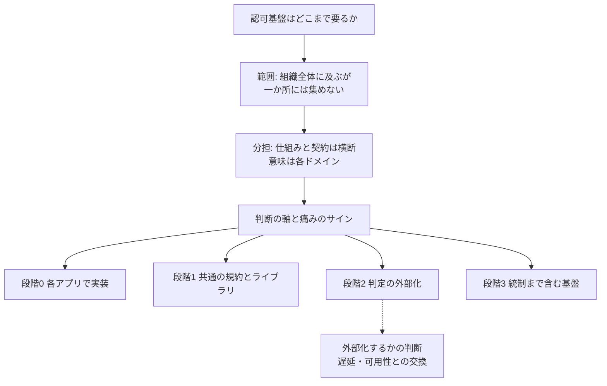
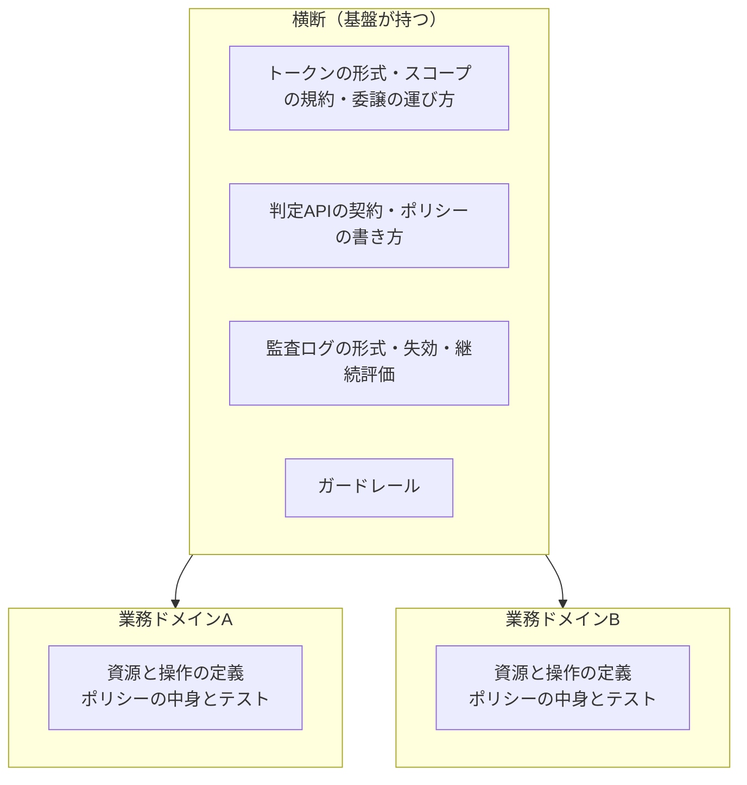
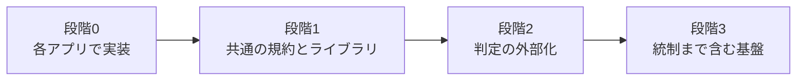
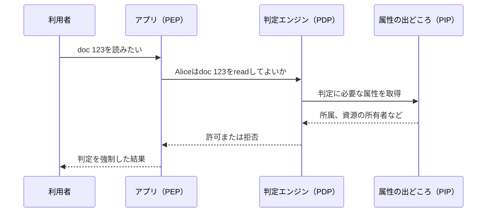

# 概要

認可基盤の話になると、「全社の権限を一か所で管理する基盤を作る」か「各アプリに任せる」かの二択で議論が進みがちである。実際にはその間にいくつかの段階があり、組織に必要なのはそのどれかである。

本記事では、組織にどれだけの認可基盤が要るかを決めるための材料を整理する。この記事でわかることは次のとおり。

- 認可基盤が組織全体に及ぶ理由と、それでも一か所に集めない理由
- 横断で揃えるものと、各業務ドメインに任せるものの線引き
- どの段階の仕組みが必要かを決める判断の軸と、今の痛みから見るサイン
- 4つの段階と、作らない方がよいサイン
- 判定をアプリの外に出す（外部化する）かどうかの判断

認可とは何か、認証との違い、IAMのサブドメインの全体像は[認可とは？認証との違いとIAMのサブドメインで見る全体像](/ja/posts/authorization-domain-iam-subdomains/)が扱う。本記事はそれを前提として、組織として作る範囲に絞る。

本記事の段階や判断の軸は筆者の整理であり、標準化された判断基準があるわけではない。

先に全体像を示す。

# 認可基盤は組織全体に及ぶ

認可の仕組みは、特定のチームやサービスの中に閉じない。理由は6つある。

## 認可はすべてのリクエストのすべての資源で起きる

認証は入口で一度確かめれば、その結果をトークンに載せて運べる。認可は「この主体が、この資源に、この操作をしてよいか」を資源ごとに問う。そのため、ゲートウェイから各サービス、データ層まで、資源のある場所すべてに強制点（PEP、Policy Enforcement Point）が要る。

OWASPのAuthorization Cheat Sheetも、権限の検証をリクエストごとに行うこと（Validate the Permissions on Every Request）を推奨している。OWASP Top 10:2025でも、アクセス制御の不備（Broken Access Control）はA01に置かれている。

PEPを要求の経路のどこに置くかは、[認可基盤のアーキテクチャと設計判断](/ja/posts/authorization-platform-architecture-decisions/)で扱う。

## 権限の「意味」は各業務ドメインにある

「この請求書を承認してよいか」の意味を知っているのは、その業務を担うチームだけである。認可基盤は判定の仕組みを提供できる。しかし、何を許すかはすべての業務ドメインとすり合わせる必要がある。認可基盤は技術の境界だけでなく、チームの境界もまたぐ。

認可がドメインルールの塊であることは、[アーキテクチャ設計における共通化の罠](/ja/posts/abstraction-trap-in-architecture/)でも触れた。

## 判定に必要な情報が組織中から集まる

判定の材料は1か所にそろっていない。

| 情報 | 主な出どころ |
|---|---|
| 主体の属性（所属、役職、雇用形態） | 人事システム、ディレクトリ |
| 権限の割り当て | 承認者、管理者（アクセスガバナンス） |
| リスクシグナル | セキュリティ部門、検知の仕組み |
| 契約の状態（プラン、契約期間） | 契約管理 |
| 資源の属性（所有者、公開範囲、状態） | 各業務ドメイン |

認可は、これらが合流する地点になる。どの情報を誰が持ち、どの鮮度で判定に届けるかは、1つのチームでは決めきれない。

## 統制は組織のプロセスそのもの

誰が権限を与えられるか、職務分掌、定期的な棚卸し、退職時の権限の剥奪は、組織構造や内部統制に直結する。NIST SP 800-53 Rev. 5も、アカウント管理（AC-2）、職務の分離（AC-5）、ユーザー権限のレビュー（AC-6(7)）を統制として挙げている。

退職者の権限を全システムから確実に消せるかは、技術だけでは決まらない。組織横断の仕組みで決まる。

## 委譲がサービスをまたいで連鎖する

ユーザーからエージェント、MCPサーバ、業務APIへと、権限はサービスをまたいで運ばれる。トークンの宛先の設計、スコープの体系、トークンの取り直し方、ユーザーとエージェントの記録の仕方が揃っていないと、どこか1か所の緩い実装が全体の穴になる。受け取ったトークンをそのまま次のサービスへ中継する実装が典型である。

サービス間の文脈の伝播は[ワークロードアイデンティティの標準化](/ja/posts/workload-identity-wimse-transaction-tokens/)、エージェントの委譲は[AIエージェントで認可の何が変わるか](/ja/posts/authorization-for-ai-agents/)で扱う。

## 後から変えにくく、止まると全体が止まる

認可のロジックは各所のコードに埋め込まれていく。そのため、権限のモデルを変えるときは、すべてのサービスに手が入る。

逆に判定を外部化すると、判定サービスの障害がすべての機能を止めうる。判定できないときは通す（fail-open）のではなく止める（fail-closed）のが原則なので、判定サービスの可用性が全体の可用性を左右する。どちらに倒しても、影響範囲はアーキテクチャ全体になる。

# 一か所に集めない: 横断で揃えるものと各ドメインに任せるもの

ここまでの理由から「認可は全社で一元管理すべき」と考えたくなる。しかし、それは2つ目の理由（権限の意味は各ドメインにある）とぶつかる。中央の基盤チームがすべての業務の権限の意味を抱え込むと、基盤チームがボトルネックになり、業務知識も古くなっていく。

そこで、**仕組みと契約は横断で揃え、意味は各ドメインに置く**。

| 横断で揃えるもの（基盤が持つ） | 各業務ドメインが持つもの |
|---|---|
| トークンの形式、宛先とスコープの設計規約、委譲の運び方 | 資源と操作の定義、業務上のルール |
| 判定APIの契約（AuthZENなど）とポリシーの書き方 | 自分のドメインのポリシーの中身 |
| 監査ログの形式、失効の手段、継続評価の配信 | ポリシーのテストと変更 |
| ガードレール（どのドメインでも破ってはいけない制約） | ガードレールの中での判断 |

ガードレールは、業務の意味を問わず、すべてのドメインが守る制約である。たとえば「テナントをまたいだ参照は許可しない」「判定できないときは拒否する」「特権操作は必ず監査ログに残す」といったものがこれにあたる。

認証はIdPにほぼ一元化できるが、認可はそうできない。「誰か」には組織全体で1つの答えを出せるが、「何をしてよいか」の答えは業務ごとに違うからである。この違いがあるので、認可基盤は組織全体に及びながら、組織全体で分担して持つものになる。

共通基盤を作るかどうかの一般的な条件（支援・汎用サブドメインであること、複数チームからの再利用、継続的なオーナーシップなど）は、[プラットフォームの成立条件](/ja/posts/platform-viability-conditions/)で整理した。認可基盤もこの条件に照らせるが、権限の意味まで基盤に入れるとコアドメインの知識を抱え込むことになる。上の表の線引きは、基盤を支援・汎用の側にとどめるための線でもある。

# 「要るか要らないか」ではなく「どの段階か」

認可基盤は「必要か、不要か」の二択ではない。**どの段階の仕組みが必要か**で考える。

## 判断の軸

| 軸 | 基盤が必要になる方向 | 基盤がなくても回る方向 |
|---|---|---|
| 規模と横断性 | 認可が必要なアプリやサービスが多く、同じルールを複数のアプリに効かせたい | アプリが少なく、ルールがアプリごとに閉じている |
| 権限モデルの複雑さ | 条件付きの許可（時刻、金額、リスク）、共有・階層・継承の関係、顧客が自分でロールを作る、委譲がある | 固定の数ロールで足りる |
| 変更の頻度と、変える人 | ポリシーの変更が頻繁で、開発者以外（業務の管理者、顧客）が変えたい | 変更が少なく、変えるのは開発者だけ |
| 統制と規制の要件 | 監査の証跡、職務分掌、定期的な棚卸し、「なぜ許可したか」の説明が求められる | 監査の要求が軽い |
| 主体の多様さ | 人だけでなく、ワークロード、外部パートナー、AIエージェントがあり、委譲が連鎖する | 主体はほぼ人だけ |
| 一貫性の要求 | 複数のプロダクトで同じ人の権限を揃えたい。退職や権限変更を全システムにすぐ反映したい | プロダクトが1つで、反映の遅れが問題にならない |
| 組織の能力とコスト | 基盤を運用するチームがあり、判定サービスを高可用に保てる（または買える） | 運用できる人がいない。判定の往復による遅延や、可用性を下げるリスクを負えない |

最後の「組織の能力とコスト」は、ほかの軸と性質が違う。ほかの軸は必要性を示し、この軸は実現の可能性を示す。必要性が強くても能力が足りないなら、段階を1つ下げる、またはマネージドサービスを使うといった選択肢を検討する。

権限モデルの選び方（RBAC、ABAC、ReBACなど）は[認可のアーキテクチャとモデル、エンジンの選び方](/ja/posts/authorization-architecture-models-engines/)で扱う。アプリ単位の権限設計（機能スコープとデータスコープなど）は[権限管理の設計](/ja/posts/permission-management-design/)にまとめた。

## 今の痛みから見るサイン

軸は将来の要件を含めて考えるものだが、今起きている痛みからも判断できる。次のような状態は、段階を上げる時期に来ているサインである。

- 認可のコードが各アプリにコピーされていて、挙動がアプリごとに違う
- 認可の欠陥（他人のデータが見えるなど）が繰り返し起きている
- ロールの追加や権限の変更に、毎回開発とリリースが要る
- 「この資源を見られるのは誰か」に答えられない。監査のたびに人手で調べている
- 権限の申請がチケットとスプレッドシートで回っている

それぞれのサインが、どの軸とどの段階に関係するかの目安は次のとおり。

| サイン | 関係する軸 | 効きやすい段階 |
|---|---|---|
| 認可のコードがコピーされ、挙動が違う | 規模と横断性 | 段階1 |
| 認可の欠陥が繰り返し起きる | 規模と横断性、権限モデルの複雑さ | 段階1、段階2 |
| 権限の変更に開発とリリースが要る | 変更の頻度と、変える人 | 段階2 |
| 誰が見られるかに答えられない | 統制と規制の要件 | 段階2、段階3 |
| 申請がチケットとスプレッドシート | 統制と規制の要件 | 段階3 |

## 4つの段階

| 段階 | 中身 | 向いている状況 |
|---|---|---|
| 0. 各アプリで実装 | アプリごとにコードで判定する | 小規模、アプリが少ない、ロールが固定 |
| 1. 共通の規約とライブラリ | トークンの形式、スコープの体系、監査ログの形式、失効の手段を全社で揃える。判定は各アプリのまま | アプリやチームが増えてきた |
| 2. 判定の外部化 | 判定エンジン（PDP、Policy Decision Point）を共通化し、ポリシーをコードで管理する。ポリシーの中身は各ドメインが持つ | 規模と横断性、権限モデルの複雑さ、変更の頻度が強い |
| 3. 統制まで含む基盤 | 申請・承認、棚卸し、継続評価、委譲の連鎖の管理まで揃える | 加えて、統制と規制、主体の多様さ、一貫性の要求も強い |

各段階は前の段階の上に積み上がる。段階2のPDPは、段階1で揃えたトークンの形式や監査ログの形式を前提に動く。段階1を飛ばしてPDPを入れると、PEPごとに主体の表し方やログの形式が違ったままになり、外部化の利点である一貫性と監査が得にくい。

段階を上げるときに、全ドメインを一度に移す必要はない。痛みの強いドメインから移し、横断の契約はそのつど固めていく方が、基盤が実際の要件から離れにくい。

freeeが専任のチームで権限管理基盤を開発・運用している事例（2023年公開の記事）は、[権限管理基盤についての事例](/ja/posts/permission-management-case-study/)にまとめた。

## 段階1は早めに揃える

アプリやチームが複数あるなら、段階1は早い時期から揃えておく方がよいと筆者は考える。トークンや監査ログの扱いはチーム間の共通の契約である。基盤チームがいなくても規約として揃えておかないと、後から統一するのが重くなりやすい。

段階1で揃える対象の多く（トークンの形式、宛先とスコープ、失効）はOAuthとその周辺の標準で表せる。どの標準が何を決めるかは[認可基盤から見たOAuthと周辺標準の地図](/ja/posts/oauth-standards-map-authorization-platform/)で整理する。

# 作らない方がよいサイン

段階を上げるべきでない状況もある。

- プロダクトが1つで、ロールも少なく安定している
- 判定を外に出すことによる遅延や、判定サービスが止まったときに全体が止まるリスクの方が大きい
- 基盤を作っても、各チームには使うインセンティブがない（結局アプリ内で判定し続ける）

早すぎる基盤化は、利点が出る前に、可用性のリスクと運用の負担を増やしやすい。3つ目のサインは、[プラットフォームの成立条件](/ja/posts/platform-viability-conditions/)の「複数チーム／複数プロダクトから再利用される」という条件を満たせない状態でもある。

ただし、基盤を作らないことは何もしないことではない。前節のとおり、アプリやチームが複数あるなら、段階1の規約は早めに揃えておく方がよい。作らない判断の対象は、主に段階2以降である。

# 判定を外部化するか

段階1から段階2へ進むかどうかは、判定をアプリの外に出すかどうかの判断である。

## アプリに散らばった判定の問題

各アプリのコードに`if user.role == "admin"`のような判定を散りばめる方式は、アプリが少ないうちは最も単純である。しかし、アプリが増えると、同じルールが複数の場所に別々に書かれ、少しずつずれていく。

AuthZEN Working Groupの共同議長であるDavid Brossardも、OpenID Foundationの発表で、サイロ化してハードコードされた脆い認可が今日のアプリですでに問題になっていると述べている。

## 外部化認可とは

外部化認可は、判定のロジックをアプリから切り離し、PDPに集める方式である。アプリ（PEP）は「Aliceはdoc 123をreadしてよいか」と問い合わせ、返ってきた判定を強制するだけになる。

外部化は、ネットワーク越しに判定サービスを呼ぶこととは限らない。PDPをアプリのプロセス内のライブラリやサイドカーとして動かしても、ロジックがアプリのコードから切り離され、ポリシーとして管理されていれば外部化である。PEP・PDP・PIP・PAPの役割は[認可のアーキテクチャとモデル、エンジンの選び方](/ja/posts/authorization-architecture-models-engines/)で、OPAを使った実装例は[OPAを使用したマイクロサービスのアクセス制御システムの実装](/ja/posts/microservices-access-control-opa/)で扱っている。

## 外部化で得られるもの

- **ポリシーの一元管理・監査・再利用**: ルールがコードの各所ではなくポリシーとして1か所にあり、判定ごとに記録できる
- **アプリ横断の一貫性**: 同じルールを、同じ評価器で、複数のアプリに効かせられる
- **変更の局所化**: ルールの変更がポリシーの変更で済み、アプリのリリースと切り離せる

これらは判断の軸のうち「規模と横断性」「変更の頻度と、変える人」「統制と規制の要件」に直接効く。

## 外部化で払うもの

外部化には代償がある。判定ごとのネットワーク往復による遅延と、PDPの可用性が全体の可用性に直結することである。緩和策は次のとおり。

| 代償 | 緩和策 |
|---|---|
| 判定の往復による遅延 | 判定結果のキャッシュ。PDPをサイドカーやプロセス内ライブラリとして近くで動かす |
| PDPの障害が全体を止める | PDPを各PEPの近くに分散して置く。キャッシュで短時間の障害を吸収する。fail-closedを前提にタイムアウトを設計する |
| 一覧表示で判定の回数が膨らむ | 部分評価でポリシーをSQLの条件などに変換する（OPAのpartial evaluation）。Resource Search APIで許可される資源をまとめて取得する（AuthZEN） |

PEPとPDPの配置、キャッシュや一貫性などの非機能の設計は、[認可基盤のアーキテクチャと設計判断](/ja/posts/authorization-platform-architecture-decisions/)で扱う。

## PEPとPDPの間をつなぐ標準: AuthZEN

外部化で気になるのは、PEPの実装が特定のPDP製品に縛られることである。OpenID FoundationのAuthZEN Working Groupは、PEPとPDPの間のインターフェースを標準化している。Authorization API 1.0は、2026年1月11日付の版がOpenID Final Specificationとして承認された（承認の発表は1月12日）。

Authorization API 1.0は、主に次のAPIを定めている。

- Access Evaluation API: 主体（Subject）、操作（Action）、資源（Resource）、文脈（Context）を受け取って判定を返す
- Access Evaluations API: 複数の判定をまとめて求める
- Search API（Subject Search、Resource Search、Action Search）: 許可される主体・資源・操作を探す

PDPのポリシー言語、アーキテクチャ、状態の管理は仕様の範囲外である。そのため、PDPの中身が何であっても、PEPからは同じ形で問い合わせられる。仕様の詳細は[AuthZEN Authorization APIとは](/ja/posts/authzen-authorization-api/)で扱う。

外部化認可のPDPとして使えるエンジンや製品には、OPA、Cedar（Amazon Verified Permissions）、Cerbos、OpenFGAなどがある。

## 外部化しても、ポリシーの中身は各ドメインが持つ

外部化は中央集権とは違う。共通化するのは判定の仕組み（評価器、判定APIの契約、ポリシーの書き方、配布の手段）であり、ポリシーの中身は各ドメインが書き、テストし、変更する。基盤チームが持つポリシーは、全ドメイン共通のガードレールだけである。

この分担は、前に示した「仕組みと契約は横断、意味は各ドメイン」の線引きを、外部化の場面に当てはめたものである。外部化したことを理由に全ドメインのポリシーを基盤チームが書き始めると、一元管理の問題がそのまま戻ってくる。

## 外部化するかの判断

外部化に向いているのは、次の条件が重なるときである。

- 同じルールを複数のアプリやサービスに効かせたい
- ポリシーの変更が多く、アプリのリリースと切り離したい
- 「なぜ許可したか」を判定単位で説明し、監査したい
- 条件付きの許可や、関係にもとづく許可（共有、階層、継承）が多い

アプリ内の判定に残す方がよいのは、次のようなときである。

- ルールが1つのアプリに閉じていて、変更も少ない
- 判定の往復を同期の経路に入れる余裕がなく、プロセス内での評価も選べない
- PDPを高可用に運用する体制がなく、マネージドサービスも使えない

迷う場合は、ネットワーク越しの中央サービスではなく、プロセス内ライブラリやサイドカーで評価するところから始める選択肢がある。ロジックの切り離しとポリシーの管理という外部化の利点を得つつ、遅延と可用性の代償を小さくできる。

# まとめ

- 認可は資源のある場所すべてで起き、意味は各業務ドメインにあり、材料は組織中から集まる。そのため認可基盤は組織全体に及ぶ
- それでも一か所には集めない。仕組みと契約（トークン、判定APIの契約、監査ログ、失効、ガードレール）は横断で揃え、意味（資源と操作、ポリシーの中身）は各ドメインに置く
- 認可基盤は要否の二択ではなく、段階0（各アプリ）、段階1（共通の規約とライブラリ）、段階2（判定の外部化）、段階3（統制まで含む基盤）のどれが要るかで考える
- 判断の軸は規模と横断性、権限モデルの複雑さ、変更の頻度、統制、主体の多様さ、一貫性、組織の能力の7つで、今の痛みからも判断できる
- アプリやチームが複数あるなら段階1は早めに揃える。プロダクトが1つで安定している、遅延と可用性のリスクの方が大きい、使われる見込みがない、といった場合は段階2以降を作らない
- 判定の外部化は一元管理・一貫性・変更の局所化と引き換えに、遅延と可用性の代償を払う。AuthZEN Authorization API 1.0がPEPとPDPの間を標準化しており、外部化してもポリシーの中身は各ドメインが持つ

# 関連記事

- [認可とは？認証との違いとIAMのサブドメインで見る全体像](/ja/posts/authorization-domain-iam-subdomains/)
- [認可のアーキテクチャとモデルとは？PEP/PDP・RBAC/ABAC/ReBAC・ポリシーエンジンの選び方](/ja/posts/authorization-architecture-models-engines/)
- [AuthZEN Authorization APIとは？PEPとPDPをつなぐ認可判定の標準](/ja/posts/authzen-authorization-api/)
- [認可基盤に必要なOAuth関連標準とは？委譲・トークン・継続評価の地図](/ja/posts/oauth-standards-map-authorization-platform/)
- [ワークロードアイデンティティとは？WIMSE・Transaction Tokens・SPIFFEクライアント認証で見るサービス間の身元と文脈](/ja/posts/workload-identity-wimse-transaction-tokens/)
- [AIエージェントの認可とは？委譲の連鎖・人の承認・監査をMCP、AuthZEN、AIMS、A2A/AP2で整理する](/ja/posts/authorization-for-ai-agents/)
- [MCPの認可はどう設計する？起きうる事故と後から直せない判断](/ja/posts/mcp-authorization-design/)
- [認可基盤のアーキテクチャとは？コンテナ構成・代表シーケンス・PEPとPDPの配置と非機能の設計判断](/ja/posts/authorization-platform-architecture-decisions/)
- [権限管理の設計｜アクセス制御の考え方を整理する](/ja/posts/permission-management-design/)
- [権限管理基盤についての事例](/ja/posts/permission-management-case-study/)
- [プラットフォームの成立条件](/ja/posts/platform-viability-conditions/)
- [アーキテクチャ設計における共通化の罠](/ja/posts/abstraction-trap-in-architecture/)
- [OPAを使用したマイクロサービスのアクセス制御システムの実装](/ja/posts/microservices-access-control-opa/)

# 参考リンク

- [OpenID Foundation - Authorization API 1.0](https://openid.net/specs/authorization-api-1_0.html)
- [OpenID Foundation - Authorization API 1.0 Final Specification Approved](https://openid.net/authorization-api-1-0-final-specification-approved/)
- [OpenID Foundation - AuthZEN Working Group](https://openid.net/wg/authzen/)
- [OpenID Foundation - OpenID Foundation advances authorization for the agent era with new AuthZEN Working Group Drafts](https://openid.net/openid-foundation-advances-authorization-for-the-agent-era-with-new-authzen-working-group-drafts/)
- [AuthZEN Interop](https://authzen-interop.net/)
- [OWASP Cheat Sheet Series - Authorization Cheat Sheet](https://cheatsheetseries.owasp.org/cheatsheets/Authorization_Cheat_Sheet.html)
- [OWASP Top 10:2025 - A01 Broken Access Control](https://owasp.org/Top10/2025/A01_2025-Broken_Access_Control/)
- [NIST SP 800-53 Rev. 5 - Security and Privacy Controls for Information Systems and Organizations](https://csrc.nist.gov/pubs/sp/800/53/r5/upd1/final)
- [NIST SP 800-162 - Guide to Attribute Based Access Control (ABAC) Definition and Considerations](https://csrc.nist.gov/pubs/sp/800/162/upd2/final)
- [Open Policy Agent - Data Filtering with OPA（partial evaluation）](https://www.openpolicyagent.org/docs/filtering)
