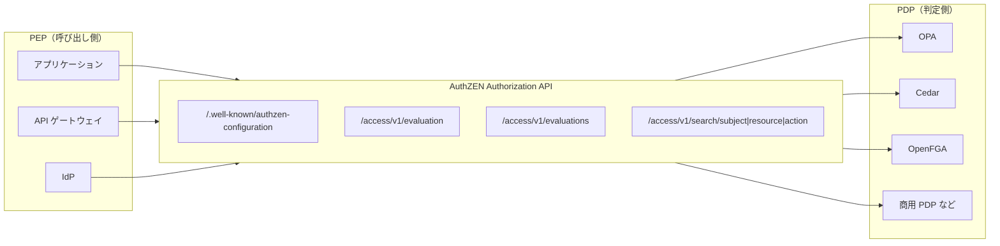

# 概要

「この人はこの資源にこの操作をしてよいか」を判定する仕組みは、2つの役割に分けて作ることが多い。判定する側のPDP（Policy Decision Point）と、強制する側のPEP（Policy Enforcement Point）である。ところが、PEPがPDPに問い合わせるAPIは、これまでエンジンごとにばらばらだった。OPAならRegoの`input`を組み立てる。Cedarなら`principal`や`action`を、OpenFGAなら`user`や`relation`、`object`を組み立てて呼ぶ。

OpenID FoundationのAuthZENワーキンググループが策定した**Authorization API 1.0**は、このPEPとPDPの間の線を標準にする仕様である。2026年1月にOpenID Final Specificationとして承認された。

この記事では、次の問いに答える。

- なぜPEPとPDPの間に標準のAPIが要るのか
- 何を送り、何が返るのか（SARCの情報モデルと5つのエンドポイント）
- 判定の理由やステップアップの要求は、どう返せるのか
- PDPの発見とセキュリティで、何が決まっていて何が決まっていないのか
- XACMLやNISTのABACとどういう関係にあるのか
- OPA・Cedar・OpenFGAを差し替えられるとは、どこまでを意味するのか

PEP・PDP・PIP・PAPの参照アーキテクチャや、RBAC・ABAC・ReBACといったモデルとエンジンの比較は[認可のアーキテクチャとモデル・エンジンの選び方](/ja/posts/authorization-architecture-models-engines/)で扱う。この記事は、そのPEPとPDPをつなぐAPIに絞る。

# 全体像

先に全体を示す。AuthZENのAuthorization APIはPDPが提供し、PEPが呼ぶ。PEPはアプリケーションのコードに限らず、APIゲートウェイやIdPでもよい。



仕様が定めるものと定めないものを表にする。

| 区分 | 内容 |
| --- | --- |
| 定める | 情報モデル（Subject・Action・Resource・ContextとDecision） |
| 定める | Access Evaluation API（1件の判定） |
| 定める | Access Evaluations API（複数件の一括判定） |
| 定める | Search API（主体・資源・操作の一覧） |
| 定める | PDPメタデータ（`/.well-known/authzen-configuration`） |
| 定める | HTTPSとJSONによるバインディング、エラーの扱い、セキュリティ上の考慮 |
| 定めない | ポリシー言語、PDPの内部アーキテクチャ、状態の管理 |
| 定めない | PEPがPDPに認証する方式（OAuth 2.0のサポートを推奨するにとどめる） |
| 定めない | 判定の`context`に入れる語彙（理由、義務など）の意味と形式 |

# なぜPEPとPDPの間に標準のAPIが要るのか

## エンジンごとに問い方が違う

認可の判定をアプリケーションの外に出すと、アプリケーションのコードはPDPへの問い合わせに置き換わる。この問い合わせの形がエンジンごとに違うと、次のことが起きる。

- PEPのコードとミドルウェアが、特定のエンジンのAPIと語彙に縛られる。
- APIゲートウェイやIdPのような製品は、エンジンごとに連携を作らなければならない。
- エンジンを替えるときに、すべてのPEPを書き換えることになる。

仕様のIntroductionによれば、PDPとPEPの通信は製品をまたいで似たパターンをたどる。そのうえでこのAPIは、PDPやPEPの提供者が特定の実装へ縛られないことを目的とする。

## OAuthとOIDCが標準化したものとの対比

OAuthは権限の委譲を、OpenID Connectは認証の結果の受け渡しを、それぞれ標準にした。AuthZENのAuthorization APIは、その隣にある「判定の問い合わせ」を標準にする。トークンに入っているスコープやクレームで粗く絞ったあと、資源ごとの細かい判定をPDPに問う。この後半の部分には、XACMLのプロファイル（後述）を除くと、共通の形がなかった。

OAuthまわりの標準の地図は[認可基盤から見たOAuthと周辺標準の地図](/ja/posts/oauth-standards-map-authorization-platform/)にまとめた。

## 仕様の状態

記事の日付時点での状態を、openid.netの公開情報で確かめた。

| 項目 | 内容 |
| --- | --- |
| 正式名 | Authorization API 1.0 |
| 種別 | OpenID Final Specification |
| 公開日 | 2026-01-11（仕様のPublished） |
| 承認の告知 | 2026-01-12（賛成81、反対1、棄権25） |
| 編集者 | O. Gazitt（Aserto）、D. Brossard（Axiomatics）、A. Tulshibagwale（SGNL） |
| 経緯 | draft 01が2024年11月に最初のImplementer's Draftになった。draft 02で一括判定、draft 03でSearch APIが加わった |
| 適合性テスト | OpenID Foundationのconformance suiteにPDP向けのテスト計画がある。2026年10月時点で、公式ページは初期段階だと明記している |

Final Specificationは、実装者に知的財産上の保護を与え、それ以上は改訂されない版である。GitHubの編集者版（openid.github.io/authzen）も、2026年10月時点では本文がFinalと同じだった。仕様は、今後の版でこのAPIに追加はしてよいが、1.0のAPIを変えてはならないと定めている。

# 情報モデル: SARC

AuthZENの要求は、4つの要素からなる。頭文字をとってSARC（Subject・Action・Resource・Context）と呼ばれる。応答はDecisionである。

| 要素 | 意味 | 必須のキー | 任意のキー |
| --- | --- | --- | --- |
| Subject | 判定の対象になる主体（人またはマシン） | `type`、`id` | `properties` |
| Action | 主体がしようとしている操作 | `name` | `properties` |
| Resource | 操作の対象 | `type`、`id` | `properties` |
| Context | 要求の環境（時刻、場所、PEPの能力など） | なし（オブジェクト全体が任意） | 任意の属性 |
| Decision | 判定の結果 | `decision`（真偽値） | `context` |

SubjectとResourceの`id`は、`type`の中で一意であればよい。Actionだけは`type`と`id`ではなく`name`で表す。

```json
{
  "subject": {
    "type": "user",
    "id": "alice@example.com",
    "properties": {
      "department": "Sales"
    }
  },
  "action": {
    "name": "can_read"
  },
  "resource": {
    "type": "book",
    "id": "123",
    "properties": {
      "library_record": {
        "title": "AuthZEN in Action",
        "isbn": "978-0593383322"
      }
    }
  },
  "context": {
    "time": "1985-10-26T01:22-07:00"
  }
}
```

`properties`が用意されている理由を、仕様は次のように説明する。多くの認可システムは状態を持たず、判定に必要な属性をすべてPEPが渡すことを期待する。そのため、部署、所属グループ、端末の識別子、IPアドレスといった主体の属性を、主体の`properties`に載せられる。資源と操作にも、同じように属性を載せる`properties`がある。

ここで決まっていないことがある。`type`の値（例: `user`、`account`）、`name`の値（例: `can_read`、`read`）、`properties`のキーは、仕様では決めていない。PEPとPDPの間で語彙をそろえる作業は、導入する側に残る。

# Access Evaluation API: 1件の判定

中心になるAPIである。PEPは1つのSARCを送り、1つのDecisionを受け取る。HTTPSバインディングでは、既定のパスは`/access/v1/evaluation`で、メソッドはPOSTである。

```http
POST /access/v1/evaluation HTTP/1.1
Host: pdp.example.com
Content-Type: application/json
Authorization: Bearer <PEP の資格情報>
X-Request-ID: bfe9eb29-ab87-4ca3-be83-a1d5d8305716

{
  "subject": { "type": "user", "id": "alice@example.com" },
  "resource": { "type": "todo", "id": "1" },
  "action": { "name": "can_read" },
  "context": { "time": "1985-10-26T01:22-07:00" }
}
```

```http
HTTP/1.1 200 OK
Content-Type: application/json
X-Request-ID: bfe9eb29-ab87-4ca3-be83-a1d5d8305716

{
  "decision": true
}
```

押さえておきたい点は3つある。

- **拒否は 200 で返る**。拒否は`200 OK`と`{"decision": false}`で表す。`401`はPEPがPDPに正しく認証できなかったことを、`400`や`500`は要求や処理の誤りを表す。HTTPのエラーと判定の結果は別物である。
- **`true`でも、PEP は分からない`context`があれば拒否してよい**。`false`のときは、要求を先に進めてはならない。
- **要求の識別子**。PEPは`X-Request-ID`ヘッダで要求を識別できる。付けた場合、PDPは応答に同じ値を返さなければならない。監査ログでPEPとPDPの記録を突き合わせるのに使える。

必須の属性が欠けていたら、PDPは`400 Bad Request`を返す。また、受け取った側は知らないフィールドを無視しなければならない。これは将来の拡張に備えるための規則である。

# Access Evaluations API: まとめて判定する

一覧画面で50件の文書それぞれに「編集ボタンを出すか」を判定したいとき、50回のHTTP往復は重い。Access Evaluations APIは、複数の判定を1回の要求にまとめる（仕様はboxcarringと呼ぶ）。既定のパスは`/access/v1/evaluations`である。

## 既定値と上書き

最上位の`subject`・`action`・`resource`・`context`は、`evaluations`配列の各要素の既定値になる。要素の中に同じキーがあれば、そちらで上書きする。次の例では、主体・操作・環境を共通にし、3件目だけ操作を`can_edit`に替えている。

```json
{
  "subject": { "type": "user", "id": "alice@example.com" },
  "context": { "time": "2024-05-31T15:22-07:00" },
  "action": { "name": "can_read" },
  "evaluations": [
    { "resource": { "type": "document", "id": "boxcarring.md" } },
    { "resource": { "type": "document", "id": "subject-search.md" } },
    {
      "action": { "name": "can_edit" },
      "resource": { "type": "document", "id": "resource-search.md" }
    }
  ]
}
```

応答の`evaluations`は、要求と同じ順にDecisionを並べる。

```json
{
  "evaluations": [
    { "decision": true },
    { "decision": false, "context": { "reason": "resource not found" } },
    { "decision": false, "context": { "reason": "Subject is a viewer of the resource" } }
  ]
}
```

`evaluations`配列がない、または空なら、このAPIは単発のAccess Evaluationと同じようにふるまう。

## 3つの評価方式

`options.evaluations_semantic`で、評価の打ち切り方を選べる。

| 値 | ふるまい | たとえ |
| --- | --- | --- |
| `execute_all`（既定） | すべてを評価し、すべての結果を返す。並列に評価してよい | 各要素を独立に判定する |
| `deny_on_first_deny` | 最初の拒否（または誤り）で打ち切り、そこまでの結果を返す | `&&` |
| `permit_on_first_permit` | 最初の許可で打ち切り、そこまでの結果を返す | `\|\|` |

`deny_on_first_deny`は、複数の前提をすべて満たしたときだけ進めたい場面に向く。`permit_on_first_permit`は、いずれかの経路で許可されればよい場面に向く。

## 誤りの扱い

誤りは2種類に分かれる。要求全体に関わる誤りは、HTTPの4xxや5xxで返す。個々の判定の誤りは、その要素を`"decision": false`にし、`context`に誤りを載せられる。判定は既定で閉じる（fail-closed）。

```json
{
  "evaluations": [
    { "decision": true },
    {
      "decision": false,
      "context": { "error": { "status": 404, "message": "Resource not found" } }
    }
  ]
}
```

# Search API: 許される相手を一覧する

Access Evaluationは「Aliceは文書123を読めるか」に答える。Search APIは向きを変えて、「Aliceが読める文書はどれか」「文書123を読めるのは誰か」「Aliceは文書123に何ができるか」に答える。

| API | 既定のパス | 省くもの | 返すもの |
| --- | --- | --- | --- |
| Subject Search | `/access/v1/search/subject` | `subject.id` | 許される主体の一覧 |
| Resource Search | `/access/v1/search/resource` | `resource.id` | 許される資源の一覧 |
| Action Search | `/access/v1/search/action` | `action`そのもの | 許される操作の一覧 |

Resource Searchの例を示す。探したい資源の`type`だけを渡す。

```json
{
  "subject": { "type": "user", "id": "alice@example.com" },
  "action": { "name": "can_read" },
  "resource": { "type": "account" },
  "page": { "limit": 2 }
}
```

```json
{
  "page": { "next_token": "a3M9NDU2O3N6PTI=", "count": 2, "total": 3 },
  "results": [
    { "type": "account", "id": "123" },
    { "type": "account", "id": "456" }
  ]
}
```

## 意味の取り決め

- **評価と食い違わないこと**。検索の結果をAccess Evaluationに渡せば、`true`になるべき（SHOULD）である。ただし、時刻などの変数に左右されるため、保証はされない。
- **推移的にたどること**。ユーザー UがグループGに属し、Gが文書Dの閲覧者なら、Dを閲覧できる主体の検索にUを含めることを推奨する。
- **ページング**。ページングへの対応はPDPの任意（MAY）である。対応するPDPでは、不透明なトークンで次のページを取る。`next_token`が空文字列になったら終わりである。ページングは結果の一貫したスナップショットを保証しない。途中でデータが変わると、重複や欠落がありうる。2ページ目以降の要求は、トークン以外を最初の要求と同じにしなければならない。

## どこで使うか

Search APIは、一覧画面の事前フィルタ、メニューやボタンの出し分け、権限の棚卸しに使える。判定を外に出した構成では、一覧とページングの扱いが難しくなる。OPAでこの問題を検討した内容は[OPAにおけるページネーションへの影響と解決策](/ja/posts/pagination-impact-solutions-opa/)にまとめた。

「誰が・何に」を逆に引く問い自体は新しくない。ZanzibarのExpand APIは、オブジェクトと関係の組に対する実効的なユーザーセットを木の形で返す。OpenFGAのListObjectsとListUsersは、許される資源と主体を一覧で返す。AuthZENで新しいのは、それがPDPをまたいだ共通のAPIになった点である。なお、Search APIはどれも任意で、メタデータに載っていなければPEPはそのPDPが対応していないと判断できる。

# 判定のcontext: 真偽値の先にあるもの

Decisionの本体は`true`か`false`だけである。それ以外の情報は、任意の`context`オブジェクトに入れる。仕様は、`context`で伝えられるものの例として次を挙げる。

- 判定の理由
- 判定に結び付いたAdviceやObligation
- UIの状態を描くためのヒント
- ステップアップ認証の指示
- 環境の情報

仕様にある非規範の例を2つ示す。1つ目は、管理者向けと利用者向けで理由を分ける例である。

```json
{
  "decision": false,
  "context": {
    "reason_admin": { "403": "Request failed policy C076E82F" },
    "reason_user": { "403": "Insufficient privileges. Contact your administrator" }
  }
}
```

2つ目は、ステップアップ認証を求める例である。PDPは、求める`acr`と`amr`の値をアクセストークンのクレームとして期待していると伝える。

```json
{
  "decision": false,
  "context": {
    "acr_values": "urn:com:example:loa:3",
    "amr_values": "mfa hwk"
  }
}
```

注意したいのは、`context`の意味と形式は仕様の範囲外だという点である。`reason_admin`や`acr_values`は例であり、規範ではない。PDPを替えたときに、`context`の読み方まで替わる可能性がある。この隙間を埋めるために、義務（Obligation）の形式を定めるObligationsプロファイルが別に作られている（後述）。

管理者向けの理由に、ポリシーの内部情報を出しすぎないことにも注意する。利用者向けの理由と分けて、利用者にはポリシーの構造が推測できない文言を返すのが安全である。

# PDPメタデータ: どこに何があるか

PDPは、自分の設定をメタデータとして公開することが推奨される（RECOMMENDED）。場所は`/.well-known/authzen-configuration`である。複数のテナントを持つPDPなら、`https://pdp.example.com/.well-known/authzen-configuration/tenant1`のように、パスの後ろにテナントを足せる。

```json
{
  "policy_decision_point": "https://pdp.example.com",
  "access_evaluation_endpoint": "https://pdp.example.com/access/v1/evaluation",
  "search_subject_endpoint": "https://pdp.example.com/access/v1/search/subject",
  "search_resource_endpoint": "https://pdp.example.com/access/v1/search/resource"
}
```

| パラメータ | 必須か | 意味 |
| --- | --- | --- |
| `policy_decision_point` | 必須 | PDPの識別子（httpsのURL）。PDPの取り違え（mix-up）攻撃を防ぐ |
| `access_evaluation_endpoint` | 必須 | Access Evaluation APIのURL |
| `access_evaluations_endpoint` | 任意 | Access Evaluations APIのURL |
| `search_subject_endpoint`など | 任意 | 各Search APIのURL |
| `capabilities` | 任意 | IANAに登録された能力のURNの配列 |
| `signed_metadata` | 任意 | メタデータを署名したJWT |

PEPが守るべき検証と扱いは次のとおりである。

- 取得したメタデータの`policy_decision_point`が、取得に使った識別子と同一であることを確かめる。違えば、その内容を使ってはならない。
- `signed_metadata`を扱うPEPは、署名と発行者（`iss`）を検証する。署名付きの値は、平文の値より優先する。
- メタデータは通常のHTTPキャッシュに従う。`Cache-Control`の`max-age`などで、適切な期間だけキャッシュする。

メタデータにエンドポイントのURLがあれば、それを使わなければならない。URLが示されていなければ、PDPの基底URLに既定のパスを足して呼ぶ（SHOULD）。ただし、メタデータに載っていないAPIは、そのPDPが対応していないと判断してよい。仕様はOAuthのメタデータのRFCを参照していないが、仕組みは認可サーバのメタデータ（RFC 8414）や保護リソースのメタデータ（RFC 9728）とよく似ている。`signed_metadata`の定義は、RFC 9728とほぼ同じ文面である。

# トランスポートとセキュリティ

## HTTPSとJSONのバインディング

仕様は、情報モデルとトランスポートを分けて定義する。準拠するPDPは、HTTPSとJSONのバインディングを実装しなければならない。gRPCなどのバインディングは、将来プロファイルとして定義されうる。

JSONについては、I-JSON（RFC 7493）に沿うことを推奨している。UTF-8で符号化すること、IEEE 754の倍精度を超える数値を使わないこと、メンバー名を重複させないことを求める。値が`null`のプロパティは省くことも推奨している。「ない」と「null」の取り違えを避けるためである。

## セキュリティ上の考慮

| 観点 | 仕様の要求 | 理由 |
| --- | --- | --- |
| 通信の完全性と機密性 | PEPとPDPの接続を、TLSなど適切な手段で保護しなければならない（MUST） | ABACの構成で最も機微な接続だから |
| PEPの認証 | PDPはPEPを認証すべき（SHOULD）。手段はmTLS、OAuth、APIキーなど | 大量の要求でポリシーを探られることと、DoSを防ぐ |
| 認証の失敗 | `401`を返さなければならず（MUST）、`WWW-Authenticate`ヘッダを付けるべき（SHOULD） | 期待する認証方式を伝える |
| 信頼 | PDPはPEPを信頼する前提に立つ | 判定を最後に強制するのはPEPだから |
| 応答の完全性 | PDPは応答に署名してよい（MAY） | プロキシやゲートウェイを挟むと、TLSだけでは経路全体を守れない |
| 可用性 | 要求の大きさ、件数、不正なJSON、深い入れ子、メモリ消費に対策すべき（SHOULD） | レート制限などでDoSを防ぐ |

## 設計で気をつけること（筆者の見立て）

「PDPはPEPを信頼する」という前提は重い。PEPが`properties`に載せた部署やロールを、PDPはそのまま信じる。したがって、判定に効く属性を誰が供給するかを決めておく必要がある。PEPが自由に書ける属性で判定するなら、PEPが乗っ取られたときにその属性も偽れる。重要な属性は、PDPが自分でPIPから引くか、署名付きのトークンから取るほうが安全である。

もう1つは、PDPに届かないときのふるまいである。仕様は個々の判定の誤りをfail-closedにすると定めるが、PDPそのものが落ちたときのPEPの動きは決めていない。タイムアウト、キャッシュ、縮退時の判定は、PEPの側で決めることになる。PEPとPDPの配置や非機能の判断は[認可基盤のアーキテクチャと設計判断](/ja/posts/authorization-platform-architecture-decisions/)で扱う。

# XACMLとNIST ABACとの関係

AuthZENは新しい概念を発明したわけではない。仕様は冒頭で、PDPとPEPの定義をXACMLとNIST SP 800-162（ABACのガイド）に負っていると明記する。

| 観点 | XACML 3.0 | AuthZEN Authorization API 1.0 |
| --- | --- | --- |
| 範囲 | ポリシー言語、要求と応答の形式、処理モデル | PEPとPDPの間の要求と応答だけ |
| 形式 | XML（JSONとRESTのプロファイルは2019年にOASIS Standard） | JSON（HTTPSバインディングが必須） |
| 要求の構造 | 属性カテゴリ（主体、資源、操作、環境）に属性を並べる | Subject・Action・Resource・Contextのオブジェクト |
| 判定の値 | Permit・Deny・NotApplicable・Indeterminate | `true`か`false` |
| 義務と助言 | ObligationとAdviceを言語で定義する | `context`に入れる（形式はプロファイルで定める） |
| 一覧の問い | 中核にはない | Search APIとして定義する |

XACMLは判定の結果を4値で返し、ポリシー言語と処理モデルまで含めて定めた。筆者の見方では、そのためにXACMLの要求を受け付けるPDPは、ほぼXACMLのエンジンに限られた。AuthZENはポリシー言語に一切踏み込まず、線の形だけを決める。内部はRego、Cedar、関係タプルのいずれでもよい。判定を`true`と`false`に絞り、ほかの情報を`context`に逃がしたのも、異なるエンジンが同じ口を持てるようにするためだと読める。

NIST SP 800-162は、ABACを主体の属性、対象の属性、操作、環境条件で説明する。SARCはこの語彙とほぼ対応している。モデルの原典の詳細は[認可のアーキテクチャとモデル・エンジンの選び方](/ja/posts/authorization-architecture-models-engines/)に譲る。

# OPA・Cedar・OpenFGAを差し替えられるとはどういうことか

## SARCと各エンジンの対応

AuthZENの効き目は、PEPの側から見たエンジンの違いを吸収する点にある。代表的なエンジンの概念とSARCは、おおむね次のように対応する。

| SARC | OPA（Rego） | Cedar | OpenFGA |
| --- | --- | --- | --- |
| Subject | `input`の任意の構造 | `principal`（エンティティ） | `user` |
| Action | `input`の任意の構造 | `action`（エンティティ） | `relation` |
| Resource | `input`の任意の構造 | `resource`（エンティティ） | `object` |
| Context | `input`の任意の構造 | `context` | `context`（条件付きの関係で使う） |
| 一覧の問い | 部分評価などで工夫する | 中核の判定APIにはない | ListObjects、ListUsers |

Cedarの4つ組はSARCとほぼ同じ形をしている。OpenFGAは関係を問うので、Actionを`relation`に写す取り決めが要る。OPAは入力の形を決めていないので、SARCをそのまま`input`として受けるポリシーを書けばよい。ただし、OPA本体はAuthZENのエンドポイントを持たない。AuthZENの要求を`input`に渡すには、OPAのcontribにあるauthzen-proxyのような変換層を前に置く。または、AuthZENのエンドポイントを足したOPAのビルドを使う。OPAのエコシステムのページには、第三者によるOPA-AuthZENが載っている。OPAの基本は[Open Policy Agent (OPA)とは](/ja/posts/open-policy-agent/)で、マイクロサービスでの使い方は[OPAを使用したマイクロサービスのアクセス制御システムの実装](/ja/posts/microservices-access-control-opa/)で扱った。

## 差し替えられるもの、差し替えられないもの

AuthZENで替えやすくなるのは、PEPのコードと通信の形である。一方で、次のものはAuthZENを入れても替わらない。

| 差し替えに伴って残る作業 | 理由 |
| --- | --- |
| ポリシーの書き直し | ポリシー言語は仕様の範囲外 |
| データモデルの移行 | 関係タプルや属性の持ち方はエンジンごとに違う |
| `type`と`name`の語彙のすり合わせ | 仕様は語彙を決めない |
| `context`の読み方 | 理由や義務の形式は仕様の範囲外 |
| Search APIの対応状況 | Searchと一括判定は任意で、PDPごとに違う |
| 属性の供給経路 | どの属性をPEPが渡し、どれをPDPが引くかは構成しだい |

つまり、AuthZENは「PEPを書き換えずにPDPを替えられる」状態を作るが、「ポリシーを書き換えずに替えられる」状態は作らない。それでも、PEPがサービスやゲートウェイの数だけある組織では、前者の価値は大きい。

## 相互運用の実績

AuthZENワーキンググループは、2024年6月から7回の相互運用イベントを開いてきた（authzen-interop.netによる）。

| 場面 | イベント | 版 | 対象 |
| --- | --- | --- | --- |
| アプリケーションのコード | Identiverse 2024 | draft 00 | `/evaluation` |
| アプリケーションのコード | EIC 2024 | draft 01 | `/evaluation` |
| アプリケーションのコード | Authenticate 2024 | draft 02 | `/evaluations`を追加 |
| アプリケーションのコード | Gartner IAM US 2024 | draft 02 | `/evaluations`を追加 |
| APIゲートウェイ | Gartner IAM London 2025 | draft 02 | `/evaluations`を追加 |
| 検索 | Identiverse 2025 | draft 03 | `/search`、`/.well-known` |
| IdP | Gartner IAM US 2025 | draft 04 | `/search` |

TodoアプリをPEPにしたシナリオには、多くのPDPが結果を載せている。Aserto、Axiomatics、Cerbos、Open Policy Agent、OpenFGA、Amazon Verified Permissions、PlainID、SGNL、Topazなどである。ただし、参加したことは、その製品がAuthZENをそのまま話すことを意味しない。たとえばOPAの結果は、相互運用のサイトで動くプロキシに対して取られている。採用するときは、各製品が仕様のどの版のどのAPIに対応しているかを、製品の文書で確かめる必要がある。

相互運用のサイトは、IdPで粗く、APIゲートウェイで中くらいに、アプリケーションで細かく判定する多層の構成を示している。同じAPIで3つの層のPEPをつなげることが、標準のAPIを持つ意味をよく表している。

# プロファイル群の概要

Authorization API 1.0の上に、用途ごとのプロファイルが作られている。どれもDraftであり、今後も変わりうる。AIエージェントでの使い方は[AIエージェントで認可の何が変わるか](/ja/posts/authorization-for-ai-agents/)で詳しく扱う。

| プロファイル | 状態 | 埋める隙間 |
| --- | --- | --- |
| Access Request and Approval Profile（AARP） | Working Group Draft | 「拒否だが申請はできる」判定を、申請・承認・再評価でつなぐ。承認後もPDPが再評価して決める |
| COAZ Framework | Working Group Draft | 任意のプロトコルの要求からSARCを組み立てる、宣言的な写し方の枠組み |
| COAZ-MCP Binding | Working Group Draft | COAZをMCPに当てはめ、MCPのメッセージごとに判定する |
| Obligations Profile | Working Group Draft | 判定に付ける、PEPが必ず実行すべき義務の形式と交渉 |
| OAuth関連（Token Issuance、Token Exchange、Authorization Claims） | リポジトリ上のDraft 1 | トークン発行やトークン交換の判断、JWTアクセストークンに入れる権限をAuthZENに問う |

AARPはOpenID Foundationの発表に合わせた略称で、ドラフトのヘッダーでの略称はARAPである。

OpenID Foundationは2026年6月の発表で、認可システムはこれまで「今この操作をしてよいか」に答えてきたが、「許可の前に何が必要か」にも答える必要が増していると述べた。Search APIが扱う「どれを・誰が」を加えると、判定のAPIが答える問いは3つに整理できる。

| 問い | 例 | 対応 |
| --- | --- | --- |
| Can（判定） | 今この操作は許可されるか | Access Evaluation、Access Evaluations |
| Which（探索） | この主体が読める資源はどれか | Search API |
| What is required（前提） | 許可には何が必要か | AARP、Obligations、`context`のステップアップ |

この3つのまとまりは筆者の整理であり、仕様がそう定義しているわけではない。MCPでの使い方は[MCPの認可を設計するときの勘所](/ja/posts/mcp-authorization-design/)も参照してほしい。

# 導入するときの勘所

最後に、AuthZENを設計に取り入れるときの勘所を、筆者の見立てとしてまとめる。

- **まず Access Evaluation だけを使う**。仕様はこのAPIを中核と位置づけ、メタデータでもこのAPIのURLだけを必須にしている。メタデータの公開自体は推奨にとどまる。一括判定と検索は対応しないPDPもあるので、対応を確かめてから使う。
- **`type`と`name`の語彙を先に決める**。資源の種類と操作の名前を、組織全体で1つの語彙にする。PEPごとに`read`と`can_read`が混ざると、PDPを替えなくても判定がずれる。
- **`context`の約束事を文書にする**。理由やステップアップの返し方を、組織内の規約として決めておく。Obligationsプロファイルが固まれば、そちらに寄せる。
- **属性の出どころを決める**。PEPが渡す属性と、PDPが自分で引く属性を分ける。重要な属性ほどPEPに任せない。
- **PEP を SDK やミドルウェアで包む**。HTTPの呼び出しを各サービスに直書きせず、共通の部品にする。メタデータの取得、キャッシュ、タイムアウト、fail-closedをそこに集める。
- **判定を外に出すかどうか自体を先に決める**。AuthZENが定めるのは、判定を外に出したあとの線だけである。外に出すべきかどうかの判断については、[認可基盤はどこまで作るか](/ja/posts/authorization-platform-scope-stages/)で扱う。

# まとめ

- AuthZEN Authorization API 1.0は、PEPとPDPの間の要求と応答を標準にする仕様である。2026年1月にOpenID Final Specificationとして承認された。
- 要求はSubject・Action・Resource・Context（SARC）で、応答は真偽値の`decision`と任意の`context`である。
- APIは、1件の判定、評価方式を選べる一括判定、主体・資源・操作の検索、`/.well-known/authzen-configuration`のメタデータからなる。
- 拒否は`200`と`false`で返り、HTTPのエラーとは区別する。個々の判定の誤りはfail-closedになる。
- セキュリティでは、PEPとPDPの接続の保護（HTTPならTLSなど）が必須で、PEPの認証、応答の署名、DoS対策が推奨または許可されている。PDPはPEPを信頼する前提に立つので、属性の出どころが設計の要になる。
- XACMLとNIST ABACの語彙を受け継ぎつつ、ポリシー言語には踏み込まない。そのためOPA、Cedar、OpenFGAなどが同じ口を持てる。
- 替えやすくなるのはPEPの側であり、ポリシー、データ、語彙、`context`の読み方は残る作業である。

# 関連記事

- [認可とは？認証との違いとIAMのサブドメインで見る全体像](/ja/posts/authorization-domain-iam-subdomains/)
- [認可基盤はどこまで作るべきか？横断と各ドメインの分担、必要な段階、判定の外部化](/ja/posts/authorization-platform-scope-stages/)
- [認可のアーキテクチャとモデルとは？PEP/PDP・RBAC/ABAC/ReBAC・ポリシーエンジンの選び方](/ja/posts/authorization-architecture-models-engines/)
- [認可基盤に必要なOAuth関連標準とは？委譲・トークン・継続評価の地図](/ja/posts/oauth-standards-map-authorization-platform/)
- [AIエージェントの認可とは？委譲の連鎖・人の承認・監査をMCP、AuthZEN、AIMS、A2A/AP2で整理する](/ja/posts/authorization-for-ai-agents/)
- [MCPの認可はどう設計する？起きうる事故と後から直せない判断](/ja/posts/mcp-authorization-design/)
- [認可基盤のアーキテクチャとは？コンテナ構成・代表シーケンス・PEPとPDPの配置と非機能の設計判断](/ja/posts/authorization-platform-architecture-decisions/)
- [Open Policy Agent (OPA)とは？ポリシー・アズ・コードの実践ガイド](/ja/posts/open-policy-agent/)
- [OPAを使用したマイクロサービスのアクセス制御システムの実装](/ja/posts/microservices-access-control-opa/)
- [OPAにおけるページネーションへの影響と解決策に関する検討](/ja/posts/pagination-impact-solutions-opa/)

# 参考リンク

- [Authorization API 1.0（OpenID Final Specification）](https://openid.net/specs/authorization-api-1_0.html)
- [Authorization API 1.0編集者版](https://openid.github.io/authzen/)
- [Authorization API 1.0 Final Specification Approved（OpenID Foundation）](https://openid.net/authorization-api-1-0-final-specification-approved/)
- [AuthZEN Working Group – Specifications](https://openid.net/wg/authzen/specifications/)
- [Conformance Testing for OpenID AuthZEN Authorization API 1.0](https://openid.net/certification/authzen_testing/)
- [OpenID AuthZEN Interop](https://authzen-interop.net/)
- [openid/authzen（GitHub）](https://github.com/openid/authzen)
- [open-policy-agent/contrib authzen-proxy（GitHub）](https://github.com/open-policy-agent/contrib/tree/main/authzen/authzen-proxy)
- [OPA-AuthZEN（OPA Ecosystem）](https://www.openpolicyagent.org/ecosystem/entry/opa-authzen)
- [OpenID Foundation advances authorization for the agent era with new AuthZEN Working Group Drafts](https://openid.net/openid-foundation-advances-authorization-for-the-agent-era-with-new-authzen-working-group-drafts/)
- [OASIS XACML 3.0](https://docs.oasis-open.org/xacml/3.0/xacml-3.0-core-spec-os-en.html)
- [JSON Profile of XACML 3.0 Version 1.1](https://docs.oasis-open.org/xacml/xacml-json-http/v1.1/xacml-json-http-v1.1.html)
- [XACML REST Profile Version 1.1](https://docs.oasis-open.org/xacml/xacml-rest/v1.1/xacml-rest-v1.1.html)
- [NIST SP 800-162 Guide to Attribute Based Access Control (ABAC) Definition and Considerations](https://csrc.nist.gov/pubs/sp/800/162/upd2/final)
- [RFC 7493 The I-JSON Message Format](https://www.rfc-editor.org/rfc/rfc7493)
- [RFC 8414 OAuth 2.0 Authorization Server Metadata](https://www.rfc-editor.org/rfc/rfc8414)
- [RFC 9728 OAuth 2.0 Protected Resource Metadata](https://www.rfc-editor.org/rfc/rfc9728)
