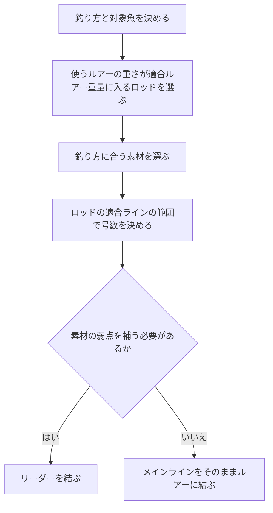

# はじめに
ラインは、素材と号数の組み合わせで種類が多く、何を選べばよいか迷いやすい。本記事では、ルアー釣りで使うラインの選び方を、素材と号数の2つに分けて整理する。数値は、ラインメーカーの公表値とロッドの公式スペックによる。

# 先に結論
- ロッド、素材、号数の順に決める。
- 素材は、擦れへの強さ・比重・伸びの違いを見て、釣り方に合わせて選ぶ。
- 号数は、ロッドに書かれた適合ラインの範囲から選ぶ。
- 号数は太さ（PEは重さ）の表示である。強さはlbやkgの表示で比べる。
- PEやエステルの弱点は、先端に結ぶリーダーで補う。

# 選ぶ順番
ラインは次の順で選ぶと迷いにくい。

ロッドを先に決めるのは、ロッドの仕様に適合ラインが書かれているからである。釣具メーカーは、太すぎるラインは糸抜けが悪くなるとして、ロッドとの不一致をライントラブルの原因に挙げている。

# 素材を選ぶ
## 4つの素材の特徴
ラインの主な素材は、ナイロン・フロロカーボン・エステル（ポリエステル）・PEの4つである。ラインメーカーの公表値と説明をまとめると、次のようになる。

| 素材 | 比重 | 伸度 | 擦れへの強さ | 長所 | 短所 | 主な用途 |
| --- | --- | --- | --- | --- | --- | --- |
| ナイロン | 1.14 | 20〜40% | ふつう | しなやかで扱いやすい。伸びが衝撃を吸収する | 吸水して劣化しやすい。伸びるぶん感度は低い | 渓流トラウト、磯釣りなど幅広い釣り |
| フロロカーボン | 1.78 | 23〜30% | 強い | 擦れに強い。沈みやすい | 硬く、巻きグセがつきやすい | 障害物周りのバス、ロックフィッシュ、リーダー |
| エステル | 1.35〜1.38 | 17〜20% | 強い | 伸びが少なく感度が高い。軽いルアーを沈めやすい | 瞬間的な力で切れやすい。硬く、扱いに慣れが要る | 軽いジグヘッドのアジング、軽いスプーンのエリアトラウト |
| PE | 0.97 | 3〜8% | 弱い | 同じ号数で最も強い。伸びが少なく感度が高い | 擦れに弱い。浮いて風や潮の影響を受けやすい | シーバス、ショアジギングなど遠投や大物狙い |

比重が大きい素材ほど水に沈みやすく、比重が1より小さいPEは浮く。伸度が小さいほど、アタリが手元に伝わりやすい。

## 釣り方に合わせて選ぶ
この表から、素材は次のように選べる。

- 根や障害物の周りを攻めるときは、擦れに強いフロロカーボンを選ぶ。
- 軽いルアーを沈めて狙う層を保ちたいときは、比重の大きいフロロカーボンかエステルを選ぶ。
- 遠投や大物狙いで細く強いラインが欲しいときは、PEを選ぶ。
- 扱いやすさやバラしにくさを優先するときは、しなやかで伸びのあるナイロンを選ぶ。

## 弱点はリーダーで補う
素材には弱点もある。PEは擦れに弱く、エステルは瞬間的な力で切れやすい。これを補うのがリーダーで、擦れに強いフロロカーボンや、伸びて衝撃を吸収するナイロンを先端に結ぶ。

# 号数を選ぶ
## 号数とlbの読み方
号数は、ラインの太さを表す表示である。釣糸JAFS基準は、ナイロン・フロロカーボン・ポリエステルの号数ごとに標準直径を定めている。一方で強度は各社に任されていて、号数と強度の対応は規格にない。

強さを表すのはlb（ポンド）やkgの表示である。ナイロンとフロロカーボンは「おおよそ1号＝4lb」が目安で、ラインメーカーの公表値の例は次のとおりである。

| 号数 | 標準直径（mm） | lb表示の例 |
| --- | --- | --- |
| 0.6 | 0.128 | 2 |
| 0.8 | 0.148 | 3 |
| 1 | 0.165 | 4 |
| 1.5 | 0.205 | 6 |
| 2 | 0.235 | 8 |
| 2.5 | 0.260 | 10 |
| 3 | 0.285 | 12 |
| 4 | 0.330 | 16 |

素材によって、号数の読み方には次の注意がある。

- PEの号数は、太さではなく重さ（9,000mあたりの質量）で決まる。同じ1号でも、製品によって16〜22lbと強さに差がある。
- PEは、同じ号数のナイロンの2.5〜3倍の強さがある。
- エステルは、同じ号数のナイロンより強度がやや劣る。
- 同じ「4lb」でも、表示のlb以下で切れるように作ったラインと、表示の数値では切れないように作ったラインがある。

号数は太さの目安として使い、強さを比べるときはlbやkgの表示を見る。

## ロッドの適合ラインから選ぶ
ロッドのスペック表には、ナイロン・フロロカーボンはlbで、PEは号数で適合ラインが書かれている。号数はこの範囲から選ぶ。大手釣具メーカー2社のロッドの公式スペック（2026年11月1日時点）から、釣りごとの代表的な例を挙げる。

| 釣り | ナイロン・フロロ（lb） | PE（号） |
| --- | --- | --- |
| アジング・メバリング | 1〜4 | 0.1〜0.6 |
| エリアトラウト | 1.5〜8 | 0.15〜0.6 |
| バス | 3〜25 | 最大1〜5 |
| ロックフィッシュ | 6〜12 | 最大1.5 |
| シーバス | - | 0.5〜2.0 |
| ショアジギング | - | 最大2.5〜4 |

同じ釣りでも、ロッドの硬さによって範囲は変わる。ここに挙げたシーバスとショアジギングのロッドは、PEの適合ラインだけを書いている。

## 範囲のなかで太さを決める
適合ラインの範囲のなかでは、次のように考える。

- 根ズレが多い場所や大きな魚を狙うときは、太めを選ぶ。
- 飛距離や軽いルアーの扱いやすさを優先するときは、細めを選ぶ。
- 軽いルアーに太いPEを使うと、ラインが風や潮を受けて、飛ばない・沈まない・底が取りにくいといった問題が起きやすい。
- PEは同じ号数でも製品で強度が違うので、号数ではなくlbやkgの表示で比べる。

# まとめ
- ラインは、ロッド、素材、号数の順に決める。
- 素材は、擦れへの強さ・比重・伸びの違いで選ぶ。根周りはフロロカーボン、軽いルアーを沈めるならフロロカーボンかエステル、遠投や大物はPE、扱いやすさならナイロンである。
- PEとエステルの弱点は、フロロカーボンやナイロンのリーダーで補う。
- 号数は太さ（PEは重さ）の表示で、強さはlbやkgで比べる。ナイロンとフロロカーボンは「1号＝4lb」が目安である。
- 号数はロッドの適合ラインの範囲から選び、範囲内では釣り場と優先したいことで太さを決める。

# 関連記事
- [スピニングリールのキャスティング入門](/ja/posts/spinning-reel-casting-guide/)
- [ロックフィッシュ実釣ガイド](/ja/posts/rockfish-worm-field-guide/)

# 参考
- [jaftma.or.jp - 釣糸JAFS基準](https://www.jaftma.or.jp/service/standard/index02.html)
- [jaftma.or.jp - ナイロン糸・フロロカーボン糸・ポリエステル糸の標準直径（JAFS-D1051100）](https://www.jaftma.or.jp/service/images/nylon.pdf)
- [jaftma.or.jp - PE糸の太さ標準規格（JAFS-D1011002）](https://www.jaftma.or.jp/service/images/pe.pdf)
- [varivas.co.jp - ラインの素材別の特性と号数・lbの説明](https://www.varivas.co.jp/contents/line/)
- [fishing.sunline.co.jp - ラインの素材ごとの特徴](https://fishing.sunline.co.jp/material/)
- [fishing.sunline.co.jp - フロロカーボンラインの号数とlb表示](https://fishing.sunline.co.jp/line/29146/)
- [fishing.sunline.co.jp - 4本組PEラインの号数とlb表示](https://fishing.sunline.co.jp/line/30531/)
- [fishing.sunline.co.jp - 8本組PEラインの号数とlb表示](https://fishing.sunline.co.jp/line/30936/)
- [xbraidygk.jp - 8本組PEラインの号数とlb表示](https://xbraidygk.jp/products/upgradex8/)
- [daiwa.com - 単位換算表](https://www.daiwa.com/jp/beginner/conversion/)
- [fish.shimano.com - アジング・メバリングロッドのスペック表](https://fish.shimano.com/ja-JP/product/rod/lightsalt/a075f00003xgh7lqaq.html)
- [fish.shimano.com - バスロッドのスペック表](https://fish.shimano.com/ja-JP/product/rod/bass/shimano/a075f00003yfzrsqam.html)
- [fish.shimano.com - ロックフィッシュロッドのスペック表](https://fish.shimano.com/ja-JP/product/rod/shoresalt/rockfish/a075f00003xgoslqae.html)
- [fish.shimano.com - ショアジギングロッドのスペック表](https://fish.shimano.com/ja-JP/product/rod/shoresalt/shorejigging/a075f00003e2chxqay_p.html)
- [daiwa.com - エリアトラウトロッドのスペック表](https://www.daiwa.com/jp/product/ngp6a8l)
- [daiwa.com - シーバスロッドのスペック表](https://www.daiwa.com/jp/product/ye9mr5u)
- [fish.shimano.com - スピニングリールのキャストとライントラブル防止](https://fish.shimano.com/ja-JP/content/fishingstyle/article/2026/260430/index.html)
