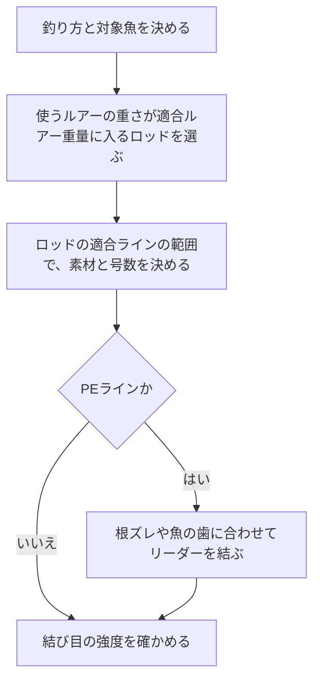

# はじめに
ラインの号数とルアー重量の関係は、「1号＝4lb」「lb数＝投げられる上限のグラム数」のような換算ルールで語られることが多い。本記事では、こうしたルールを一次情報で確かめながら、号数・強度・ルアー重量の関係を整理する。

使った情報は次の4つである。

- 日本釣用品工業会（JAFTMA）の釣糸JAFS基準
- ライン各社の公表値
- 大手釣具メーカー2社のロッドの公式スペック表
- キャスト時の荷重を扱った論文と、簡単な力学計算

# 先に結論
- 号数は太さ（PEは重さ）の規格であり、強度の規格ではない。ナイロンとフロロカーボンの「1号＝4lb」は業界の目安である。PEは同じ号数でも、製品によって強度が大きく違う（1号で16〜22lb）。
- 投げられるルアー重量を決めるのは、ラインではなくロッドに表示された適合ルアー重量である。ラインも、ロッドの適合ラインの範囲から選ぶ。
- ロッドの公式スペックで比べると、「ナイロン・フロロのlb数＝上限のグラム数」はトラウトやバスでは近い。ライトゲームやロックフィッシュでは、上限のグラム数がlb数の2〜3倍になる。
- 「PE号数×25〜30＝上限のグラム数」は、シーバスロッドやショアジギングロッドのメタルジグの上限には近い。トラウトやバスのロッドでは、倍率は4〜18倍にとどまる。
- 通常のキャストでラインにかかる力は、ルアー重量の数倍から数十倍程度である。ラインの強度にはそれよりはるかに大きな余裕がある。この余裕は、リリースの失敗、結び目、傷、魚とのやり取りに備えるためのものである。

# 号数は太さの規格である
## ナイロン・フロロカーボン
釣糸JAFS基準（JAFS-D1051100）は、ナイロン糸・フロロカーボン糸・ポリエステル糸の号数ごとに標準直径を定めている。強度については「各企業の裁量に委ねる」とあり、号数と強度の対応は規格にない。

| 号数 | 標準直径（mm） | 公表されているlb表示の例 |
| --- | --- | --- |
| 0.6 | 0.128 | 2 |
| 0.8 | 0.148 | 3 |
| 1 | 0.165 | 4 |
| 1.5 | 0.205 | 6 |
| 2 | 0.235 | 8 |
| 2.5 | 0.260 | 10 |
| 3 | 0.285 | 12 |
| 4 | 0.330 | 16 |

ラインメーカーも、ナイロンやフロロカーボンは「おおよそ1号＝4lb」と説明している。号数とlbの換算表に、製品やメーカーで異なる場合がある目安だと注記する例もある。

lbの表示にも2種類ある。表示のlb以下で切れるIGFA規格のラインと、表示の数値では切れないLB.OVER表示のラインを分けているメーカーもある。同じ「4lb」でも、実際に切れる強さは製品によって違う。

## PE
PEの号数は太さではなく重さで決まる。釣糸JAFS基準（JAFS-D1011002）は、PE糸を9,000mあたりの質量（デニール）で表し、1号＝200デニール（9,000mで200g）としている。直径は定めていない。

同じ号数でも強度は製品で違う。次の表は、ラインメーカーが公表している3製品の号数ごとのlb表示である。

| 号数 | JAFS標準値（デニール） | 4本組の製品 | 8本組の製品A | 8本組の製品B |
| --- | --- | --- | --- | --- |
| 0.3 | 60 | 5 | 8 | - |
| 0.4 | 80 | 6 | 10 | - |
| 0.6 | 120 | 10 | 14 | 14 |
| 0.8 | 160 | 12 | 18 | 16 |
| 1 | 200 | 16 | 21 | 22 |
| 1.2 | 240 | 20 | 26 | 25 |
| 1.5 | 300 | 25 | 32 | 30 |
| 2 | 400 | 35 | 38 | 40 |

1号で比べると16〜22lbと、3割以上の差がある。PEの強度を同じ号数のナイロンの2.5〜3倍とするメーカーの説明もある。

# 投げられるルアー重量はロッドが決める
ロッドの仕様には、適合ルアー重量と適合ラインが書かれている。釣具メーカーは、重すぎるルアーはロッドがぶれ、太すぎるラインは糸抜けが悪くなるとして、ロッドとの不一致をライントラブルの原因に挙げている。

ラインの号数だけでは、投げられるルアー重量は決まらない。大手釣具メーカー2社の14シリーズ70機種の公式スペック（2026年11月1日時点）から、適合ルアー重量の上限（グラム）を適合ラインの上限（lbまたはPE号数）で割って比べた。この値を倍率と呼ぶ。代表的な例は次のとおりである。

| 釣り | パワー表記 | 適合ルアー（グラム） | ナイロン・フロロ（lb） | PE（号） | 倍率（対lb） | 倍率（対PE号） |
| --- | --- | --- | --- | --- | --- | --- |
| アジング・メバリング | UL | 0.5〜5 | 1〜4 | 0.1〜0.4 | 1.3 | 12.5 |
| アジング・メバリング | L | 0.6〜12 | 1.5〜4 | 0.1〜0.6 | 3.0 | 20 |
| エリアトラウト | UL | 0.4〜3 | 1.5〜3 | 0.15〜0.3 | 1.0 | 10 |
| エリアトラウト | MH | 2〜10 | 2〜8 | 0.3〜0.6 | 1.3 | 17 |
| バス | L | 3〜10 | 3〜6 | 最大1 | 1.7 | 10 |
| バス | M | 7〜21 | 8〜16 | 最大3 | 1.3 | 7 |
| バス | H | 14〜42 | 12〜25 | 最大5 | 1.7 | 8 |
| ロックフィッシュ | MH | 8〜32 | 6〜12 | 最大1.5 | 2.7 | 21 |
| シーバス | L | 5〜28 | - | 0.5〜1.2 | - | 23 |
| シーバス | M | 10〜50 | - | 0.8〜2.0 | - | 25 |
| ショアジギング | M | ジグ最大60、プラグ最大45 | - | 最大2.5 | - | ジグ24、プラグ18 |
| ショアジギング | H | ジグ最大100、プラグ最大85 | - | 最大4 | - | ジグ25、プラグ21 |

70機種の倍率を釣りごとにまとめると次のようになる。今回集めたシーバスとショアジギングのロッドには、ナイロン・フロロの適合ラインが書かれていない。

| 釣り | 倍率（対lb） | 倍率（対PE号） |
| --- | --- | --- |
| ライトゲーム | 1.2〜3.0 | 10〜25 |
| エリア・渓流トラウト | 0.8〜1.3 | 7.5〜18 |
| バス（ビッグベイト用を除く） | 0.9〜1.8 | 4〜11 |
| ロックフィッシュ | 1.5〜2.7 | 15〜21 |
| シーバス（ビッグベイト用を除く） | - | 19〜25 |
| ショアジギング | - | ジグ24〜30、プラグなど18〜25 |

よく見かける換算ルールと照らし合わせると、次のことがわかる。

- 「ナイロン・フロロのlb数＝上限のグラム数」は、トラウトとバスではおおむね合う。ライトゲームとロックフィッシュでは、上限のグラム数がlb数の2〜3倍まで広がる。
- 「PE号数×25〜30＝上限のグラム数」は、ショアジギングロッドのメタルジグの上限とおおむね合う。プラグの上限は号数の約20倍で、トラウトやバスのロッドでは4〜18倍にとどまる。

## パワー表記は共通の規格ではない
UL・L・ML・M・MH・Hといったパワー表記に、メーカー共通の定義は見当たらなかった。同じ表記でも、シリーズによって適合ルアー重量は大きく違う。

- MLの上限は、あるエリアトラウトロッドでは5g、あるショアジギングロッドではメタルジグ50gである。
- Lでも、あるバスロッドは3〜10g、あるエリアトラウトロッドは0.6〜4gである。

パワー表記はシリーズ内での相対的な強さとして読み、ルアー重量はスペック表の数値で確かめる。

# キャスト時にラインにかかる力
## 主な荷重は遠心力
渡邉らの研究（2008年、日本機械学会論文集）は、全長152.4cmのウルトラライトのロッドと4lbのラインでキャストを実験し、数値シミュレーションと比べている。この研究では、ルアーにかかる荷重は主に遠心力で、ルアーが重いほど、リリースが遅いほど大きくなる。

## 簡単な見積もり
キャスト時の荷重の大きさは、次の単純なモデルで見積もれる。

- ルアーは、ロッドの長さとタラシを合わせた半径`r`の円を描いて加速し、速さ`v`でリリースされる。
- リリース直前にラインが引く力は、遠心力`m×v²÷r`（`m`はルアーの質量）とみなす。
- 空気抵抗を無視して45度で投げると、飛距離`R`は`v²÷g`（`g`は重力加速度）になる。

この3つから、ラインにかかる力はルアー重量の`R÷r`倍以上になる。空気抵抗がある実際のキャストでは、同じ距離を飛ばすためにより速い初速が必要なので、荷重はこれより大きくなる。

| 飛距離 | 必要な初速（下限） | 回転半径 | 荷重とルアー重量の比（下限） |
| --- | --- | --- | --- |
| 15m | 約12m/s | 2m | 約8倍 |
| 30m | 約17m/s | 2.5m | 約12倍 |
| 60m | 約24m/s | 3m | 約20倍 |
| 90m | 約30m/s | 3.5m | 約26倍 |

渡邉らの実験は体育館で目標距離を15mとしたもので、ルアーの平均速度は11m/sだった。半径2mとすると荷重はルアー重量の約6倍で、上の見積もりと同じ桁に収まる。

この見積もりでは、5gのルアーを30m投げるときの荷重は約60gfである。4lb（約1.8kgf）のラインと比べると、約30倍の余裕がある。

## リリースに失敗したとき
ルアーをリリースしそこねると、荷重は通常のキャストより大きくなる。渡邉らは、ルアーをリリースしない場合の最大荷重をシミュレーションしている。4lb（17.8N）のラインに安全率3を見込むと許容荷重は約6Nで、これに達するのはルアー重量が約10gのときだった。

6Nは10gのルアーの重さの約60倍にあたる。論文はこの結果から、4lbのラインならルアー重量は10g以下がよいとしている。

## 結び目で強度は落ちる
ラインは結んだところで弱くなる。メーカーの公表値は次のとおりで、PEは結び方によって強度が半分以下になる。

| 素材 | 比重 | 結節強度（メーカーA） | 結節強度（メーカーB） | 伸度（メーカーB） |
| --- | --- | --- | --- | --- |
| ナイロン | 1.14 | 直線強力の約85% | 80〜90% | 20〜40% |
| フロロカーボン | 1.78 | 直線強力の約70% | 70〜80% | 23〜30% |
| PE | 0.97 | 直線強力の約40% | 40〜90% | 3〜8% |

メーカーBの値は、いずれも結び方によって変わる幅である。ナイロンとフロロカーボンは1〜3割の低下が目安になるが、PEは結び方の影響がずっと大きい。

## 傷と擦れ
PEは細い繊維を編んだ糸なので、擦れや摩擦熱で1本が切れると、そこからライン全体の破断につながるおそれがある。PEの先にフロロカーボンやナイロンのショックリーダーを結ぶのは、根ズレや歯ズレへの弱さを補うためである。いずれもラインメーカーの説明による。

英国の釣具メーカーには、重いオモリを投げるサーフキャスティングの目安として「1オンス（約28g）につきリーダー10lb」を挙げる例がある。重さに対する強度の比は約160倍で、ここでも通常のキャストの荷重よりはるかに大きな余裕を取っている。

ラインの強度に余裕が必要なのは、キャストそのものより、リリースの失敗・結び目・傷・魚とのやり取りに備えるためである。

# ロッドの硬さとラインの太さ
硬いロッドほど太いラインを使うのは、主に、硬いロッドほど重いルアーと強い魚を相手にするからである。シリーズ内で比べると、パワーが上がるほど適合ルアー重量と適合ラインの両方が上がる。たとえばあるバスロッドのシリーズでは、Lが3〜10g・3〜6lb、Hが14〜42g・12〜25lbである。

柔らかいロッドはばねとして働くので、リリースの失敗や根掛かりのような急な衝撃をやわらげる方向に働くと考えられる。ただし、ロッドの硬さとラインにかかる荷重の関係を数値で示したメーカーの公表データは見つからなかった。

# PEラインが太すぎるとき
PEラインは比重が0.97で水より軽い。ラインメーカーも、PEは水に浮きやすく風や潮の影響を受けやすいとしている。

ただし、浮力そのものは小さい。PE1号は1mあたり約0.022gで、海水の比重を1.025とすると、10mを沈めても浮力と重さの差は約0.013gfにとどまる。影響が大きいのは太さによる抵抗である。太いラインほど、空気中では風を、水中では潮を受けやすい。その結果、飛距離が落ち、糸ふけが大きくなり、ルアーが沈みにくくなる。

軽いルアーを太いPEで使うと、浮力ではなく抵抗のために、飛ばない・沈まない・底が取りにくいといった問題が起きる。芯に高比重の繊維を入れて比重を1.48にした、沈むPEラインもある。

# ラインの選び方
ラインは次の順で選ぶと迷いにくい。

号数を決めるときは、次のように考える。

- 根ズレが多い場所や大きな魚を狙うときは、適合ラインの範囲で太めを選ぶ。
- 飛距離や軽いルアーの扱いやすさを優先するときは、範囲内で細めを選ぶ。
- PEは同じ号数でも製品で強度が違うので、号数ではなくlbやkgの表示で比べる。

# まとめ
- 号数は太さ（PEは重さ）の規格で、強度は各社の表示で確かめる。ナイロンとフロロカーボンの「1号＝4lb」は目安である。
- 投げられるルアー重量は、ロッドの適合ルアー重量で決まる。ラインはロッドの適合ラインの範囲から選ぶ。
- 「lb数＝上限のグラム数」はトラウトとバスのロッドで、「PE号数×25〜30」はショアジギングロッドのメタルジグで、おおむね合う。ほかの釣りでは倍率がずれる。
- 通常のキャストの荷重はルアー重量の数倍から数十倍で、ラインの強度の余裕は、リリースの失敗・結び目・傷・魚とのやり取りに備えるためのものである。
- 太いPEで軽いルアーが扱いにくいのは、浮力よりも、太さによる風や潮の抵抗が主な原因である。

# 関連記事
- [スピニングリールのキャスティング入門](/ja/posts/spinning-reel-casting-guide/)
- [ロックフィッシュ実釣ガイド](/ja/posts/rockfish-worm-field-guide/)

# 参考
- [jaftma.or.jp - 釣糸JAFS基準](https://www.jaftma.or.jp/service/standard/index02.html)
- [jaftma.or.jp - ナイロン糸・フロロカーボン糸・ポリエステル糸の標準直径（JAFS-D1051100）](https://www.jaftma.or.jp/service/images/nylon.pdf)
- [jaftma.or.jp - PE糸の太さ標準規格（JAFS-D1011002）](https://www.jaftma.or.jp/service/images/pe.pdf)
- [varivas.co.jp - ラインの素材別の特性と号数・lbの説明](https://www.varivas.co.jp/contents/line/)
- [fishing.sunline.co.jp - ラインの素材ごとの比重と結節強度](https://fishing.sunline.co.jp/material/)
- [fishing.sunline.co.jp - フロロカーボンラインの号数とlb表示](https://fishing.sunline.co.jp/line/29146/)
- [fishing.sunline.co.jp - 4本組PEラインの号数とlb表示](https://fishing.sunline.co.jp/line/30531/)
- [fishing.sunline.co.jp - 8本組PEラインの号数とlb表示](https://fishing.sunline.co.jp/line/30936/)
- [xbraidygk.jp - 8本組PEラインの号数とlb表示](https://xbraidygk.jp/products/upgradex8/)
- [daiwa.com - 単位換算表](https://www.daiwa.com/jp/beginner/conversion/)
- [fish.shimano.com - アジング・メバリングロッドのスペック表](https://fish.shimano.com/ja-JP/product/rod/lightsalt/a075f00003xgh7lqaq.html)
- [fish.shimano.com - バスロッドのスペック表](https://fish.shimano.com/ja-JP/product/rod/bass/shimano/a075f00003yfzrsqam.html)
- [fish.shimano.com - ロックフィッシュロッドのスペック表](https://fish.shimano.com/ja-JP/product/rod/shoresalt/rockfish/a075f00003xgoslqae.html)
- [fish.shimano.com - ショアジギングロッドのスペック表](https://fish.shimano.com/ja-JP/product/rod/shoresalt/shorejigging/a075f00003e2chxqay_p.html)
- [daiwa.com - エリアトラウトロッドのスペック表](https://www.daiwa.com/jp/product/ngp6a8l)
- [daiwa.com - シーバスロッドのスペック表](https://www.daiwa.com/jp/product/ye9mr5u)
- [fish.shimano.com - スピニングリールのキャスティングとライントラブル対策](https://fish.shimano.com/ja-JP/content/fishingstyle/article/2026/260430/index.html)
- [渡邉鉄也, 笠井泰明, 田中基八郎「ルアーキャスティングの力学（ルアー重量の影響）」日本機械学会論文集C編 74巻742号, 2008](https://doi.org/10.1299/kikaic.74.1445)
- [tronixpro.com - サーフキャスティングのショックリーダーの解説（英語）](https://tronixpro.com/understanding-surf-shock-leaders)

