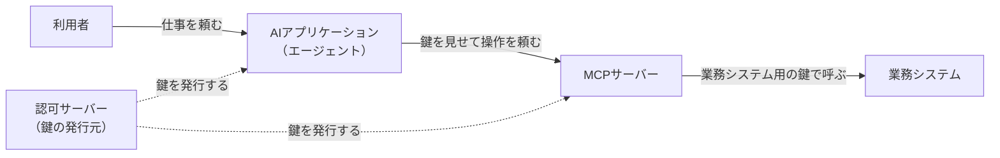

# 概要

MCP（Model Context Protocol）は、AIアプリケーションを社内のシステムや外部のサービスにつなぐための標準である。MCPを使うと、AIエージェントが利用者の代わりに業務データを読んだり書き換えたりできるようになる。

便利な反面、AIに何をどこまで任せるかという認可の設計を誤ると、事故につながる。AIが意図しないデータを消したり、盗まれた鍵で別のシステムまで入られたりする。

この記事は、MCPを使う機能を企画したり導入を判断したりする人に向けて、次の点を整理する。マネージャーやPMにも伝わるように、仕様の細部には立ち入らない。

- なぜMCPの認可は難しいのか
- どんな事故が起きうるのか
- 最初に決めることと、後でよいこと
- チームに確かめる問い

仕様は、2026年10月時点の現行版である2026-07-28版にもとづく。実装の詳細は、原文と関連記事を参照してほしい。

# MCPで何が起きているか

社内の業務システムの前にMCPサーバーを置き、社員がAIアプリケーションから業務データを扱う場面を考える。

利用者がAIに仕事を頼むと、AIは利用者の代わりにMCPサーバーを呼ぶ。このとき、AIは「トークン」と呼ばれる一時的な鍵を見せる。MCPサーバーは鍵を確かめてから、業務システムを操作する。

認可とは、この流れの中で「誰に、何を、どこまで許すか」を決めることである。

# なぜMCPの認可は難しいのか

## 1. 誰の権限で動いているのかが見えにくい

AIは利用者の代わりに動く。記録に利用者しか残らないと、AIの誤りと利用者の意図を見分けられない。事故が起きたときに、原因と責任を切り分けられない。

## 2. AIは間違えるし、だまされる

AIは指示を取り違えることがある。さらに、読んだメールやWebページに埋め込まれた指示を、そのまま実行してしまうこともある（プロンプトインジェクション）。このときの操作は正規の鍵で行われるので、ログインの仕組みでは止められない。AIは操られうるという前提で、任せる範囲を絞る必要がある。

## 3. 鍵が使い回されやすい

MCPサーバーが受け取った鍵を、そのまま裏の業務システムにも渡す作りは手軽である。しかし、1本の鍵で複数のシステムに入れると、盗まれたときの被害も広がる。MCPの仕様は、この使い回しを禁じている。

## 4. 仕様が守ってくれる範囲は狭い

MCPの認可の仕様が決めるのは、主に「MCPサーバーに入る鍵をどう受け取り、どう確かめるか」である。「このAIが、この利用者の代わりに、このデータを操作してよいか」の判断の仕方は決めていない。仕様は、サーバーがアクセス制御をしなければならない（MUST）と定めるだけで、判断の仕組みは各チームが作る。

| 問い | MCPの認可の仕様で足りるか |
|---|---|
| 利用者は本人か | 範囲外。社内のログインの仕組みに任せる |
| どのAIに、どのMCPサーバーへのアクセスを任せたか | 仕様の中心 |
| このAIが、このデータを操作してよいか | 判断の方法は決めていない。各チームで作る |
| どのAIにどの機能を使わせるかを、誰が決めて見直すか | 範囲外 |
| 高リスクの操作に人の承認を挟むか | 専用の仕組みはない |

# 起きうる事故

「動けばよい」で作ったときに起きうる事故と、その防ぎ方をまとめる。

| 起きうる事故 | 影響 | 防ぎ方 |
|---|---|---|
| 盗まれた鍵で、MCPサーバーの裏の業務システムにまで入られる | 1つの漏えいが、複数のシステムに広がる | MCPサーバー宛ての鍵だけを受け入れ、業務システム用には別の鍵を取り直す |
| AIが、削除や外部への送信、他人のデータの参照をする | 情報漏えいやデータの消失 | 権限を最小にし、操作ごとに許すかを判断する。高リスクの操作は人が確認する |
| パスワードや鍵が、AIとの会話ログに混ざって漏れる | 鍵の漏えい | 鍵はシステムの側で持ち、AIに見せない |
| 事故の後に「誰が、どのAI経由で、何をしたか」を追えない | 原因の調査や監査ができない | 利用者とAIを分けて記録する |
| 退職や異動が、AIの権限に反映されない | 辞めた人の権限でAIが動き続ける | 鍵の有効期限を短くし、止める手段を用意する |

# 最初に決めることと、後でよいこと

すべてを最初に作る必要はない。ただし、後から変えるとコストが大きいものは最初に決める。

| 区分 | 項目 | 理由 |
|---|---|---|
| 最初に決める | 鍵の発行元を、MCPサーバーごとに作らず社内の認証基盤に寄せる | 発行元が分かれると、退職や権限の変更をすべてに反映させる必要が出る |
| 最初に決める | 鍵を使い回さず、宛先ごとに分ける | 後から分けると、すべての接続の設定を直すことになる |
| 最初に決める | 権限を最小にし、必要になったら足す | 一度配った広い権限は、取り上げにくい |
| 最初に決める | 利用者とAIを分けて記録する | 後から記録を足しても、過去の操作は追えない |
| 最初に決める | 鍵の有効期限を短くし、止める手段を持つ | 長く使える鍵をばらまくと、回収できない |
| 後でよい | 判断のルールを外部の仕組みに切り出す、人の承認の流れ、権限の継続的な見直し | 判断を呼ぶ場所を1か所にまとめておけば、後から足せる |

後回しにするものは、理由と見直す条件を記録に残す。そうすれば、前に進みつつ、残した課題も見える状態を保てる。

# チームに確かめる問い

導入を判断するときは、次の問いにチームが答えられるかを確かめる。

1. AIが触れるシステムとデータは何か
2. AIは誰の権限で動くか。利用者より広い権限を持っていないか
3. 削除や送金のような高リスクの操作に、人の確認を挟んでいるか
4. 後から「誰が、どのAI経由で、何をしたか」を追えるか
5. 退職や異動のとき、AIの権限も止まるか

答えられない問いがあれば、そこが設計の抜けである。

# まとめ

- MCPの認可の仕様が守るのは、主に「MCPサーバーに入る鍵の受け渡し」である。AIにどのデータの操作を許すかは、各チームで作る。
- AIは間違えるし、だまされる。正規の鍵で動くので、ログインの仕組みでは止められない。任せる範囲を最小にする。
- 鍵を使い回さない、利用者とAIを分けて記録する、鍵を短命にして止められるようにする。この3つは後から直しにくいので、最初に決める。
- 導入を判断するときは、5つの問いにチームが答えられるかを確かめる。

# 関連記事

- [認可とは？認証との違いとIAMのサブドメインで見る全体像](/ja/posts/authorization-domain-iam-subdomains/)
- [認可のアーキテクチャとモデルとは？PEP/PDP・RBAC/ABAC/ReBAC・ポリシーエンジンの選び方](/ja/posts/authorization-architecture-models-engines/)
- [AuthZEN Authorization APIとは？PEPとPDPをつなぐ認可判定の標準](/ja/posts/authzen-authorization-api/)
- [認可基盤に必要なOAuth関連標準とは？委譲・トークン・継続評価の地図](/ja/posts/oauth-standards-map-authorization-platform/)
- [AIエージェントの認可とは？委譲の連鎖・人の承認・監査をMCP、AuthZEN、AIMS、A2A/AP2で整理する](/ja/posts/authorization-for-ai-agents/)
- [OAuth 2.1とは？OAuth 2.0からの変更点とSecurity BCP（RFC 9700）](/ja/posts/oauth-2-1-security-bcp/)
- [送信者制約トークンとは？mTLS（RFC 8705）とDPoP（RFC 9449）入門](/ja/posts/sender-constrained-tokens-mtls-dpop/)
- [動的クライアント登録（DCR）とは？RFC 7591・7592入門](/ja/posts/dynamic-client-registration/)
- [OpenID ConnectのDiscoveryとメタデータとは？自動設定と鍵取得の仕組み](/ja/posts/oidc-discovery-metadata/)
- [サービス間認証の全体像とは？mTLS・Token Exchange・SPIFFE・ゼロトラスト](/ja/posts/service-to-service-authentication/)
- [アクセストークンの検証と失効とは？Introspection・JWT AT・Revocation](/ja/posts/access-token-validation-revocation/)

# 参考リンク

- [MCP Specification 2026-07-28](https://modelcontextprotocol.io/specification/2026-07-28)
- [MCP Authorization（2026-07-28）](https://modelcontextprotocol.io/specification/2026-07-28/basic/authorization)
- [MCP Tools（2026-07-28）](https://modelcontextprotocol.io/specification/2026-07-28/server/tools)
- [MCP Security Best Practices（2026-07-28）](https://modelcontextprotocol.io/docs/2026-07-28/tutorials/security/security_best_practices)
- [OWASP Top 10 for LLM Applications: LLM06 Excessive Agency](https://genai.owasp.org/llmrisk/llm062025-excessive-agency/)
