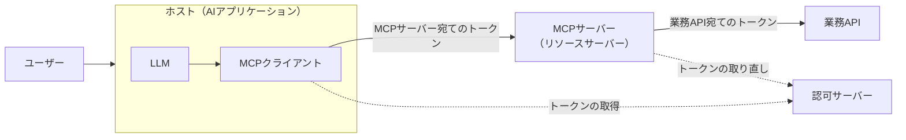
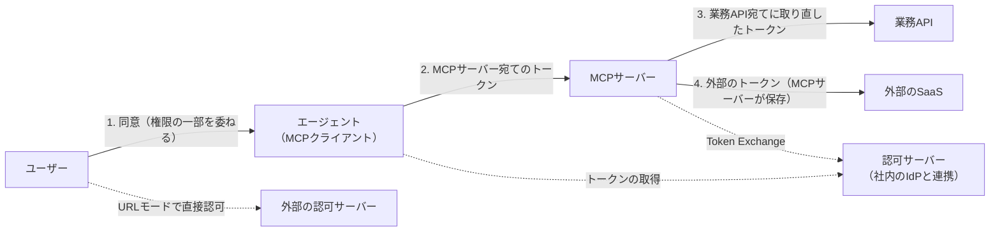
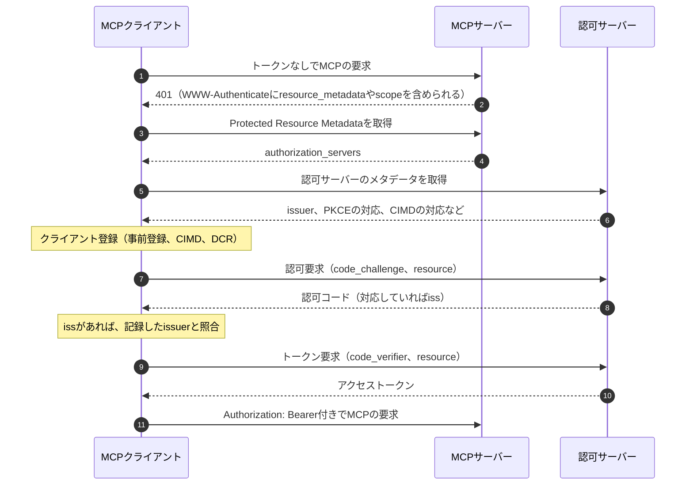

# 概要

MCP（Model Context Protocol）は、AIアプリケーションを外部のツールやデータにつなぐためのオープンな標準である。社内の業務APIの前にMCPサーバーを置くと、エージェントがユーザーの代わりに業務データを読み書きできるようになる。便利な反面、認可の設計を誤ると、エージェントがユーザーの意図しない操作をしたり、盗まれたトークンで別のAPIまで叩かれたりする。

MCPには、OAuth 2.1（IETFで策定中のDraft）を土台にした認可の仕様がある。ただし、仕様が決めているのは主に「MCPサーバー宛てのトークンを得て、検証する」部分である。「このユーザーのこのエージェントが、このtoolを、このデータに対して実行してよいか」という判定は、自分たちで設計する必要がある。

この記事は、MCPサーバーやMCPクライアントに認可を実装するチームに向けて、次のことを整理する。

- 「動くだけの実装」で起きうる事故と、その典型的な原因
- MCPの認可仕様が決めることと、自分たちで設計すること
- ホップごとに「誰の権限で動いているか」の整理
- 後から変えるとコストが大きい判断
- 今やることと後でよいことの線の引き方
- 仕様の主な要件の一覧

参照する仕様は、2026年10月時点の現行版（Current）である2026-07-28版である。MCPの仕様は改訂が続いているので、採用する版を決めて原文で確かめてほしい。AIエージェントの認可の全体像（AuthZENの新しいDraft（AARP、COAZ）や委譲の拡張など）は[AIエージェントの認可](/ja/posts/authorization-for-ai-agents/)で扱っている。

# まず構成を一枚の図にする

設計の議論を始める前に、今作っているもの（または作ろうとしているもの）の構成を一枚の図にする。図に書くのは次の3つである。

- 登場人物: ユーザー、ホスト（AIアプリケーション）とMCPクライアント、MCPサーバー、裏の業務API、認可サーバー
- トークンの流れ: 誰が、どこから、何宛てのトークンを受け取り、どこに渡しているか
- 権限の持ち方: どのスコープを、どの寿命で、どこに保存しているか

MCPの仕様では、ホストが複数のMCPクライアントを持ち、各クライアントは1つのMCPサーバーとだけ通信する。認可の仕様の上では、MCPサーバーはOAuth 2.1のリソースサーバー、MCPクライアントはOAuth 2.1のクライアントとして振る舞う。

この図に、後で述べる事故の一覧と「誰の権限か」の整理を当てはめると、自分たちの構成の具体的な問題が見えてくる。

# 起きうる事故

まず「機能が動くだけの実装」で起きることを、自分たちのユースケースに当てはめて確認する。

| 起きうること | 典型的な原因 | 主な対策 |
|---|---|---|
| MCPサーバーが受け取ったトークンを、そのまま裏のAPIに渡す。トークンを盗めば別のAPIも叩ける | トークンの宛先（audience）を検証しない。トークンをそのまま中継する（token passthrough） | 自分宛てのトークンだけを受け入れ、裏のAPI宛てには取り直す |
| 第三者のAPIにつなぐMCPサーバー経由で、ユーザーの同意なしに認可コードを奪われる | 固定のclient IDで第三者の認可サーバーにつなぐプロキシが、クライアントごとの同意を取らない（confused deputy） | クライアントごとに同意を記録し、同意画面を出す |
| エージェントが、削除や送信、他人のデータの参照など、ユーザーの意図しない操作をする | スコープが広すぎる。プロンプトインジェクションで正規の権限が悪用される | 最小のスコープと段階的な取得、toolごとのアクセス判定、人の確認 |
| 資格情報がプロンプトや会話ログに混ざって漏れる | LLMのコンテキストにAPIキーやトークンを載せている | 資格情報はホストやMCPサーバーが持ち、LLMに見せない |
| 後から「誰が、どのエージェント経由で、何をしたか」を追えない | ユーザーとエージェントを区別して記録していない | ユーザー、エージェント、tool、対象、結果を分けて記録する |
| 退職や権限の変更が、エージェントの権限に反映されない | 長命のトークン、静的なAPIキー、失効の仕組みがない | 短命のトークンと失効の手段を用意する |
| 他人の状態（カートやワークフロー）を操作される | 状態のハンドルを持っていることを認証とみなす | ハンドルを検証済みのユーザーに結び付け、要求ごとに確かめる |

以下、MCPに特有の論点が大きいものを補足する。

## トークンの中継（token passthrough）

MCPのSecurity Best Practicesは、token passthroughを次のように定義している。MCPサーバーが、自分宛てに発行されたかを検証せずにトークンを受け入れ、そのまま裏のAPIに渡すアンチパターンである。認可仕様もこれを明示的に禁じている。

中継が危ないのは、トークンが盗まれたときの被害だけではない。Best Practicesは次のリスクを挙げている。

- MCPサーバーや裏のAPIが、トークンの宛先を前提に実装したレート制限や検査を迂回される
- 裏のAPI向けに発行されたトークンで呼ばれると、MCPサーバーはクライアントを見分けられない。裏のAPIのログには、実際とは違う送り手が残る。インシデントの調査や監査が難しくなる
- 1つのトークンを複数のサービスが適切な検証なしに受け入れると、1つのサービスを破られただけで、つながった他のサービスにも入られる
- 今は「ただのプロキシ」でも、後で制御を足すことはありうる。最初から宛先を分けておくと、セキュリティの仕組みを育てやすい

最後の点は、ほかの3つと違い、今の被害ではなく将来の拡張に関わる。宛先を分けておくことは、今の安全のためだけでなく、後から制御を足せる余地を残すためでもある。

## confused deputy

confused deputyは、MCPサーバーが第三者のAPIへのプロキシとして動く構成で起きうる。Best Practicesは、次の条件がすべてそろうと攻撃が成り立つとしている。

- MCPサーバーが、第三者の認可サーバーに対して1つの固定のclient IDを使う
- MCPサーバーが、MCPクライアントに動的な登録を許す
- 第三者の認可サーバーが、最初の認可の後に同意のcookieを設定する
- MCPサーバーが、クライアントごとの同意を取らずに第三者の認可サーバーへ転送する

このとき、攻撃者が悪意のあるクライアントを登録してユーザーにリンクを踏ませる。同意のcookieが残っているので同意画面は出ず、認可コードは攻撃者のリダイレクト先に送られる。

対策として、固定のclient IDを使うMCPプロキシは、動的に登録されたクライアントごとにユーザーの同意を得てから第三者へ転送しなければならない（MUST）。Best Practicesは、ユーザーごとに承認済みの`client_id`を記録すること、同意画面にクライアント名とスコープとリダイレクト先を示すこと、`redirect_uri`を完全一致で検証することなどを求めている（MUST）。

## 過剰なスコープと、スコープだけに頼る判定

Best PracticesのScope Minimizationは、広いスコープ（`files:*`、`admin:*`など）をまとめて取ったトークンが漏れる場面を挙げている。よくある誤りとして、次のものが並んでいる。

- `scopes_supported`に、ありうるすべてのスコープを載せる
- `*`、`all`、`full-access`のような万能のスコープを使う
- 将来の確認を避けるために、無関係な権限を束ねる
- トークンのスコープだけで足りるとし、サーバー側の認可のロジックを持たない

最後の誤りは、次の節で扱う「仕様が決めないこと」に直結する。

## LLMのコンテキストに資格情報を載せる

APIキーやトークンをLLMのコンテキストに入れると、会話ログやプロンプトから漏れるおそれがある。プロンプトインジェクションでモデルに資格情報を出力させる攻撃も成り立つ。資格情報はMCPクライアント（ホスト）やMCPサーバーが持ち、モデルには見せない。

MCPの仕様にも、この考え方が表れている。Elicitation（サーバーがユーザーに入力を求める仕組み）のフォームモードでは、パスワード、APIキー、アクセストークンを求めてはならない。外部のサービスのOAuthにはURLモードを使い、外部の資格情報がMCPクライアントを通らないようにする。

## 誰がやったかを追えない

エージェントが動いた記録にユーザーのIDしか残っていないと、本人の操作とエージェントの操作を見分けられない。MCPのtoolsの仕様は、監査のためにtoolの利用を記録するよう（SHOULD）クライアントに求めている。ただし、ユーザーとエージェントを区別する標準の方法は定めていない。この点は後の節で扱う。

# MCPの認可仕様が決めることと、決めないこと

「OAuthを入れたら認可は終わり」ではない。IAMのサブドメインで見ると、責務の抜けが見える。サブドメイン（アイデンティティ、認証、委譲、アクセス判定、アクセスガバナンス）は[認可とは何か](/ja/posts/authorization-domain-iam-subdomains/)で整理した。

| 問い | サブドメイン | MCPの認可仕様で足りるか |
|---|---|---|
| ユーザーは本人か | 認証 | 範囲外。既存のIdPに任せる |
| どのクライアントに、どのMCPサーバーへのアクセスを、どこまで委ねたか | 委譲（OAuth、スコープ、宛先） | 仕様の中心 |
| このtoolを、このデータに対して実行してよいか | アクセス判定 | アクセス制御の実装を求める（MUST）が、判定の方法は決めない。自分たちで設計する |
| どのエージェントにどのtoolを使わせるかを誰が決め、見直すか | アクセスガバナンス | 範囲外 |
| 高リスクの操作に人の承認を挟むか | アクセス判定とガバナンス | ホストの画面についてのSHOULDがあるだけで、承認のための専用の仕組みはない。サーバーがElicitationで確認を求めることはできる |

仕様はアクセス判定を無視しているわけではない。toolsの仕様は、サーバーが適切なアクセス制御を実装しなければならない（MUST）と書く。キャッシュの仕様も、`cacheScope`だけに頼らず、プリミティブ（toolやリソースなど）ごとのアクセス制御をかけなければならないと書く。ただし、どう判定するかは決めていない。そこが自分たちの設計の範囲である。

## toolとデータへのアクセス判定を設計する

アクセス判定では、少なくとも次の入力を使う。

- 主体: 検証済みのトークンから得たユーザー（`sub`）とクライアント（`client_id`）
- 操作: MCPのメソッドとtoolの名前（`tools/call`の`execute_sql`など）
- 対象: toolの引数が指すデータ（テナント、レコード、ファイル）
- 文脈: スコープ、時刻、操作のリスクの高さ

スコープは「このMCPサーバーのこの種類の機能を使ってよい」という粗い上限として使い、個々のデータへの判定はサーバー側で行う。2026-07-28版では、`tools/list`の結果が要求に付いた認可によって変わってよいと明記された。たとえば、付与されたスコープで許されるtoolだけを返せる。見せるtoolを絞ると、LLMが誤って危険なtoolを選ぶ機会も減る。ただし、一覧に出さないことは判定の代わりにならない。`tools/call`のたびに判定する。

判定を置く場所には、主に次の3つがある。

| 置き場所 | 向いている場面 | 注意点 |
|---|---|---|
| MCPサーバーのコードに直接書く | MCPサーバーが少なく、ポリシーが単純 | ポリシーを変えるたびに、すべてのMCPサーバーを改修する |
| MCPサーバーの前のゲートウェイ（PEP） | tool単位の許可やテナントごとの制御を一か所でかけたい | 引数の中身を見るには、本文を解析するか、サーバーが`x-mcp-header`で指定してクライアントがヘッダに写した引数を使う |
| 外部の判定サービス（PDP）に問い合わせる | MCPサーバーが多く、ポリシーを横断で管理したい | 判定のAPIと、判定に使う属性の設計が要る |

2026-07-28版のStreamable HTTPでは、すべての要求に`Mcp-Method`ヘッダが必須（REQUIRED）になった。`tools/call`などの要求には`Mcp-Name`ヘッダも必須である。ゲートウェイは本文を解析せずに「どのメソッドの、どのtoolか」を知り、tool単位の制御をかけられる。本文を処理するサーバーは、ヘッダと本文の値の一致を検証し、違う場合は拒否しなければならない。ヘッダで判定するゲートウェイは、`MCP-Protocol-Version`がこの照合を求める版かを確かめ、そうでなければ要求を拒否すべきである（SHOULD）。

判定を外部化するなら、PEPとPDPをつなぐ標準としてAuthZENの[Authorization API](/ja/posts/authzen-authorization-api/)がある。AuthZENには、MCPの要求を判定の要求に写すバインディング（COAZ-MCP）のDraftもある。COAZ-MCPの表記はDraft 1（2026-02-13付）のままだが、編集中の版には2026-07-28版に合わせた変更も入り始めている（`initialize`の対応付けの削除など）。採用するときは、前提にしているMCPの版を確かめる必要がある。PEPとPDPの分け方は[認可のアーキテクチャ](/ja/posts/authorization-architecture-models-engines/)で扱っている。

## 識別子は権限ではない

2026-07-28版でプロトコルのセッションがなくなった。呼び出しをまたぐ状態は、サーバーが発行したハンドルをtoolの引数で受け渡す形になる。仕様は、利用者を認証するサーバーにとってハンドルは名前であって権限ではないと書く。Best Practicesも、ハンドルを持っていることを認証とみなしてはならない（MUST NOT）とする。そのうえで、ハンドルを検証済みのユーザーに結び付けて保存することを勧めている。たとえば`<user_id>:<handle>`の形で保存し、ユーザーIDは検証済みのトークンから取る。

同じ考え方は、ほかの値にも当てはまる。`clientInfo`（2026-07-28版では要求の`_meta`にある`io.modelcontextprotocol/clientInfo`）は自己申告である。仕様は、セキュリティの判断にこれを頼るべきでない（SHOULD NOT）と書く。toolのannotationsも、信頼できるサーバーから得たものでない限り、クライアントは信頼できないものとして扱わなければならない（MUST）。アクセス判定の入力に使う主体の情報は、検証済みのトークンから得たものに限る。

# 誰の権限で動いているかをホップごとに整理する

各ホップで「誰の権限で動いているか」をチームで共有する。ここが曖昧だと、トークンの中継や過剰な権限が起きる。

| ホップ | 誰の権限か | トークンの宛先 | 受け手がすること |
|---|---|---|---|
| 1. ユーザー → クライアント | ユーザーが、権限の一部をクライアントに委ねる | — | 認可サーバーが、同意画面でクライアントとスコープを示す |
| 2. クライアント → MCPサーバー | ユーザーの権限を、クライアントが代わりに使う | MCPサーバー（`resource`で指定） | MCPサーバーが宛先、期限、スコープを検証し、toolとデータへの判定をする |
| 3. MCPサーバー → 業務API | ユーザーの権限を、MCPサーバーが代わりに使う | 業務API | 業務APIが宛先を検証し、ユーザーと代理の主体を記録する |
| 4. MCPサーバー → 外部のSaaS | ユーザーが外部のサービスで直接与えた権限 | 外部のサービス | 外部のサービスが検証する |

## ホップごとにトークンを分ける

MCPサーバーが裏のAPIを呼ぶときは、受け取ったトークンを中継しない。仕様は、裏のAPIにはそのAPIの認可サーバーが発行した別のトークンを使うよう求めている。社内のAPIなら、Token Exchange（RFC 8693）で裏のAPI宛てに取り直すのが素直である。Token Exchangeの基本は[サービス間認証の全体像](/ja/posts/service-to-service-authentication/)で扱った。

外部のSaaSを呼ぶときは、MCPサーバーが外部のサービスのOAuthクライアントになる。仕様はこの場面にElicitationのURLモードを用意している。ユーザーはMCPクライアントを介さずにブラウザで外部のサービスを認可し、外部の資格情報はMCPクライアントを通らない。外部のトークンはMCPサーバーが保存して管理するので、MCPサーバーは状態を持つことになる。

このときサーバーは、Elicitationを始めたユーザーと、ブラウザで認可を終えたユーザーが同じかを確かめなければならない。確かめないと、攻撃者が自分の依頼で得たURLを被害者に踏ませ、被害者の外部のトークンを攻撃者のアカウントに結び付けられる。

## ユーザーとエージェントを区別する

トークンと記録の中で、ユーザー（`sub`）と、代わりに動いている主体（`act`）を分ける。Token Exchangeの`act`クレームは、委譲の連鎖を表すのに使える。監査ログには、少なくともユーザー、クライアント（エージェント）、tool、対象、結果を残す。

ただし、MCPの仕様にはユーザーとエージェントを区別する標準の方法がない。`clientInfo`は自己申告である。CIMDの`client_id`はクライアントのソフトウェアを表すもので、エージェントのインスタンスや多段の委譲は表さない。区別をどう持つかは、認可サーバーが発行するトークンの設計として自分たちで決める。エージェント向けの委譲の拡張は[AIエージェントの認可](/ja/posts/authorization-for-ai-agents/)で紹介している。

# 後から直せない判断

全部を今やる必要はない。ただし、後から変えるとコストが大きい判断だけは、最初に決めておく。

| 判断 | 後から直しにくい理由 |
|---|---|
| 認可サーバーをMCPサーバーごとに自作せず、社内の認証基盤に寄せる | 資格情報の正典が分かれると、統合が非常に重い |
| MCPサーバーごとの宛先（`resource`）の設計 | トークンの検証ロジックと、クライアントの設定に広がる |
| スコープの粒度 | 一度配ったスコープは変えにくい。細かい権限をトークンに詰め込まず、細かい判定は判定側に置く |
| 判定ロジックの置き場所 | 直書きすると、ポリシーを変えるたびにすべてのMCPサーバーを改修する |
| 監査ログの項目（ユーザー、エージェント、tool、対象、結果） | 後から足しても、過去の分は追えない |
| トークンの寿命と失効の手段 | 長命のトークンをばらまくと回収できない |

このうち4つを補足する。判定の置き場所と監査ログの項目は前の節で扱った。

- 認可サーバー: 仕様は、認可サーバーがMCPサーバーと同居してもよいとしている。ただしMCPサーバーごとに認可サーバーを作ると、権限の変更や退職をすべての認可サーバーに反映させる必要が出る。企業の中なら、社内のIdPに寄せる。その場合も、寄せる先の認可サーバーは、PKCEに対応してメタデータを公開し、MCPサーバーごとの宛先を持つトークンを発行できなければならない。公式の認可の拡張であるEnterprise-Managed Authorizationは、企業のIdPでMCPサーバーへのアクセスを一元管理する方式を定めている。
- 宛先: MCPクライアントは`resource`にMCPサーバーの正規のURIを入れる。仕様は、末尾のスラッシュに意味がある場合を除き、付けない形にそろえるよう勧めている。表記を最初にそろえておかないと、検証側とクライアントの設定の両方を直すことになる。
- スコープ: 2026-07-28版は、最小の初期スコープと、`insufficient_scope`による段階的な取得（step-up）を前提にしている。スコープを「機能の種類と読み書き」程度の粗さに保ち、データ単位の判定を判定側に置けば、スコープを増やさずにポリシーを変えられる。トークンの粒度と判定の分担は[認可基盤のアーキテクチャと設計判断](/ja/posts/authorization-platform-architecture-decisions/)でも扱う。
- 寿命と失効: 仕様は、認可サーバーが短命のアクセストークンを発行すべき（SHOULD）とし、公開クライアントのリフレッシュトークンの回転を求める（MUST）。検証と失効の選択肢は[アクセストークンの検証と失効](/ja/posts/access-token-validation-revocation/)で整理した。盗まれたトークンの悪用を防ぐなら、[mTLSやDPoPによる送信者制約](/ja/posts/sender-constrained-tokens-mtls-dpop/)も選択肢になる。ただしMCPの認可仕様は送信者制約を求めていない。

# 今やることと後でよいこと

「全部やらないと出せない」と考えず、線を引く。後回しにするものは、理由と再検討の条件をADR（Architecture Decision Record）に残す。そうすれば、チームは前に進みつつ、中長期の負債も見える状態を保てる。

| 区分 | 項目 |
|---|---|
| 今やる | トークンの宛先の検証と中継の禁止、PKCE、最小のスコープ、短命のトークン、LLMに資格情報を持たせない、ユーザーとエージェントを分けた監査ログ、要求ごとのアクセス判定（直書きでもよい） |
| 後でよい（ただし記録する） | 判定の外部化（AuthZEN、COAZ-MCP）、人の承認フロー（AuthZENのAARP、CIBA）、継続的な評価（CAEP）、toolごとの細かいポリシー |

AARPは、AuthZENのAccess Request and Approval Profile（Draft）を指す。OpenID Foundationの発表での略称で、ドラフトのヘッダではARAPと書かれている。

「今やる」の項目のうち、宛先の検証と中継の禁止、PKCEは仕様のMUSTである。要求ごとのアクセス判定も、toolsの仕様がサーバーに求めるアクセス制御の実装（MUST）に当たる。短命のトークンや監査ログを後から足しても、すでに配った長命のトークンや、記録していない過去の操作には手が届かない。一方、筆者の見立てでは、「後でよい」の項目の多くは、判定の入口（PEP）が決まっていれば後から足したり差し替えたりしやすい。だからこそ、直書きでもよいので、判定を呼ぶ場所を1か所に集めておく。

# MCPの認可仕様の主な要件

最後に、2026-07-28版の認可仕様の主な要件をまとめる。詳細は原文を確かめてほしい。

認可の流れは次のとおりである。MCPクライアントはトークンなしの要求で401を受け、Protected Resource Metadataから認可サーバーを見つける。そのうえで、PKCEと`resource`を付けて認可コードフローを進める。

| 領域 | 要件 | 対象 | 強さ |
|---|---|---|---|
| 適用範囲 | 認可の実装自体は任意。HTTPのトランスポートは仕様に従うべき。stdioは従うべきでなく、資格情報を環境から得る | 全体 | OPTIONAL / SHOULD / SHOULD NOT |
| 基盤 | 公開クライアントと機密クライアントの両方に向けて、適切な対策とともにOAuth 2.1を実装する | 認可サーバー | MUST |
| 発見 | Protected Resource Metadata（RFC 9728）を実装し、`authorization_servers`を示す | MCPサーバー | MUST |
| 発見 | Protected Resource Metadataで認可サーバーを見つける | MCPクライアント | MUST |
| メタデータ | RFC 8414かOpenID Connect Discoveryの少なくとも一方を提供する。クライアントは両方に対応する | 認可サーバー / MCPクライアント | MUST |
| 登録 | 事前登録、CIMD、DCRのいずれかでclient IDを得る。優先順は事前登録、CIMD、DCR、ユーザーの入力 | MCPクライアント | MUST（優先順はSHOULD） |
| 登録 | Client ID Metadata Documentsに対応する | 認可サーバー / MCPクライアント | SHOULD |
| 登録 | Dynamic Client Registration（RFC 7591）は非推奨で、後方互換のために残る。使うなら`application_type`を指定する | 認可サーバー / MCPクライアント | MAY（指定はMUST） |
| 登録 | 事前登録やDCRで得た資格情報を、発行した認可サーバーに結び付け、別の認可サーバーで使い回さない | MCPクライアント | MUST |
| 宛先 | `resource`（RFC 8707）を認可要求とトークン要求の両方に入れ、MCPサーバーの正規のURIを指定する。認可サーバーが対応していなくても送る | MCPクライアント | MUST |
| 送信 | `Authorization: Bearer`ヘッダで、すべてのHTTP要求に付ける。URIのクエリには入れない | MCPクライアント | MUST / MUST NOT |
| 検証 | 自分宛てに発行されたトークンかを検証する。無効や期限切れには401を返す | MCPサーバー | MUST |
| 中継の禁止 | 自分宛て以外のトークンを受け入れたり、通過させたりしない | MCPサーバー | MUST NOT |
| PKCE | PKCEを実装し、可能なら`S256`を使う。メタデータに`code_challenge_methods_supported`がなければ進めない | MCPクライアント | MUST |
| mix-up対策 | 認可応答に`iss`（RFC 9207）を含める。含めるならメタデータで宣言する | 認可サーバー | SHOULD（宣言はMUST） |
| mix-up対策 | 選んだ認可サーバーの`issuer`を記録する。応答に`iss`があれば、認可コードを使う前に照合する。`iss`を宣言済みの認可サーバーから`iss`のない応答が来たら拒否する | MCPクライアント | MUST |
| スコープ | 最初の401の`scope`、なければ`scopes_supported`を使う。不足は403の`insufficient_scope`で返し、クライアントは和集合で認可をやり直す | MCPサーバー / MCPクライアント | SHOULD |
| 通信 | 認可サーバーの口はすべてHTTPSにする。リダイレクトURIはlocalhostかHTTPSにし、認可サーバーが完全一致で検証する | 認可サーバー / MCPクライアント | MUST |
| トークンの盗難 | 短命のアクセストークンを発行する。公開クライアントのリフレッシュトークンは回転させる | 認可サーバー | SHOULD / MUST |
| confused deputy | 固定のclient IDを使うMCPプロキシは、動的に登録されたクライアントごとにユーザーの同意を得てから転送する | MCPサーバー（プロキシ） | MUST |

クライアント登録では、事前登録がなく、認可サーバーがメタデータでCIMDへの対応を示していれば、DCRより先にCIMDを使う。仕様はCIMDを、MCPで最も多い「クライアントとサーバーに事前の関係がない場面」に向く方式と位置づけている。CIMDは2025-11-25版で推奨の方式として入り、2026-07-28版ではDCRが非推奨になった。CIMDでは、クライアントがHTTPSのURLを`client_id`にし、そのURLにメタデータのJSONを置く。認可サーバーはその文書を取得し、`client_id`の一致と、`redirect_uri`が文書に載っているかを検証する。任意のURLを取得することになるので、認可サーバーの側はSSRFに注意する。

DCRの仕組みは[動的クライアント登録（DCR）](/ja/posts/dynamic-client-registration/)、メタデータによる発見は[OpenID ConnectのDiscoveryとメタデータ](/ja/posts/oidc-discovery-metadata/)で扱った。PKCEやmix-up対策などOAuth 2.1の土台は[OAuth 2.1とSecurity BCP](/ja/posts/oauth-2-1-security-bcp/)にまとめている。MCPが使うOAuthの周辺標準の位置づけは[OAuthと周辺標準の地図](/ja/posts/oauth-standards-map-authorization-platform/)を参照してほしい。

コアの仕様は、ユーザーが対話的に、クライアントにMCPサーバーへのアクセスを許す場面に向く。そうでない場面のために、公式の認可の拡張が2つある。人のいない機械どうしの連携にはOAuth Client Credentialsを使う。企業のIdPで一元管理する場面にはEnterprise-Managed Authorizationを使う。後者では、クライアントが企業のIdPからID-JAG（Identity Assertion JWT Authorization Grant）を受け取り、MCPの認可サーバーでアクセストークンに交換する。どちらの拡張も、MCPクライアントが明示的に対応していなければ有効にならない。

# まとめ

- MCPの認可仕様が決めるのは、主に委譲（トークンの取得と検証）である。toolとデータへのアクセス判定、アクセスガバナンス、人の承認は自分たちで設計する。
- トークンの宛先の検証と中継の禁止を最初に入れる。裏のAPIにはToken Exchangeなどで取り直したトークンを使う。
- ホップごとに誰の権限で動いているかを図にし、ユーザーとエージェントを区別して記録する。
- ハンドルや`clientInfo`のような識別子を権限とみなさない。判定に使う主体の情報は検証済みのトークンから取る。
- 認可サーバーの置き場所、宛先、スコープの粒度、判定の置き場所、監査ログの項目、トークンの寿命と失効の手段は後から直しにくい。最初に決める。
- 後回しにするものは、理由と再検討の条件をADRに残す。

# 関連記事

- [認可とは？認証との違いとIAMのサブドメインで見る全体像](/ja/posts/authorization-domain-iam-subdomains/)
- [認可のアーキテクチャとモデルとは？PEP/PDP・RBAC/ABAC/ReBAC・ポリシーエンジンの選び方](/ja/posts/authorization-architecture-models-engines/)
- [AuthZEN Authorization APIとは？PEPとPDPをつなぐ認可判定の標準](/ja/posts/authzen-authorization-api/)
- [認可基盤に必要なOAuth関連標準とは？委譲・トークン・継続評価の地図](/ja/posts/oauth-standards-map-authorization-platform/)
- [AIエージェントの認可とは？委譲の連鎖・人の承認・監査をMCP、AuthZEN、AIMS、A2A/AP2で整理する](/ja/posts/authorization-for-ai-agents/)
- [認可基盤のアーキテクチャとは？コンテナ構成・代表シーケンス・PEPとPDPの配置と非機能の設計判断](/ja/posts/authorization-platform-architecture-decisions/)
- [OAuth 2.1とは？OAuth 2.0からの変更点とSecurity BCP（RFC 9700）](/ja/posts/oauth-2-1-security-bcp/)
- [送信者制約トークンとは？mTLS（RFC 8705）とDPoP（RFC 9449）入門](/ja/posts/sender-constrained-tokens-mtls-dpop/)
- [動的クライアント登録（DCR）とは？RFC 7591・7592入門](/ja/posts/dynamic-client-registration/)
- [OpenID ConnectのDiscoveryとメタデータとは？自動設定と鍵取得の仕組み](/ja/posts/oidc-discovery-metadata/)
- [サービス間認証の全体像とは？mTLS・Token Exchange・SPIFFE・ゼロトラスト](/ja/posts/service-to-service-authentication/)
- [アクセストークンの検証と失効とは？Introspection・JWT AT・Revocation](/ja/posts/access-token-validation-revocation/)

# 参考リンク

- [MCP Specification 2026-07-28](https://modelcontextprotocol.io/specification/2026-07-28)
- [MCP Versioning](https://modelcontextprotocol.io/docs/2026-07-28/learn/versioning)
- [MCP Key Changes（2026-07-28）](https://modelcontextprotocol.io/specification/2026-07-28/changelog)
- [MCP Key Changes（2025-11-25）](https://modelcontextprotocol.io/specification/2025-11-25/changelog)
- [MCP Architecture（2026-07-28）](https://modelcontextprotocol.io/specification/2026-07-28/architecture)
- [MCP Base Protocol Overview（2026-07-28）](https://modelcontextprotocol.io/specification/2026-07-28/basic)
- [MCP Authorization（2026-07-28）](https://modelcontextprotocol.io/specification/2026-07-28/basic/authorization)
- [MCP Authorization Server Discovery（2026-07-28）](https://modelcontextprotocol.io/specification/2026-07-28/basic/authorization/authorization-server-discovery)
- [MCP Client Registration（2026-07-28）](https://modelcontextprotocol.io/specification/2026-07-28/basic/authorization/client-registration)
- [MCP Authorization Security Considerations（2026-07-28）](https://modelcontextprotocol.io/specification/2026-07-28/basic/authorization/security-considerations)
- [MCP Tools（2026-07-28）](https://modelcontextprotocol.io/specification/2026-07-28/server/tools)
- [MCP Caching（2026-07-28）](https://modelcontextprotocol.io/specification/2026-07-28/server/utilities/caching)
- [MCP Elicitation（2026-07-28）](https://modelcontextprotocol.io/specification/2026-07-28/client/elicitation)
- [MCP Streamable HTTP（2026-07-28）](https://modelcontextprotocol.io/specification/2026-07-28/basic/transports/streamable-http)
- [MCP Security Best Practices（2026-07-28）](https://modelcontextprotocol.io/docs/2026-07-28/tutorials/security/security_best_practices)
- [MCP Authorization Extensions](https://modelcontextprotocol.io/extensions/auth/overview)
- [MCP OAuth Client Credentials](https://modelcontextprotocol.io/extensions/auth/oauth-client-credentials)
- [MCP Enterprise-Managed Authorization](https://modelcontextprotocol.io/extensions/auth/enterprise-managed-authorization)
- [The OAuth 2.1 Authorization Framework（draft-ietf-oauth-v2-1）](https://datatracker.ietf.org/doc/draft-ietf-oauth-v2-1/)
- [OAuth Client ID Metadata Document（draft-ietf-oauth-client-id-metadata-document）](https://datatracker.ietf.org/doc/draft-ietf-oauth-client-id-metadata-document/)
- [RFC 9728 OAuth 2.0 Protected Resource Metadata](https://www.rfc-editor.org/rfc/rfc9728)
- [RFC 8707 Resource Indicators for OAuth 2.0](https://www.rfc-editor.org/rfc/rfc8707)
- [RFC 8414 OAuth 2.0 Authorization Server Metadata](https://www.rfc-editor.org/rfc/rfc8414)
- [OpenID Connect Discovery 1.0](https://openid.net/specs/openid-connect-discovery-1_0.html)
- [RFC 9207 OAuth 2.0 Authorization Server Issuer Identification](https://www.rfc-editor.org/rfc/rfc9207)
- [RFC 7591 OAuth 2.0 Dynamic Client Registration Protocol](https://www.rfc-editor.org/rfc/rfc7591)
- [RFC 8693 OAuth 2.0 Token Exchange](https://www.rfc-editor.org/rfc/rfc8693)
- [AuthZEN Authorization API 1.0](https://openid.net/specs/authorization-api-1_0.html)
- [COAZ-MCP: COAZ Binding for the Model Context Protocol](https://openid.github.io/authzen/authzen-coaz-mcp-binding-1_0.html)
- [AuthZEN Access Request and Approval Profile](https://openid.github.io/authzen/authzen-access-request-approval-profile-1_0.html)
- [OpenID Foundation advances authorization for the agent era with new AuthZEN Working Group Drafts](https://openid.net/openid-foundation-advances-authorization-for-the-agent-era-with-new-authzen-working-group-drafts/)
- [OWASP Top 10 for LLM Applications: LLM06 Excessive Agency](https://genai.owasp.org/llmrisk/llm062025-excessive-agency/)
