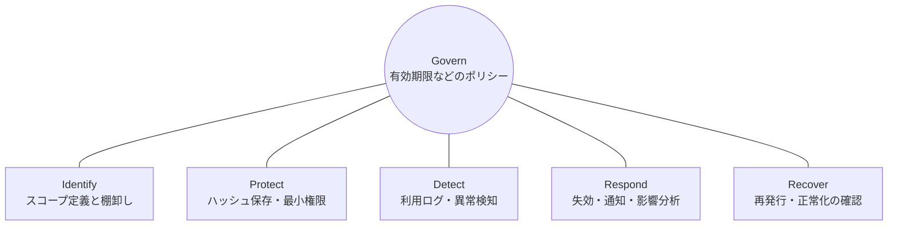
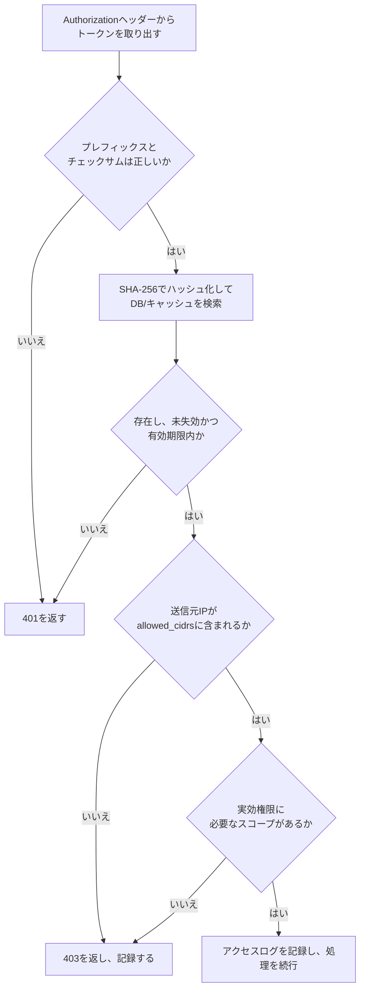

# はじめに
GitHubのPersonal Access Token（PAT）やOpenAIのAPIキーのように、ユーザーが権限範囲（スコープ）を指定してトークンを発行できる機能は便利である。

一方で「トークンを発行してDBに保存し、リクエスト時に照合する」だけの実装では、トークンが漏洩した時点で攻撃者のリクエストも正当なアクセスとして通ってしまう。しかも、そのことに気付く手段がない。

本記事では、NISTのサイバーセキュリティフレームワーク（CSF）2.0の考え方を先に整理し、そこから逆算してAPIトークン機能の設計と実装に落とし込む。

# TL;DR
- APIトークンの設計は「防ぐ（Protect）」だけでなく「異常に気付く（Detect）」とセットで考える。
- NIST CSF 2.0の6つの機能を設計のチェックリストとして使うと、運用まで含めた抜け漏れを減らせる。
- 具体的には、ハッシュ保存・識別可能なトークン形式・スコープの包含チェック・利用ログ・失効とキャッシュパージを実装する。

# なぜNIST CSFを使うのか
セキュリティ対策を考えるとき、多くの場合は「どう暗号化するか」「どう認証するか」という防御の話に目が向く。

しかしAPIトークンは、持っている者を正当な利用者として扱う鍵である。漏洩したトークンは認証をそのまま通過するため、防御だけでは被害を止められない。突破されたことにどう気付き、どう止め、どう戻すかまで設計に含める必要がある。

この全体像を整理する枠組みとして、NIST CSF 2.0が使える。CSF 2.0は2024年2月26日に公開され、従来の5つの機能に「Govern（統治）」が加わって6つの機能になった。各機能の定義は次の通りである。

| 機能 | CSF 2.0の定義（要約） |
|---|---|
| Govern（GV） | サイバーセキュリティリスク管理の戦略・期待・ポリシーを定め、伝え、監視する |
| Identify（ID） | 組織の現在のサイバーセキュリティリスクを理解する |
| Protect（PR） | リスクを管理するための保護策を使う |
| Detect（DE） | 攻撃や侵害の可能性を見つけて分析する |
| Respond（RS） | 検知したインシデントに対して行動を取る |
| Recover（RC） | インシデントの影響を受けた資産と業務を復元する |

CSFは「何を達成すべきか」という成果（Outcome）を示す枠組みであり、具体的な実装方法は規定していない。本記事のマッピングは、CSFの観点をAPIトークン機能に当てはめた筆者の解釈である。

6つの機能は順番に実施する手順ではない。CSF 2.0は、機能に同時に対処することを望ましいとしている。Govern・Identify・Protect・Detectの活動は継続的に行い、RespondとRecoverは常に準備しておき、インシデント発生時に実行する。またCSF 2.0は6機能を車輪として描き、Governを中心に置いている。Governが、他の5つの機能をどう実装するかを方向付けるためである。



# NIST CSFをAPIトークン設計に当てはめる
CSFの各機能を、APIトークン機能の要件にマッピングすると次のようになる。カッコ内は関連するCSF 2.0のサブカテゴリである。

| 機能 | APIトークン機能での要件 | 設計への落とし込み |
|---|---|---|
| Govern | トークンのライフサイクルのルール（GV.PO-01） | 有効期限の必須化と上限（例：最大90日）、長期間未使用トークンの自動失効 |
| Identify | 権限範囲・保有状況・漏洩時の影響の把握（ID.AM-08、ID.RA-04） | スコープの粒度設計（`read:users`、`write:orders`など）、トークン一覧と最終利用日時の可視化 |
| Protect | 安全な保管・最小権限・ログの生成（PR.AA-01、PR.AA-05、PR.DS-01、PR.PS-04） | 生トークンを保存せずハッシュ化、権限昇格の防止、IPアドレス制限（CIDR）、リクエスト単位のアクセスログ |
| Detect | 漏洩・不正利用の早期発見（DE.CM-03、DE.AE-02、DE.AE-07） | レートリミット超過、未知のIPや国からのアクセス、Secret Scanning連携 |
| Respond | 封じ込め・通知・分析（RS.MI-01、RS.CO-02、RS.AN-03） | 即時失効（Revoke）、検知時の自動失効とユーザー通知、アクセスログによる影響範囲の分析 |
| Recover | 正常な利用状態への復帰（RC.RP-05） | 再発行フロー、復帰後の利用状況の確認 |

# フレームワークから逆算した実装
ここからは、上の要件を満たすための実装例を示す。DBはPostgreSQL、コードはGoで書く。

## 【Protect】DB設計：生トークンは保存しない
暗号学的に安全な乱数でトークンを生成し、DBにはSHA-256のハッシュ値だけを保存する。生トークンは発行時に1度だけ表示する。

```sql
CREATE TABLE api_tokens (
    id            UUID PRIMARY KEY DEFAULT gen_random_uuid(),
    user_id       UUID NOT NULL REFERENCES users(id),
    name          VARCHAR(255) NOT NULL,
    token_hash    CHAR(64) NOT NULL UNIQUE,         -- SHA-256の16進表記 (Protect)
    token_prefix  VARCHAR(16) NOT NULL,             -- UI表示用の先頭数文字 (Identify)
    scopes        JSONB NOT NULL DEFAULT '[]',      -- 最小権限 (Protect)
    allowed_cidrs CIDR[],                           -- IPアドレス制限 (Protect)
    last_used_at  TIMESTAMPTZ,                      -- 最終利用日時 (Detect)
    last_used_ip  INET,                             -- 最終利用IP (Detect)
    expires_at    TIMESTAMPTZ NOT NULL,             -- 有効期限の必須化 (Govern)
    revoked_at    TIMESTAMPTZ,                      -- 失効日時 (Respond)
    created_at    TIMESTAMPTZ NOT NULL DEFAULT now()
);

CREATE INDEX api_tokens_user_id_idx ON api_tokens (user_id);
```

設計上のポイントは次の通り。

- パスワードと違い、APIトークンは十分な長さのランダム値である。総当たりで元の値を復元できないため、bcryptなどの低速なハッシュは不要で、SHA-256で足りる。照合は「受け取ったトークンをハッシュ化して`token_hash`で検索する」だけで済む。
- `expires_at`は`NOT NULL`にして、無期限トークンをスキーマの段階で作れなくする。上限日数はアプリケーション側でポリシーとして検証する。
- 失効は行の削除ではなく`revoked_at`で表す。行を消すと、後の影響調査（Recover）で「どのトークンがいつ失効したか」を追えなくなる。

## 【Protect / Detect】識別できるトークン形式
トークンには、サービス固有のプレフィックスとチェックサムを含める。GitHubは2021年にトークン形式を変更し、`ghp_`などのプレフィックスと、末尾6文字にCRC32チェックサムを入れる形式にした。

この形式には次の利点がある。

- プレフィックスで、ログやソースコード中のトークンを正規表現で見つけやすくなる。Secret Scanningの誤検知も減る。
- チェックサムで、形式不正のトークンをDBへ問い合わせる前に弾ける。
- 区切りの`_`は標準のBase64に含まれない文字なので、SHAなどのランダムな文字列と紛れにくい。ダブルクリックでトークン全体を選択できる利点もある。ただしURL安全なBase64（base64url）は`_`を使うため、ランダム部分をbase64urlで符号化すると区切りとして機能しない。本記事の例はBase62を使う。

たとえば`sk_live_`はStripeが使っているプレフィックスなので、他社の形式は流用せず、自社サービス固有のプレフィックスを決める。以下は`acme_pat_`を使う例である。

```go
package token

import (
	"crypto/rand"
	"crypto/sha256"
	"encoding/hex"
	"hash/crc32"
	"math/big"
	"strings"
)

const (
	prefix    = "acme_pat_"
	randomLen = 30 // Base62で30文字 ≒ 178ビット
	sumLen    = 6  // 62^6 > 2^32 なのでCRC32が収まる
	alphabet  = "0123456789ABCDEFGHIJKLMNOPQRSTUVWXYZabcdefghijklmnopqrstuvwxyz"
)

// Generate は生トークン（ユーザーに1度だけ表示）と、DBに保存するハッシュを返す。
func Generate() (raw, hash string, err error) {
	var b strings.Builder
	max := big.NewInt(int64(len(alphabet)))
	for i := 0; i < randomLen; i++ {
		n, err := rand.Int(rand.Reader, max)
		if err != nil {
			return "", "", err
		}
		b.WriteByte(alphabet[n.Int64()])
	}
	body := b.String()
	raw = prefix + body + checksum(body)
	return raw, Hash(raw), nil
}

// Hash はDBの検索キーとなるSHA-256の16進表記を返す。
func Hash(raw string) string {
	sum := sha256.Sum256([]byte(raw))
	return hex.EncodeToString(sum[:])
}

// LooksValid はDBに問い合わせる前に、プレフィックスとチェックサムを検証する。
func LooksValid(raw string) bool {
	if len(raw) != len(prefix)+randomLen+sumLen || !strings.HasPrefix(raw, prefix) {
		return false
	}
	body := raw[len(prefix) : len(prefix)+randomLen]
	return checksum(body) == raw[len(prefix)+randomLen:]
}

func checksum(body string) string {
	c := uint64(crc32.ChecksumIEEE([]byte(body)))
	out := make([]byte, sumLen)
	for i := sumLen - 1; i >= 0; i-- {
		out[i] = alphabet[c%62]
		c /= 62
	}
	return string(out)
}
```

チェックサムは改ざん防止ではなく、打ち間違いや誤検知を安く弾くためのものである。トークンの正当性は、あくまでDBのハッシュ照合で判断する。

## 【Protect】権限昇格の防止
発行APIでは、ユーザー自身が持っていない権限をトークンへ付与できないようにする。要求されたスコープが、ユーザーの権限にすべて含まれているかを検証する。

```go
// ValidateScopes は requested が granted の部分集合かを検証する。
func ValidateScopes(requested, granted []string) error {
	allowed := make(map[string]struct{}, len(granted))
	for _, s := range granted {
		allowed[s] = struct{}{}
	}
	for _, s := range requested {
		if _, ok := allowed[s]; !ok {
			return fmt.Errorf("scope %q exceeds the user's permissions", s)
		}
	}
	return nil
}
```

発行時のチェックだけでは不十分である。発行後にユーザーの権限が下がった場合でも、トークンが古い権限のまま使えてはいけない。リクエスト時には「トークンのスコープ」と「その時点のユーザー権限」の積集合を実効権限として扱う。

## 【Protect / Detect】リクエスト時の検証フロー
リクエストを受けたときの検証は次の順で行う。安い検証を先に置き、DBへの問い合わせを減らす。



`last_used_at`と`last_used_ip`をリクエストごとに更新すると、トークンの利用頻度がそのままDBの書き込み負荷になる。更新は一定間隔に間引くとよい。

```sql
UPDATE api_tokens
SET last_used_at = now(), last_used_ip = $2
WHERE id = $1
  AND (last_used_at IS NULL OR last_used_at < now() - interval '1 minute');
```

## 【Detect】異常検知の仕組み
`last_used_ip`は直近の値しか残らない。検知と後の影響調査のために、リクエスト単位のアクセスログ（トークンID、送信元IP、User-Agent、エンドポイント、ステータス）を別途残す。そのうえで、次のような兆候を検知する。

- **スパイクアクセス**：短時間に異常な数のリクエストが来る。レートリミットで429を返すだけでなく、超過したこと自体を検知イベントとして記録する。
- **未知のIPや国**：過去の利用履歴にない送信元からのアクセスを記録し、ユーザーに通知する。
- **利用パターンの変化**：長期間使われていなかったトークンが急に使われる、普段使わないエンドポイントへのアクセスが増える。

## 【Detect】Secret Scanningとの連携
GitHubのSecret Scanningは、公開リポジトリや公開npmパッケージをデフォルトでスキャンし、シークレットを検出する。サービス提供者として「Secret Scanningパートナープログラム」に参加すると、自社トークンの形式に一致する文字列が公開の場所で見つかったときにGitHubから通知を受け取れる。非公開リポジトリでの検出結果は、リポジトリの管理者とコミットした人へのアラートになり、サービス提供者には届かない。

参加にはGitHubへの連絡が必要で、トークンを検出する正規表現と、通知を受けるエンドポイントを登録する。GitHubは正規表現の質を上げるために、固有のプレフィックス、高エントロピーのランダム文字列、32ビットのチェックサムを推奨している。前述のトークン形式は、この推奨にそのまま沿っている。

エンドポイントには、次のようなJSON配列がPOSTされる。

```json
[
  {
    "token": "acme_pat_...",
    "type": "acme_personal_access_token",
    "url": "https://github.com/octocat/Hello-World/blob/.../foo/bar.txt",
    "source": "content"
  }
]
```

受信側では次の順で処理する。

1. `Github-Public-Key-Identifier`と`Github-Public-Key-Signature`ヘッダーで、送信元がGitHubであることを検証する。署名はECDSA（NIST P-256、SHA-256）で、JSONを再シリアライズせず受信した生のボディに対して検証する。
2. 各`token`を`LooksValid`で検査し、ハッシュ化してDBを検索する。
3. 該当したトークンを失効させ、ユーザーに通知する。`url`には検出場所の公開URLが入るが、空の場合もある。そのときは`source`で検出元の種類を伝える。

GitHubのドキュメントは、通知されたシークレットを公開済み・侵害済みとして扱うことを推奨している。そのため、ここでは確認を待たずに自動で失効させる。

## 【Respond】即時失効とキャッシュパージ
ユーザーがダッシュボードから、いつでもトークンを失効できるようにする。

```sql
UPDATE api_tokens
SET revoked_at = now()
WHERE id = $1 AND user_id = $2 AND revoked_at IS NULL;
```

トークンの検証結果をRedisなどにキャッシュしている場合は、失効と同時にキャッシュも削除する。キャッシュのキーを生トークンではなく`token_hash`にしておくと、キャッシュ側にも生トークンが残らない。

```go
func (s *Service) Revoke(ctx context.Context, userID, tokenID string) error {
	hash, err := s.repo.Revoke(ctx, userID, tokenID) // 上のUPDATEを実行し、token_hashを返す
	if err != nil {
		return err
	}
	if err := s.cache.Del(ctx, "apitoken:"+hash).Err(); err != nil {
		return err // パージ失敗を握りつぶさない
	}
	s.notifier.TokenRevoked(ctx, userID, tokenID)
	return nil
}
```

キャッシュのTTLも短めにしておく。パージに失敗しても、TTLが失効の反映を遅らせる上限になる。

異常検知による自動対応では、誤検知の影響も考える。Secret Scanningの通知のように侵害がほぼ確実な場合は自動で失効させ、未知のIPからのアクセスのように判断が分かれる場合は、通知してユーザーに確認を求める、という使い分けが現実的である。

## 【Respond / Recover】影響範囲の分析と再発行
失効の後は、何が起きたかを分析して安全な状態に戻す。CSFでは、分析はRespond（RS.AN-03）、正常な状態への復帰はRecover（RC.RP-05）に当たる。

- **影響範囲の分析（Respond）**：漏洩が疑われる時点から失効時点までのアクセスログを、トークンID単位で抽出してユーザーに提示する。どのエンドポイントで、どのデータに触れたかが分かれば、追加の対応を判断できる。
- **再発行（Recover）**：同じスコープで新しいトークンを発行する導線を用意する。ただし、元のスコープが本当に必要だったかを見直すきっかけにもする。再発行後は、新しいトークンで正常に利用できていることを確認する。

対応で得た知見は、有効期限やスコープ粒度などのポリシーへ反映する。CSF 2.0では、運用からの改善点の特定はIdentify（ID.IM-03）、ポリシーの見直しはGovern（GV.PO-02）に当たる。

# まとめ
機能要件だけを見て設計すると、APIトークンは「発行してDBに保存し、リクエスト時に照合する」というProtectだけの設計になりやすい。

最初にNIST CSFの観点を通すと、次のような運用上の問いを設計段階で洗い出せる。

- 漏洩したときにどう気付くか（Detect）
- 気付いたときにどう止めるか（Respond）
- 止めた後にどう戻すか（Recover）
- そもそもどんなルールで運用するか（Govern）

ハッシュ保存、識別できるトークン形式、スコープの包含チェック、アクセスログ、失効とキャッシュパージは、どれも後から追加すると移行が面倒になる。開発の初期段階からこれらの観点を持って設計しておきたい。

# 関連記事
- [アクセストークンの検証と失効とは？Introspection・JWT AT・Revocation](/ja/posts/access-token-validation-revocation/)
- [OAuth 2.1とは？OAuth 2.0からの変更点とSecurity BCP（RFC 9700）](/ja/posts/oauth-2-1-security-bcp/)
- [OAuth・OIDCへの攻撃と対策を整理して理解できる本（リダイレクトへの攻撃編）](/ja/posts/oauth-oidc-attacks-and-countermeasures-guide/)

# 参考リンク
- [The NIST Cybersecurity Framework (CSF) 2.0（NIST CSWP 29）](https://doi.org/10.6028/NIST.CSWP.29)
- [NIST Releases Version 2.0 of Landmark Cybersecurity Framework](https://www.nist.gov/news-events/news/2024/02/nist-releases-version-20-landmark-cybersecurity-framework)
- [Behind GitHub's new authentication token formats - The GitHub Blog](https://github.blog/engineering/platform-security/behind-githubs-new-authentication-token-formats/)
- [Secret scanning partner program - GitHub Docs](https://docs.github.com/en/code-security/secret-scanning/secret-scanning-partnership-program/secret-scanning-partner-program)

