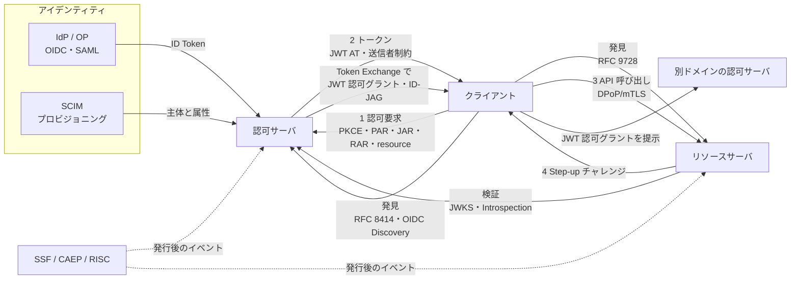
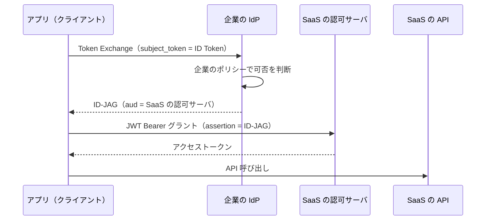

# 概要

OAuthの周辺にはRFCとOpenID Foundationの仕様が数十本ある。認可基盤を作る立場から見ると、それぞれを個別に覚えるよりも「どの問いに答える標準か」で分けて把握する方が役に立つ。

この記事は、認可基盤から見たOAuthと周辺標準の地図である。次のことがわかる。

- 標準を7つの問い（委譲、要求の完全性、発見と宛先、ドメイン横断、トークン、アイデンティティとプロビジョニング、継続評価）に分けた全体像
- 各標準の1行の役割と、2026年10月時点の状態（RFC、Draft、Finalの別）
- 認可基盤として決めなければならないこと
- このブログで詳しく解説した記事への索引

OAuth 2.0、OAuth 2.1、PKCE、JOSE、JWT、送信者制約トークン、Introspection、DCR、OIDCなどは既存の記事で詳しく扱った。ここでは要点だけを書き、リンク先に任せる。

まだ扱っていない標準は、この記事で短く説明する。対象はRAR、PARとJAR、Step-up、Protected Resource Metadata、Client ID Metadata Documentである。CIBA、GNAP、SCIM、IPSIE、SSF/CAEP/RISC、FAPI 2.0も含む。

# OAuthは認可基盤のどこを担うか

OAuthは「誰が、どのクライアントに、どの資源へのアクセスを任せたか」を運ぶ委譲の仕組みである。資源の中で「この主体がこの行をこの操作で扱ってよいか」を決めるのはOAuthの仕事ではない。それはポリシーに基づく判定（PDP）の仕事で、[認可のアーキテクチャ、モデル、エンジンの比較](/ja/posts/authorization-architecture-models-engines/)で扱う。

認可基盤の中で、OAuthと周辺標準は次の役割を持つ。

- 委譲の結果をトークンとして発行し、運び、検証させる
- 主体（ユーザー、クライアント、ワークロード）の識別子と属性を供給する
- 発行した後に状況が変わったとき、その変化を伝える

IAM全体での位置づけは[認可とは？認証との違いとIAMのサブドメイン](/ja/posts/authorization-domain-iam-subdomains/)にまとめた。

# 地図の全体像

まず、OAuthの基本の流れの上に標準を配置する。クライアントが認可サーバ（AS）からアクセストークンを得て、リソースサーバ（RS）を呼ぶ。各標準はこの流れのどこかを定義するか、強化する。



次の表が、この記事の地図そのものである。状態は2026年10月時点で、IETF Datatrackerとopenid.netで確かめた。

| 問い | 主な標準 | 状態（2026年10月） | 詳しい記事 |
| --- | --- | --- | --- |
| 委譲: 誰が何を任せるか | OAuth 2.0（RFC 6749/6750）、OAuth 2.1、RFC 9700、PKCE（RFC 7636）、RAR（RFC 9396）、CIBA、GNAP（RFC 9635） | OAuth 2.1はDraft、他はRFCまたはFinal | [OAuth 2.0](/ja/posts/oauth-2-0/)、[OAuth 2.1](/ja/posts/oauth-2-1-security-bcp/) |
| 要求の完全性: 要求を改ざんさせない | PAR（RFC 9126）、JAR（RFC 9101）、`iss`（RFC 9207）、FAPI 2.0 | RFC、FAPI 2.0はFinal | [OAuth 2.1](/ja/posts/oauth-2-1-security-bcp/) |
| 発見と宛先: どこに何向けのトークンを | RFC 8414、OIDC Discovery、Resource Indicators（RFC 8707）、Protected Resource Metadata（RFC 9728）、DCR（RFC 7591/7592）、CIMD | CIMDはDraft、他はRFCまたはFinal | [Discovery](/ja/posts/oidc-discovery-metadata/)、[DCR](/ja/posts/dynamic-client-registration/) |
| ドメイン横断: 信頼境界を越える | Token Exchange（RFC 8693）、Identity Chaining、ID-JAG、Transaction Tokens | RFC 8693以外はDraft | [サービス間認証](/ja/posts/service-to-service-authentication/) |
| トークン: 何を入れ、どう検証し、どう止めるか | JOSE、JWT、JWT AT（RFC 9068）、Introspection（RFC 7662）、Revocation（RFC 7009）、mTLS（RFC 8705）、DPoP（RFC 9449） | RFC | [JOSE](/ja/posts/jose-overview/)、[検証と失効](/ja/posts/access-token-validation-revocation/)、[送信者制約](/ja/posts/sender-constrained-tokens-mtls-dpop/) |
| アイデンティティ: 誰かを確立し属性を供給する | OIDC Core、SAML 2.0、SCIM（RFC 7643/7644/9967）、IPSIE | OIDCはFinal、SAML 2.0はOASIS標準、SCIMはRFC、IPSIEはDraft | [OIDC](/ja/posts/openid-connect-1-0-spec-summary/)、[SAML](/ja/posts/saml-2-0/) |
| 継続評価: 発行後の変化を反映する | SET（RFC 8417）、SSF、CAEP、RISC、Step-up（RFC 9470） | RFC、SSF/CAEP/RISCはFinal | [ログアウトとSET](/ja/posts/oidc-logout-security-event-token/) |

ここから問いごとに、各標準の役割と、認可基盤として決めることを見ていく。

# 委譲: 誰が、何を、どこまで任せるか

## 土台となる標準

| 標準 | 1行の役割 | 状態 |
| --- | --- | --- |
| RFC 6749 / RFC 6750 | ロール、グラント、Bearerトークンの使い方を定めるOAuth 2.0の本体 | RFC |
| OAuth 2.1（draft-ietf-oauth-v2-1） | 6749と主要な拡張、BCPを1本にまとめ直した版。PKCE必須、ImplicitとPasswordを削除 | Draft（-16、2026年9月） |
| RFC 9700（BCP 240） | 2012年以降にわかった攻撃と対策をまとめたSecurity BCP | RFC |
| RFC 7636（PKCE） | 認可コードの横取りを防ぐ。RFC 9700は公開クライアントに必須、機密クライアントに推奨とし、OAuth 2.1は原則すべてのクライアントに求める | RFC |
| RFC 8252とRFC 10017（BCP 212） | ネイティブアプリとブラウザで動くアプリのBest Current Practice | RFC（10017は2026年8月） |
| RFC 8628 | 入力しにくい端末で、別の端末から承認するデバイスグラント | RFC |
| RFC 7523 | JWTでクライアントを認証する（OIDCの`private_key_jwt`もこれを使う）。JWTを認可グラントとしても使う | RFC |

OAuth 2.0の全体は[OAuth 2.0とは？](/ja/posts/oauth-2-0/)に、OAuth 2.1とRFC 9700の推奨は[OAuth 2.1とは？](/ja/posts/oauth-2-1-security-bcp/)にまとめた。OAuth 2.1は2026年10月時点でもまだRFCではない。ブラウザで動くアプリのBCPは2026年8月にRFC 10017として出た。SPAでのトークンの置き場所は[SPAのトークンをどこに置く？](/ja/posts/spa-token-storage-bff/)で扱った。

## RAR（RFC 9396）: スコープでは表せない委譲を表す

スコープは空白区切りの文字列なので、「口座AからBへ123.50ユーロを送金してよい」のような具体的な委譲を表せない。RAR（OAuth 2.0 Rich Authorization Requests）は、認可要求に`authorization_details`というJSONの配列を加えて、これを構造化して表す。

各要素は必須の`type`を持ち、その型ごとに中身をAPI側が決める。共通のフィールドとして`locations`、`actions`、`datatypes`、`identifier`、`privileges`が用意されている。

```json
[
  {
    "type": "payment_initiation",
    "locations": ["https://example.com/payments"],
    "instructedAmount": { "currency": "EUR", "amount": "123.50" },
    "creditorName": "Merchant A"
  }
]
```

認可サーバは、同意画面でこの内容を利用者に示し、許可した内容をトークンレスポンスやトークンの中に返す。対応する型はASメタデータの`authorization_details_types_supported`で公開する。

認可基盤として決めることは次の2つである。

- どの操作をスコープで表し、どの操作を`authorization_details`で表すか。金額や対象の資源など、値を伴う委譲はRARに向く。
- `type`ごとのスキーマを誰が定義し、どこで検証するか。RSがトークンの中の`authorization_details`を読んで、実際の要求と突き合わせる必要がある。

RARは「何を委譲したか」を運ぶだけで、資源の中での判定は別に要る。PDPの入力として使う形が自然である。

## CIBA: 利用者の手元の端末で承認を得る

OpenID Connect Client-Initiated Backchannel Authentication（CIBA）Core 1.0は、OpenID FoundationのFinal仕様である（2021年9月）。リダイレクトを使わず、クライアントはバックチャネルを通じてOPへ認証と同意を求める。利用者は自分のスマートフォンなど、別の端末で承認する。

流れは次のとおりである。

1. クライアントがBackchannel Authentication Endpointに、`login_hint`などで利用者を示して要求を送る。
2. OPは`auth_req_id`を返し、利用者の端末に承認を求める。
3. クライアントは結果を受け取る。受け取り方はPoll、Ping、Pushの3つのモードから登録時に選ぶ。

`binding_message`を使うと、要求した側と承認する側の両方の画面に同じ文字列を出せる。コールセンターや店頭端末のように、操作する人と承認する人の端末が分かれる場面に向く。AIエージェントが人の承認を求める場面でも、CIBAは候補の1つになる。これは[AIエージェントで認可の何が変わるか](/ja/posts/authorization-for-ai-agents/)で扱う。

認可基盤として決めることは、利用者をどう指定するか（`login_hint`の形式）と、承認の通知をどの端末に送るかである。利用者を取り違えると、別人に承認を求めることになる。

## GNAP（RFC 9635）: OAuthを作り直した別のプロトコル

GNAP（Grant Negotiation and Authorization Protocol）は、OAuthの拡張ではなく、委譲を最初から設計し直したプロトコルである。2024年10月、RFC 9635として発行された。RSとの連携は2025年4月のRFC 9767が定める。

OAuthとの主な違いは次のとおりである。

- クライアントは1つのグラントエンドポイントにJSONで要求を送る。グラントタイプの種類で分岐しない。
- クライアントは鍵を持つことが前提で、要求のたびに鍵の所有を証明する。
- 利用者とのやりとり（リダイレクト、ユーザーコードなど）を要求の中で交渉する。
- 発行後も、継続用のURLでグラントを更新したり取り消したりできる。

筆者の知る範囲では、2026年10月時点でGNAPを採用した大きなエコシステムは少ない。そのため筆者は、認可基盤が今GNAPを実装する必要は薄いと考える。ただし「鍵に結び付いたクライアント」「継続するグラント」という考え方は、OAuthの送信者制約やエージェントの委譲を設計する際の参考になる。

# 要求の完全性: 認可要求を改ざんさせない

認可要求のパラメータは、ふつうブラウザのURLに載る。利用者の端末やブラウザの拡張機能が中身を書き換えたり、覗いたりできる。RARのように大きなJSONを載せるとURLも長くなる。

| 標準 | 1行の役割 | 状態 |
| --- | --- | --- |
| PAR（RFC 9126） | 認可要求をバックチャネルで先にASに送り、ブラウザには参照だけを渡す | RFC（2021年9月） |
| JAR（RFC 9101） | 認可要求を署名付きのJWT（Request Object）にする | RFC（2021年8月） |
| RFC 9207 | 認可レスポンスに`iss`を入れて、Mix-Up攻撃を防ぐ | RFC |
| FAPI 2.0 Security Profile | PARや送信者制約を必須にした高保証のプロファイル | Final（2025年2月） |

`iss`とMix-Up攻撃は[OAuth 2.1とは？](/ja/posts/oauth-2-1-security-bcp/)で扱った。

## PAR（RFC 9126）とJAR（RFC 9101）

PARでは、クライアントが認可要求のパラメータをASの`pushed_authorization_request_endpoint`にPOSTする。ASは、トークンエンドポイントと同じ規則でクライアントを認証し、短い有効期限の`request_uri`を返す。

```http
POST /as/par HTTP/1.1
Host: as.example.com
Content-Type: application/x-www-form-urlencoded

response_type=code&client_id=s6BhdRkqt3&redirect_uri=...
&code_challenge=...&code_challenge_method=S256
&client_assertion_type=urn%3Aietf%3Aparams%3Aoauth%3Aclient-assertion-type%3Ajwt-bearer
&client_assertion=...
```

```json
{ "request_uri": "urn:example:bwc4JK-ESC0w8acc191e-Y1LTC2", "expires_in": 90 }
```

ブラウザは`client_id`と`request_uri`だけを持って認可エンドポイントへ行く。パラメータはブラウザを通らないので、改ざんや漏えいが起きにくい。クライアント認証を認可要求の段階で済ませられるのも利点である。

JARは、認可要求のパラメータを署名付きのJWT（Request Object）にまとめ、`request`または`request_uri`で渡す。署名によって、要求を作ったのが確かにそのクライアントであることと、途中で変わっていないことを示せる。RFC 9101では、同じパラメータが外にも置かれていても、ASはRequest Objectの中のパラメータだけを使わなければならない。

2つは組み合わせられる。PARは「要求をブラウザに通さない」、JARは「要求そのものに署名する」で、守る対象が違う。

認可基盤として決めることは、PARをすべてのクライアントに要求するかどうかである。ASメタデータの`require_pushed_authorization_requests`で公開できる。クライアントごとに要求するときは、同じ名前のクライアントメタデータを使う。新しく作る基盤なら、機密クライアントにはPARを要求しておくと、後からRARを足してもURLの問題が起きない。

## FAPI 2.0: 高保証のプロファイル

FAPI 2.0は、金融などの高リスクなAPI向けにOAuthの使い方を絞り込んだOpenID Foundationのプロファイルである。Finalの公開は、Security Profileが2025年2月、Message Signingが2025年9月である。

Security Profileの要求の例は次のとおりである。

- 認可要求は認可コードフロー（`response_type=code`）に限り、機密クライアントだけをサポートする
- PARを使い、PKCEはS256を必須にする
- アクセストークンは送信者制約（mTLSかDPoP）付きだけを発行する
- 認可コードの有効期限は最長60秒にする

金融のAPIを作らない場合でも、「高いリスクの操作ではどこまで締めるか」の基準として参照できる。

# 発見と宛先: どのASに、どの資源向けのトークンを求めるか

クライアントとASとRSが、事前に知り合っていないこともある。たとえばMCPやAIエージェントでは、初めて見るRSに対して、どのASからトークンを得ればよいかをその場で調べる必要がある。

| 標準 | 1行の役割 | 状態 |
| --- | --- | --- |
| RFC 8414 / OIDC Discovery | AS（OP）のエンドポイント、対応機能、`jwks_uri`を公開する | RFC / Final |
| RFC 8707（Resource Indicators） | `resource`でトークンの宛先を指定し、`aud`を絞る | RFC |
| RFC 9728（Protected Resource Metadata） | RSが、自分を守るASや対応するスコープを公開する | RFC（2025年4月） |
| RFC 7591 / RFC 7592（DCR） | クライアントをASに動的に登録し、管理する | RFC |
| CIMD（draft-ietf-oauth-client-id-metadata-document） | URLを`client_id`にし、そのURLにクライアントのメタデータを置く | Draft（-02、2026年7月） |

AS側のメタデータは[OpenID ConnectのDiscoveryとメタデータとは？](/ja/posts/oidc-discovery-metadata/)で、Resource Indicatorsは[送信者制約トークンとは？](/ja/posts/sender-constrained-tokens-mtls-dpop/)で、DCRは[動的クライアント登録（DCR）とは？](/ja/posts/dynamic-client-registration/)で扱った。

## Protected Resource Metadata（RFC 9728）

RFC 8414はASが自分を説明するメタデータである。RFC 9728はそのRS版で、RSが`/.well-known/oauth-protected-resource`にJSONを置く。

```json
{
  "resource": "https://api.example.com",
  "authorization_servers": ["https://as.example.com"],
  "scopes_supported": ["orders.read", "orders.write"],
  "bearer_methods_supported": ["header"],
  "dpop_bound_access_tokens_required": true
}
```

主なフィールドは、RSの識別子の`resource`（必須）、このRS向けのトークンを出す`authorization_servers`、`scopes_supported`、`jwks_uri`などである。送信者制約も公開できる。`dpop_bound_access_tokens_required`はDPoPを常に要求するかを、`tls_client_certificate_bound_access_tokens`はmTLSで結び付けたトークンへの対応を示す。

RSは401を返すときに、`WWW-Authenticate`ヘッダーの`resource_metadata`パラメータでこのURLを示せる。クライアントは、RSを呼んで失敗した時点で、どのASに行けばよいかがわかる。MCPの認可仕様は、MCPサーバにこのメタデータの実装を求めている。

認可基盤として決めることは、RSの識別子（`resource`の値）をどう付けるかである。この値はRFC 8707の`resource`パラメータとトークンの`aud`にも使う。識別子が揃っていないと、宛先の検証が成り立たない。

## Client ID Metadata Document（CIMD）

DCRでは、クライアントは使うASごとに登録し、ASは登録したクライアントの情報を保存する。クライアントとASの組み合わせが多い環境では、登録が増え続け、管理が重くなる。

OAuth Client ID Metadata Documentは、HTTPSのURLを`client_id`にする仕組みである。クライアントはそのURLに、自分のメタデータ（`redirect_uris`、`client_name`など）をJSONで置く。ASは、そのURLから文書を自動で取得することが推奨される（SHOULD）。内容は変わりうるので、定期的に取り直すことも推奨される。クライアントは、ASごとの事前の登録をしなくてよい。

主な要件は次のとおりである（draft-02時点）。

- `client_id`のURLはhttpsで、パスを含み、フラグメントを含まない
- 文書の中の`client_id`は、文書のURLと完全に一致しなければならない
- `client_secret`を使う認証方式は使えない。公開クライアントか、`private_key_jwt`などの鍵による認証になる
- ASは対応していることを、メタデータの`client_id_metadata_document_supported`で示す

ASは外部のURLを取得するので、SSRFへの対策が要る。どのURLでも受け入れると、誰でもクライアントになれ、よく知られたクライアントを装うこともできる。そのため、どのドメインを信頼するかのポリシーも要る。MCPの認可仕様（2026-07-28版）は、DCRよりCIMDを優先し、DCRを非推奨とした。詳しくは[MCPの認可を設計するときの勘所](/ja/posts/mcp-authorization-design/)で扱う。

認可基盤として決めることは、クライアントの登録方式（事前登録、DCR、CIMD）のどれを、どの種類のクライアントに許すかである。

# ドメイン横断: 信頼境界を越えて委譲を運ぶ

社内のマイクロサービスの間や、SaaSをまたいで、利用者の委譲を引き継ぎたい場面がある。元のトークンをそのまま次へ渡すと、宛先を絞れず、漏れたときの被害も広がる。そこで、境界を越えるたびにトークンを交換する。

| 標準 | 1行の役割 | 状態（2026年10月） |
| --- | --- | --- |
| RFC 8693（Token Exchange） | トークンを別のトークンに交換する。`act`で代理の連鎖を記録する | RFC |
| Identity Chaining（draft-ietf-oauth-identity-chaining） | ドメインAのASでJWT認可グラントを得て、ドメインBのASでトークンに換える | Draft（-17、RFC Editorの待ち行列） |
| ID-JAG（draft-ietf-oauth-identity-assertion-authz-grant） | IdPが発行したID-JAGを使い、SSO済みの利用者のトークンを別のSaaSで得る | Draft（-04、2026年5月） |
| Transaction Tokens | 社内の呼び出しの連鎖に、利用者と処理の文脈を運ぶ | Draft |

Token Exchangeの基本は[サービス間認証の全体像とは？](/ja/posts/service-to-service-authentication/)で扱った。Transaction Tokensとワークロードのアイデンティティは[ワークロードアイデンティティの標準化](/ja/posts/workload-identity-wimse-transaction-tokens/)で扱う。

## Identity ChainingとID-JAG

Identity Chainingは、ドメインをまたぐ一般的な仕組みである。クライアントはまず自分のドメインのASでToken Exchangeを行い、相手のドメイン向けのJWT認可グラントを得る。次に、そのグラントを相手のドメインのASにRFC 7523のJWT Bearerグラントとして出し、アクセストークンを得る。

ID-JAG（Identity Assertion JWT Authorization Grant）は、この形を、SSOで同じIdPを信頼するアプリの間に当てはめたものである。代表例は企業の従業員向けのIdPだが、それに限らない。この仕様が定めるパターンは、非公式にCross-App Access（XAA）と呼ばれる。



利用者はもう一度ログインしたり同意したりしなくてよい。企業のIdPが、どのアプリがどのSaaSにアクセスしてよいかを一か所で決められる。これが企業にとっての利点である。ただし、SaaSの認可サーバも自分のポリシーで、ID-JAGを受け入れるかと、どの範囲のトークンを出すかを決める。

認可基盤として決めることは、ドメインをまたぐときに、誰の権限をどこまで引き継ぐかである。交換のたびに`aud`とスコープを絞り、`act`で誰が代理しているかを残す。AIエージェントでの使い方は[AIエージェントで認可の何が変わるか](/ja/posts/authorization-for-ai-agents/)で扱う。

# トークン: 何を入れ、どう検証し、どう止めるか

この領域はこのブログで最も詳しく扱ってきた。要点と記事だけを並べる。

| 標準 | 1行の役割 | 詳しい記事 |
| --- | --- | --- |
| JOSE（RFC 7515〜7518）、JWT（RFC 7519）、JWT BCP（RFC 8725） | 署名、暗号化、鍵、アルゴリズム、クレームの器と安全な使い方 | [JOSEとは？](/ja/posts/jose-overview/)、[JWTとは？](/ja/posts/jwt-introduction/) |
| RFC 9068（JWTアクセストークン） | アクセストークンをJWTにするときのクレームと検証の手順 | [アクセストークンの検証と失効](/ja/posts/access-token-validation-revocation/) |
| RFC 7662（Introspection） | 不透明なトークンの有効性と属性をASに問い合わせる | 同上 |
| RFC 7009（Revocation） | アクセストークンやリフレッシュトークンを失効させる | 同上 |
| RFC 8705（mTLS）、RFC 9449（DPoP） | トークンを鍵に結び付け、盗まれても使えなくする | [送信者制約トークンとは？](/ja/posts/sender-constrained-tokens-mtls-dpop/) |
| BFF | ブラウザにトークンを渡さない構成 | [SPAのトークンをどこに置く？](/ja/posts/spa-token-storage-bff/) |

RFC 8725の改訂版（draft-ietf-oauth-rfc8725bis）は、2026年10月時点でRFC Editorの待ち行列にある。

認可基盤として決めることは次のとおりである。

- **形式**: JWTでRSに自己検証させるか、不透明なトークンをIntrospectionで確かめさせるか。失効をすぐに効かせたいか、問い合わせの遅延を避けたいかで選ぶ。
- **寿命**: アクセストークンを短くし、リフレッシュトークンとイベントによる失効で補う。
- **宛先**: `aud`を必ず検証し、RFC 8707で絞る。宛先のないトークンは、受け取ったどのRSでも使えてしまう。
- **送信者制約**: Bearerのまま配るか、DPoPかmTLSで鍵に結び付けるか。
- **中身**: トークンに権限の一覧を詰めるか、判定はPDPに任せてトークンには主体と委譲だけを入れるか。この判断は[認可基盤のアーキテクチャと設計判断](/ja/posts/authorization-platform-architecture-decisions/)で扱う。

APIキーのような長命のトークンの設計は[NIST CSF 2.0に学ぶ安全なAPIトークン設計](/ja/posts/nist-csf-api-token-design/)で扱った。

# アイデンティティとプロビジョニング: 誰かを確立し、属性を供給する

認可の判定には、主体が誰で、どのグループに属し、どの属性を持つかが要る。これを運ぶのが認証の標準と、プロビジョニングの標準である。

| 標準 | 1行の役割 | 状態 |
| --- | --- | --- |
| OpenID Connect Core 1.0 | OAuthの上で認証の結果をID Tokenとして運ぶ | Final |
| SAML 2.0 | XMLのアサーションでSSOを行う。2005年3月にOASIS標準になった | OASIS標準 |
| SCIM（RFC 7643 / 7644） | 利用者とグループを組織の間で作成、更新、削除するREST APIとスキーマ | RFC（2015年9月） |
| SCIMのSETプロファイル（RFC 9967） | SCIMの変更をSecurity Event Tokenで非同期に通知する | RFC（2026年5月） |
| IPSIE | 企業のSSO、ライフサイクル、失効などの相互運用プロファイル | Draft（WGで策定中） |

OIDCは[OpenID Connect 1.0 仕様まとめ](/ja/posts/openid-connect-1-0-spec-summary/)で、SAMLは[SAML 2.0とは？](/ja/posts/saml-2-0/)で扱った。認証と認可は層として分けておく。ID Tokenは「誰が認証されたか」をRPに伝えるもので、APIを呼ぶためのトークンではない。

## SCIM: 認可の前提となる主体と属性を揃える

SCIM（System for Cross-domain Identity Management）は、IdPや人事システムからSaaSへ、利用者とグループを配る標準である。RFC 7643がスキーマ、RFC 7644がプロトコルを定める。

- `/Users`と`/Groups`に対して、HTTPのGET、POST、PUT、PATCH、DELETEで操作する
- `filter`で検索し、`/Bulk`でまとめて処理する
- Enterprise Userの拡張で、`department`や`manager`などの組織の属性を持てる
- `/ServiceProviderConfig`と`/Schemas`で、対応している機能とスキーマを公開する

認可基盤から見ると、SCIMはPIP（属性の供給元）を満たす仕組みである。入社、異動、退職に合わせて、グループや属性が自動で変わる。逆に、このプロビジョニングが欠けていると、退職者のアカウントがSaaSに残りやすい。

2026年5月のRFC 9967は、SCIMの変更をSET（RFC 8417）で通知するプロファイルである。プロビジョニングを非同期にし、変更を受け手に知らせられる。

認可基盤として決めることは次のとおりである。

- 主体と属性の正本をどこに置くか（人事システム、IdP、自前のディレクトリ）
- SaaSや社内サービスへSCIMで配るか、判定のたびにPIPとして問い合わせるか
- グループを権限の単位として使うか、属性からロールを導くか

## IPSIE: 企業向けの相互運用プロファイル

IPSIE（Interoperability Profiling for Secure Identity in the Enterprise）は、OpenID FoundationのWorking Groupである。新しいプロトコルを作るのではなく、既存の仕様の使い方を絞ったプロファイルを作る。

最初に扱う範囲は、SSO、利用者のライフサイクル管理、エンタイトルメント、リスクシグナルの共有、ログアウト、トークンの失効である。既存の仕様は選択肢が多く、SaaSごとに実装がばらつきやすい。IPSIEはこの問題に答えようとしている。

2026年10月時点で、FinalとImplementer's Draftはまだない。認可基盤として今できることは、SaaSを選ぶときにOIDC、SCIM、SSFへの対応を条件に入れ、IPSIEのプロファイルが固まったら合わせられるようにしておくことである。

# 継続評価: 発行した後に状況が変わったら

トークンは発行した時点の判断である。発行した後に、利用者が退職したり、端末が乗っ取られたり、リスクが上がったりする。トークンの寿命を短くするだけでは、その間の変化を拾えない。

| 標準 | 1行の役割 | 状態 |
| --- | --- | --- |
| RFC 8417（SET） | セキュリティイベントをJWTで表す器 | RFC |
| OIDC Back-Channel Logout 1.0 | OPからRPへ、Logout Token（`events`クレームを持つJWT）でログアウトを伝える | Final |
| SSF 1.0 | イベントの送り手と受け手の間で、SETを配るためのストリームを定める | Final（2025年8月） |
| CAEP 1.0 | セッションの失効、クレームの変更などのイベント型を定める | Final（2025年8月） |
| RISC 1.0 | アカウントの無効化や資格情報の漏えいなどのイベント型を定める | Final（2025年8月） |
| RFC 9470（Step-up） | RSが、より強い認証や新しい認証を求めるチャレンジを返す | RFC（2023年9月） |

SETとOIDCのログアウトは[OIDCのログアウトとSecurity Event Token（SET）とは？](/ja/posts/oidc-logout-security-event-token/)で扱った。

## SSF、CAEP、RISC

SSF（OpenID Shared Signals Framework）は、イベントを送るTransmitterと受け取るReceiverの間の取り決めである。Receiverはストリームを設定し、受け取りたいイベントと主体を指定する。実際に配るイベントは、その要求の範囲でTransmitterが決める。配信はRFC 8935のPushか、RFC 8936のPollを使う。主体の識別にはRFC 9493のSubject Identifiersを使う。

CAEP（Continuous Access Evaluation Profile）は、継続的なアクセス評価のためのイベント型を定める。

- `session-revoked`: セッションを失効させた
- `token-claims-change`: トークンのクレームが変わった
- `credential-change`: 資格情報が変わった
- `assurance-level-change`: 認証の保証レベルが変わった
- `device-compliance-change`: 端末がポリシーに適合しなくなった、または適合した
- `risk-level-change`: リスクのレベルが変わった
- `session-established` / `session-presented`: Transmitterがセッションを作った、Transmitterでセッションが存在することを観測した

RISC（Risk Incident Sharing and Coordination）は、アカウントのリスクに関わるイベント型を定める。例は`account-disabled`、`credential-compromise`、`identifier-recycled`である。事業者の間でアカウント乗っ取りの兆候を共有するために使う。

こうした標準を使うと、「アクセストークンは短命にし、重要な変化はイベントで即座に伝える」という運用ができる。長命のBearerを配って放置するのとは逆の考え方である。

## Step-up（RFC 9470）: RSからより強い認証を求める

OAuth 2.0 Step Up Authentication Challenge Protocolは、RSが「このトークンの認証では足りない」と返すための仕組みである。RSは401と次のヘッダーを返す。

```http
HTTP/1.1 401 Unauthorized
WWW-Authenticate: Bearer error="insufficient_user_authentication",
  error_description="A different authentication level is required",
  acr_values="myACR"
```

`acr_values`は求める認証の強さ、`max_age`は認証からの経過時間の上限である。クライアントは、これらを付けた認可要求で利用者に再認証してもらい、新しいトークンで呼び直す。RSは、JWTアクセストークンやIntrospectionの結果に含まれる`acr`と`auth_time`を見て判断する。

送金や権限の変更のような操作だけで強い認証を求めたいときに使う。最初のログインで常に最も強い認証を求めるより、利用者の負担が小さい。PDPの判定結果からStep-upにつなげる例は[AuthZEN Authorization APIとは？](/ja/posts/authzen-authorization-api/)で扱う。

認可基盤として決めることは次のとおりである。

- どのイベントを受け取り、受け取ったら何を止めるか（セッション、リフレッシュトークン、キャッシュした判定）
- どの操作で、どの`acr`を要求するか。`acr`の値の意味を組織で揃える
- イベントの送り手（IdP、MDM、リスクエンジン）を何にするか

# 認可基盤が決めることの一覧

ここまでの「決めること」を1つの表にまとめる。

| 領域 | 決めること | 関わる標準 |
| --- | --- | --- |
| 委譲 | 許すグラントタイプとクライアントの種類 | OAuth 2.1、RFC 9700、RFC 10017 |
| 委譲 | スコープで表すか、`authorization_details`で表すか | RAR |
| 委譲 | 別の端末での承認が要るか | CIBA、デバイスグラント |
| 要求の完全性 | PARやJARを必須にするか、どのリスクから必須にするか | PAR、JAR、FAPI 2.0 |
| 発見と宛先 | RSの識別子の付け方と`aud`の検証 | RFC 8707、RFC 9728 |
| 発見と宛先 | クライアントの登録方式 | 事前登録、DCR、CIMD |
| ドメイン横断 | 境界を越えるときに引き継ぐ権限の範囲と、代理の記録 | Token Exchange、ID-JAG、Transaction Tokens |
| トークン | 形式、寿命、送信者制約、中に入れるもの | JWT AT、Introspection、DPoP、mTLS |
| アイデンティティ | 主体と属性の正本と配り方 | OIDC、SCIM |
| 継続評価 | 受け取るイベントと止めるもの、Step-upを求める操作 | SSF、CAEP、RISC、Step-up |

すべてを最初から採用する必要はない。[認可基盤はどこまで作るか](/ja/posts/authorization-platform-scope-stages/)で扱った段階に合わせて、必要になった問いから答えていけばよい。ただし、RSの識別子の付け方や、トークンに何を入れるかは、後から変えにくい。早めに決めておく。

# まとめ

- OAuthは委譲を運ぶ仕組みで、資源の中での判定はPDPが担う。周辺標準は7つの問いに分けると見通しがよい。
- 委譲の細かさはRARで、要求の完全性はPARとJARで、高いリスクの基準はFAPI 2.0で補う。
- 初めて会うRSとASとクライアントをつなぐのが、RFC 9728とCIMDである。CIMDは2026年10月時点でDraftである。
- ドメイン横断の委譲はToken Exchangeが土台である。Identity ChainingはRFC Editorの待ち行列にあり、ID-JAGはWGのDraftである。
- 主体と属性はSCIMで揃え、発行後の変化はSSF、CAEP、RISCとStep-upで反映する。IPSIEはこれらを企業向けにまとめようとしている。
- OAuth 2.1は2026年10月時点でもまだDraftである。

# 関連記事

- [認可とは？認証との違いとIAMのサブドメインで見る全体像](/ja/posts/authorization-domain-iam-subdomains/)
- [認可基盤はどこまで作るべきか？横断と各ドメインの分担、必要な段階、判定の外部化](/ja/posts/authorization-platform-scope-stages/)
- [認可のアーキテクチャとモデルとは？PEP/PDP・RBAC/ABAC/ReBAC・ポリシーエンジンの選び方](/ja/posts/authorization-architecture-models-engines/)
- [AuthZEN Authorization APIとは？PEPとPDPをつなぐ認可判定の標準](/ja/posts/authzen-authorization-api/)
- [ワークロードアイデンティティとは？WIMSE・Transaction Tokens・SPIFFEクライアント認証で見るサービス間の身元と文脈](/ja/posts/workload-identity-wimse-transaction-tokens/)
- [AIエージェントの認可とは？委譲の連鎖・人の承認・監査をMCP、AuthZEN、AIMS、A2A/AP2で整理する](/ja/posts/authorization-for-ai-agents/)
- [MCPの認可はどう設計する？起きうる事故と後から直せない判断](/ja/posts/mcp-authorization-design/)
- [認可基盤のアーキテクチャとは？コンテナ構成・代表シーケンス・PEPとPDPの配置と非機能の設計判断](/ja/posts/authorization-platform-architecture-decisions/)
- [OAuth 2.0とは？フロー・トークン・実装の完全解説](/ja/posts/oauth-2-0/)
- [OAuth 2.1とは？OAuth 2.0からの変更点とSecurity BCP（RFC 9700）](/ja/posts/oauth-2-1-security-bcp/)
- [OpenID Connect 1.0 仕様まとめ](/ja/posts/openid-connect-1-0-spec-summary/)
- [OpenID ConnectのDiscoveryとメタデータとは？自動設定と鍵取得の仕組み](/ja/posts/oidc-discovery-metadata/)
- [動的クライアント登録（DCR）とは？RFC 7591・7592入門](/ja/posts/dynamic-client-registration/)
- [JOSEとは？JWT・JWS・JWE・JWK・JWAの全体像と安全な使い方](/ja/posts/jose-overview/)
- [JWTとは？安全なAPI認証のためのJSON Web Token解説](/ja/posts/jwt-introduction/)
- [アクセストークンの検証と失効とは？Introspection・JWT AT・Revocation](/ja/posts/access-token-validation-revocation/)
- [送信者制約トークンとは？mTLS（RFC 8705）とDPoP（RFC 9449）入門](/ja/posts/sender-constrained-tokens-mtls-dpop/)
- [OIDCのログアウトとSecurity Event Token（SET）とは？](/ja/posts/oidc-logout-security-event-token/)
- [SPAのトークンをどこに置く？BFF＋セッションで守る認証構成](/ja/posts/spa-token-storage-bff/)
- [サービス間認証の全体像とは？mTLS・Token Exchange・SPIFFE・ゼロトラスト](/ja/posts/service-to-service-authentication/)
- [SAML 2.0とは？SSOとフェデレーテッドアイデンティティの仕組みを解説](/ja/posts/saml-2-0/)
- [NIST CSF 2.0に学ぶ安全なAPIトークン設計｜防御と検知から逆算する実装パターン](/ja/posts/nist-csf-api-token-design/)
- [OAuth2、OIDCのキャッチアップのための資料](/ja/posts/resources-for-catching-up-on-oauth2-oidc/)

# 参考リンク

- [RFC 6749 The OAuth 2.0 Authorization Framework](https://www.rfc-editor.org/rfc/rfc6749)
- [The OAuth 2.1 Authorization Framework（draft-ietf-oauth-v2-1）](https://datatracker.ietf.org/doc/draft-ietf-oauth-v2-1/)
- [RFC 9700 Best Current Practice for OAuth 2.0 Security](https://www.rfc-editor.org/rfc/rfc9700)
- [RFC 10017 OAuth 2.0 for Browser-Based Applications](https://www.rfc-editor.org/rfc/rfc10017)
- [RFC 9396 OAuth 2.0 Rich Authorization Requests](https://www.rfc-editor.org/rfc/rfc9396)
- [RFC 9126 OAuth 2.0 Pushed Authorization Requests](https://www.rfc-editor.org/rfc/rfc9126)
- [RFC 9101 The OAuth 2.0 Authorization Framework: JWT-Secured Authorization Request (JAR)](https://www.rfc-editor.org/rfc/rfc9101)
- [RFC 9207 OAuth 2.0 Authorization Server Issuer Identification](https://www.rfc-editor.org/rfc/rfc9207)
- [RFC 9470 OAuth 2.0 Step Up Authentication Challenge Protocol](https://www.rfc-editor.org/rfc/rfc9470)
- [RFC 8414 OAuth 2.0 Authorization Server Metadata](https://www.rfc-editor.org/rfc/rfc8414)
- [RFC 8707 Resource Indicators for OAuth 2.0](https://www.rfc-editor.org/rfc/rfc8707)
- [RFC 9728 OAuth 2.0 Protected Resource Metadata](https://www.rfc-editor.org/rfc/rfc9728)
- [OAuth Client ID Metadata Document（draft-ietf-oauth-client-id-metadata-document）](https://datatracker.ietf.org/doc/draft-ietf-oauth-client-id-metadata-document/)
- [RFC 8693 OAuth 2.0 Token Exchange](https://www.rfc-editor.org/rfc/rfc8693)
- [OAuth Identity and Authorization Chaining Across Domains（draft-ietf-oauth-identity-chaining）](https://datatracker.ietf.org/doc/draft-ietf-oauth-identity-chaining/)
- [Identity Assertion JWT Authorization Grant（draft-ietf-oauth-identity-assertion-authz-grant）](https://datatracker.ietf.org/doc/draft-ietf-oauth-identity-assertion-authz-grant/)
- [RFC 9635 Grant Negotiation and Authorization Protocol (GNAP)](https://www.rfc-editor.org/rfc/rfc9635)
- [RFC 9767 GNAP Resource Server Connections](https://www.rfc-editor.org/rfc/rfc9767)
- [OpenID Connect Client-Initiated Backchannel Authentication Flow - Core 1.0](https://openid.net/specs/openid-client-initiated-backchannel-authentication-core-1_0.html)
- [FAPI 2.0 Security Profile](https://openid.net/specs/fapi-security-profile-2_0-final.html)
- [FAPI 2.0 Message Signing](https://openid.net/specs/fapi-message-signing-2_0-final.html)
- [OpenID Connect Core 1.0](https://openid.net/specs/openid-connect-core-1_0.html)
- [RFC 7643 SCIM: Core Schema](https://www.rfc-editor.org/rfc/rfc7643)
- [RFC 7644 SCIM: Protocol](https://www.rfc-editor.org/rfc/rfc7644)
- [RFC 9967 SCIM Profile for Security Event Tokens](https://www.rfc-editor.org/rfc/rfc9967)
- [IPSIE Working Group](https://openid.net/wg/ipsie/)
- [RFC 8417 Security Event Token (SET)](https://www.rfc-editor.org/rfc/rfc8417)
- [OpenID Shared Signals Framework Specification 1.0](https://openid.net/specs/openid-sharedsignals-framework-1_0-final.html)
- [OpenID Continuous Access Evaluation Profile 1.0](https://openid.net/specs/openid-caep-1_0-final.html)
- [OpenID RISC Profile Specification 1.0](https://openid.net/specs/openid-risc-1_0-final.html)
