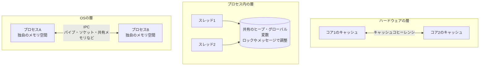
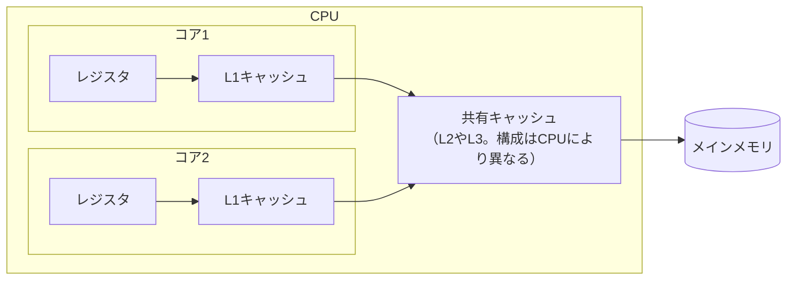

# はじめに
並行処理の話をしていると、「プロセス間」「スレッド間」「コア間」という言葉が混ざりやすい。どれも「複数の実行単位でデータをどう共有するか」という話だが、仕組みは層ごとにまったく違う。

本記事では、この3つの層でデータがどう共有されるかを軽く整理する。説明はLinuxを前提とし、根拠はmanページやカーネル文書に置く。

# TL;DR
- **プロセス間**：メモリ空間が分かれているので直接は見えない。OSのIPC（パイプ、ソケット、共有メモリなど）で渡す。
- **スレッド間**：同じメモリ空間を共有しているので直接読み書きできる。そのぶん、ロックで守るか、あえて共有せずメッセージで渡すかを選ぶ。
- **コア間**：データは通常、メモリを介してやり取りする。各コアのキャッシュの値は、ハードウェアのキャッシュコヒーレンシの仕組みが一致させる。

# プロセス間：OSのIPCで渡す
fork(2)のmanページにあるとおり、親プロセスと子プロセスは別々のメモリ空間で動く。fork直後は同じ内容だが、片方がメモリに書き込んでも、もう片方には影響しない。

なお、Linuxのforkはコピーオンライトで実装されている。fork時にメモリを丸ごと複製するのではなく、書き込みがあったページだけを複製する。

メモリが分かれている以上、プロセス同士は相手の変数を直接読めない。そこでOSが用意するプロセス間通信（IPC）を使う。

| 方法 | 仕組み | 主な用途 |
|---|---|---|
| パイプ | 一方向のバイト列の通り道。親子など関連するプロセス間で使う | シェルの`ls \| grep` |
| 名前付きパイプ（FIFO） | ファイルシステム上の名前で開けるパイプ。関連のないプロセス同士でも使える | 単純なプロセス間連携 |
| UNIXドメインソケット | 同じマシン内専用のソケット。双方向に通信できる | ローカルのデーモンやDBへの接続 |
| TCP/UDPソケット | ネットワーク越しにも使えるソケット | 別マシンとの通信 |
| 共有メモリ | 同じメモリ領域を複数プロセスのメモリ空間に割り当てる | 大きなデータを高速に共有したい場合 |
| メッセージキュー | OSが管理するキューでメッセージを受け渡す | メッセージ単位の受け渡し。到着を非同期に通知させることもできる |
| シグナル | 「終了しろ」などの短い合図だけを送る | プロセスの停止。デーモンによってはSIGHUPで設定を読み直す慣習もある |

大きく分けると、データをコピーして渡す方式（パイプ、ソケット、キュー）と、同じメモリを見る方式（共有メモリ）がある。コピー方式は安全だが、コピーの分だけコストがかかる。

共有メモリはコピーが要らないぶん速いが、同時に書き換えると壊れる。shm_overview(7)も、共有メモリへのアクセスは通常POSIXセマフォなどで同期する必要があると述べている。つまり共有メモリを選ぶと、次に述べるスレッド間と同じ問題を抱えることになる。

# スレッド間：メモリを共有し、ロックかメッセージで調整する
pthreads(7)によると、同じプロセス内のスレッドはグローバルなメモリ（データ領域とヒープ）を共有し、スタックはスレッドごとに持つ。開いているファイルディスクリプタも共有し、スレッドIDなど一部の属性はスレッドごとに分かれる。

| スレッド間で共有するもの | スレッドごとに別のもの |
|---|---|
| ヒープ、グローバル変数 | スタック（ローカル変数） |
| 開いているファイルディスクリプタ | スレッドID、シグナルマスク、errno |

つまり、スレッド同士はIPCを使わなくても同じデータを直接読み書きできる。問題は、同時に書き換えると結果がおかしくなること（データ競合）である。スレッド間の課題は、データを渡すことよりも、アクセスの順序をどう守るかにある。

主な手段は次のとおりである。

| 手段 | 仕組み |
|---|---|
| ミューテックス | 1度に1スレッドだけが入れる区間を作る |
| 読み書きロック | 読むだけなら複数スレッドが同時に入れ、書くときは1スレッドだけにする |
| スピンロック | 空くまでループして待つ。pthread_spin_init(3)は、ほとんどのプログラムではミューテックスを使うべきだとしている |
| アトミック操作 | CPU命令で「比較して書き換え」などを不可分に行う |
| 条件変数・セマフォ | 「準備ができたら起こす」といった待ち合わせに使う |
| キュー・チャネル | データを共有せず、キューで受け渡す |

最後のキューやチャネルは、スレッド間でもあえてメモリを共有せず、プロセス間のように受け渡す発想である。Goの公式ドキュメント「Effective Go」は、これを次の標語で表している。

> Do not communicate by sharing memory; instead, share memory by communicating.

（メモリを共有して通信するのではなく、通信によってメモリを共有せよ）

ただし同ドキュメントは、この考え方も行き過ぎることがあり、参照カウントのような処理は整数をミューテックスで守るほうがよい場合もあると添えている。ロックかメッセージかは、用途に応じて選ぶものである。

# コア間：キャッシュコヒーレンシで、ハードウェアが自動で値を一致させる
ここからはハードウェアの話になる。コアとコアの間のデータは、通常はメモリを介してやり取りする。どのコアも同じメインメモリを見ていて、その手前にあるキャッシュの値をハードウェアが一致させている。

## キャッシュの階層
CPUは、コアごとの小さく速いキャッシュと、複数のコアで共有する大きめのキャッシュを重ねた階層を持つことが多い。

構成はCPUによって異なる。Linux以外の例になるが、筆者のApple M1（macOS）で`sysctl`を見ると、L2は4コアで共有され、L3キャッシュの項目は報告されなかった。

キャッシュとメモリの間は、キャッシュラインという単位でやり取りする。カーネル文書によれば、キャッシュラインは通常64バイト以上である。前述のApple M1は128バイトだった。

## キャッシュコヒーレンシ
コア1がある値を書き換えたとき、コア2のキャッシュに古い値が残っていると矛盾が起きる。これを防ぐのがキャッシュコヒーレンシの仕組みである。

カーネルのメモリバリアの文書は、あるコアの読み書きが自分のキャッシュ内で完結した場合でも、他のコアから見れば通常のメモリアクセスと同じに見えると説明している。コヒーレンシの仕組みがキャッシュラインを必要なコアへ移し、競合があれば変更を伝えるからである。

前の章で「スレッドはメモリを共有して直接読み書きできる」と書いたが、ハードウェアの層ではこの仕組みが支えている。

## コアをまたぐ共有のコスト
値の一致はハードウェアが自動で行うが、タダではない。

| 現象 | 内容 |
|---|---|
| キャッシュラインの往復 | 複数のコアが同じデータを交互に書き換えると、キャッシュラインがコア間を行き来して遅くなる |
| フォールスシェアリング | 別々の変数でも、同じキャッシュラインに乗っていると同じ往復が起きる |
| メモリアクセスの順序 | コアは命令やメモリアクセスの順序を入れ替えることがある。他のコアから見た順序を保証するにはメモリバリアが要る |
| NUMA | 複数のメモリノードを持つマシンでは、CPUから近いノードのメモリほど速く読める |

フォールスシェアリングについてカーネル文書は、多くのCPUが共有するデータで、少なくとも1つの書き込みがあると性能を落とすと述べている。対策として、頻繁に書く変数と頻繁に読む変数を別のキャッシュラインに分けることを勧めている。

# まとめ
3つの層を並べると次のようになる。

| 層 | メモリ | データの共有方法 | 主な注意点 |
|---|---|---|---|
| プロセス間 | 分かれている | IPCで渡す（共有メモリも選べる） | コピーのコスト。共有メモリなら同期が必要 |
| スレッド間 | 共有している | 直接読み書きし、ロックかメッセージで調整する | データ競合 |
| コア間 | 同じメモリをキャッシュ越しに見る | ハードウェアのキャッシュコヒーレンシが自動で一致させる | キャッシュラインの往復、フォールスシェアリング、メモリアクセスの順序 |

上の層ほどプログラマーが明示的に扱い、下の層ほどOSやハードウェアが自動で面倒を見る。ただし下の層のコストは、上の層の設計に跳ね返ってくる。ロックの取り合いが遅いことも、データをスレッドごとに分ける設計が速いことも、その一因はコア間のキャッシュの動きにある。

# 関連記事
- [プロセス vs スレッド：開発者が知るべき本質的な違い](/ja/posts/process-vs-thread/)
- [Goの並行・並列処理モデル｜goroutineスケジューリング](/ja/posts/go-concurrency-parallelism-models/)
- [Redis・Memcached・Dragonflyの違い｜シングルスレッドとShared-Nothingで読み解くインメモリストアの設計](/ja/posts/redis-memcached-dragonfly-architecture/)

# 参考リンク
- [fork(2) — Linux manual page](https://man7.org/linux/man-pages/man2/fork.2.html)
- [pipe(7) — Linux manual page](https://man7.org/linux/man-pages/man7/pipe.7.html)
- [fifo(7) — Linux manual page](https://man7.org/linux/man-pages/man7/fifo.7.html)
- [mq_overview(7) — Linux manual page](https://man7.org/linux/man-pages/man7/mq_overview.7.html)
- [shm_overview(7) — Linux manual page](https://man7.org/linux/man-pages/man7/shm_overview.7.html)
- [pthreads(7) — Linux manual page](https://man7.org/linux/man-pages/man7/pthreads.7.html)
- [pthread_spin_init(3) — Linux manual page](https://man7.org/linux/man-pages/man3/pthread_spin_init.3.html)
- [numa(7) — Linux manual page](https://man7.org/linux/man-pages/man7/numa.7.html)
- [Effective Go: Share by communicating](https://go.dev/doc/effective_go#sharing)
- [Linux Kernel Memory Barriers](https://www.kernel.org/doc/Documentation/memory-barriers.txt)
- [False Sharing — The Linux Kernel documentation](https://docs.kernel.org/kernel-hacking/false-sharing.html)

