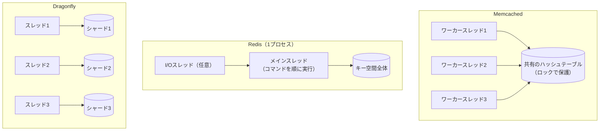

# はじめに
Webアプリケーションの高速化に欠かせないインメモリデータストアとして、長くMemcachedとRedisが使われてきた。近年は、マルチコアを前提に設計し直したDragonflyのようなプロダクトも登場している。

本記事では、3つの違いをスレッドモデルとスケールの仕方という観点から整理する。各プロダクトの公式ドキュメントやリポジトリの記述をもとに、主張の根拠と注意点も添える。

# TL;DR
- Memcachedはマルチスレッドで、単純なキー・バリューのキャッシュに特化している。永続化はない。
- Redisは豊富なデータ構造と永続化を持つ。コマンドの実行はシングルスレッドで、マルチコアは複数プロセスやRedis Clusterで使う。
- DragonflyはRedis・Memcached互換のAPIを持ち、キー空間をスレッドごとに分割するShared-Nothing設計で、1プロセスのままマルチコアを使う。
- 性能比較はベンチマークの条件次第で結論が変わる。ライセンスの違いも選定に影響する。

# MemcachedとRedisの違い
まずは定番の2つを比べる。

| 比較項目 | Memcached | Redis |
|---|---|---|
| 設計思想 | シンプルなキャッシュに特化 | 多機能なデータ構造サーバー |
| データ構造 | キーと値（値は任意のバイト列） | 文字列、ハッシュ、リスト、セット、ソート済みセットなど |
| 永続化 | なし（Warm Restartは計画的な再起動時のみ） | RDB（スナップショット）とAOF（追記ログ） |
| スレッドモデル | マルチスレッド（ワーカースレッドごとにイベントループ） | コマンド実行はシングルスレッド（I/Oなど一部は別スレッド） |
| 複数ノードへの分散 | クライアント側でキーをハッシュして振り分ける | Redis Cluster（サーバー側のシャーディング）とレプリケーション |

Memcachedのワーカースレッドは、それぞれが自分のイベントループで接続を処理し、キャッシュ本体は集中管理されたロックを介して共有する。1.5.18以降はWarm Restartという機能で、計画的に再起動したときにキャッシュを引き継げる。ただし公式ドキュメントのとおり停止中の更新は失われるため、永続化とは別物である。

Redisはデータ構造ごとに原子的な操作を提供し、RDBとAOFでディスクにも保存できる。キャッシュに限らず、カウンターやランキング、キューなど幅広い用途に使われてきた。

# Redisのコマンド実行がシングルスレッドである理由
Redisは「シングルスレッド」と言われるが、正確にはコマンドの実行がシングルスレッドである。設定ファイル（redis.conf）にも「Redisはほぼシングルスレッドだが、UNLINKや遅いI/Oなど一部の処理は別スレッドで行う」と書かれている。`io-threads`を有効にすると、ソケットの読み書きとプロトコルの解析も複数スレッドで処理できる。

コマンド実行をシングルスレッドにしている理由は、次の3つに整理できる。

- **CPUがボトルネックになりにくい**：公式FAQは、RedisでCPUがボトルネックになることはまれで、多くはメモリかネットワークが律速すると述べている。パイプラインを使えば、一般的なLinuxマシンで毎秒100万リクエストを処理できるとしている。
- **ロックが要らない**：コマンドは1本のスレッドで順に実行されるため、データ構造を守るためのロックが不要になる。ロックの取り合いや、それに伴うバグの心配がない。
- **原子性を保ちやすい**：1つのコマンドの実行中に他のコマンドが割り込まないため、各コマンドが原子的に動く。MULTI/EXECやLuaスクリプトでまとめた処理も、途中で他のクライアントの処理が挟まらない。

## Redisでマルチコアを使う方法
シングルスレッドでも、Redisでマルチコアを使う方法はある。公式FAQは、CPUを使い切りたい場合は同じマシンで複数のRedisインスタンスを起動し、別々のサーバーとして扱うよう勧めている。Redis Clusterを使えば、キー空間を16384個のハッシュスロットに分け、複数のプロセスやマシンに分散できる。

つまりRedisは、スレッドではなくプロセスを単位にマルチコアと複数マシンを使う設計である。「単一プロセスに大量のコアを与えても使い切れない」というのが正確な理解になる。

# 1プロセスでマルチコアを使うという課題
ここまでを整理すると、両者には次のようなトレードオフがある。

- **Memcached**：1プロセスでマルチコアを使えるが、扱えるのは単純なキー・バリューのみで、永続化もない。
- **Redis**：機能は豊富だが、1プロセスで使えるのは実質1コア分のコマンド実行能力である。マルチコアを使うには、複数のプロセスを起動してシャーディングする運用が要る。

複数プロセスの運用には、シャードの配置やリバランス、クライアントのクラスタ対応といった手間がかかる。「Redisのような機能を、1プロセスのままマルチコアで速く動かせないか」という発想から生まれたのが、Dragonflyのようなマルチスレッドのデータストアである。

# Dragonflyとは
DragonflyはC++製のインメモリデータストアで、RedisとMemcachedのAPIとの互換性をうたっている。READMEによると、2022年に設計したらどうなるかという実験から始まり、パブリッククラウドの大きなマシンでCPU・メモリ・I/Oを使い切ることを目標にしている。

## Shared-Nothingアーキテクチャ
Dragonflyの中心にあるのが、Shared-Nothingアーキテクチャである。

- キー空間を「シャード」に分割し、スレッドごとに担当させる。各スレッドは自分のシャードのデータだけを管理する。
- キーはハッシュによって担当のシャードが決まり、そのシャードを持つスレッドが処理する。他のスレッドが直接そのデータに触れることはない。
- 複数のシャードにまたがる操作は、VLL（Very Lightweight Locking）という論文を基にしたトランザクションの仕組みで調整する。READMEによれば、これによりミューテックスやスピンロックを使わずに、複数キーの操作を原子的に実行できる。

3つのスレッドモデルを図にすると次のようになる。

Memcachedは複数のスレッドが1つの領域を共有し、Redisは1本のスレッドがすべてを扱う。Dragonflyはスレッドごとに担当範囲を分けることで、共有によるロックの取り合いを避けている。

このほか、ハッシュテーブルにDashという構造を採用し、fork()を使わないスナップショットも実装している。READMEのベンチマークでは、スナップショット中のメモリ使用量がRedisより小さいとしている。

# ベンチマークの読み方
Dragonflyの性能を語るときによく引用されるのが、READMEにある「25倍のスループット」である。これはAWSのc6gn.16xlargeで、Dragonfly 1台と単一プロセスのRedisを比べた結果である。

これに対してRedis社は2022年のブログで、同じインスタンスに40シャードのRedis 7.0 Clusterを動かせば、Dragonflyより18〜40%高いスループットが出たと反論している。比較の土台が「1プロセス対1プロセス」か「マシン1台全体対マシン1台全体」かで、結論が逆になるわけである。

どちらもベンダー自身による計測であり、ワークロードや設定によって結果は変わる。採用を検討する際は、自分のワークロードで計測するのが確実である。

# ライセンスとエコシステム
技術以外に、ライセンスも選定に影響する。

- **Redis**：2024年3月に、BSDからSSPLなどのソース公開型ライセンスへ変更した。その後Redis 8から、OSI承認のAGPLv3も選べるようになった。
- **Valkey**：Redisのライセンス変更を受けて生まれたBSDライセンスのフォークで、Linux Foundationのもとで開発されている。AWSのElastiCacheやGoogle CloudのMemorystoreが、Valkeyのマネージドサービスを提供している。
- **Dragonfly**：BSL 1.1（Business Source License）で、OSI承認のオープンソースではない。自社の製品やサービスの一部として使うことは許可されているが、インメモリデータストアそのものを提供するサービスとしては使えない。各バージョンは公開から4年後、または2030年11月1日のいずれか早い日にApache 2.0へ切り替わる。

自社サービスのキャッシュとして使う分には、多くの場合どれも問題にならない。ただし社内基盤として他チームに提供する場合などは、条件を確認しておきたい。

# まとめ
3つのプロダクトの位置付けは次のとおりである。

- **Memcached**：単純なキー・バリューのキャッシュを、1プロセスのマルチスレッドで高速に処理したい場合の選択肢である。
- **Redis（とValkey）**：豊富なデータ構造、永続化、レプリケーション、クラスタを使いたい場合の定番である。マルチコアはプロセスを増やして使う。
- **Dragonfly**：Redis互換のAPIのまま、1プロセスでマルチコアを使い切りたい場合の選択肢である。互換性の範囲とライセンスは事前に確認が要る。

「シングルスレッドだから遅い」「マルチスレッドだから速い」と単純には言えない。スケールの単位をプロセスにするかスレッドにするかという設計の違いであり、運用の手間やライセンスも含めて、要件に合うものを計測して選ぶのがよい。

# 関連記事
- [キャッシュ戦略の基本的なパターン](/ja/posts/cache-strategy-patterns/)
- [キャッシュの書き込み方式](/ja/posts/cache-write-methods/)
- [実践Redis入門 技術の仕組みから現場の活用まで](/ja/posts/redis-practical-introduction/)

# 参考リンク
- [Redis FAQ](https://redis.io/docs/latest/develop/get-started/faq/)
- [redis.conf（THREADED I/Oの節）](https://github.com/redis/redis/blob/unstable/redis.conf)
- [Redis is now available under the AGPLv3 open source license](https://redis.io/blog/agplv3/)
- [13 Years Later – Does Redis Need a New Architecture?](https://redis.io/blog/redis-architecture-13-years-later/)
- [Valkey](https://valkey.io/)
- [Memcached Documentation: Performance and Efficiency](https://docs.memcached.org/serverguide/performance/)
- [Memcached Documentation: Warm Restart](https://docs.memcached.org/features/restart/)
- [dragonflydb/dragonfly（README）](https://github.com/dragonflydb/dragonfly)
- [Dragonfly LICENSE（BSL 1.1）](https://github.com/dragonflydb/dragonfly/blob/main/LICENSE.md)

