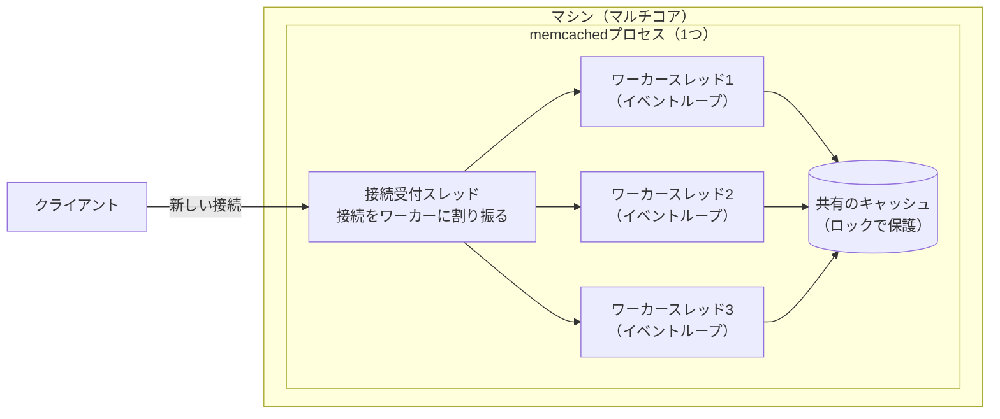
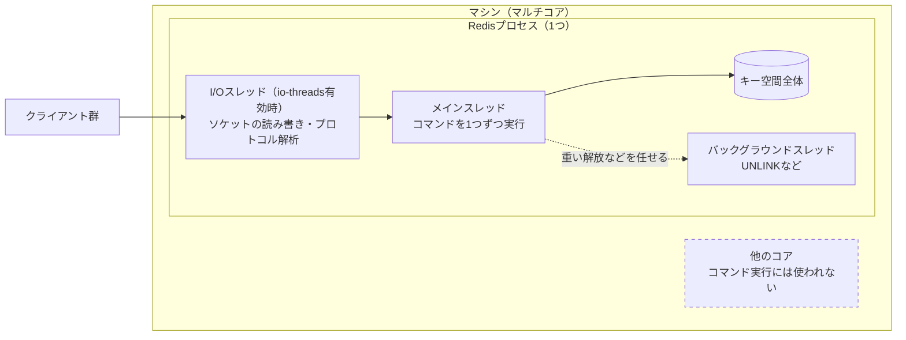
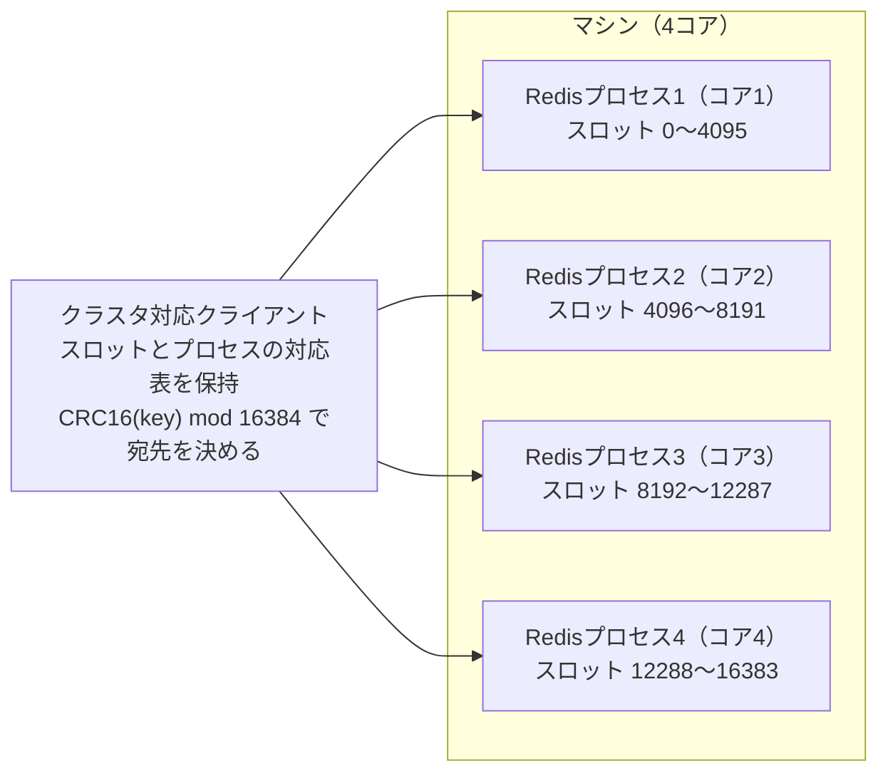
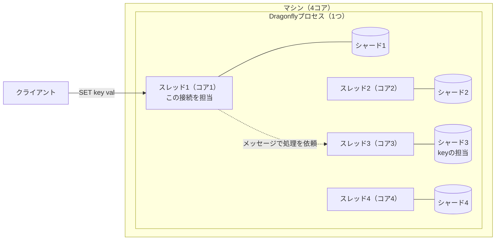
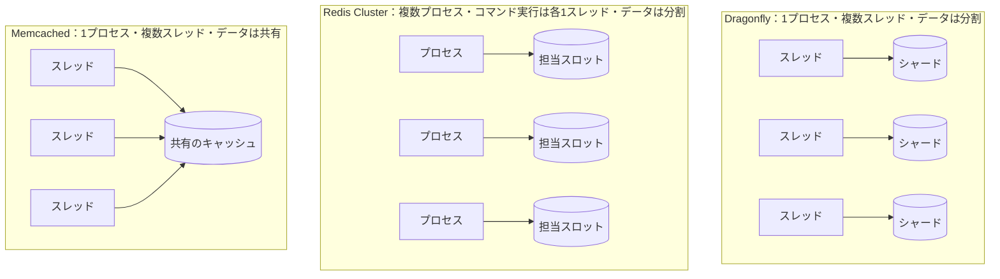

# はじめに
Webアプリケーションの高速化に欠かせないインメモリデータストアとして、長くMemcachedとRedisが使われてきた。近年は、マルチコアを前提に設計し直したDragonflyのようなプロダクトも登場している。

本記事では、3つの違いをスレッドモデルとスケールの仕方という観点から整理する。各プロダクトの公式ドキュメントやリポジトリの記述をもとに、主張の根拠と注意点も添える。

# TL;DR
- Memcachedはマルチスレッドで、単純なキー・バリューのキャッシュに特化している。永続化はない。
- Redisは豊富なデータ構造と永続化を持つ。コマンドの実行はシングルスレッドで、マルチコアは複数プロセスやRedis Clusterで使う。
- DragonflyはRedis・Memcached互換のAPIを持ち、キー空間をスレッドごとに分割するShared-Nothing設計で、1プロセスのままマルチコアを使う。
- 性能比較はベンチマークの条件次第で結論が変わる。ライセンスの違いも選定に影響する。

# MemcachedとRedisの違い
まずは定番の2つを比べる。

| 比較項目 | Memcached | Redis |
|---|---|---|
| 設計思想 | シンプルなキャッシュに特化 | 多機能なデータ構造サーバー |
| データ構造 | キーと値（値は任意のバイト列） | 文字列、ハッシュ、リスト、セット、ソート済みセットなど |
| 永続化 | なし（Warm Restartは計画的な再起動時のみ） | RDB（スナップショット）とAOF（追記ログ） |
| スレッドモデル | マルチスレッド（ワーカースレッドごとにイベントループ） | コマンド実行はシングルスレッド（I/Oなど一部は別スレッド） |
| 複数ノードへの分散 | クライアント側でキーをハッシュして振り分ける（組み込みプロキシも利用可） | Redis Cluster（ハッシュスロットによるシャーディング）とレプリケーション |

Memcachedのワーカースレッドは、それぞれが自分のイベントループで接続を処理し、キャッシュ本体は集中管理されたロックを介して共有する。1.5.18以降はWarm Restartという機能で、計画的に再起動したときにキャッシュを引き継げる。ただし公式ドキュメントのとおり停止中の更新は失われるため、永続化とは別物である。

1つのMemcachedプロセスの内部構成は次のとおりである。

新しい接続は接続受付スレッドが受け取り、いずれかのワーカースレッドへ割り振る。以降の処理はそのワーカースレッドが受け持つ。ワーカースレッドは複数のコアで並列に動くが、キャッシュ本体は1つを共有する。

Redisはデータ構造ごとに原子的な操作を提供し、RDBとAOFでディスクにも保存できる。キャッシュに限らず、カウンターやランキング、キューなど幅広い用途に使われてきた。

# Redisのコマンド実行がシングルスレッドである理由
Redisは「シングルスレッド」と言われるが、正確にはコマンドの実行がシングルスレッドである。設定ファイル（redis.conf）にも「Redisはほぼシングルスレッドだが、UNLINKや遅いI/Oなど一部の処理は別スレッドで行う」と書かれている。`io-threads`を有効にすると、ソケットの読み書きとプロトコルの解析も複数スレッドで処理できる。

1台のマシンで1つのRedisプロセスを動かした場合の構成は次のとおりである。

コマンドを実行するのはメインスレッドだけである。I/Oスレッドを有効にしても、コマンド実行に使えるコアは1つのままである。

コマンド実行をシングルスレッドにしている理由は、次の3つに整理できる。

- **CPUがボトルネックになりにくい**：公式FAQは、RedisでCPUがボトルネックになることはまれで、多くはメモリかネットワークが律速すると述べている。パイプラインを使えば、一般的なLinuxマシンで毎秒100万リクエストを処理できるとしている。
- **ロックが要らない**：コマンドは1本のスレッドで順に実行されるため、データ構造を守るためのロックが不要になる。ロックの取り合いや、それに伴うバグの心配がない。
- **原子性を保ちやすい**：1つのコマンドの実行中に他のコマンドが割り込まないため、各コマンドが原子的に動く。MULTI/EXECやLuaスクリプトでまとめた処理も、途中で他のクライアントの処理が挟まらない。

## Redisでマルチコアを使う方法
シングルスレッドでも、Redisでマルチコアを使う方法はある。公式FAQは、CPUを使い切りたい場合は同じマシンで複数のRedisインスタンスを起動し、別々のサーバーとして扱うよう勧めている。Redis Clusterを使えば、キー空間を16384個のハッシュスロットに分け、複数のプロセスやマシンに分散できる。

次の図は、4コアのマシン上の4つのRedisプロセスでRedis Clusterを組んだ例である。スロットの範囲は説明のための一例である。

各プロセスは担当スロットのキーだけを保持する。コマンド実行で使うのは、プロセスごとに1コアである。クライアントは、キーのハッシュスロットをもとに宛先のプロセスへ直接送る。対応表が古い場合は、MOVEDリダイレクトによって正しい宛先を教えてもらえる。同じ形のまま、プロセスを複数のマシンへ広げられる。

つまりRedisは、スレッドではなくプロセスを単位にマルチコアと複数マシンを使う設計である。「単一プロセスに大量のコアを与えても使い切れない」というのが正確な理解になる。

# 1プロセスでマルチコアを使うという課題
ここまでを整理すると、両者には次のようなトレードオフがある。

- **Memcached**：1プロセスでマルチコアを使えるが、扱えるのは単純なキー・バリューのみで、永続化もない。
- **Redis**：機能は豊富だが、1プロセスで使えるのは実質1コア分のコマンド実行能力である。マルチコアを使うには、複数のプロセスを起動してシャーディングする運用が要る。

複数プロセスの運用には、シャードの配置やリバランス、クライアントのクラスタ対応といった手間がかかる。Redis Clusterでは、複数キーを扱う操作も、対象のキーがすべて同じハッシュスロットにある場合だけ実行できる。「Redisのような機能を、1プロセスのままマルチコアで速く動かせないか」という発想から生まれたのが、Dragonflyのようなマルチスレッドのデータストアである。

# Dragonflyとは
DragonflyはC++製のインメモリデータストアで、RedisとMemcachedのAPIとの互換性をうたっている。READMEによると、2022年に設計したらどうなるかという実験から始まった。最初の課題は、パブリッククラウドで現在使えるサーバーのCPU・メモリ・I/Oを使い切ることだったという。

## Shared-Nothingアーキテクチャ
Dragonflyの中心にあるのが、Shared-Nothingアーキテクチャである。

- キー空間をスレッド数以下の「シャード」に分割する。各シャードの所有者は1つのスレッドに限られ、データの操作も所有スレッドだけが行う。
- キーのハッシュ値で担当のシャードが決まる。接続担当のスレッドは、担当シャードのスレッドへメッセージで処理を依頼する。スレッド間の連携はメッセージの受け渡しだけで行う。他のスレッドがシャードのデータを直接操作することもない。
- 複数のシャードにまたがる操作は、VLL（Very Lightweight Locking）という論文を基にしたトランザクションの仕組みで調整する。READMEによれば、これによりミューテックスやスピンロックを使わずに、複数キーの操作を原子的に実行できる。

4コアのマシンで動くDragonflyの構成は次のとおりである。

例えば、キーの担当がシャード3なら、スレッド1はスレッド3へメッセージで処理を依頼する。各シャードに触れるのは所有スレッドだけなので、データを守るロックも要らない。

Memcachedは複数のスレッドが1つの領域を共有し、Redisは1本のスレッドがすべてを扱う。Dragonflyはスレッドごとに担当範囲を分けることで、共有によるロックの取り合いを避けている。

このほか、ハッシュテーブルにDashという構造を採用し、fork()を使わないスナップショットも実装している。READMEのベンチマークでは、アイドル時のメモリ効率がRedisより30%高いとしている。スナップショット中もメモリ使用量がほぼ増えず、ピーク時のRedisはDragonflyの約3倍のメモリを使ったという。

# ベンチマークの読み方
Dragonflyの性能を語るときによく引用されるのが、READMEにある「25倍のスループット」である。これはAWSのc6gn.16xlargeで、Dragonfly 1台と単一プロセスのRedisを比べた結果である。

これに対してRedis社は2022年のブログで、同じインスタンスに40シャードのRedis 7.0 Clusterを動かせば、Dragonflyより18〜40%高いスループットが出たと反論している。このときRedis側のプロセスは64 vCPUのうち40個分だけで、Dragonfly側が64 vCPUすべてを使い切っていた点も添えている。比較の土台が「1プロセス対1プロセス」か「マシン1台全体対マシン1台全体」かで、結論が逆になるわけである。

どちらもベンダー自身による計測であり、ワークロードや設定によって結果は変わる。採用を検討する際は、自分のワークロードで計測するのが確実である。

# ライセンスとエコシステム
技術以外に、ライセンスも選定に影響する。

- **Redis**：2024年3月、Redis 7.4以降のライセンスをBSDからRSALv2とSSPLv1のデュアルライセンスへ変更した。どちらもOSI承認のオープンソースライセンスではない。その後Redis 8から、OSI承認のAGPLv3も選べるようになった。
- **Valkey**：Redisのライセンス変更を受けて生まれたBSDライセンスのフォークで、Linux Foundationのもとで開発されている。AWSのElastiCacheやGoogle CloudのMemorystoreが、Valkeyのマネージドサービスを提供している。
- **Dragonfly**：BSL 1.1（Business Source License）で、OSI承認のオープンソースではない。本番利用で許されるのは、自社の製品やサービスの一部として使う場合だけである。ただし、その製品やサービスがインメモリデータストアにあたるときは対象外となる。Dragonflyを第三者向けのサービス（SaaSなど）として提供することも認められていない。現行のLICENSEの規定で、各バージョンは公開から4年後、または2030年11月1日のいずれか早い日にApache 2.0へ切り替わる。

自社サービスのキャッシュや社内基盤として使う分には、多くの場合どれも問題にならない。注意が要るのは、他社向けのマネージドサービスとして提供する場合や、インメモリデータストアそのものを製品にする場合である。

# まとめ
3つのプロダクトの位置付けは次のとおりである。

- **Memcached**：単純なキー・バリューのキャッシュを、1プロセスのマルチスレッドで高速に処理したい場合の選択肢である。
- **Redis（とValkey）**：豊富なデータ構造、永続化、レプリケーション、クラスタを使いたい場合の定番である。マルチコアはプロセスを増やして使う。
- **Dragonfly**：Redis互換のAPIのまま、1プロセスでマルチコアを使い切りたい場合の選択肢である。互換性の範囲とライセンスは事前に確認が要る。

3つのスケールの仕方を並べると、次の図のようになる。

「シングルスレッドだから遅い」「マルチスレッドだから速い」と単純には言えない。スケールの単位をプロセスにするかスレッドにするかという設計の違いであり、運用の手間やライセンスも含めて、要件に合うものを計測して選ぶのがよい。

# 関連記事
- [キャッシュ戦略の基本的なパターン](/ja/posts/cache-strategy-patterns/)
- [キャッシュの書き込み方式](/ja/posts/cache-write-methods/)
- [実践Redis入門 技術の仕組みから現場の活用まで](/ja/posts/redis-practical-introduction/)

# 参考リンク
- [Redis FAQ](https://redis.io/docs/latest/develop/get-started/faq/)
- [redis.conf（THREADED I/Oの節）](https://github.com/redis/redis/blob/unstable/redis.conf)
- [Redis Adopts Dual Source-Available Licensing](https://redis.io/blog/redis-adopts-dual-source-available-licensing/)
- [Redis is now available under the AGPLv3 open source license](https://redis.io/blog/agplv3/)
- [Redis cluster specification](https://redis.io/docs/latest/operate/oss_and_stack/reference/cluster-spec/)
- [Redis Transactions](https://redis.io/docs/latest/develop/using-commands/transactions/)
- [13 Years Later – Does Redis Need a New Architecture?](https://redis.io/blog/redis-architecture-13-years-later/)
- [Valkey](https://valkey.io/)
- [Memcached Documentation: Performance and Efficiency](https://docs.memcached.org/serverguide/performance/)
- [Memcached Documentation: Warm Restart](https://docs.memcached.org/features/restart/)
- [Memcached Documentation: Basic Text Protocol](https://docs.memcached.org/protocols/basic/)
- [dragonflydb/dragonfly（README）](https://github.com/dragonflydb/dragonfly)
- [Dragonfly Architecture（docs/df-share-nothing.md）](https://github.com/dragonflydb/dragonfly/blob/main/docs/df-share-nothing.md)
- [Dragonfly LICENSE（BSL 1.1）](https://github.com/dragonflydb/dragonfly/blob/main/LICENSE.md)

