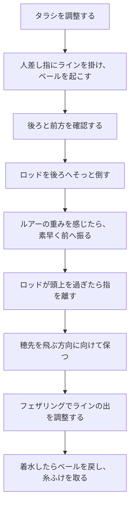
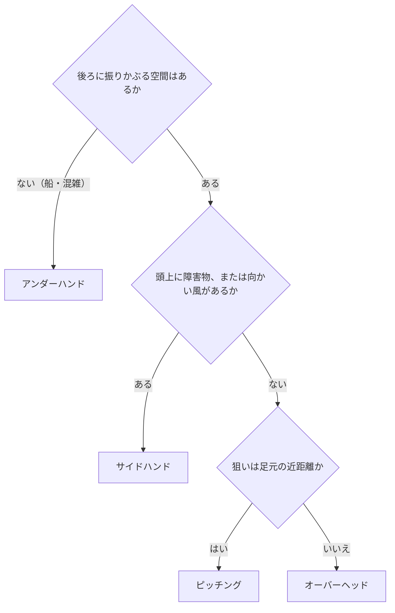

# はじめに
ルアー釣りは、狙った場所へルアーを届けるところから始まる。本記事では、スピニングリールのキャストを基本の手順、投げ方の使い分け、精度と飛距離、ライントラブル対策の順に整理する。

シーバス、ロックフィッシュ、ライトゲームなど、スピニングタックルでルアーを投げる釣り全般に共通する内容である。

# キャストの基本：ロッドの反発で投げる
ルアーを飛ばすのは腕力ではなく、曲がったロッドが元に戻るときの反発力である。力を込めて振り切るのではなく、ルアーの重さをロッドに乗せることを意識する。

両手で投げるときは、利き手を前へ押し出し、反対の手でグリップエンドを手前に強く引く。ロッドが十分に曲がり、飛距離に必要な力が生まれる。

# 投げる前の準備
## タラシの長さ
穂先からルアーまでのラインの長さを「タラシ」と呼ぶ。シマノは30〜50cmを目安とし、最初は短めを勧めている。ダイワは短い場合で10cm、長い場合で70〜80cm程度とし、ルアーの重さや風で調整するとしている。

| タラシ | 特徴 | 向く場面 |
| --- | --- | --- |
| 短い（10〜30cm） | 振りが小さく、狙いを定めやすい | 近距離、精度を重視するとき、初心者 |
| 標準（30〜50cm） | 精度と飛距離のバランスがよい | まずはここから |
| 長い（50〜80cm） | ロッドがしなりやすく、飛距離を出しやすい。狙いはぶれやすい | 遠投、重いルアー |

## 握り方とラインの掛け方
投げるたびに繰り返す基本動作である。次の順に行う。

1. **2本指で持つ**：リールフットの前に人差し指と中指の2本を出し、リールフットを中指と薬指の間に挟んで握る。ロッドがぶれにくく、人差し指を自由に動かせる。
2. **リールを回してラインローラーを上にする**：ハンドルを少し回してローターを回転させ、ラインローラーをロッド側（真上）に持ってくる。ラインローラーが下にあると、人差し指がラインに届かない。
3. **人差し指にラインを掛ける**：ラインローラーから出ているラインを人差し指で拾い、指先に掛ける。
4. **ベールを起こす**：ラインを指に掛けたまま、反対の手でベールを起こす。指で押さえているので、指を離すまでラインは出ていかない。

## 安全確認
後ろに人や障害物がないか、投げる方向に船などがないかを確認してから投げる。

# 基本の投げ方（オーバーヘッドキャスト）
頭上から真っすぐ振り下ろす、もっとも基本の投げ方である。流れは次のとおり。

1. タラシを30〜50cmにする。慣れるまでは短めでよい。
2. 利き手でリールシートを握り、人差し指の指先にラインを掛けてベールを起こす。
3. 後ろと投げる方向を確認する。
4. ルアーの重さを感じながら、ロッドを後ろへゆっくり倒す。
5. 狙う場所に目線を合わせ、後ろに振られたルアーの重みが指先に伝わったら、素早く前へ振り始める。
6. ロッドが頭上を通過したところで、ラインを掛けていた人差し指を離す。
7. ロッドを前へ振り抜き、ルアーが飛ぶ方向に穂先を向けたまま保つ。
8. ラインが出ている間は、人差し指でスプールのふちに軽く触れ、余分なラインが出ないように調整する。
9. 着水してから着底までの間にベールを戻し、巻き始める。

コツは次の3つである。

- 脇を締め、ロッドを水面に対して垂直に振る。脇が開くと軌道がぶれ、狙いが定まらない。
- 指を離すのが早いとルアーは上へ高く飛び、遅いと手前の水面に叩きつけるように落ちる。方向がずれたら、まず離すタイミングを見直す。
- 最初から全力で投げない。力は7〜8割程度にして、狙った方向へまっすぐ飛ばすことを優先する。

# 投げ方の種類と使い分け
オーバーヘッドキャストだけでは対応できない場面がある。周りの状況に合わせて投げ方を選ぶ。

| 投げ方 | 振り方 | 長所 | 向く場面 |
| --- | --- | --- | --- |
| オーバーヘッド | 頭上から真っすぐ振り下ろす | 方向が安定し、飛距離も出やすい | 開けた場所。まずはこれ |
| サイドハンド | 体の横から水平に振る | 弾道が低く、風の影響を受けにくい | 向かい風、頭上に木や橋がある、低い弾道で奥へ入れたい |
| アンダーハンド | 腰より下から前へ振り出す | 振りかぶる空間がなくても投げられる | 船の上、混雑した釣り場、近距離 |
| ピッチング | ルアーを振り子のように揺らして送り出す | 着水音が小さく、近距離の精度が高い | 足元や障害物の周りを正確に狙う |

船の上では隣の釣り人との距離が近く、振りかぶる空間もない。そのため自分の前で投げるアンダーハンドがマナーとされている。

どの投げ方を選ぶかは、次の順に考えると迷わない。

# 狙った場所に落とす
- 狙う点を決めてから投げる。目線は着水させたい場所に置き続ける。
- 体とロッドの向きを狙う方向にそろえる。脇を締め、ロッドを垂直に振る。
- 距離はフェザリングで合わせる。飛びすぎそうなら、人差し指でスプールのふちに触れてラインの出を抑える。
- 障害物の際を狙うときは、狙いの少し奥へ投げてから、引いてきて際を通すと外しにくい。

フェザリングは、キャスト中に出ていくラインの量を指で調整する操作である。ベイトリールで親指を使う場合はサミングと呼ぶ。

# 飛距離を伸ばす
- ルアーの重さを、ロッドに表記された適合ルアー重量の範囲に収める。重すぎるとロッドが曲がりすぎ、ぶれてラインが絡みやすくなる。
- ラインは適量まで巻く。少なすぎると飛距離が落ちる。
- タラシを少し長めにして、ロッドをしっかり曲げる。
- 力まない。腕で振り切るより、手首を軽く返すイメージで振り抜く方がロッドの弾力を活かせる。
- 追い風は利用する。向かい風では、サイドハンドで弾道を低くする。

# 着水したらやること
- 着水の瞬間にフェザリングでラインの放出を止め、糸ふけ（余分なたるみ）を出さない。
- ベールを手で戻し、ラインを軽く張ってから巻き始める。たるんだラインをそのまま巻くと、スプール上でラインが浮き、次のキャストでトラブルの原因になる。
- 底を取るルアーなら、着水から着底までの秒数を数えておく。水深の目安になり、次の一投でレンジを刻むときに使える。

# ライントラブルを防ぐ
エアノット（ラインにできるこぶ状の結び目）やガイドへの絡みは、事前の準備と現場でのケアで多くを防げる。シマノが挙げている主な原因と対策は次のとおりである。

| 原因 | 起こること | 対策 |
| --- | --- | --- |
| ラインの巻きすぎ | ラインがまとまって出て、エアノットになる | スプールのふちを目安に巻く。多発するなら少し減らす |
| 巻き形状の崩れ（下側が膨らむ） | もっともトラブルが起きやすい | スプールを奥まで確実に付ける。ワッシャーを減らして巻き直す |
| リーダーをスプールに巻き込んで投げる | リーダーがガイドで抵抗になり、後から出たラインがたるんで絡む | リーダーをスプールに巻き込まない長さで投げる |
| ノットが長すぎる | エアノットやガイド絡みが増える | 強度が出る範囲で、結び目を短く仕上げる |
| リーダーの巻き癖 | ガイドでの抵抗が増え、絡みのきっかけになる | 釣行ごとにリーダーを結び直す |
| ロッドとの不一致 | 太すぎるラインは糸抜けが悪化。重すぎるルアーはロッドがぶれる | ロッドの適合ラインと適合ルアー重量を守る |
| 継ぎ目のずれ | ガイドの向きがずれ、ラインの出が乱れる | 継ぎ目のガイドが一直線に並んでいるか確かめる |

現場では、前節のとおり着水時にフェザリングを入れ、たるんだラインをそのまま巻かないことが一番の対策になる。

# 安全とマナー
- 投げる前に、後ろと左右に人がいないか必ず確認する。
- 船の上や混雑した釣り場では、振りかぶらないアンダーハンドで投げる。
- フックの付いたルアーが後ろを通るので、偏光グラスと帽子で目と頭を守る。

# 練習方法
- 最初は7〜8割の力で、狙った方向へまっすぐ投げることを優先する。飛距離は、方向が安定してから伸ばせばよい。
- 練習では、フックの付いていない練習用のおもりを使う。
- バケツや輪を的にして、狙った距離で止めるフェザリングも一緒に練習する。
- 公園などでは、投げる練習が禁止されていないか事前に確認する。

# 現場用まとめ
- 投げる前に後ろを確認する
- タラシは30〜50cm。2本指で持ち、ラインローラーを上にして人差し指に掛けてからベールを起こす
- 腕力ではなくロッドの曲がりで投げる。力は7〜8割
- ロッドが頭上を過ぎたら指を離す
- 飛びすぎたらフェザリング。着水したらベールを手で戻し、糸ふけを取る
- 空間がなければアンダーハンド、風や頭上の障害物にはサイドハンド

# 関連記事
- [ロックフィッシュ実釣ガイド](/ja/posts/rockfish-worm-field-guide/)

# 参考
- [fish.shimano.com - 初心者向け ルアーの投げ方](https://fish.shimano.com/ja-JP/content/beginners/fishingstyle/lurefishing/action/index.html)
- [fish.shimano.com - 必見！SWスピニングリールキャスティング・ライントラブル対策法](https://fish.shimano.com/ja-JP/content/fishingstyle/article/2026/260430/index.html)
- [daiwa.com - ガイド付き竿で投げる](https://www.daiwa.com/jp/beginner/throw/guide)

