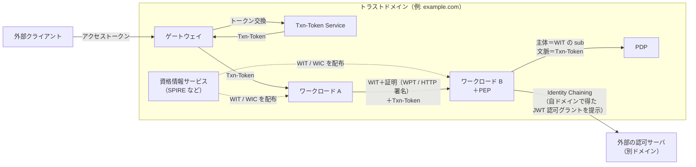
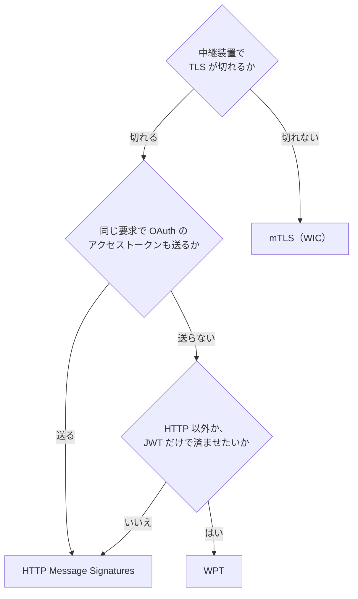
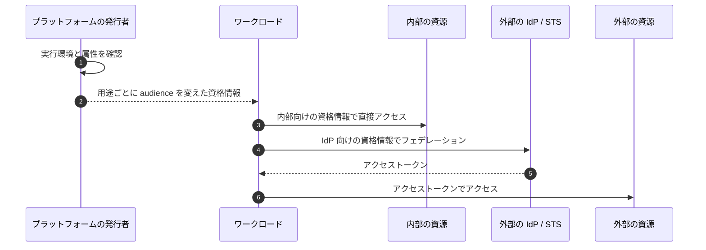
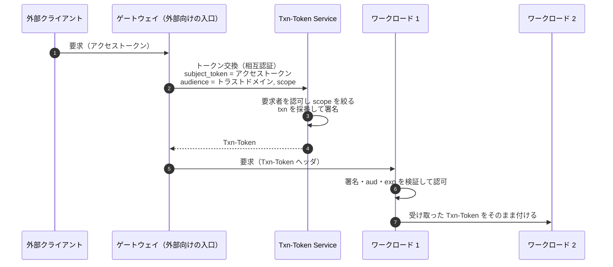
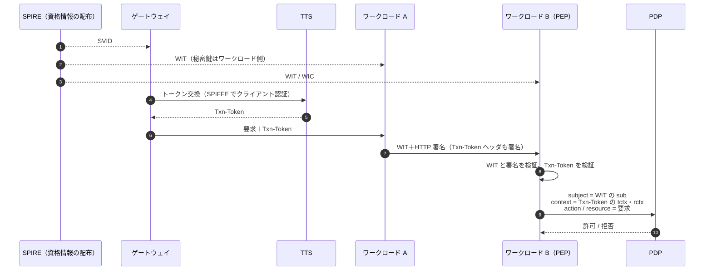

# 概要

マイクロサービスでは、人間だけでなくサービス自身も認証と認可の主体になる。サービスAがサービスBを呼ぶとき、Bは「呼び出し元はどのワークロードか」と「この呼び出しは誰の、どの取引のためか」の2つを知る必要がある。

mTLS、Token Exchange（RFC 8693）、SPIFFE/SPIREといった基本の道具は「[サービス間認証の全体像とは？](/ja/posts/service-to-service-authentication/)」で整理した。この記事では、その上でIETFが進めている次の標準化を扱う。

- **WIMSE**（Workload Identity in Multi System Environments）: ワークロードの識別子、資格情報（WIT/WIC）、認証方式を定めるIETFのドラフト群
- **Transaction Tokens**: 外部のアクセストークンなどを、1つの取引に結び付いた内部用のトークンに交換し、呼び出しの連鎖に伝える仕組み
- **OAuth SPIFFE Client Authentication**: SPIFFEのSVIDをOAuthのクライアント認証に使い、`client_secret`をなくす仕組み

この記事で答える問いは次のとおりである。

- WIMSEはSPIFFEと何が違い、何を足すのか
- WIT、WIC、WPTとは何で、mTLS・HTTP署名・WPTのどれをいつ選ぶのか
- ワークロードに資格情報を配るとき、何を守るべきか
- Transaction Tokensはアクセストークンと何が違い、どう伝播させるのか
- これらをどう組み合わせると、PEPとPDPに渡す「主体」と「文脈」がそろうのか

どれもまだインターネットドラフトで、版ごとに中身が動いている。各ドラフトの版と状態は2026年10月時点でIETF Datatrackerを確認した結果を末尾にまとめた。

# なぜワークロードアイデンティティを標準化するのか

ゼロトラストの考え方では、ネットワークの内側にいることを信頼の根拠にしない。各ワークロードは検証できる身元と資格情報を持ち、呼ばれる側がそれを毎回確かめる必要がある。

このとき、解くべき問いは4つに分かれる。

| 問い | 何が難しいか | 主な標準 |
| --- | --- | --- |
| ワークロードにどう身元を配るか | 秘密を事前に配ると、配布とローテーションと漏えいが問題になる | SPIFFE/SPIRE、WIMSEの実践ガイド |
| ワークロード同士でどう認証するか | TLSがプロキシやロードバランサで切れると、相手の身元が途切れる | WIMSEのWIT/WIC、mTLS、HTTP署名、WPT |
| 呼び出しの文脈を内部でどう運ぶか | 外部のアクセストークンを内部で使い回すと、盗まれたときの被害が大きい | Transaction Tokens |
| 別のトラストドメインにどうアクセスするか | 内部の資格情報や形式を外に出したくない | Identity Chaining、Transaction Tokenのチェイニングのプロファイル |

このうち身元の配布と認証に共通するのは、長命の共有シークレット（静的なAPIキーや`client_secret`）を置かないという方針である。代わりに、短命でできるだけ鍵に結び付いた資格情報を、環境の構成証明（attestation）にもとづいて配る。

全体の関係を先に図で示す。



身元はWIMSEの資格情報が、取引の文脈はTransaction Tokensが運ぶ。HTTP署名やWPTを使う場合は、両者を所持の証明で結び付ける。呼ばれる側のPEPは、検証済みの値だけをPDPに渡す。これが全体の骨格である。

# WIMSEのアーキテクチャ

WIMSEのアーキテクチャのドラフト（draft-ietf-wimse-arch）は、それ自体ではプロトコルを定めない。プロトコルを設計・標準化するための土台として、用語、ユースケース、部品の関係を整理する文書である。

## 3つの基本要素

アーキテクチャは次の3つで組み立てる。

| 要素 | 内容 |
| --- | --- |
| トラストドメイン | 共通のセキュリティ統制とポリシーを持つシステムのまとまり。組織が持つFQDNで識別すべき（SHOULD）。X.509のトラストアンカーと、WITを検証するJWK Setに安全な方法で対応づける（MUST） |
| ワークロード識別子 | トラストドメインの中でワークロードを一意に表すURI。形式は別のドラフト（draft-ietf-wimse-identifier）が定める。SPIFFE IDは準拠する例として挙がっている |
| ワークロードアイデンティティ資格情報 | 識別子を暗号鍵に結び付けた資格情報。JWTの形のWIT（Workload Identity Token）と、X.509証明書の形のWIC（Workload Identity Certificate）がある |

識別子の意味は、検証したトラストドメインに依存する。arch-08によれば、同じ識別子の値を含む2つの資格情報も、同じトラストドメインと発行者の信頼設定で検証したときにだけ同じワークロードを表す。後で出てくる、pathだけで認可しないという規則も、この考え方に立っている。

資格情報は寿命を区切り、自動で更新すべき（SHOULD）とされる。要求ごとに鍵ペアを作り直す必要は通常ない。

## 3つのシナリオ

arch-08は部品を段階的に足しながら3つのシナリオを示す。

| シナリオ | 追加される部品 | 要点 |
| --- | --- | --- |
| 基本 | ゲートウェイ、CA/資格情報サービス | ワークロードは資格情報で互いを認証する。呼ばれる側は相手の身元で呼べるAPIを決め、監査に残す |
| コンテキスト | コンテキストサービス | ゲートウェイが外部のアクセストークンを内部用のコンテキストトークンに交換する。アクセストークンは通常内部に転送しない |
| ドメインをまたぐ | トークンサービス、外部トークンサービス | 内部の身元と文脈を、別ドメインで使えるトークンに交換する。手順はIdentity Chainingに沿う |

arch-08は、このコンテキストトークンの例としてTransaction Tokensを挙げている。外部向けのベアラートークンを内部に流さず、内部でだけ意味を持つトークンに置き換える。

# ワークロード識別子の規則

draft-ietf-wimse-identifierは、ワークロード識別子の形式を定めるドラフトである。識別子は認可ポリシーの主体や監査ログのキーになるので、データモデルに直接効く。

識別子は、トラストドメインをauthorityに持つ絶対URIである。スキームは固定せず、`spiffe`も、ドラフトが定義する`wimse`も使える。SPIFFE IDは準拠する形式の1つで、そのまま使える。

```text
spiffe://prod.example.org/ns/prod-01/sa/payment-api
wimse://trust.example.com/service/payment
```

認可基盤の設計に効くのは次の3点である。

- **ポリシーは識別子全体で書く**。比較と認可はURI全体で行う（MUST）。pathだけを照合すると、別のトラストドメインが同じpathを名乗ったときに通してしまう。ワイルドカードや前方一致での解釈も避ける（SHOULD NOT）。
- **まとまりは属性で引く**。名前空間やチームのような単位は、pathの解析ではなくサービスカタログなどのPIPから得る。
- **到達先と識別子の対応を持つ**。DNS名やIPアドレスから識別子を導けると仮定してはならない（MUST NOT）。対応は設定やサービスディスカバリで持つ。

# 資格情報: WITとWIC

draft-ietf-wimse-workload-credsは、識別子を公開鍵に結び付ける2つの資格情報を定める。使うときは、対応する秘密鍵の所持を証明する。

| 形式 | 中身 | 主な用途 |
| --- | --- | --- |
| WIT（Workload Identity Token） | 資格情報サービスが署名したJWT。`typ`は`wit+jwt` | アプリ層の認証 |
| WIC（Workload Identity Certificate） | URI型のSANに識別子を1つだけ入れたX.509証明書 | トランスポート層（mTLS）の認証 |

WITの主なクレームは、ワークロード識別子の`sub`、有効期限の`exp`、公開鍵の`cnf.jwk`である。資格情報1つにつき識別子は1つなので、主体がぶれず、ポリシーと監査を突き合わせやすい。

検証鍵は、`sub`のトラストドメインに帯域外で設定したトラストアンカーから得る。`iss`のURLなど、トークンの中の情報だけを頼りに鍵を取りに行ってはならない（MUST NOT）。WITは通常失効させられないので、漏えいへの主な対策は数時間程度の短い有効期限である。

SPIFFEも、WITをSPIFFE向けに絞り込んだWIT-SVIDを取り込み始めている（安定度はIncubating）。ベアラーのJWT-SVIDと違い、盗まれても所持の証明がなければ使えない。

# 3つの認証方式と選び方

WITとWICで相手を認証する方式は、3本のドラフトに分かれている。

| 観点 | mTLS（mutual-tls） | HTTP Message Signatures（http-signature） | WPT（wpt） |
| --- | --- | --- | --- |
| 層 | トランスポート層 | アプリ層（HTTPだけ） | アプリ層（形式はプロトコル非依存） |
| 資格情報 | WIC | WIT | WIT |
| TLSを終端する中継装置 | 認証が途切れる | 越えられる。署名した部分の改変を検出できる | 越えられる。能動的に悪意のある中継装置からは守れない |
| 同じ要求にOAuthのアクセストークン | 載せられる | `Authorization`を署名で覆える | 載せられない（`Authorization`をWPTが占める） |

次の問いを順にたどると、選び方はおおむね決まる。主な分かれ目は、TLSが中継装置で切れるかと、同じ要求でOAuthのアクセストークンも送るかの2つである。



層は組み合わせられる。区間ごとのmTLSに、端から端までのHTTP署名を重ねる構成がその一例である。

WIMSEの方式は「呼び出し元はどのワークロードか」を証明する。OAuthの送信者制約（「[送信者制約トークンとは？](/ja/posts/sender-constrained-tokens-mtls-dpop/)」）が証明するのは「このアクセストークンを使ってよいのは誰か」で、守る対象が違う。

# 資格情報をどう配るか

draft-ietf-wimse-workload-identity-practicesは、今のプラットフォームでワークロードが資格情報を得る実践をまとめた文書である。秘密を事前に配るのではなく、プラットフォームが実行環境を確かめてから資格情報を発行する。外部の資源には、外部のIdPやSTSにフェデレーションして得たトークンでアクセスする。



Kubernetes、クラウド、SPIFFEでの具体例は「[サービス間認証の全体像とは？](/ja/posts/service-to-service-authentication/)」で扱った。設計に直結する要件は次のとおりである。

- **用途ごとにaudienceの違う資格情報を使い、`aud`は1つにする**（MUST）。同じベアラートークンを内部の資源と外部のIdPに見せると、IdPがワークロードになりすませる。
- **寿命をインスタンスより長くせず、インスタンスが止まったら無効にする**（MUST）。
- **所持の証明を使う**（SHOULD）。使えない場合は、短い寿命、厳しいaudience、ネットワークの統制で補う（MUST）。
- **独自クレームの値を評価する**（MUST）。CI/CDで保護された`main`ブランチにだけフェデレーションを許すには、ブランチのクレームの値を見る必要がある。
- **環境変数で渡さない**。他の受け渡し方があるなら、本番で環境変数を使ってはならない（MUST NOT）。

# Transaction Tokensで取引の文脈を運ぶ

WIMSEの資格情報が運ぶのは「どのワークロードか」までで、「誰の、どの取引のためか」は運ばない。それを担うのがdraft-ietf-oauth-transaction-tokens（Txn-Token）である。

内部のワークロードが侵害されると、正当な取引がないのに他のワークロードを呼んだり、パラメータを書き換えたりできる。Txn-Tokenは、利用者やワークロードの身元と取引の文脈を短命の署名付きJWTにして、トラストドメインの中の呼び出しの連鎖全体に伝える。下流のワークロードはこれにもとづいて認可を判断し、署名で途中の改変を検知する。



発行するのは、トラストドメインごとに1つのTransaction Token Service（TTS）である。要求にはRFC 8693のトークン交換を使い、`subject_token`に外部のアクセストークンを渡す。渡せる受信トークンがない内部の処理は、自己署名のJWTで取引を始めてもよい。

Txn-TokenはJWTで、主な中身は取引の識別子`txn`、主体`sub`、目的`scope`、取引の間変わらない認可の詳細`tctx`、元の要求の環境`rctx`である。ドラフトの例では、株の売買を次のように表している（一部を省略した）。

```jsonc
{
  "aud": "trust-domain.example",
  "txn": "97053963-771d-49cc-a4e3-20aad399c312",
  "sub": "d084sdrt234fsaw34tr23t",
  "req_wl": "apigateway.trust-domain.example",
  "scope": "trade.stocks",
  "rctx": { "req_ip": "69.151.72.123", "authn": "face" },
  "tctx": { "action": "BUY", "ticker": "MSFT", "quantity": "100" }
}
```

`tctx`に数量や銘柄を入れておけば、途中のワークロードが要求の数量を書き換えても検知できる。

扱いの規則は次のとおりである。

- HTTPでは`Txn-Token`ヘッダで渡し、`Authorization`ヘッダは使わない。受け取った側は署名、`aud`、`exp`を検証し、下流へは改変せずに付ける。
- OAuthのアクセストークンとしても、自分の認証にも使わない（MUST NOT）。中に外部のアクセストークンを入れない。
- TTSはスコープを`subject_token`より広げない（MUST）。
- リプレイに耐性がないので、寿命は数分以下にとどめ、一度見た`txn`は拒否する。

Txn-Tokenは`aud`のトラストドメインの中でだけ有効である。別ドメインへ文脈を引き継ぐなら、Identity Chainingを使う（SHOULD）。Txn-TokenからJWT認可グラントを得る具体的な手順は、個人ドラフトのdraft-fletcher-oauth-txn-token-chaining-profileが定める。Identity Chainingそのものは「[認可基盤に必要なOAuth関連標準とは？](/ja/posts/oauth-standards-map-authorization-platform/)」で扱う。

# SPIFFEをOAuthのクライアント認証に使う

サービス間のOAuthで`client_secret`を使うと、その秘密を配って管理する必要がある。draft-ietf-oauth-spiffe-client-authは、SPIFFEのSVIDをそのままOAuthのクライアント資格情報にして、この秘密をなくす。

| 方式 | 資格情報 | 所持の証明 |
| --- | --- | --- |
| JWT-SVID | `sub`にSPIFFE IDを入れたJWT | なし（ベアラー） |
| X.509-SVID | URI SANにSPIFFE IDを入れた証明書 | TLSハンドシェイク |
| WIT-SVID | WIMSEのWIT | PoP JWT |

ASは、検証鍵をトラストドメインごとに設定したSPIFFEのバンドルから得る。X.509-SVIDの検証にシステムの信頼ストアを使ってはならない（MUST NOT）。`iss`から発見した鍵で署名が通るだけで、JWT-SVIDとして受け入れてもならない（MUST NOT）。どちらも、無関係なCAや発行者が任意のSPIFFE IDを名乗れてしまう。

設計上の注意は、SPIFFE IDと`client_id`の対応づけがそのまま認可の判断になることである。SPIREの登録エントリを作れる人は、どのワークロードがどのOAuthクライアントとして振る舞えるかを決められる。登録エントリの作成は、ASのクライアント登録と同じ水準で管理する。

既定の方式は、ASと直接TLSでつながるならX.509-SVID、途中でTLSが終端されるなら短命のJWT-SVIDが現実的である。ただしJWT-SVIDはベアラーなので、その中継装置を信頼できることが前提になる。

# どう組み合わせるか

ここまでの仕様は、役割がはっきり分かれている。

| 仕様 | 運ぶもの | 問い |
| --- | --- | --- |
| WIMSEの識別子 | ワークロードの名前 | 誰を指すか |
| WIT / WIC | 識別子と公開鍵の結び付き | 誰の鍵か |
| mTLS / HTTP署名 / WPT | 所持の証明 | 今提示しているのは本人か |
| Transaction Tokens | 利用者と取引の文脈 | 誰の、どの取引のためか |
| SPIFFEクライアント認証 | ASに対するワークロードの身元 | どのOAuthクライアントか |
| Identity Chaining とそのプロファイル | 境界を越えるグラント | 別ドメインでどう続けるか |

これらを1つの要求の流れに重ねると次のようになる。



PDPへの入力では、主体はWITの`sub`、文脈はTxn-Tokenのクレームになる。ここで大事なのは、**所持の証明に結び付いた値だけをPDPに渡す**ことである。HTTP署名は`Txn-Token`ヘッダを署名の対象にし、WPTは`tth`でTxn-Tokenのハッシュを結び付ける。

ただし結び付けで防げるのは、中継装置によるTxn-Tokenの差し替えや削除までである。Txn-Tokenを盗んだ別の正当なワークロードが、自分の証明で覆って送ることは防げない。これは「このワークロードがこの取引のTxn-Tokenを提示してよいか」という認可ポリシーと、TTSの発行ポリシーで防ぐ。

# 設計の指針

- **主体は識別子全体で書く**。pathだけの照合や前方一致を避ける。
- **認証の成功を認可とみなさない**。mTLSが通ったことは、どの資源にアクセスしてよいかを意味しない。
- **認証方式は主に「TLSが中継装置で切れるか」と「同じ要求にOAuthのトークンを載せるか」で選ぶ**。HTTPの東西トラフィックでは、mTLSを基本にし、TLSが切れる経路にはHTTP署名を重ねるのが無難である。
- **外部のアクセストークンを内部で使い回さない**。ゲートウェイでTxn-Tokenに交換し、スコープを取引の目的まで絞る。
- **資格情報は用途ごとにaudienceを分け、短命にする**。
- **`client_secret`はSPIFFEのクライアント認証で置き換え、SPIFFE IDと`client_id`の対応づけを認可の判断として管理する**。
- **即時の取り消しはポリシーでも効かせる**。WITのような資格情報は通常失効させられないので、短命の資格情報と即時に効くPDPのポリシーを組み合わせる。

# 仕様の状態（2026年10月時点）

2026年10月26日にIETF Datatrackerで確認した状態である。ドラフトは版ごとに中身が変わるので、実装するときは準拠する版を固定してほしい。

| ドラフト | 最新版（日付） | 状態 |
| --- | --- | --- |
| draft-ietf-wimse-arch | -08（2026-07-06） | WG Document |
| draft-ietf-wimse-identifier | -04（2026-10-23） | WG Document。本文はStandards Track |
| draft-ietf-wimse-workload-identity-practices | -07（2026-09-22） | IESGに提出済み（AD Evaluation）。Informational |
| draft-ietf-wimse-workload-creds | -02（2026-07-02） | WG Document |
| draft-ietf-wimse-mutual-tls | -03（2026-10-24） | WG Document |
| draft-ietf-wimse-http-signature | -08（2026-10-20） | WG Document。Doc Shepherd Follow-up Underway。Proposed Standardを予定 |
| draft-ietf-wimse-wpt | -02（2026-08-27） | WG Document |
| draft-ietf-oauth-transaction-tokens | -11（2026-07-30） | WG Consensus: Waiting for Write-Up。本文はStandards Track |
| draft-ietf-oauth-spiffe-client-auth | -02（2026-06-15） | WG Document |
| draft-ietf-oauth-identity-chaining | -17（2026-07-19） | IESG承認後、RFC Editor Queue |
| draft-fletcher-oauth-txn-token-chaining-profile | -00（2026-09-10） | 個人ドラフト。draft-fletcher-transaction-token-chaining-profileを置き換えた |

WIMSEの中では、実践ガイドが最もRFCに近く、HTTP署名がそれに続く。資格情報とmTLS・WPTのドラフトはまだWG Documentの段階である。Transaction TokensはWGの合意を得ており、IESGへの提出を待っている。

# まとめ

- WIMSEは、トラストドメイン・ワークロード識別子・資格情報（WIT/WIC）の3つでワークロードの身元を表す。SPIFFE IDはその準拠例で、そのまま使える。
- 認証方式はmTLS、HTTP Message Signatures、WPTの3つ。主にTLSが切れるかと、同じ要求でOAuthのトークンを送るかで選ぶ。
- 資格情報の配布は、構成証明にもとづき、用途ごとにaudienceを分けた短命の資格情報にする。本番では、他の受け渡し方があるなら環境変数を使わない。
- Transaction Tokensは、外部のアクセストークン（渡せる受信トークンがない場合は自己署名のJWTなど）を取引に結び付いた内部用のトークンに交換し、改変されない形で呼び出しの連鎖に伝える。アクセストークンとも認証の資格情報とも別物として扱う。
- SPIFFEのクライアント認証で`client_secret`をなくせるが、SPIFFE IDと`client_id`の対応づけは認可の判断として管理する。
- 組み合わせると、HTTP署名やWPTを使う場合、PEPは「主体＝WITの`sub`」「文脈＝Txn-Token」を所持の証明と結び付いた形で受け取り、PDPに渡せる。

# 関連記事

- [認可とは？認証との違いとIAMのサブドメインで見る全体像](/ja/posts/authorization-domain-iam-subdomains/)
- [認可基盤はどこまで作るべきか？横断と各ドメインの分担、判断の軸](/ja/posts/authorization-platform-scope-stages/)
- [認可のアーキテクチャとモデルとは？PEP/PDP・RBAC/ABAC/ReBAC・ポリシーエンジンの選び方](/ja/posts/authorization-architecture-models-engines/)
- [AuthZEN Authorization APIとは？PEPとPDPをつなぐ認可判定の標準](/ja/posts/authzen-authorization-api/)
- [認可基盤に必要なOAuth関連標準とは？委譲・トークン・継続評価の地図](/ja/posts/oauth-standards-map-authorization-platform/)
- [AIエージェントの認可とは？委譲の連鎖・人の承認・監査をMCP、AuthZEN、AIMS、A2A/AP2で整理する](/ja/posts/authorization-for-ai-agents/)
- [MCPの認可はどう設計する？起きうる事故と後から直せない判断](/ja/posts/mcp-authorization-design/)
- [認可基盤のアーキテクチャとは？コンテナ構成・代表シーケンス・PEPとPDPの配置と非機能の設計判断](/ja/posts/authorization-platform-architecture-decisions/)
- [サービス間認証の全体像とは？mTLS・Token Exchange・SPIFFE・ゼロトラスト](/ja/posts/service-to-service-authentication/)
- [送信者制約トークンとは？mTLS（RFC 8705）とDPoP（RFC 9449）入門](/ja/posts/sender-constrained-tokens-mtls-dpop/)

# 参考リンク

- [IETF WIMSE Working Group documents](https://datatracker.ietf.org/wg/wimse/documents/)
- [draft-ietf-wimse-arch](https://datatracker.ietf.org/doc/draft-ietf-wimse-arch/)
- [draft-ietf-wimse-identifier](https://datatracker.ietf.org/doc/draft-ietf-wimse-identifier/)
- [draft-ietf-wimse-workload-identity-practices](https://datatracker.ietf.org/doc/draft-ietf-wimse-workload-identity-practices/)
- [draft-ietf-wimse-workload-creds](https://datatracker.ietf.org/doc/draft-ietf-wimse-workload-creds/)
- [draft-ietf-wimse-mutual-tls](https://datatracker.ietf.org/doc/draft-ietf-wimse-mutual-tls/)
- [draft-ietf-wimse-http-signature](https://datatracker.ietf.org/doc/draft-ietf-wimse-http-signature/)
- [draft-ietf-wimse-wpt](https://datatracker.ietf.org/doc/draft-ietf-wimse-wpt/)
- [draft-ietf-oauth-transaction-tokens](https://datatracker.ietf.org/doc/draft-ietf-oauth-transaction-tokens/)
- [draft-fletcher-oauth-txn-token-chaining-profile](https://datatracker.ietf.org/doc/draft-fletcher-oauth-txn-token-chaining-profile/)
- [draft-ietf-oauth-identity-chaining](https://datatracker.ietf.org/doc/draft-ietf-oauth-identity-chaining/)
- [draft-ietf-oauth-spiffe-client-auth](https://datatracker.ietf.org/doc/draft-ietf-oauth-spiffe-client-auth/)
- [SPIFFE standards](https://github.com/spiffe/spiffe/tree/main/standards)
- [SPIRE Concepts](https://spiffe.io/docs/latest/spire-about/spire-concepts/)
- [RFC 8693: OAuth 2.0 Token Exchange](https://www.rfc-editor.org/rfc/rfc8693)
- [RFC 9421: HTTP Message Signatures](https://www.rfc-editor.org/rfc/rfc9421)
- [RFC 9449: OAuth 2.0 Demonstrating Proof of Possession (DPoP)](https://www.rfc-editor.org/rfc/rfc9449)
- [RFC 8705: OAuth 2.0 Mutual-TLS Client Authentication and Certificate-Bound Access Tokens](https://www.rfc-editor.org/rfc/rfc8705)
- [RFC 9334: Remote ATtestation procedureS (RATS) Architecture](https://www.rfc-editor.org/rfc/rfc9334)
