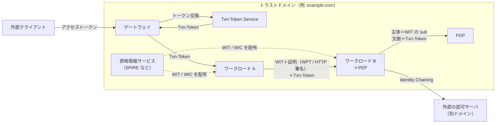
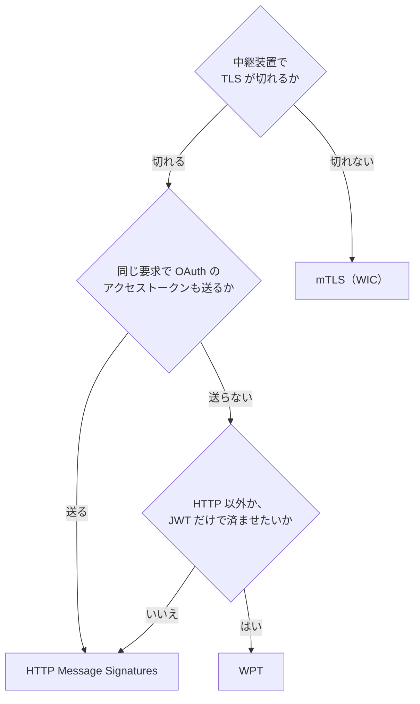
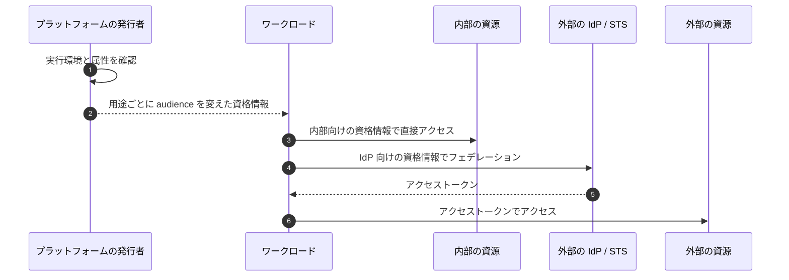
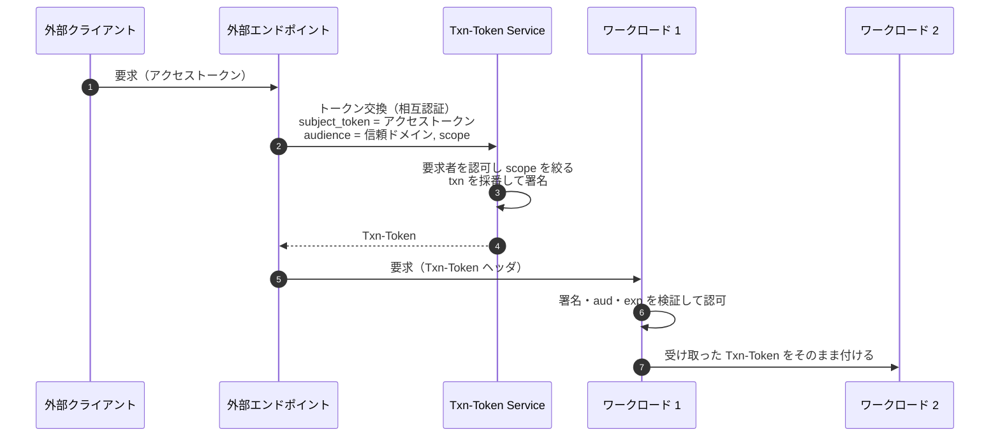
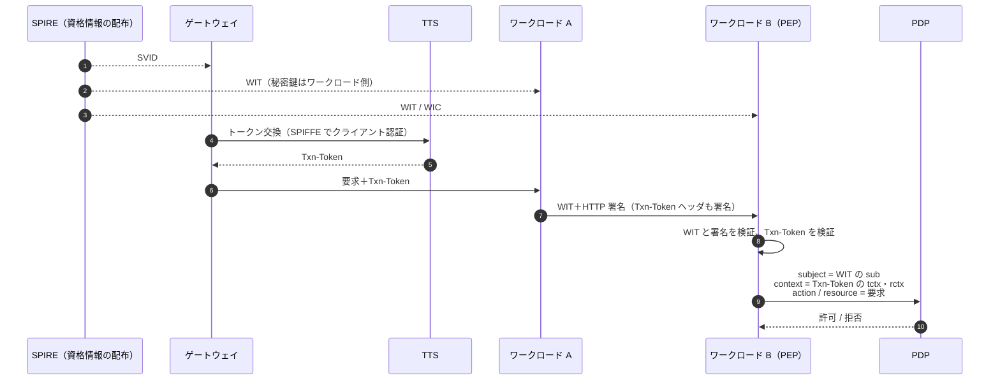

# 概要

マイクロサービスでは、人間だけでなくサービス自身も認証と認可の主体になる。サービスAがサービスBを呼ぶとき、Bは「呼び出し元はどのワークロードか」と「この呼び出しは誰の、どの取引のためか」の2つを知る必要がある。

mTLS、Token Exchange（RFC 8693）、SPIFFE/SPIREといった基本の道具は「[サービス間認証の全体像とは？](/ja/posts/service-to-service-authentication/)」で整理した。この記事では、その上でIETFが進めている次の標準化を扱う。

- **WIMSE**（Workload Identity in Multi System Environments）: ワークロードの識別子、資格情報（WIT/WIC）、認証方式を定めるIETFのドラフト群
- **Transaction Tokens**: 外部のアクセストークンを、1つの取引に結び付いた内部用のトークンに交換し、呼び出しの連鎖に伝える仕組み
- **OAuth SPIFFE Client Authentication**: SPIFFEのSVIDをOAuthのクライアント認証に使い、`client_secret`をなくす仕組み

この記事で答える問いは次のとおりである。

- WIMSEはSPIFFEと何が違い、何を足すのか
- WIT、WIC、WPTとは何で、mTLS・HTTP署名・WPTのどれをいつ選ぶのか
- ワークロードに資格情報を配るとき、何を守るべきか
- Transaction Tokensはアクセストークンと何が違い、どう伝播させるのか
- これらをどう組み合わせると、PEPとPDPに渡す「主体」と「文脈」がそろうのか

どれもまだインターネットドラフトで、版ごとに中身が動いている。各ドラフトの版と状態は2026年10月時点でIETF Datatrackerを確認した結果を末尾にまとめた。

# なぜワークロードアイデンティティを標準化するのか

ゼロトラストの考え方では、ネットワークの内側にいることを信頼の根拠にしない。各ワークロードは検証できる身元と資格情報を持ち、呼ばれる側がそれを毎回確かめる必要がある。

このとき、解くべき問いは4つに分かれる。

| 問い | 何が難しいか | 主な標準 |
| --- | --- | --- |
| ワークロードにどう身元を配るか | 秘密を事前に配ると、配布とローテーションと漏えいが問題になる | SPIFFE/SPIRE、WIMSEの実践ガイド |
| ワークロード同士でどう認証するか | TLSがプロキシやロードバランサで切れると、相手の身元が途切れる | WIMSEのWIT/WIC、mTLS、HTTP署名、WPT |
| 呼び出しの文脈を内部でどう運ぶか | 外部のアクセストークンを内部で使い回すと、盗まれたときの被害が大きい | Transaction Tokens |
| 別のトラストドメインにどうアクセスするか | 内部の資格情報や形式を外に出したくない | Identity Chaining、Transaction Tokenのチェイニングのプロファイル |

共通する原則は、長命の共有シークレット（静的なAPIキーや`client_secret`）を置かず、短命で鍵に結び付いた資格情報を、環境の構成証明（attestation）にもとづいて配ることである。

全体の関係を先に図で示す。



身元はWIMSEの資格情報が、取引の文脈はTransaction Tokensが運ぶ。両者を所持の証明で結び付け、呼ばれる側のPEPが検証済みの値だけをPDPに渡す。これが全体の骨格である。

# WIMSEのアーキテクチャ

WIMSEのアーキテクチャのドラフト（draft-ietf-wimse-arch）は、プロトコルを定めない。部品とやり取りの語彙をそろえる文書である。

## 3つの基本要素

アーキテクチャは次の3つで組み立てる。

| 要素 | 内容 |
| --- | --- |
| トラストドメイン | 共通のセキュリティ統制とポリシーを持つシステムのまとまり。組織が持つFQDNで識別すべき（SHOULD）。X.509のトラストアンカーと、WITを検証するJWK Setに安全な方法で対応づける（MUST） |
| ワークロード識別子 | トラストドメインの中でワークロードを一意に表すURI。形式は別のドラフト（draft-ietf-wimse-identifier）が定める。SPIFFE IDは準拠する例として挙がっている |
| ワークロードアイデンティティ資格情報 | 識別子を暗号鍵に結び付けた資格情報。JWTの形のWIT（Workload Identity Token）と、X.509証明書の形のWIC（Workload Identity Certificate）がある |

識別子の意味は、検証したトラストドメインに依存する。arch-08によれば、同じ識別子の値を含む2つの資格情報も、同じトラストドメインと発行者の信頼設定で検証したときにだけ同じワークロードを表す。後で出てくる「パスだけで認可してはならない」も、この考え方に立っている。

資格情報は寿命を区切り、自動で更新すべき（SHOULD）とされる。要求ごとに鍵を作り直す必要はない。

## 3つのシナリオ

arch-08は部品を段階的に足しながら3つのシナリオを示す。

| シナリオ | 追加される部品 | 要点 |
| --- | --- | --- |
| 基本 | ゲートウェイ、CA/資格情報サービス | ワークロードは資格情報で互いを認証する。呼ばれる側は相手の身元で呼べるAPIを決め、監査に残す |
| コンテキスト | コンテキストサービス | ゲートウェイが外部のアクセストークンを内部用のコンテキストトークンに交換する。アクセストークンは通常内部に転送しない |
| ドメインをまたぐ | トークンサービス、外部トークンサービス | 内部の身元と文脈を、別ドメインで使えるトークンに交換する。手順はIdentity Chainingに沿う |

コンテキストのシナリオは、Transaction Tokensの考え方そのものである。外部向けのベアラートークンを内部に流さず、内部でだけ意味を持つトークンに置き換える。

## PEPとPDPの置き方

arch-08では、1つの呼び出しを「資格情報の取得 → トランスポートの確立 → アプリ層の認証 → 認可 → 応答」の段階に分けて描いている。認可を強制するのはPEPで、必要ならPDPに判定を委ねる。PEPは呼ばれる側の経路上の論理的な機能で、ワークロードの内部、サイドカー、ゲートウェイのどれに置いてもよい。

アーキテクチャは、ポリシー言語もPEPとPDPの間のプロトコルも定めない。参照アーキテクチャとしては「[認可のアーキテクチャとモデルとは？](/ja/posts/authorization-architecture-models-engines/)」の切り分けと同じで、PEPとPDPの間はAuthZEN（「[AuthZEN Authorization APIとは？](/ja/posts/authzen-authorization-api/)」）で埋められる。

判定の場所は、原則として呼ばれる側である。データベースのように判定が細かすぎる場合は、呼ぶ側で判定してもよい（MAY）。

## 層を重ねた認証と「認証は認可ではない」

実際の配置では、ワークロードがサイドカーやゲートウェイにmTLSで認証し、宛先のワークロードにはアプリ層のWITで認証することがよくある。arch-08はこれを層を重ねた認証と呼び、次の規範を置く。

- 宛先は、中継者が認証したトランスポート層の身元を、アプリ層の呼び出し元と同じとみなしてはならない（MUST NOT）。関係を明示した場合は除く。
- 監査記録には、両方の層の身元を残すべき（SHOULD）。

また、セキュリティ上の考慮の節は、有効な資格情報を持つワークロードでもトラストドメインのすべての資源を認可されたわけではない、と明記している。サービスメッシュでよく見る「mTLSが通れば許可」の構成は、この原則に反する。識別子ごとに許可を明示し、認可は別の判定として行う。

arch-08はAIエージェントも扱っている。エージェントは委譲されたワークロードの特別な場合で、多段の連鎖では各ホップでセキュリティコンテキストの範囲を明示し直し、結び付け直さなければならない（MUST）。エージェントの認可は「[AIエージェントの認可とは？](/ja/posts/authorization-for-ai-agents/)」で詳しく扱う。

# ワークロード識別子の規則

draft-ietf-wimse-identifierは、WIMSEのドラフトの中で識別子の形式を規範として定める文書である。認可ポリシーの主体、監査ログのキー、PIPの主キーになる文字列の要件を決めるので、データモデルに直接効く。

版-04（2026-10-23）の時点の主な要件は次のとおりである。

| 要件 | 強さ |
| --- | --- |
| 絶対URIで、トラストドメインを表す空でないauthorityを含む | MUST |
| 空でないpathを含む。`.`や`..`のセグメントを含まない（どちらも-04で追加） | MUST / MUST NOT |
| query、fragment、userinfo、portを含まない | MUST NOT |
| 2048バイトまでの識別子を扱える。2048バイトを超えない | MUST / SHOULD NOT |
| トラストドメインは組織のFQDNにする | SHOULD |
| トラストドメインにIPアドレスを使わない（古い命名との互換を除く。-04でMUST NOTからSHOULD NOTに変更） | SHOULD NOT |
| 比較と認可は、pathなどの一部ではなくURI全体で行う | MUST |
| 比較はRFC 3986の構文ベースの正規化をしてからバイト単位で行う（-04で追加） | MUST |
| ワイルドカードや前方一致で解釈しない（ポリシーで明示した場合を除く） | SHOULD NOT |

スキームは固定しない。`spiffe`も使えるし、ドラフトが定義する`wimse`スキームも使える。

```text
spiffe://prod.example.org/ns/prod-01/sa/payment-api
wimse://trust.example.com/service/payment
```

認可基盤の設計では、次の3点が効いてくる。

- **ポリシーは識別子全体で書く**。`*/payments`のようにpathだけを照合すると、別のトラストドメインが同じpathを名乗ったときに通してしまう。信頼するトラストドメインの許可リストと組で使う。
- **まとまりはpathの解析ではなく属性で引く**。名前空間やチームのような単位は、前方一致ではなくサービスカタログなどのPIPから属性として得るほうが壊れにくい。
- **到達先と識別子の対応を持つ**。DNS名やIPアドレスから識別子を導けると仮定してはならない（MUST NOT）。「このホスト名の相手はこの識別子であるべき」という対応を設定やサービスディスカバリで持たないと、呼ぶ側は「同じトラストドメインの誰か」までしか確かめられない。

SPIFFE IDとの関係も押さえておく。SPIFFE IDはWIMSEの識別子の一種で、WIMSEはSPIFFEを置き換えない。データモデルではスキームを`spiffe`に決め打ちせず「ワークロード識別子（URI）」として扱うと、クラウドやCI/CDから来る主体も同じ枠に入れられる。

# 資格情報: WITとWIC

draft-ietf-wimse-workload-credsは、2つの資格情報の形式を定める。どちらも公開鍵をワークロード識別子に結び付けるもので、使うときには対応する秘密鍵の所持の証明が要る。証明の方法は別のドラフトに任せている。

| 形式 | 中身 | 主な用途 |
| --- | --- | --- |
| WIT（Workload Identity Token） | 資格情報サービスが署名したJWT。`typ`は`wit+jwt` | アプリ層の認証 |
| WIC（Workload Identity Certificate） | URI型のSANに識別子を1つだけ入れたX.509証明書 | トランスポート層（mTLS）の認証 |

WITの主なクレームは次のとおりである。

| クレーム | 要否 | 意味 |
| --- | --- | --- |
| `sub` | 必須 | ワークロード識別子。資格情報1つにつき識別子はちょうど1つ |
| `exp` | 必須 | 有効期限。数時間程度の短命が想定されている |
| `cnf.jwk` | 必須 | ワークロードの公開鍵（RFC 7800） |
| `cnf.jwk.alg` | 必須 | 証明に使うアルゴリズム。`none`や対称鍵は使えない。汎用の実装はES256に対応する |
| `iss` | 推奨（任意） | 発行者。監査と運用のため |
| `jti` | 任意 | トークンの一意な識別子 |

```json
{
  "cnf": {
    "jwk": {
      "alg": "EdDSA",
      "crv": "Ed25519",
      "kty": "OKP",
      "x": "1CXXvflN_LVVsIsYXsUvB03JmlGWeCHqQVuouCF92bg"
    }
  },
  "exp": 1745512510,
  "iat": 1745508910,
  "jti": "x-_1CTL2cca3CSE4cwb_l",
  "sub": "wimse://example.com/specific-workload"
}
```

WITは`Workload-Identity-Token`というHTTPヘッダで運ぶ。検証では、`sub`のトラストドメインに帯域外で設定したトラストアンカーの鍵を使う。WITの`iss`のURLなど、トークンの中の情報だけを頼りに鍵を取りに行ってはならない（MUST NOT）。トークン自身が指す場所から検証鍵を得ると、誰でも発行者を立てられてしまうからである。

「資格情報1つに識別子1つ」は、PDPの側を単純にする。主体の識別がぶれないので、ポリシーと監査の突き合わせが楽になる。インスタンスの区別などは`jti`や追加のクレームで扱い、認可の主体とは分ける。

SPIFFEも、WITをSPIFFE向けに絞り込んだWIT-SVIDを標準に取り込み始めている（仕様の安定度はIncubating）。JWT-SVIDはベアラートークンだが、WIT-SVIDは鍵に結び付くので、JWT-SVIDの弱点だった「盗まれたら使われる」「受け取った側が下流でなりすませる」を所持の証明で埋められる。

# 3つの認証方式と選び方

WITとWICを使って実際に相手を認証する方式は、3本のドラフトに分かれている。もとは1本のdraft-ietf-wimse-s2s-protocolだったが、2025年11月に資格情報と3つの方式の4本に分割された。

| 観点 | mTLS（mutual-tls） | HTTP Message Signatures（http-signature） | WPT（wpt） |
| --- | --- | --- | --- |
| 層 | トランスポート層 | アプリ層（HTTPだけ） | アプリ層（形式はプロトコル非依存） |
| 資格情報 | WIC | WIT | WIT |
| 所持の証明 | TLSハンドシェイク | RFC 9421の署名 | 署名付きJWT（`Authorization: WPT`） |
| 証明が覆う範囲 | その区間の接続全体 | メソッド、パス、クエリ、本文のダイジェスト、`Authorization`、`Txn-Token`、WITなど | 宛先（`aud`）、WITのハッシュ（`wth`）、Txn-Tokenのハッシュ（`tth`）、他の文脈トークンのハッシュ（`oth`）。メソッドと本文は覆わない |
| TLSを終端する中継装置 | 認証が途切れる | 越えられる。署名した部分の改変を検出できる | 越えられる。能動的に悪意のある中継装置からは守れない |
| 応答の保護 | TLSが担う | 応答にも署名できる | 守らない |
| 同じ要求にOAuthのアクセストークン | 載せられる | `Authorization`を署名で覆える | 載せられない（`Authorization`をWPTが占める） |
| 認証失敗時のHTTPステータス | TLSで失敗 | 400（401は推奨しない） | 401と`WWW-Authenticate: WPT` |

それぞれの要点を補足する。

- **mTLS**: WICのトラストドメインが、その接続に期待するトラストドメインと一致することを確かめる（MUST）。DNS名で接続する場合はRFC 9525のホスト名検証も行う。識別子の検証は、ホスト名検証を置き換えずに補う。HTTPヘッダの自己申告の識別によって、mTLSが確立した識別を上書きしてはならない（MUST NOT）。
- **HTTP Message Signatures**: TLSを終端するプロキシが`Host`を書き換えても壊れないよう、`@authority`は署名しない。代わりに宛先を署名パラメータ`wimse-aud`に入れ、受け手は信頼できる設定値と完全一致で照合する。`nonce`は64ビット以上のエントロピーが必須で、署名の有効期間（`expires`）は分単位に短くする。
- **WPT**: OAuthのDPoP（RFC 9449）に着想を得た、WITの鍵で署名した短命のJWTである。-02で送り方が専用ヘッダから`Authorization: WPT`に変わった。その結果、同じ要求でBearerやDPoPのアクセストークンを送れなくなった。ドラフトはこの排他性を、要求の強さが最も弱い資格情報に引きずられるのを防ぐための意図的なものとしている。

選び方は、次の2つの問いでおおむね決まる。



層は組み合わせられる。mutual-tlsのドラフトは、TLSを終端する中継装置をまたいで端から端までの認証が要る場合、TLS層の認証に加えてアプリ層のWIMSEの方式を使うべき（SHOULD）としている。区間ごとのmTLSに端から端までのHTTP署名を重ねる構成は、その一例である。

WIMSEの方式と、OAuthの送信者制約（RFC 8705のmTLS、RFC 9449のDPoP）は守る対象が違う。WIMSEは「呼び出し元はどのワークロードか」を、送信者制約は「このアクセストークンを使ってよいのは誰か」を証明する。送信者制約の仕組みは「[送信者制約トークンとは？](/ja/posts/sender-constrained-tokens-mtls-dpop/)」を参照してほしい。X.509-SVIDやWICをRFC 8705のクライアント認証と証明書束縛に使えば、1枚の証明書で両方を賄える。

# 資格情報をどう配るか

draft-ietf-wimse-workload-identity-practicesは、WIMSEのプロトコルを前提にせず、今のプラットフォームでワークロードが資格情報を得る実践を記録した文書である。WIMSEのドラフトの中で最も進んでおり、IESGで審査中である。

## 汎用のパターン

秘密を事前に配るのではなく、プラットフォームがワークロードの実行環境を確かめてから資格情報を発行する。内部の資源にはその資格情報で直接アクセスし、外部の資源には外部のIdPやSTSにフェデレーションして得た別のトークンでアクセスする。



practicesが取り上げるのは、Kubernetesのサービスアカウントトークン、SPIFFEのWorkload API、クラウドのインスタンスメタデータ、CI/CDのワークフローの身元、サービスメッシュのサイドカーである。このうちKubernetes・クラウド・SPIFFEの概要は、既存記事「[サービス間認証の全体像とは？](/ja/posts/service-to-service-authentication/)」のアイデンティティ基盤の節にある。

## 受け渡しの3つの型

| 型 | 長所 | 注意点 |
| --- | --- | --- |
| ファイルシステム | 更新と独立に動ける。読むだけでよい | 途中まで書かれたファイルを見せない（一時ファイルに書いて原子的にrenameする）。メモリ上のストレージに置く |
| ローカルAPI（UNIXドメインソケット、メタデータサービスなど） | 短命の資格情報を配り直せる | SSRFへの対策が要る。プロセス単位で識別しないと、同じホストのどのプロセスも身元を得られる |
| 環境変数 | 簡単 | ログやプロセスの調査で漏れやすい。他の型があるなら、本番で資格情報を渡してはならない（MUST NOT） |

## 守るべき要件

practicesの規範のうち、設計に直結するものを挙げる。

- **用途ごとにaudienceの違う資格情報を使う**（MUST）。内部の資源向けと外部のIdP向けで同じベアラートークンを使うと、IdPがそのトークンで内部の資源にアクセスし、ワークロードになりすませる。
- **JWTの`aud`は1つにする**（MUST NOT複数）。`aud`に並んだ受け手の誰もが、他の受け手にそのトークンを提示できてしまう。
- **トークンの寿命をインスタンスの寿命より長くしない**（MUST NOT）。インスタンスがなくなったら資格情報を無効にする（MUST）。
- **所持の証明を使う**（SHOULD）。使えない場合は、短い寿命、厳しいaudience、ネットワークの統制で補う（MUST）。
- **アプリの脆弱性で資格情報が漏れうると仮定する**（MUST）。信頼できない入力が、資格情報のファイルのパスやローカルAPIへの接続を左右してはならない（MUST NOT）。
- **独自クレームの値を評価する**（MUST）。CI/CDなら、保護された`main`ブランチだけにフェデレーションを許し、他のブランチは許さない、という判断はブランチのクレームの値を見ないとできない。
- **マルチテナントで`iss`だけを信頼しない**。各テナントが同じ発行者の識別子を設定できる環境では、`iss`は信頼する権限者を一意に表さない。

プラットフォームの資格情報からアクセストークンを得る方法については、Token Exchangeや独自APIは相互運用を妨げるとして勧めていない。RFC 7521とdraft-ietf-oauth-rfc7523bisのJWT認可グラントを推している。

# Transaction Tokensで取引の文脈を運ぶ

WIMSEの資格情報が運ぶのは「どのワークロードか」までで、「誰の、どの取引のためか」は運ばない。それを担うのがdraft-ietf-oauth-transaction-tokens（Txn-Token）である。

## 何を解くか

外部からの1回のAPI呼び出しは、内部で多数のワークロードを呼ぶ。内部のワークロードがサプライチェーン攻撃や内部不正で侵害されると、正当な取引がないのに他のワークロードを呼んだり、パラメータを書き換えたり、アクセストークンを盗んだりできる。

Txn-Tokenは、利用者やワークロードの身元と認可・要求の文脈を、特定の取引に結び付いた短命の署名付きJWTとして表す。そのJWTを信頼ドメインの中の呼び出しの連鎖（Call Chain）全体に伝える。下流のワークロードはこのトークンにもとづいて、その取引の中での認可を判断する。署名があるので途中での改変を検知できる。

## 発行と伝播の流れ



発行するのはTransaction Token Service（TTS）で、信頼ドメインごとに論理的なTTSはちょうど1つ（MUST）である。HTTPで要求するならRFC 8693のトークン交換を使う。主なパラメータは次のとおりである。

| パラメータ | 内容 |
| --- | --- |
| `requested_token_type` | `urn:ietf:params:oauth:token-type:txn_token` |
| `audience` | 信頼ドメインの名前 |
| `scope` | 取引の目的。できるだけ狭く |
| `subject_token` | 主体を表すトークン。外部のアクセストークン、自己署名のJWT、署名なしのJSONなど。リフレッシュトークンは不可 |
| `request_context` | 元の要求のIPアドレスなどの環境の文脈（推奨） |
| `request_details` | APIのパラメータなど要求の詳細（推奨） |

外部からの要求がない場合（バッチやスケジュールされた処理）は、ワークロードが自己署名のJWTを`subject_token`にして取引を始められる。TTSとワークロードは互いに認証しなければならない（MUST）。ワークロード側の認証にはRFC 8705、WIMSEのmTLS・HTTP署名・WPT、RFC 7523の署名付きJWTが例に挙がっている。

## トークンの形式

Txn-TokenはJWTで、`typ`は`txntoken+jwt`である。

| クレーム | 要否 | 内容 |
| --- | --- | --- |
| `aud` | 必須 | 有効な信頼ドメイン。その外で受け入れてはならない |
| `iat`、`exp` | 必須 | 寿命は数分以下を想定 |
| `txn` | 必須 | 取引の一意な識別子（RFC 8417） |
| `sub` | 必須 | 取引の主体。信頼ドメインの中で一意 |
| `scope` | 必須 | TTSが決める取引の目的。外部のスコープと一致しなくてよい |
| `req_wl` | 必須 | Txn-Tokenを要求したワークロード |
| `tctx` | 推奨 | 取引の間ずっと変わらない認可の詳細。TTSが決める |
| `rctx` | 推奨 | 元の要求の環境の文脈 |
| `iss` | 任意 | 署名者の特定に使える |

ドラフトの例では、株の売買の取引を次のように表している（一部を省略した）。

```jsonc
{
  "aud": "trust-domain.example",
  "txn": "97053963-771d-49cc-a4e3-20aad399c312",
  "sub": "d084sdrt234fsaw34tr23t",
  "req_wl": "apigateway.trust-domain.example",
  "scope": "trade.stocks",
  "rctx": { "req_ip": "69.151.72.123", "authn": "face" },
  "tctx": { "action": "BUY", "ticker": "MSFT", "quantity": "100" }
}
```

`tctx`に数量や銘柄を入れておけば、下流のワークロードはパラメータを信頼できる値として得られる。途中のワークロードが数量を書き換えても、署名された`tctx`と食い違うので検知できる。

## 伝播の規則

- HTTPでは`Txn-Token`ヘッダで渡す（MUST）。`Authorization`ヘッダを使ってはならない（MUST NOT）。`Authorization`はアクセストークンなど呼び出し自体の認証のために空けておく。
- 受け取ったワークロードは、署名、`aud`、`exp`を検証してから認可に使う（MUST）。
- 外向きの呼び出しには、受け取ったTxn-Tokenを改変せずに付ける（MUST）。

## アクセストークンとは別物として扱う

ドラフトは、Txn-Tokenを他のトークンと混同しないよう、いくつもの禁止を置いている。

| 規則 | 理由 |
| --- | --- |
| Txn-TokenをOAuthのアクセストークンとして使わない（MUST NOT） | アクセストークンはクライアントへの権限の付与で、Txn-Tokenは取引の文脈。分けることで最小権限を保つ |
| Txn-Tokenを自分の認証に使わない（MUST NOT） | 身元の証明はWIMSEの資格情報などの役割 |
| Txn-Tokenに外部のアクセストークンを入れない（MUST NOT） | 抜き取られると、Txn-Tokenが切れた後もアクセストークンをリプレイされる |
| TTSはスコープを`subject_token`より広げない（MUST） | 内部で権限が膨らむのを防ぐ。スコープが分からない`subject_token`は拒否する |
| Txn-Token全体をそのままログに残さない（MUST NOT） | リプレイと個人情報の漏えいを防ぐ。ハッシュか署名を外したペイロードを残す |

Txn-Tokenはリプレイに耐性がない。対策は短い寿命と、`txn`を記録して同じ値を拒否することである。TTSは、どのワークロードに発行するかを選んでよい。たとえば取引金額を含むTxn-Tokenは、利用者の要求を受けるゲートウェイにだけ発行する、という方針が取れる。

## 置き換え（replacement）

Txn-Tokenを`subject_token`にして、新しいTxn-Tokenを得ることもできる。これは置き換えのTxn-Tokenになる。-07で本文の節から削除され、今はセキュリティ上の考慮の注記として次の規則だけが残っている。

| 規則 | 強さ |
| --- | --- |
| 許される操作の範囲を狭める変更、値の追加は認めてよい | MAY |
| 範囲を広げる変更は認めない | MUST NOT |
| `txn`、`sub`、`aud`を変えない | MUST NOT |
| 置き換え元が期限切れなら発行しない | MUST NOT |
| 寿命を延ばせるなら、置き換えの回数を制限する | SHOULD |
| 置き換え元を要求したワークロードのCall Chainを保持する（方法は範囲外） | MUST |

Call Chainの保持方法は決まっていないので、置き換えを使う場合は、監査でどの経路を通ったかを追う仕組みを自前で用意する必要がある。

## 信頼ドメインをまたぐ場合

Txn-Tokenは`aud`の信頼ドメインの中でだけ有効である。別ドメインの資源が必要なら、Identity Chaining（draft-ietf-oauth-identity-chaining）を使うべき（SHOULD）とされる。

その具体的な手順を定めるのが個人ドラフトのdraft-fletcher-oauth-txn-token-chaining-profileである。以前はdraft-fletcher-transaction-token-chaining-profileという名前だったが、2026年9月、現在の名前の-00に置き換えられた。このプロファイルでは、Txn-Tokenを`subject_token`としてトークン交換し、境界を越えるJWT認可グラントを得る。`subject_token_type`は`urn:ietf:params:oauth:token-type:txn_token`である。内部の資格情報やトークンの形式を外に出さず、取引の文脈を相手のドメインへ渡せる。Identity Chainingそのものは「[認可基盤に必要なOAuth関連標準とは？](/ja/posts/oauth-standards-map-authorization-platform/)」で扱う。

# SPIFFEをOAuthのクライアント認証に使う

サービス間のOAuth（client_credentials、トークン交換、TTSへの要求）では、クライアント認証の`client_secret`が設定ファイルやCIのシークレットに散らばりがちである。draft-ietf-oauth-spiffe-client-authは、SPIFFEのSVIDをそのままOAuthのクライアント資格情報にして、この秘密をなくす。

| 方式 | 資格情報 | 送り方 | 所持の証明 | AS メタデータでの名前 |
| --- | --- | --- | --- | --- |
| JWT-SVID | `sub`にSPIFFE IDを入れたJWT | `client_assertion_type=urn:ietf:params:oauth:client-assertion-type:jwt-spiffe` | なし（ベアラー） | `spiffe_jwt` |
| X.509-SVID | URI SANにSPIFFE IDを入れた証明書 | mTLSで接続し、`client_id`にSPIFFE IDを入れる | TLSハンドシェイク | `spiffe_x509` |
| WIT-SVID | WIMSEのWIT | Attestation-Based Client Authenticationのヘッダ | PoP JWT | `spiffe_wit` |

要点は次のとおりである。

- JWT-SVIDの`aud`は、ASのissuer識別子1つだけでなければならない（rfc7523bisに従う）。RFC 7523と違い`iss`を求めず、`sub`のSPIFFE IDを登録済みのクライアントに対応づける。
- 検証鍵は、トラストドメインごとにひも付けたSPIFFEのバンドルエンドポイントから得るのが推奨の方法である。X.509-SVIDの検証にシステムの信頼ストアを使ってはならない（MUST NOT）。そうすると、ストアに入っているどのCAでも、任意のSPIFFE IDの証明書を発行できてしまう。
- `iss`から鍵を発見して「署名が通り、`sub`がSPIFFE IDに見える」だけで受け入れてはならない（MUST NOT）。別の目的のOIDCトークンをJWT-SVIDとして示す、トークンの取り違えを招く。
- Client ID Metadata Document（CIMD）を使う場合、メタデータの`spiffe_id`に末尾`/*`のワイルドカードを書ける。一致はpathのセグメント単位の前方一致で判定する。

設計上の注意は、SPIFFE IDと`client_id`の対応づけが、そのまま認可の判断になることである。どのワークロードがどのOAuthクライアントとして振る舞えるかは、そのクライアントに許すスコープの上限を決める。SPIREの登録エントリを作れる人は、事実上OAuthのクライアントを作れる人になる。登録エントリの作成は、ASのクライアント登録と同じ水準で管理する必要がある。

既定の方式は、ASと直接TLSでつながる経路なら所持の証明がある`spiffe_x509`、TLSが途中で終端される経路なら短命の`spiffe_jwt`が現実的だと筆者は考える。`spiffe_wit`は依存するドラフトがまだ動いているので、本番の既定にするのはまだ早いと判断している。

# どう組み合わせるか

ここまでの仕様は、役割がはっきり分かれている。

| 仕様 | 運ぶもの | 問い |
| --- | --- | --- |
| WIMSEの識別子 | ワークロードの名前 | 誰を指すか |
| WIT / WIC | 識別子と公開鍵の結び付き | 誰の鍵か |
| mTLS / HTTP署名 / WPT | 所持の証明 | 今提示しているのは本人か |
| Transaction Tokens | 利用者と取引の文脈 | 誰の、どの取引のためか |
| SPIFFEクライアント認証 | ASに対するワークロードの身元 | どのOAuthクライアントか |
| Identity Chaining とそのプロファイル | 境界を越えるグラント | 別ドメインでどう続けるか |

これらを1つの要求の流れに重ねると次のようになる。



workload-credsとwptのドラフトは、役割の分け方を「WITの身元でどのAPIを呼べるかを決め、文脈トークンでどの資源にアクセスできるかを決める」と例示している。PDPへの入力に直すと、主体はWITの`sub`、文脈はTxn-Tokenのクレームになる。

ここで大事なのは、**証明に結び付いた値だけをPDPに渡す**ことである。HTTP署名は`Txn-Token`ヘッダがあれば署名の対象にしなければならず（MUST）、WPTは`tth`でTxn-Tokenのハッシュを結び付ける。wptのドラフトは、`oth`を使う場合、`oth`で覆われていない追加のトークンを認可の判断に使ってはならない（MUST NOT）と定めている。これはPEPの実装規則としてそのまま採用できる。

ただし、結び付けで防げるのは、中継装置が正当な要求のTxn-Tokenを差し替えたり外したりすることまでである。Txn-Tokenを盗んだ別の正当なワークロードが、自分のWITと証明でそれを覆って送ることは防げない。これは「このワークロードがこの取引のTxn-Tokenを提示してよいか」という認可ポリシーと、TTSの発行ポリシーで防ぐ。

# 設計の指針

- **主体は識別子全体で書く**。トラストドメインとpathを組で扱い、pathだけの照合や前方一致を避ける。
- **認証の成功を認可とみなさない**。mTLSが通ったことは、どの資源にアクセスしてよいかを意味しない。
- **トランスポート層とアプリ層の身元を分けてPDPに渡し、両方を監査に残す**。
- **認証方式は「TLSが中継装置で切れるか」と「同じ要求にOAuthのトークンを載せるか」で選ぶ**。HTTPの東西トラフィックでは、mTLSを基本にして、切れる区間にHTTP署名を重ねるのが無難である。
- **外部のアクセストークンを内部で使い回さない**。ゲートウェイでTxn-Tokenに交換し、スコープを取引の目的まで絞る。
- **資格情報は用途ごとにaudienceを分け、短命にし、環境変数で渡さない**。
- **`client_secret`はSPIFFEのクライアント認証で置き換える**。そのうえで、SPIFFE IDと`client_id`の対応づけを認可の判断として管理する。
- **取り消しは資格情報の失効ではなくポリシーで効かせる**。WITのようなJWTの資格情報は通常、必要なときに失効させられないので、短命の資格情報と、即時に効くPDPのポリシーを組み合わせる。

# 仕様の状態（2026年10月時点）

2026年10月24日にIETF Datatrackerで確認した状態である。ドラフトは版ごとに中身が変わるので、実装するときは準拠する版を固定してほしい。

| ドラフト | 最新版（日付） | 状態 |
| --- | --- | --- |
| draft-ietf-wimse-arch | -08（2026-07-06） | WG Document |
| draft-ietf-wimse-identifier | -04（2026-10-23） | WG Document。本文はStandards Track |
| draft-ietf-wimse-workload-identity-practices | -07（2026-09-22） | IESGに提出済み（AD Evaluation）。Informational |
| draft-ietf-wimse-workload-creds | -02（2026-07-02） | WG Document |
| draft-ietf-wimse-mutual-tls | -02（2026-07-06） | WG Document |
| draft-ietf-wimse-http-signature | -08（2026-10-20） | WG Document。Doc Shepherd Follow-up Underway。Proposed Standardを予定 |
| draft-ietf-wimse-wpt | -02（2026-08-27） | WG Document |
| draft-ietf-oauth-transaction-tokens | -11（2026-07-30） | WG Consensus: Waiting for Write-Up。本文はStandards Track |
| draft-ietf-oauth-spiffe-client-auth | -02（2026-06-15） | WG Document |
| draft-ietf-oauth-identity-chaining | -17（2026-07-19） | IESG承認後、RFC Editor Queue |
| draft-fletcher-oauth-txn-token-chaining-profile | -00（2026-09-10） | 個人ドラフト。draft-fletcher-transaction-token-chaining-profileを置き換えた |

WIMSEの中では、実践ガイドが最もRFCに近く、HTTP署名がそれに続く。資格情報とmTLS・WPTのドラフトはまだWG Documentの段階で、WPTは-02で送り方を変えたばかりである。Transaction TokensはWGの合意を得ており、IESGへの提出を待っている。

# まとめ

- WIMSEは、SPIFFEの考え方を一般化し、トラストドメイン・ワークロード識別子・資格情報（WIT/WIC）の3つでワークロードの身元を表す。SPIFFE IDはその準拠例で、置き換えられるわけではない。
- 認証方式はmTLS、HTTP Message Signatures、WPTの3つ。TLSが切れるか、同じ要求でOAuthのトークンを送るかで選ぶ。
- 資格情報の配布は、構成証明にもとづき、用途ごとにaudienceを分けた短命の資格情報にする。環境変数は避ける。
- Transaction Tokensは、外部のアクセストークンを取引に結び付いた内部用のトークンに交換し、改変されない形で呼び出しの連鎖に伝える。アクセストークンとも認証の資格情報とも別物として扱う。
- SPIFFEのクライアント認証で`client_secret`をなくせるが、SPIFFE IDと`client_id`の対応づけは認可の判断として管理する。
- 組み合わせると、PEPは「主体＝WITの`sub`」「文脈＝Txn-Token」を所持の証明と結び付いた形で受け取り、PDPに渡せる。

# 関連記事

- [認可とは？認証との違いとIAMのサブドメインで見る全体像](/ja/posts/authorization-domain-iam-subdomains/)
- [認可基盤はどこまで作るべきか？横断と各ドメインの分担、必要な段階、判定の外部化](/ja/posts/authorization-platform-scope-stages/)
- [認可のアーキテクチャとモデルとは？PEP/PDP・RBAC/ABAC/ReBAC・ポリシーエンジンの選び方](/ja/posts/authorization-architecture-models-engines/)
- [AuthZEN Authorization APIとは？PEPとPDPをつなぐ認可判定の標準](/ja/posts/authzen-authorization-api/)
- [認可基盤に必要なOAuth関連標準とは？委譲・トークン・継続評価の地図](/ja/posts/oauth-standards-map-authorization-platform/)
- [AIエージェントの認可とは？委譲の連鎖・人の承認・監査をMCP、AuthZEN、AIMS、A2A/AP2で整理する](/ja/posts/authorization-for-ai-agents/)
- [MCPの認可はどう設計する？起きうる事故と後から直せない判断](/ja/posts/mcp-authorization-design/)
- [認可基盤のアーキテクチャとは？コンテナ構成・代表シーケンス・PEPとPDPの配置と非機能の設計判断](/ja/posts/authorization-platform-architecture-decisions/)
- [サービス間認証の全体像とは？mTLS・Token Exchange・SPIFFE・ゼロトラスト](/ja/posts/service-to-service-authentication/)
- [送信者制約トークンとは？mTLS（RFC 8705）とDPoP（RFC 9449）入門](/ja/posts/sender-constrained-tokens-mtls-dpop/)

# 参考リンク

- [IETF WIMSE Working Group documents](https://datatracker.ietf.org/wg/wimse/documents/)
- [draft-ietf-wimse-arch](https://datatracker.ietf.org/doc/draft-ietf-wimse-arch/)
- [draft-ietf-wimse-identifier](https://datatracker.ietf.org/doc/draft-ietf-wimse-identifier/)
- [draft-ietf-wimse-workload-identity-practices](https://datatracker.ietf.org/doc/draft-ietf-wimse-workload-identity-practices/)
- [draft-ietf-wimse-workload-creds](https://datatracker.ietf.org/doc/draft-ietf-wimse-workload-creds/)
- [draft-ietf-wimse-mutual-tls](https://datatracker.ietf.org/doc/draft-ietf-wimse-mutual-tls/)
- [draft-ietf-wimse-http-signature](https://datatracker.ietf.org/doc/draft-ietf-wimse-http-signature/)
- [draft-ietf-wimse-wpt](https://datatracker.ietf.org/doc/draft-ietf-wimse-wpt/)
- [draft-ietf-oauth-transaction-tokens](https://datatracker.ietf.org/doc/draft-ietf-oauth-transaction-tokens/)
- [draft-fletcher-oauth-txn-token-chaining-profile](https://datatracker.ietf.org/doc/draft-fletcher-oauth-txn-token-chaining-profile/)
- [draft-ietf-oauth-identity-chaining](https://datatracker.ietf.org/doc/draft-ietf-oauth-identity-chaining/)
- [draft-ietf-oauth-spiffe-client-auth](https://datatracker.ietf.org/doc/draft-ietf-oauth-spiffe-client-auth/)
- [SPIFFE standards](https://github.com/spiffe/spiffe/tree/main/standards)
- [SPIRE Concepts](https://spiffe.io/docs/latest/spire-about/spire-concepts/)
- [RFC 8693: OAuth 2.0 Token Exchange](https://www.rfc-editor.org/rfc/rfc8693)
- [RFC 9421: HTTP Message Signatures](https://www.rfc-editor.org/rfc/rfc9421)
- [RFC 9449: OAuth 2.0 Demonstrating Proof of Possession (DPoP)](https://www.rfc-editor.org/rfc/rfc9449)
- [RFC 8705: OAuth 2.0 Mutual-TLS Client Authentication and Certificate-Bound Access Tokens](https://www.rfc-editor.org/rfc/rfc8705)
- [RFC 9334: Remote ATtestation procedureS (RATS) Architecture](https://www.rfc-editor.org/rfc/rfc9334)
