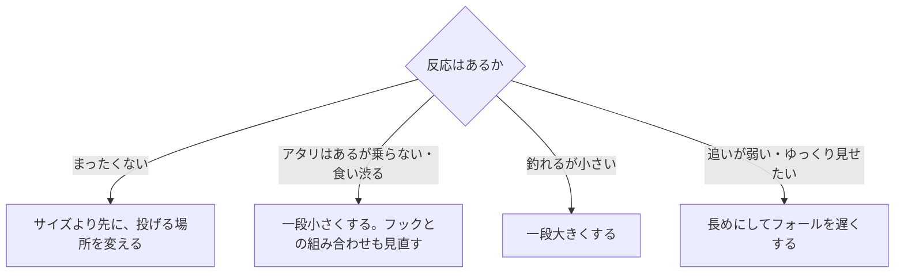

# はじめに
ワームのサイズは、釣果を左右するのに基準がわかりにくい要素である。本記事では、特定の魚種や釣り方に依らないワームサイズの選び方を、釣具メーカーの公式の説明から整理する。

ワームの種類（シャッド系、クロー系など）の使い分けは、[ロックフィッシュ実釣ガイド](/ja/posts/rockfish-worm-field-guide/)にまとめている。本記事はサイズに絞る。

# 先に結論
- インチ表記は実際の長さとは限らない。同じ「2インチ」表記でも、実寸が41mmのものと65mmのものがある。
- サイズは、魚の大きさとエサ、フックの大きさ、沈め方と飛ばし方の3つで決める。
- ワームの長さはフックの大きさに合わせ、リグの重さは水深や潮で決める。
- 基準サイズを1つ決め、小さめと大きめを1つずつ用意して調整する。
- 反応がまったくないときは、サイズより先に投げる場所を変える。サイズは、魚がいるとわかってから調整する。

# インチ表記と実際の長さ
1インチは25.4mmなので、2インチは計算上50.8mmになる。ただし、メーカーが表示するインチは、公表されている実寸とずれることがある。次の表は、あるメーカー1社が公表しているインチ表記と実寸の例である。

| 表記 | 計算上の長さ | 公表されている実寸の例 |
| --- | --- | --- |
| 1.5インチ | 38.1mm | 37mm |
| 2インチ | 50.8mm | 41mm、49mm、60mm、65mm |
| 3インチ | 76.2mm | 56mm、74mm |
| 4インチ | 101.6mm | 76mm、110mm |

同じメーカーの2インチ表記でも、41mmのものと65mmのものは1.5倍以上違う。クローやホッグのように腕や脚のパーツが付く形では、表記と実寸の差が大きくなりやすい。

サイズを比べるときは、インチ表記ではなく、公表されている実寸と形を見る。実寸を公表していないメーカーも多いので、その場合は同じシリーズのなかでの大小として読む。

# サイズを決める3つの軸
## 1. 魚の大きさとエサ
釣れている魚の大きさと、魚が食べているエサの大きさに合わせる。

- 釣れる魚が小さい、または小さいエサを食べているときは、小さめにする。
- 大きい魚を狙うときや、魚が小魚を追っているときは、大きめにする。
- 基準は魚の大きさで変わる。同じ2インチでも、小型の魚には標準になり、大型の魚には小さめになる。

魚のエサは成長とともに変わることがある。たとえばアジでは、体長約1〜5cmの稚魚はエサのほとんどがカイアシ類で、成長につれて幅の広いエサを選ぶようになる（Hirota et al. 2004）。東シナ海の調査では、体が大きいアジほど食物に占める魚類の寄与が大きかった（Xu et al. 2024）。

## 2. フックの大きさ
ワームの長さは、ジグヘッドの重さよりもフックの大きさと組み合わせて考える。あるメーカーは、ライトゲーム用ジグヘッドの推奨ワームサイズを次のように示している。

| フックサイズ | 推奨ワームサイズ |
| --- | --- |
| #12 | 0.9〜1.5インチ |
| #10 | 1.5〜2.0インチ |
| #8 | 1.8〜2.2インチ |

このジグヘッドは、どのフックサイズでも0.5〜2.5gの重さがそろっている。ワームの長さはフックで決め、重さは水深や潮で決めると考えればよい。より大きいワームでも、3インチには#1、4インチには#1/0、4.5インチには#2/0と、ワームが大きくなるほど大きいフックを推奨する例がある。

## 3. 沈め方と飛ばし方
ワームの大きさは、沈む速さや飛距離にも影響する。

- 長いワームは水の抵抗でゆっくり沈む。メーカーの説明にも、長さを活かしてフォールスピードを抑えるというものがある。
- 水の抵抗が大きいワームは、重めのシンカーと組み合わせる。パーツが大きいワームを、比較的重いシンカーと使うよう勧める説明がある。
- 重いシンカーで遠く深くを探るなら、大きめのワームが合う。大きいサイズのワームを、ウエイトを重くしたり遠く深くを探ったりするときに効果的とする説明がある。
- 軽いリグで遠投したいときは、空気抵抗の小さい小さめのワームが有利になる。フリーリグの遠投で、空気抵抗を減らすためにワームを小さめにする例がある。

深い場所や流れが速い場所では、重いリグに大きめのワームを合わせることが多い。一方で、遠投を優先するなら小さめが有利なので、「重いリグには必ず大きいワーム」とは限らない。

# アタリの出方で調整する
サイズの変更は、魚がいるとわかってから行う。反応がまったくないときは、まず投げる方向と距離を変え、立ち位置を移動する。

- 食いが渋いときのサイズダウンは、メーカーの説明にもある。基本のサイズを決めて、食いが渋いときはサイズダウン、型が伸びないときはサイズアップするという説明や、スレた魚にはもっとも小さいサイズを勧める説明がある。
- 「アタリはあるのに乗らない」ときにワームを小さくするのは、現場でよく使われる経験則である。ワームを小さくする前に、ワームの長さが使っているフックサイズの推奨範囲に入っているかも確かめる。
- 一度に変えるのは1つだけにする。サイズとカラーを同時に変えると、どちらが効いたのかわからなくなる。

# 持っていくサイズ
基準サイズを1つ決め、それより小さいものと大きいものを1つずつ足した3つを持っていく。こうしておけば、上の調整を釣り場で試せる。

基準サイズとは、釣り場で最初に投げて、反応を見ながら上下させる起点にするサイズである。サイズを決める3つの軸から、次の条件を満たすものを選ぶ。

- 狙う魚の大きさと、その魚が食べているエサの大きさに近い。
- 使うフックの推奨範囲に入る。
- 使うリグの重さと、飛ばしたい距離に合う。

条件だけで絞り切れないときは、狙う魚向けのワームのうち、メーカーが基本や標準と位置づけているサイズを選ぶ。

| 役割 | 使う場面 |
| --- | --- |
| 小さめ | 食いが渋い。アタリはあるが乗らない。魚が小さいエサを食べている |
| 基準 | 最初に投げる。反応を見て上下させる起点にする |
| 大きめ | 型が伸びない。大きい魚を狙う。重いリグで遠く深くを探る。フォールを遅くしたい |

小さめ・基準・大きめは、インチ表記ではなく実寸と形で差がつくように選ぶ。同じ2インチ表記でも、実寸の大きく違うワームがあるためである。

# まとめ
- インチ表記は実寸と一致しないことがある。サイズは実寸と形で比べる。
- 基準サイズを1つ決め、小さめと大きめを1つずつ用意する。
- サイズは、魚の大きさとエサ、フックの大きさ、沈め方と飛ばし方で決める。ワームの長さはフックサイズと合わせる。
- 反応がなければまず場所を変え、魚がいるとわかってからサイズを調整する。食い渋りには小さく、型が伸びないときは大きくする。

# 関連記事
- [ロックフィッシュ実釣ガイド](/ja/posts/rockfish-worm-field-guide/)
- [スピニングリールのキャスティング入門](/ja/posts/spinning-reel-casting-guide/)

# 参考
- [ecogear.jp - アジ用ワーム（1.6〜2.4インチ）の説明](https://ecogear.jp/ecogear/aji_shokunin_aji_must/)
- [ecogear.jp - 大型アジ向けワーム（3.3インチ）の説明](https://ecogear.jp/ecogear/aji_shokunin_aji_must-lb/)
- [ecogear.jp - カサゴ用ワーム（2インチ、41mm）の説明](https://ecogear.jp/ecogear/kasago_shokunin_rock_max/)
- [ecogear.jp - カサゴ用ワーム（2インチ、60mm）の説明](https://ecogear.jp/ecogear/kasago_shokunin_bug_ants/)
- [ecogear.jp - カサゴ用ワーム（2インチ、65mm）の説明](https://ecogear.jp/ecogear/kasago_shokunin_rock_claw/)
- [ecogear.jp - カサゴ用ワーム（1.5インチ、37mm）の説明](https://ecogear.jp/ecogear/kasago_shokunin_mini_tank/)
- [ecogear.jp - ハタ類向けワーム（3インチ、74mm）の説明](https://ecogear.jp/ecogear/kijihata_hog/)
- [ecogear.jp - ハタ類向けワーム（3・4・4.5インチ）の説明](https://ecogear.jp/ecogear/kijihata_grub/)
- [ecogear.jp - ハタ類向けワーム（4インチ、110mm）の説明](https://ecogear.jp/ecogear/katakuchi_minnow/)
- [daiwa.com - アジ用ワーム（1.5・2インチ）の説明](https://www.daiwa.com/jp/product/u2rumzj)
- [daiwa.com - アジング用ジグヘッドの推奨ワームサイズ](https://www.daiwa.com/jp/product/w4snpkq)
- [daiwa.com - ロックフィッシュのフリーリグで小さめのワームを選ぶ例](https://www.daiwa.com/jp/column/hrf/d003)
- [jackall.co.jp - アジ用ワーム（2・2.5・3インチ）の説明](https://www.jackall.co.jp/saltwater/shore-casting/products/lure/azi/pekering/)
- [jackall.co.jp - 秋のロックフィッシュゲームにおすすめのワーム](https://www.jackall.co.jp/saltwater/shore-casting/column/2022_11_kai/)
- [begood-funegg.jackall.co.jp - 春のアジ&サバを狙うならルアーを使い分けるのがコツ](https://begood-funegg.jackall.co.jp/tsuri-report/article-052/)
- [Hirota et al. (2004) Ontogenetic changes of feeding selectivity in juvenile jack mackerel Trachurus japonicus collected off south-east Kyushu, Japan. Fisheries Science 70](https://www.jstage.jst.go.jp/article/fishsci1994/70/1/70_1_100/_article)
- [Xu et al. (2024) 東シナ海におけるマアジの食性（J-GLOBALの抄録）](https://jglobal.jst.go.jp/detail?JGLOBAL_ID=202402224007707837)

