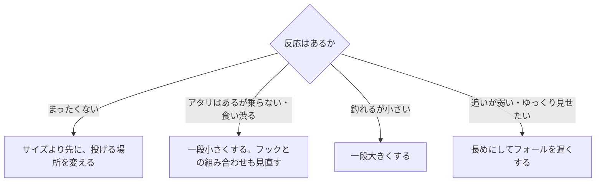

# はじめに
ワームのサイズは、釣果を左右するのに基準がわかりにくい要素である。本記事では、アジング、カサゴ（関西ではガシラ）、ハタ類のワームサイズの選び方を、メーカー公式の製品説明と、魚の成長や食性の資料から整理する。

ワームの種類（シャッド系、クロー系など）の使い分けは、[ロックフィッシュ実釣ガイド](/ja/posts/rockfish-worm-field-guide/)にまとめている。本記事はサイズに絞る。

# 先に結論
- アジングとカサゴのライトゲームでは、2インチ前後を軸にする。エコギアはアジ用ワームの2インチを「ザ･ベーシック」、カサゴ用ワームの2インチを「パイロットルアー」と説明している。
- インチ表記は製品名に近く、実際の長さとは限らない。同じ「2インチ」でも、実寸が41mmの製品と65mmの製品がある。
- サイズは、魚の大きさとエサ、フックの大きさ、沈め方と飛ばし方の3つで上下させる。
- 大きいワームはロックフィッシュ専用ではない。30cmを超えるアジ向けに、3インチ以上のアジ用ワームもある。ハタ類には3〜4.5インチの製品が多い。
- 反応がまったくないときは、サイズより先に投げる場所を変える。サイズは、魚がいるとわかってから調整する。

# インチ表記と実際の長さ
1インチは25.4mmなので、2インチは計算上50.8mmになる。ただし、メーカーが表示するインチは製品名に近く、公表されている実寸とずれることがある。

| 製品 | 表記 | 公表されている長さ |
| --- | --- | --- |
| エコギア アジ職人 アジマスト | 2インチ | 49mm |
| エコギア アジ職人 アジマスト | 2.4インチ | 62mm |
| エコギア アジ職人 アジマストLB | 3.3インチ | 84mm |
| エコギア カサゴ職人 ロックマックス | 2インチ | 41mm |
| エコギア カサゴ職人 ロッククロー | 2インチ | 65mm |
| エコギア カサゴ職人 ミニタンク | 1-1/2インチ | 37mm |
| エコギア キジハタグラブ | 3インチ | 56mm |
| エコギア キジハタグラブ | 4.5インチ | 88mm |

カサゴ職人の2インチは、ロックマックスが41mm、ロッククローが65mmで、1.5倍以上違う。クローやホッグのように腕や脚のパーツが付く形では、表記と実寸の差が大きくなりやすい。

サイズを比べるときは、インチ表記ではなく、公表されている実寸と形を見る。実寸を公表していないメーカーも多いので、その場合は同じシリーズのなかでの大小として読む。

# 対象魚ごとのサイズの目安
## アジ
アジ用ワームの各サイズについて、メーカーは次のように説明している。

| サイズ帯 | 製品と説明 |
| --- | --- |
| 1.5インチ前後 | ジャッカルは、釣れている魚が15cmまでなら1.5インチとしている。ダイワ アジハンターワーム リングの1.5インチはプランクトンを、エコギア アジマストの1.6インチは小さいアジや高活性時を想定している |
| 2インチ前後 | エコギア アジマストの2インチは「ザ･ベーシック」で、ローテーションの核とされる。ジャッカルは15cmを超える魚に2インチとしている。ダイワの2インチは小魚を想定している |
| 2.4〜2.5インチ | エコギア アジマストの2.4インチは、長さでフォールを遅くし、低活性時にゆっくり見せるためのサイズである。ジャッカル ペケリングでは、2インチが小型アジの数釣り向け、2.5インチが「用途を選ばないベーシックなサイズ」とされる |
| 3インチ以上 | エコギア アジマストLB（3.3インチ）は30cm超のアジ向けである。ジャッカル ペケリングの3.0インチは中型〜大型のアジ向けだが、20cmクラスにも使えるとしている |

アジのエサは成長とともに大きくなる。体長約1〜5cmの稚魚は、エサのほとんどがカイアシ類で、成長につれて幅の広いエサを選ぶようになる（Hirota et al. 2004）。東シナ海の調査では、体が大きいアジほど食物に占める魚類の寄与が大きかった（Xu et al. 2024）。小さいアジには小さいワーム、大きいアジには大きいワームという考え方は、この食性の変化と合っている。

## カサゴ（ガシラ）
エコギアのカサゴ職人シリーズは、1-1/2〜2インチの4製品で構成されている。

| 製品 | 表記と実寸 | メーカーの説明 |
| --- | --- | --- |
| ロックマックス | 2インチ（41mm） | 汎用性が高く、カサゴゲームのパイロットルアー |
| バグアンツ | 2インチ（60mm） | 活性が低く、ストラクチャーの奥に潜んでいる状況に |
| ロッククロー | 2インチ（65mm） | シリーズ中で最大のアピール力 |
| ミニタンク | 1-1/2インチ（37mm） | シリーズ最小で、スレたカサゴに |

カサゴの成長は遅い。東京都島しょ農林水産総合センターによると、満1年で体長6cm、2年で13cm、3年で18cmほどになり、20cmを超えるのはオスで満4年、メスで満6年である。最大でも30cm程度の魚なので、ライトゲームでは2インチ前後のワームが中心になる。

## ハタ類
ハタ類向けのワームは、カサゴ用より一回り大きい。

| 製品 | サイズ | メーカーの説明 |
| --- | --- | --- |
| ダイワ HRF GRクロー | 3.5インチ | ハタ専用設計。推奨フックはオフセット#1/0 |
| エコギア キジハタホッグ | 3インチ（74mm） | ハタ系のメインベイトである甲殻類をイメージした形 |
| エコギア キジハタグラブ | 3・4・4.5インチ | 4インチは繊細に狙うとき、4.5インチは重いシンカーで遠く深くを探るとき |
| エコギア カタクチミノー | 4インチ（110mm） | ハタ系ターゲットへの「攻めの一手」 |

# サイズを決める3つの軸
## 1. 魚の大きさとエサ
釣れている魚の大きさと、魚が食べているエサの大きさに合わせる。

- 釣れる魚が小さい、または小さいエサを食べているときは、小さめにする。
- 大きい魚を狙うときや、魚が小魚を追っているときは、大きめにする。
- 魚の種類が変わると基準も変わる。同じ2インチでも、アジには標準、ハタ類には小さめである。

## 2. フックの大きさ
ワームの長さは、ジグヘッドの重さよりもフックの大きさと組み合わせて考える。ダイワは、月下美人アジングジグヘッドの推奨ワームサイズを次のように示している。

| フックサイズ | 推奨ワームサイズ |
| --- | --- |
| #12 | 0.9〜1.5インチ |
| #10 | 1.5〜2.0インチ |
| #8 | 1.8〜2.2インチ |

このジグヘッドは、どのフックサイズでも0.5〜2.5gの重さがそろっている。ワームの長さはフックで決め、重さは水深や潮で決めると考えればよい。エコギア キジハタグラブも、3インチには#1、4インチには#1/0、4.5インチには#2/0のフックを推奨している。

## 3. 沈め方と飛ばし方
ワームの大きさは、沈む速さや飛距離にも影響する。

- 長いワームは水の抵抗でゆっくり沈む。エコギアは、アジマストの2.4インチを「長さを活かすことでフォールスピードを抑えられる」と説明している。
- 水の抵抗が大きいワームは、重めのシンカーと組み合わせる。ジャッカルは、パーツが大きいチャンクロー2.8インチを比較的重いシンカーと使うよう勧めている。
- 重いシンカーで遠く深くを探るなら、大きめのワームが合う。エコギア キジハタグラブの4.5インチは、ウエイトを重くしたり、遠く深くを探るときに効果的とされる。
- 軽いリグで遠投したいときは、空気抵抗の小さい小さめのワームが有利になる。ダイワのコラムでは、フリーリグの遠投で空気抵抗を減らすためにワームを小さめにしている。

深い場所や流れが速い場所では、重いリグに大きめのワームを合わせることが多い。一方で、遠投を優先するなら小さめが有利なので、「重いリグには必ず大きいワーム」とは限らない。

# アタリの出方で調整する
サイズの変更は、魚がいるとわかってから行う。反応がまったくないときは、まず投げる方向と距離を変え、立ち位置を移動する。

- 食いが渋いときのサイズダウンは、メーカーの説明にもある。ジャッカルはロックフィッシュ用ワームについて、3インチを基本に、食いが渋いときはサイズダウン、サイズが伸びないときは3.8インチにサイズアップするとしている。エコギアも、スレたカサゴにはシリーズ最小のミニタンクを勧めている。
- 「アタリはあるのに乗らない」ときにワームを小さくするのは、現場でよく使われる経験則である。ワームを小さくする前に、ワームの長さが使っているフックサイズの推奨範囲に入っているかも確かめる。
- 一度に変えるのは1つだけにする。サイズとカラーを同時に変えると、どちらが効いたのかわからなくなる。

# 持っていくサイズ
アジとカサゴのライトゲームなら、2インチ前後を中心に、小さめと大きめを1つずつ足した3つを持っていけば、多くの状況に対応できる。

| 釣り | 小さめ | 中心 | 大きめ |
| --- | --- | --- | --- |
| アジング | 1.5インチ前後 | 2インチ前後 | 2.4〜2.5インチ。大型狙いなら3インチ以上 |
| カサゴ | 1.5インチ前後 | 2インチ前後 | 実寸の長いクロー系など |
| ハタ類 | 3インチ | 3.5〜4インチ | 4.5インチ |

小さめ・中心・大きめは、インチ表記ではなく実寸と形で差がつくように選ぶ。同じ2インチ表記でも、実寸の大きく違う製品があるためである。

# まとめ
- アジとカサゴのライトゲームは2インチ前後を軸にし、ハタ類は3〜4.5インチを使う。大型のアジ向けには3インチ以上もある。
- インチ表記は実寸と一致しないことがある。サイズは実寸と形で比べる。
- サイズは、魚の大きさとエサ、フックの大きさ、沈め方と飛ばし方で決める。ワームの長さはフックサイズと合わせる。
- 反応がなければまず場所を変え、魚がいるとわかってからサイズを調整する。食い渋りには小さく、型が伸びないときは大きくする。

# 関連記事
- [ロックフィッシュ実釣ガイド](/ja/posts/rockfish-worm-field-guide/)
- [スピニングリールのキャスティング入門](/ja/posts/spinning-reel-casting-guide/)

# 参考
- [ecogear.jp - アジ職人 アジマスト](https://ecogear.jp/ecogear/aji_shokunin_aji_must/)
- [ecogear.jp - アジ職人 アジマストLB](https://ecogear.jp/ecogear/aji_shokunin_aji_must-lb/)
- [ecogear.jp - カサゴ職人 ロックマックス](https://ecogear.jp/ecogear/kasago_shokunin_rock_max/)
- [ecogear.jp - カサゴ職人 バグアンツ](https://ecogear.jp/ecogear/kasago_shokunin_bug_ants/)
- [ecogear.jp - カサゴ職人 ロッククロー](https://ecogear.jp/ecogear/kasago_shokunin_rock_claw/)
- [ecogear.jp - カサゴ職人 ミニタンク](https://ecogear.jp/ecogear/kasago_shokunin_mini_tank/)
- [ecogear.jp - キジハタホッグ](https://ecogear.jp/ecogear/kijihata_hog/)
- [ecogear.jp - キジハタグラブ](https://ecogear.jp/ecogear/kijihata_grub/)
- [ecogear.jp - カタクチミノー](https://ecogear.jp/ecogear/katakuchi_minnow/)
- [daiwa.com - アジハンターワーム リング](https://www.daiwa.com/jp/product/u2rumzj)
- [daiwa.com - 月下美人アジングジグヘッド](https://www.daiwa.com/jp/product/w4snpkq)
- [daiwa.com - HRF GRクロー](https://www.daiwa.com/jp/product/i0fm4z5)
- [daiwa.com - HRF AGSを体感せよ part3 漁港アイナメ編](https://www.daiwa.com/jp/column/hrf/d003)
- [jackall.co.jp - ペケリング](https://www.jackall.co.jp/saltwater/shore-casting/products/lure/azi/pekering/)
- [jackall.co.jp - ペケリング3.0インチ 大解剖](https://www.jackall.co.jp/saltwater/shore-casting/column/p-3868/)
- [jackall.co.jp - 秋のロックフィッシュゲームにおすすめのワーム](https://www.jackall.co.jp/saltwater/shore-casting/column/2022_11_kai/)
- [begood-funegg.jackall.co.jp - 春のアジ&サバを狙うならルアーを使い分けるのがコツ](https://begood-funegg.jackall.co.jp/tsuri-report/article-052/)
- [ifarc.metro.tokyo.lg.jp - カサゴ（東京都島しょ農林水産総合センター）](https://www.ifarc.metro.tokyo.lg.jp/archive/27,1065,55,227.html)
- [Hirota et al. (2004) Ontogenetic changes of feeding selectivity in juvenile jack mackerel Trachurus japonicus collected off south-east Kyushu, Japan. Fisheries Science 70](https://www.jstage.jst.go.jp/article/fishsci1994/70/1/70_1_100/_article)
- [Xu et al. (2024) 東シナ海におけるマアジの食性（J-GLOBALの抄録）](https://jglobal.jst.go.jp/detail?JGLOBAL_ID=202402224007707837)

